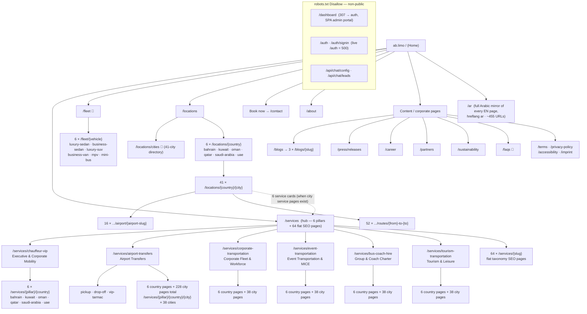
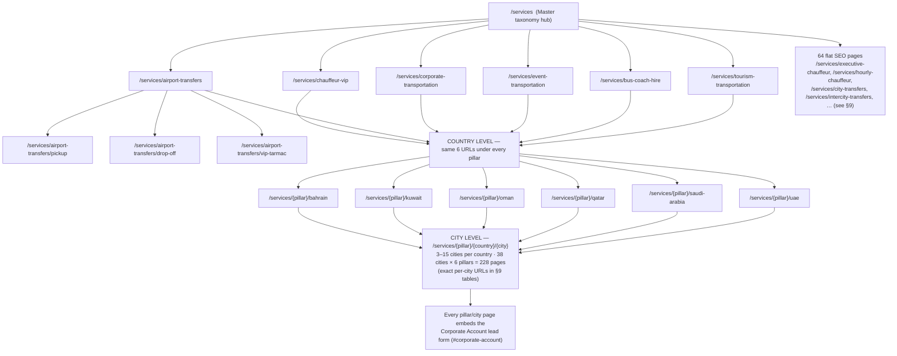
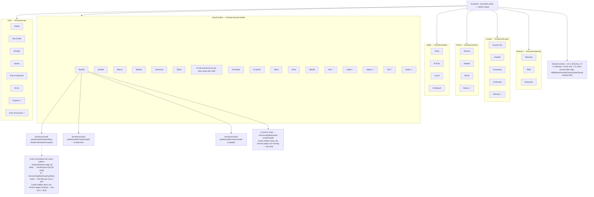
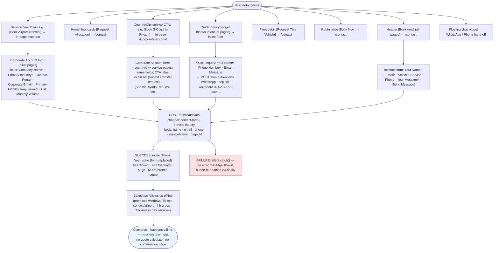
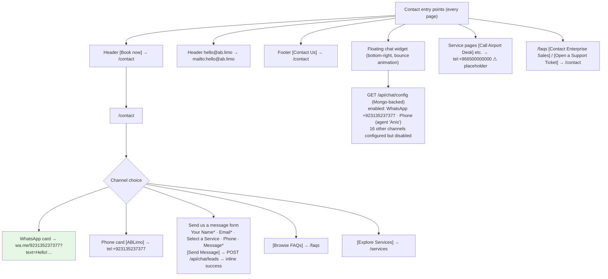
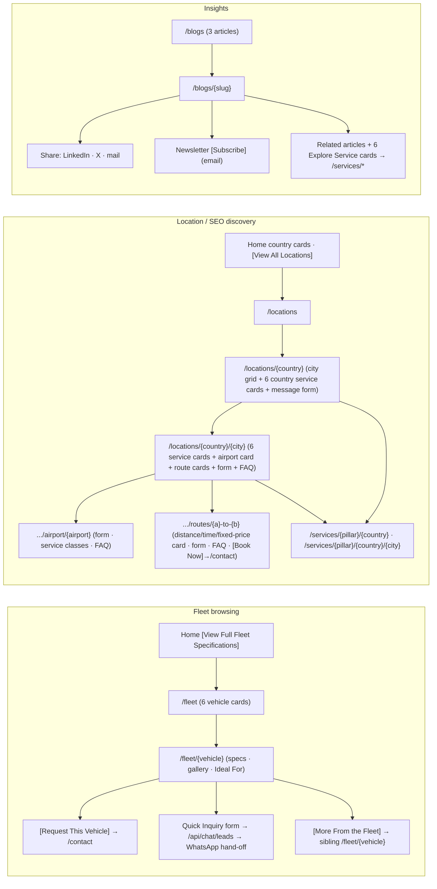

# AB.Limo — Site Sitemap, Hierarchy & User-Flow Map (with full URL + interaction mapping)

**Live site:** https://www.ab.limo · **Research date:** 23 October 2026
**Method:** live `sitemap.xml` parse (455 EN URLs + full `/ar` mirror), HTTP verification of sitemap gaps, HTML anchor/button/form extraction across 23 page templates, `/api/chat/config` probe, and comparison against this repo's `src/app` route tree.
**Companion file:** `ab_limo_live_site_hierarchy_interaction_map.md` (earlier crawl — this document supersedes it with sitemap-verified URLs).

**Confidence labels:** ✅ = in live `sitemap.xml` **and** fetched HTTP 200 · 🔎 = HTTP 200 but **not** in sitemap (discovered by probing) · ❌ = HTTP 404 · `#` = dead placeholder link in shipped HTML.

---

## 1. Master sitemap (Mermaid)



---

## 2. Services hierarchy (Mermaid)

All 6 pillars share one geo matrix: **each pillar = 1 base + 6 country pages + 38 city pages (228 city pages total, 6 × 38)**. Full clickable URL tables in **§9**.



---

## 3. Locations hierarchy (Mermaid)



---

## 4. Booking / lead-capture user flow (Mermaid)

There is **no self-serve booking engine** (`/book`, `/booking`, `/reserve`, `/rates`, `/thank-you` = ❌ 404). Every "book" CTA is a **lead form** → internal API → human sales follow-up.



**Key structural facts:**
- Form anchors: pillar pages use `#contact`; country/city service pages use `#corporate-account`.
- Trust line under forms: "Data secured by AB.Limo Enterprise infrastructure."
- Fallback under every form: `[Contact Sales Directly](mailto:hello@ab.limo)`.
- GTM events: `trackEvent("lead_captured", {form_id, form_location})` · `trackContactClick({method, location, label, whatsapp_number})`.

---

## 5. Contact user flow (Mermaid)



**No map embed, no address block on `/contact`** — physical addresses only on `/imprint` (HQ: Malaz Area, Umar Ibn Abdulaziz Rd, Bldg 59, 2nd Floor, Riyadh 12626, KSA; offices Dubai, Abu Dhabi, Doha).

---

## 6. Discovery flows: fleet · locations/SEO · blog (Mermaid)



---

## 7. Global interactive chrome (header · footer · widget · transitions)

### 7.1 Header (fixed, identical on every page; RTL-mirrored on `/ar`)

| Element | Target | Type | Status |
|---|---|---|---|
| Logo | `/` | route | ✅ |
| **Our Services** (button, chevron) | client-side mega-menu (columns: Tourism Mobility / Corporate Mobility / Events Mobility; flat list: Executive Chauffeur, Chauffeur Hailing, Hourly Chauffeur, Airport Transfers, City Transfers, Intercity Transfers, Limousine Services, Bus/Mini Bus/Coach Charter…) | dropdown (client-rendered, **not in SSR HTML**; items largely `#` with DB override `dbServiceLinks`) | Needs browser QA |
| **Our Solutions** (button) | dropdown → flat `/services/{slug}` pages (VIP Diplomatic, Corporate Fleet, Group Charter, Tourism & Leisure, Premium Lifestyle, Cross-Border, Religious Tourism…) | dropdown | Mostly `#` placeholders |
| **Mobility by Industry** (button) | dropdown → industry `/services/{slug}` pages (Oil & Gas, Government, Aviation/FBO, Events, Sports, Healthcare, Education…) | dropdown | Mostly `#` placeholders |
| **Technology** (button) | Corporate Login · Affiliate Login · Chauffeur Portal · Fleet Portal · Chauffeur Partner Portal | dropdown | All `#` (intended target: `/dashboard` — robots-disallowed) |
| 🌐 globe | EN ↔ `/ar` locale toggle | locale switch | ✅ |
| LinkedIn icon | `https://www.linkedin.com/company/ablimo24x7` | external | ✅ |
| Instagram · Facebook icons | `#` | external | ❌ dead |
| **[Book now]** | `/contact` | primary CTA | ✅ |
| `hello@ab.limo` | `mailto:hello@ab.limo` | mailto | ✅ |

*Mobile header:* same items as accordion + hamburger; nested Services sub-accordion (Tourism/Corporate/Events).

### 7.2 Footer (sitewide, 4 columns + bottom bar) — the most reliable full link map

| Column | Links (label → URL) |
|---|---|
| About Us | Homepage `/` · About `/about` · Chauffeur Recruitment `/partners` · Corporate Careers `/career` · Press/Newsroom `/press/releases` · Blog `/blogs` · Sustainability `/sustainability` · Contact Us `/contact` |
| Locations | Qatar `/locations/qatar` · Saudi Arabia `/locations/saudi-arabia` · UAE `/locations/uae` · Kuwait `/locations/kuwait` · Bahrain `/locations/bahrain` · Oman `/locations/oman` · All Cities `/locations/cities` · All Countries `/locations` |
| Cities We Serve In | Doha `/locations/qatar/doha` · Riyadh `/locations/saudi-arabia/riyadh` · Dubai `/locations/uae/dubai` · Kuwait City `/locations/kuwait/kuwait-city` · Manama `/locations/bahrain/manama` · Muscat `/locations/oman/muscat` · [View All Cities] `/locations/cities` |
| Our Services | Executive & Corporate Mobility `/services/chauffeur-vip` · Airport Transfers `/services/airport-transfers` · Corporate Fleet `/services/corporate-transportation` · Event Transportation `/services/event-transportation` · Group & Coach Charter `/services/bus-coach-hire` · Tourism & Leisure `/services/tourism-transportation` |
| Bottom bar | ©2026 AB.Limo · Terms `/terms` · Privacy `/privacy-policy` · Accessibility `/accessibility` · social icons (LinkedIn live; 5 others → `#`) |

### 7.3 Floating chat widget (all pages)

- Entry: bottom-right bubble, `animation: bounce`, label "Chat with us!" · popup header "Chat with us on WhatsApp".
- Config: `GET /api/chat/config` → MongoDB document; **enabled channels: WhatsApp `+923135237377`, Phone (agent "Anis")**; 16 disabled (Messenger, Telegram, Viber, Instagram, TikTok, Snapchat, X, LinkedIn, Line, WeChat, Discord, Slack, SMS, Email, Maps, Waze).
- Number resolution order: page override → city → country → universal `+923075905094` → widget default `+923135237377` (city/country numbers currently empty → all users get defaults).

### 7.4 Page transitions / motion

- **Next.js App Router client-side navigation** (React `startTransition`, RSC payload) — soft navigations, no full reloads.
- **No View Transitions API, no framer-motion / animation library** detected in shipped chunks.
- Only micro-motion: Tailwind `transition-colors/transform` hovers + chat-widget bounce entrance.
- Breadcrumbs on interior templates (`Home / …`, numbered `<ol>` on airport/route pages). No back buttons.

---

## 8. Full URL tree (summary — every segment)

```text
https://www.ab.limo
│
├── /                                          Home (hero · event logistics · duty-of-care · fleet · countries · cities · industry chips)
├── /about · /contact · /faqs 🔎 · /sustainability · /career · /partners
├── /press/releases · /blogs(3 articles) · /imprint · /terms · /privacy-policy · /accessibility
│
├── /fleet 🔎                                  6 vehicle detail pages (see §11.F)
│   └── /fleet/{luxury-sedan|business-sedan|luxury-suv|business-van|mpv|mini-bus}
│
├── /services                                   Master hub
│   ├── 6 PILLARS ─ each has:
│   │     ├── /services/{pillar}                                            (base)
│   │     ├── /services/{pillar}/{bahrain|kuwait|oman|qatar|saudi-arabia|uae}   (6 country pages)
│   │     └── /services/{pillar}/{country}/{city}                            (38 cities → 228 pages; full list §9)
│   ├── /services/airport-transfers/{pickup|drop-off|vip-tarmac}
│   └── 64 × /services/{flat-slug}                                          (SEO taxonomy; full list §9)
│
├── /locations                                  Countries index (search)
│   ├── /locations/cities 🔎                     41-city A–Z directory w/ country tabs
│   └── /locations/{country}                     6 countries
│         └── /locations/{country}/{city}         41 cities (32 sitemap + 9 live-only)
│               ├── .../airport/{airport-slug}     16 airport pages
│               └── .../routes/{from}-to-{to}      52 intercity route pages
│
├── /ar/…                                       Full Arabic mirror (hreflang ar; ~455 URLs)
├── /dashboard (307) · /auth (500) · /auth/signin (200) · /api/*        robots-disallowed
└── Legacy: /en-US/… → 308 redirect to clean URLs
```

**Counts:** 455 EN sitemap URLs · ~490 live EN URLs (sitemap + 🔎 extras) · 228 service-city pages · 64 flat service pages · 36 service-country pages · 41 location cities · 16 airports · 52 routes · 3 blog posts · 6 fleet vehicles · ~455 `/ar` mirror URLs.

---
## 9. Services hierarchy — pillar → country → city (every URL)

URL pattern: `/services/{service}/{country}` and `/services/{service}/{country}/{city}`.
All 6 pillars share the same 38-city set (228 city pages). ✅ = present in live `sitemap.xml` and verified HTTP 200.

**Flat taxonomy landing pages — 64 × `/services/{slug}` (all ✅ 200):**
- `/services/airport-coach-transfers` · `/services/airport-transfers` · `/services/aviation-mobility` · `/services/bus-charter`
- `/services/bus-coach-hire` · `/services/chauffeur-hailing` · `/services/chauffeur-vip` · `/services/city-to-city`
- `/services/city-transfers` · `/services/coach-charter` · `/services/conference-transportation` · `/services/construction-mobility`
- `/services/construction-staff-transport` · `/services/corporate-fleet` · `/services/corporate-shuttle` · `/services/corporate-transportation`
- `/services/crew-transportation` · `/services/cross-border-mobility` · `/services/education-mobility` · `/services/embassy-transportation`
- `/services/energy-mobility` · `/services/event-mice-mobility` · `/services/event-transportation` · `/services/executive-chauffeur`
- `/services/executive-corporate-mobility` · `/services/exhibition-transportation` · `/services/financial-roadshows` · `/services/government-mobility`
- `/services/group-coach-charter` · `/services/healthcare-mobility` · `/services/hospitality-mobility` · `/services/hotel-shuttle`
- `/services/hourly-chauffeur` · `/services/industrial-mobility` · `/services/intercity-transfers` · `/services/limousine-services`
- `/services/luxury-vip-mobility` · `/services/marine-mobility` · `/services/media-entertainment-mobility` · `/services/media-production-mobility`
- `/services/medical-transportation` · `/services/mice-transportation` · `/services/mini-bus-charter` · `/services/mining-mobility`
- `/services/mining-staff-transport` · `/services/ngo-mobility` · `/services/oil-gas-mobility` · `/services/premium-lifestyle`
- `/services/real-estate-mobility` · `/services/religious-tourism` · `/services/retail-mobility` · `/services/school-transport`
- `/services/sports-entertainment-mobility` · `/services/sports-team-transportation` · `/services/staff-transport` · `/services/technology-mobility`
- `/services/tourism-dmc` · `/services/tourism-leisure` · `/services/tourism-roadshows` · `/services/tourism-transportation`
- `/services/university-transport` · `/services/vip-delegation` · `/services/vip-diplomatic-government` · `/services/workforce-mobility`

### 9.1 Airport Transfers — extra sub-feature pages

| Page | URL |
|---|---|
| Airport Pickup | `/services/airport-transfers/pickup` |
| Airport Drop-Off | `/services/airport-transfers/drop-off` |
| VIP Tarmac Arrivals | `/services/airport-transfers/vip-tarmac` |

### 9.2 `/services/chauffeur-vip` — Executive & Corporate Mobility

**Country pages (6):** [`/services/chauffeur-vip/bahrain`](https://www.ab.limo/services/chauffeur-vip/bahrain) · [`/services/chauffeur-vip/kuwait`](https://www.ab.limo/services/chauffeur-vip/kuwait) · [`/services/chauffeur-vip/oman`](https://www.ab.limo/services/chauffeur-vip/oman) · [`/services/chauffeur-vip/qatar`](https://www.ab.limo/services/chauffeur-vip/qatar) · [`/services/chauffeur-vip/saudi-arabia`](https://www.ab.limo/services/chauffeur-vip/saudi-arabia) · [`/services/chauffeur-vip/uae`](https://www.ab.limo/services/chauffeur-vip/uae)

| # | Country | City | URL |
|---:|---|---|---|
| 1 | Bahrain | Manama | `/services/chauffeur-vip/bahrain/manama` |
| 2 | Bahrain | Muharraq | `/services/chauffeur-vip/bahrain/muharraq` |
| 3 | Bahrain | Riffa | `/services/chauffeur-vip/bahrain/riffa` |
| 4 | Kuwait | Al Ahmadi | `/services/chauffeur-vip/kuwait/al-ahmadi` |
| 5 | Kuwait | Hawalli | `/services/chauffeur-vip/kuwait/hawalli` |
| 6 | Kuwait | Kuwait City | `/services/chauffeur-vip/kuwait/kuwait-city` |
| 7 | Kuwait | Salmiya | `/services/chauffeur-vip/kuwait/salmiya` |
| 8 | Oman | Muscat | `/services/chauffeur-vip/oman/muscat` |
| 9 | Oman | Nizwa | `/services/chauffeur-vip/oman/nizwa` |
| 10 | Oman | Salalah | `/services/chauffeur-vip/oman/salalah` |
| 11 | Oman | Sohar | `/services/chauffeur-vip/oman/sohar` |
| 12 | Qatar | Al Khor | `/services/chauffeur-vip/qatar/al-khor` |
| 13 | Qatar | Al Wakrah | `/services/chauffeur-vip/qatar/al-wakrah` |
| 14 | Qatar | Doha | `/services/chauffeur-vip/qatar/doha` |
| 15 | Qatar | Lusail | `/services/chauffeur-vip/qatar/lusail` |
| 16 | Saudi Arabia | Abha | `/services/chauffeur-vip/saudi-arabia/abha` |
| 17 | Saudi Arabia | Al Khobar | `/services/chauffeur-vip/saudi-arabia/al-khobar` |
| 18 | Saudi Arabia | Al Ula (alias slug) | `/services/chauffeur-vip/saudi-arabia/alula` |
| 19 | Saudi Arabia | Dammam | `/services/chauffeur-vip/saudi-arabia/dammam` |
| 20 | Saudi Arabia | Hail | `/services/chauffeur-vip/saudi-arabia/hail` |
| 21 | Saudi Arabia | Jeddah | `/services/chauffeur-vip/saudi-arabia/jeddah` |
| 22 | Saudi Arabia | Jubail | `/services/chauffeur-vip/saudi-arabia/jubail` |
| 23 | Saudi Arabia | Mecca | `/services/chauffeur-vip/saudi-arabia/mecca` |
| 24 | Saudi Arabia | Medina | `/services/chauffeur-vip/saudi-arabia/medina` |
| 25 | Saudi Arabia | Najran | `/services/chauffeur-vip/saudi-arabia/najran` |
| 26 | Saudi Arabia | NEOM | `/services/chauffeur-vip/saudi-arabia/neom` |
| 27 | Saudi Arabia | Riyadh | `/services/chauffeur-vip/saudi-arabia/riyadh` |
| 28 | Saudi Arabia | Tabuk | `/services/chauffeur-vip/saudi-arabia/tabuk` |
| 29 | Saudi Arabia | Taif | `/services/chauffeur-vip/saudi-arabia/taif` |
| 30 | Saudi Arabia | Yanbu | `/services/chauffeur-vip/saudi-arabia/yanbu` |
| 31 | United Arab Emirates | Abu Dhabi | `/services/chauffeur-vip/uae/abu-dhabi` |
| 32 | United Arab Emirates | Ajman | `/services/chauffeur-vip/uae/ajman` |
| 33 | United Arab Emirates | Al Ain | `/services/chauffeur-vip/uae/al-ain` |
| 34 | United Arab Emirates | Dubai | `/services/chauffeur-vip/uae/dubai` |
| 35 | United Arab Emirates | Fujairah | `/services/chauffeur-vip/uae/fujairah` |
| 36 | United Arab Emirates | Ras Al Khaimah | `/services/chauffeur-vip/uae/ras-al-khaimah` |
| 37 | United Arab Emirates | Sharjah | `/services/chauffeur-vip/uae/sharjah` |
| 38 | United Arab Emirates | Umm Al Quwain | `/services/chauffeur-vip/uae/umm-al-quwain` |

### 9.3 `/services/airport-transfers` — Airport Transfers

**Country pages (6):** [`/services/airport-transfers/bahrain`](https://www.ab.limo/services/airport-transfers/bahrain) · [`/services/airport-transfers/kuwait`](https://www.ab.limo/services/airport-transfers/kuwait) · [`/services/airport-transfers/oman`](https://www.ab.limo/services/airport-transfers/oman) · [`/services/airport-transfers/qatar`](https://www.ab.limo/services/airport-transfers/qatar) · [`/services/airport-transfers/saudi-arabia`](https://www.ab.limo/services/airport-transfers/saudi-arabia) · [`/services/airport-transfers/uae`](https://www.ab.limo/services/airport-transfers/uae)

| # | Country | City | URL |
|---:|---|---|---|
| 1 | Bahrain | Manama | `/services/airport-transfers/bahrain/manama` |
| 2 | Bahrain | Muharraq | `/services/airport-transfers/bahrain/muharraq` |
| 3 | Bahrain | Riffa | `/services/airport-transfers/bahrain/riffa` |
| 4 | Kuwait | Al Ahmadi | `/services/airport-transfers/kuwait/al-ahmadi` |
| 5 | Kuwait | Hawalli | `/services/airport-transfers/kuwait/hawalli` |
| 6 | Kuwait | Kuwait City | `/services/airport-transfers/kuwait/kuwait-city` |
| 7 | Kuwait | Salmiya | `/services/airport-transfers/kuwait/salmiya` |
| 8 | Oman | Muscat | `/services/airport-transfers/oman/muscat` |
| 9 | Oman | Nizwa | `/services/airport-transfers/oman/nizwa` |
| 10 | Oman | Salalah | `/services/airport-transfers/oman/salalah` |
| 11 | Oman | Sohar | `/services/airport-transfers/oman/sohar` |
| 12 | Qatar | Al Khor | `/services/airport-transfers/qatar/al-khor` |
| 13 | Qatar | Al Wakrah | `/services/airport-transfers/qatar/al-wakrah` |
| 14 | Qatar | Doha | `/services/airport-transfers/qatar/doha` |
| 15 | Qatar | Lusail | `/services/airport-transfers/qatar/lusail` |
| 16 | Saudi Arabia | Abha | `/services/airport-transfers/saudi-arabia/abha` |
| 17 | Saudi Arabia | Al Khobar | `/services/airport-transfers/saudi-arabia/al-khobar` |
| 18 | Saudi Arabia | Al Ula (alias slug) | `/services/airport-transfers/saudi-arabia/alula` |
| 19 | Saudi Arabia | Dammam | `/services/airport-transfers/saudi-arabia/dammam` |
| 20 | Saudi Arabia | Hail | `/services/airport-transfers/saudi-arabia/hail` |
| 21 | Saudi Arabia | Jeddah | `/services/airport-transfers/saudi-arabia/jeddah` |
| 22 | Saudi Arabia | Jubail | `/services/airport-transfers/saudi-arabia/jubail` |
| 23 | Saudi Arabia | Mecca | `/services/airport-transfers/saudi-arabia/mecca` |
| 24 | Saudi Arabia | Medina | `/services/airport-transfers/saudi-arabia/medina` |
| 25 | Saudi Arabia | Najran | `/services/airport-transfers/saudi-arabia/najran` |
| 26 | Saudi Arabia | NEOM | `/services/airport-transfers/saudi-arabia/neom` |
| 27 | Saudi Arabia | Riyadh | `/services/airport-transfers/saudi-arabia/riyadh` |
| 28 | Saudi Arabia | Tabuk | `/services/airport-transfers/saudi-arabia/tabuk` |
| 29 | Saudi Arabia | Taif | `/services/airport-transfers/saudi-arabia/taif` |
| 30 | Saudi Arabia | Yanbu | `/services/airport-transfers/saudi-arabia/yanbu` |
| 31 | United Arab Emirates | Abu Dhabi | `/services/airport-transfers/uae/abu-dhabi` |
| 32 | United Arab Emirates | Ajman | `/services/airport-transfers/uae/ajman` |
| 33 | United Arab Emirates | Al Ain | `/services/airport-transfers/uae/al-ain` |
| 34 | United Arab Emirates | Dubai | `/services/airport-transfers/uae/dubai` |
| 35 | United Arab Emirates | Fujairah | `/services/airport-transfers/uae/fujairah` |
| 36 | United Arab Emirates | Ras Al Khaimah | `/services/airport-transfers/uae/ras-al-khaimah` |
| 37 | United Arab Emirates | Sharjah | `/services/airport-transfers/uae/sharjah` |
| 38 | United Arab Emirates | Umm Al Quwain | `/services/airport-transfers/uae/umm-al-quwain` |

### 9.4 `/services/corporate-transportation` — Corporate Fleet & Workforce Mobility

**Country pages (6):** [`/services/corporate-transportation/bahrain`](https://www.ab.limo/services/corporate-transportation/bahrain) · [`/services/corporate-transportation/kuwait`](https://www.ab.limo/services/corporate-transportation/kuwait) · [`/services/corporate-transportation/oman`](https://www.ab.limo/services/corporate-transportation/oman) · [`/services/corporate-transportation/qatar`](https://www.ab.limo/services/corporate-transportation/qatar) · [`/services/corporate-transportation/saudi-arabia`](https://www.ab.limo/services/corporate-transportation/saudi-arabia) · [`/services/corporate-transportation/uae`](https://www.ab.limo/services/corporate-transportation/uae)

| # | Country | City | URL |
|---:|---|---|---|
| 1 | Bahrain | Manama | `/services/corporate-transportation/bahrain/manama` |
| 2 | Bahrain | Muharraq | `/services/corporate-transportation/bahrain/muharraq` |
| 3 | Bahrain | Riffa | `/services/corporate-transportation/bahrain/riffa` |
| 4 | Kuwait | Al Ahmadi | `/services/corporate-transportation/kuwait/al-ahmadi` |
| 5 | Kuwait | Hawalli | `/services/corporate-transportation/kuwait/hawalli` |
| 6 | Kuwait | Kuwait City | `/services/corporate-transportation/kuwait/kuwait-city` |
| 7 | Kuwait | Salmiya | `/services/corporate-transportation/kuwait/salmiya` |
| 8 | Oman | Muscat | `/services/corporate-transportation/oman/muscat` |
| 9 | Oman | Nizwa | `/services/corporate-transportation/oman/nizwa` |
| 10 | Oman | Salalah | `/services/corporate-transportation/oman/salalah` |
| 11 | Oman | Sohar | `/services/corporate-transportation/oman/sohar` |
| 12 | Qatar | Al Khor | `/services/corporate-transportation/qatar/al-khor` |
| 13 | Qatar | Al Wakrah | `/services/corporate-transportation/qatar/al-wakrah` |
| 14 | Qatar | Doha | `/services/corporate-transportation/qatar/doha` |
| 15 | Qatar | Lusail | `/services/corporate-transportation/qatar/lusail` |
| 16 | Saudi Arabia | Abha | `/services/corporate-transportation/saudi-arabia/abha` |
| 17 | Saudi Arabia | Al Khobar | `/services/corporate-transportation/saudi-arabia/al-khobar` |
| 18 | Saudi Arabia | Al Ula (alias slug) | `/services/corporate-transportation/saudi-arabia/alula` |
| 19 | Saudi Arabia | Dammam | `/services/corporate-transportation/saudi-arabia/dammam` |
| 20 | Saudi Arabia | Hail | `/services/corporate-transportation/saudi-arabia/hail` |
| 21 | Saudi Arabia | Jeddah | `/services/corporate-transportation/saudi-arabia/jeddah` |
| 22 | Saudi Arabia | Jubail | `/services/corporate-transportation/saudi-arabia/jubail` |
| 23 | Saudi Arabia | Mecca | `/services/corporate-transportation/saudi-arabia/mecca` |
| 24 | Saudi Arabia | Medina | `/services/corporate-transportation/saudi-arabia/medina` |
| 25 | Saudi Arabia | Najran | `/services/corporate-transportation/saudi-arabia/najran` |
| 26 | Saudi Arabia | NEOM | `/services/corporate-transportation/saudi-arabia/neom` |
| 27 | Saudi Arabia | Riyadh | `/services/corporate-transportation/saudi-arabia/riyadh` |
| 28 | Saudi Arabia | Tabuk | `/services/corporate-transportation/saudi-arabia/tabuk` |
| 29 | Saudi Arabia | Taif | `/services/corporate-transportation/saudi-arabia/taif` |
| 30 | Saudi Arabia | Yanbu | `/services/corporate-transportation/saudi-arabia/yanbu` |
| 31 | United Arab Emirates | Abu Dhabi | `/services/corporate-transportation/uae/abu-dhabi` |
| 32 | United Arab Emirates | Ajman | `/services/corporate-transportation/uae/ajman` |
| 33 | United Arab Emirates | Al Ain | `/services/corporate-transportation/uae/al-ain` |
| 34 | United Arab Emirates | Dubai | `/services/corporate-transportation/uae/dubai` |
| 35 | United Arab Emirates | Fujairah | `/services/corporate-transportation/uae/fujairah` |
| 36 | United Arab Emirates | Ras Al Khaimah | `/services/corporate-transportation/uae/ras-al-khaimah` |
| 37 | United Arab Emirates | Sharjah | `/services/corporate-transportation/uae/sharjah` |
| 38 | United Arab Emirates | Umm Al Quwain | `/services/corporate-transportation/uae/umm-al-quwain` |

### 9.5 `/services/event-transportation` — Event Transportation

**Country pages (6):** [`/services/event-transportation/bahrain`](https://www.ab.limo/services/event-transportation/bahrain) · [`/services/event-transportation/kuwait`](https://www.ab.limo/services/event-transportation/kuwait) · [`/services/event-transportation/oman`](https://www.ab.limo/services/event-transportation/oman) · [`/services/event-transportation/qatar`](https://www.ab.limo/services/event-transportation/qatar) · [`/services/event-transportation/saudi-arabia`](https://www.ab.limo/services/event-transportation/saudi-arabia) · [`/services/event-transportation/uae`](https://www.ab.limo/services/event-transportation/uae)

| # | Country | City | URL |
|---:|---|---|---|
| 1 | Bahrain | Manama | `/services/event-transportation/bahrain/manama` |
| 2 | Bahrain | Muharraq | `/services/event-transportation/bahrain/muharraq` |
| 3 | Bahrain | Riffa | `/services/event-transportation/bahrain/riffa` |
| 4 | Kuwait | Al Ahmadi | `/services/event-transportation/kuwait/al-ahmadi` |
| 5 | Kuwait | Hawalli | `/services/event-transportation/kuwait/hawalli` |
| 6 | Kuwait | Kuwait City | `/services/event-transportation/kuwait/kuwait-city` |
| 7 | Kuwait | Salmiya | `/services/event-transportation/kuwait/salmiya` |
| 8 | Oman | Muscat | `/services/event-transportation/oman/muscat` |
| 9 | Oman | Nizwa | `/services/event-transportation/oman/nizwa` |
| 10 | Oman | Salalah | `/services/event-transportation/oman/salalah` |
| 11 | Oman | Sohar | `/services/event-transportation/oman/sohar` |
| 12 | Qatar | Al Khor | `/services/event-transportation/qatar/al-khor` |
| 13 | Qatar | Al Wakrah | `/services/event-transportation/qatar/al-wakrah` |
| 14 | Qatar | Doha | `/services/event-transportation/qatar/doha` |
| 15 | Qatar | Lusail | `/services/event-transportation/qatar/lusail` |
| 16 | Saudi Arabia | Abha | `/services/event-transportation/saudi-arabia/abha` |
| 17 | Saudi Arabia | Al Khobar | `/services/event-transportation/saudi-arabia/al-khobar` |
| 18 | Saudi Arabia | Al Ula (alias slug) | `/services/event-transportation/saudi-arabia/alula` |
| 19 | Saudi Arabia | Dammam | `/services/event-transportation/saudi-arabia/dammam` |
| 20 | Saudi Arabia | Hail | `/services/event-transportation/saudi-arabia/hail` |
| 21 | Saudi Arabia | Jeddah | `/services/event-transportation/saudi-arabia/jeddah` |
| 22 | Saudi Arabia | Jubail | `/services/event-transportation/saudi-arabia/jubail` |
| 23 | Saudi Arabia | Mecca | `/services/event-transportation/saudi-arabia/mecca` |
| 24 | Saudi Arabia | Medina | `/services/event-transportation/saudi-arabia/medina` |
| 25 | Saudi Arabia | Najran | `/services/event-transportation/saudi-arabia/najran` |
| 26 | Saudi Arabia | NEOM | `/services/event-transportation/saudi-arabia/neom` |
| 27 | Saudi Arabia | Riyadh | `/services/event-transportation/saudi-arabia/riyadh` |
| 28 | Saudi Arabia | Tabuk | `/services/event-transportation/saudi-arabia/tabuk` |
| 29 | Saudi Arabia | Taif | `/services/event-transportation/saudi-arabia/taif` |
| 30 | Saudi Arabia | Yanbu | `/services/event-transportation/saudi-arabia/yanbu` |
| 31 | United Arab Emirates | Abu Dhabi | `/services/event-transportation/uae/abu-dhabi` |
| 32 | United Arab Emirates | Ajman | `/services/event-transportation/uae/ajman` |
| 33 | United Arab Emirates | Al Ain | `/services/event-transportation/uae/al-ain` |
| 34 | United Arab Emirates | Dubai | `/services/event-transportation/uae/dubai` |
| 35 | United Arab Emirates | Fujairah | `/services/event-transportation/uae/fujairah` |
| 36 | United Arab Emirates | Ras Al Khaimah | `/services/event-transportation/uae/ras-al-khaimah` |
| 37 | United Arab Emirates | Sharjah | `/services/event-transportation/uae/sharjah` |
| 38 | United Arab Emirates | Umm Al Quwain | `/services/event-transportation/uae/umm-al-quwain` |

### 9.6 `/services/bus-coach-hire` — Group & Coach Charter

**Country pages (6):** [`/services/bus-coach-hire/bahrain`](https://www.ab.limo/services/bus-coach-hire/bahrain) · [`/services/bus-coach-hire/kuwait`](https://www.ab.limo/services/bus-coach-hire/kuwait) · [`/services/bus-coach-hire/oman`](https://www.ab.limo/services/bus-coach-hire/oman) · [`/services/bus-coach-hire/qatar`](https://www.ab.limo/services/bus-coach-hire/qatar) · [`/services/bus-coach-hire/saudi-arabia`](https://www.ab.limo/services/bus-coach-hire/saudi-arabia) · [`/services/bus-coach-hire/uae`](https://www.ab.limo/services/bus-coach-hire/uae)

| # | Country | City | URL |
|---:|---|---|---|
| 1 | Bahrain | Manama | `/services/bus-coach-hire/bahrain/manama` |
| 2 | Bahrain | Muharraq | `/services/bus-coach-hire/bahrain/muharraq` |
| 3 | Bahrain | Riffa | `/services/bus-coach-hire/bahrain/riffa` |
| 4 | Kuwait | Al Ahmadi | `/services/bus-coach-hire/kuwait/al-ahmadi` |
| 5 | Kuwait | Hawalli | `/services/bus-coach-hire/kuwait/hawalli` |
| 6 | Kuwait | Kuwait City | `/services/bus-coach-hire/kuwait/kuwait-city` |
| 7 | Kuwait | Salmiya | `/services/bus-coach-hire/kuwait/salmiya` |
| 8 | Oman | Muscat | `/services/bus-coach-hire/oman/muscat` |
| 9 | Oman | Nizwa | `/services/bus-coach-hire/oman/nizwa` |
| 10 | Oman | Salalah | `/services/bus-coach-hire/oman/salalah` |
| 11 | Oman | Sohar | `/services/bus-coach-hire/oman/sohar` |
| 12 | Qatar | Al Khor | `/services/bus-coach-hire/qatar/al-khor` |
| 13 | Qatar | Al Wakrah | `/services/bus-coach-hire/qatar/al-wakrah` |
| 14 | Qatar | Doha | `/services/bus-coach-hire/qatar/doha` |
| 15 | Qatar | Lusail | `/services/bus-coach-hire/qatar/lusail` |
| 16 | Saudi Arabia | Abha | `/services/bus-coach-hire/saudi-arabia/abha` |
| 17 | Saudi Arabia | Al Khobar | `/services/bus-coach-hire/saudi-arabia/al-khobar` |
| 18 | Saudi Arabia | Al Ula (alias slug) | `/services/bus-coach-hire/saudi-arabia/alula` |
| 19 | Saudi Arabia | Dammam | `/services/bus-coach-hire/saudi-arabia/dammam` |
| 20 | Saudi Arabia | Hail | `/services/bus-coach-hire/saudi-arabia/hail` |
| 21 | Saudi Arabia | Jeddah | `/services/bus-coach-hire/saudi-arabia/jeddah` |
| 22 | Saudi Arabia | Jubail | `/services/bus-coach-hire/saudi-arabia/jubail` |
| 23 | Saudi Arabia | Mecca | `/services/bus-coach-hire/saudi-arabia/mecca` |
| 24 | Saudi Arabia | Medina | `/services/bus-coach-hire/saudi-arabia/medina` |
| 25 | Saudi Arabia | Najran | `/services/bus-coach-hire/saudi-arabia/najran` |
| 26 | Saudi Arabia | NEOM | `/services/bus-coach-hire/saudi-arabia/neom` |
| 27 | Saudi Arabia | Riyadh | `/services/bus-coach-hire/saudi-arabia/riyadh` |
| 28 | Saudi Arabia | Tabuk | `/services/bus-coach-hire/saudi-arabia/tabuk` |
| 29 | Saudi Arabia | Taif | `/services/bus-coach-hire/saudi-arabia/taif` |
| 30 | Saudi Arabia | Yanbu | `/services/bus-coach-hire/saudi-arabia/yanbu` |
| 31 | United Arab Emirates | Abu Dhabi | `/services/bus-coach-hire/uae/abu-dhabi` |
| 32 | United Arab Emirates | Ajman | `/services/bus-coach-hire/uae/ajman` |
| 33 | United Arab Emirates | Al Ain | `/services/bus-coach-hire/uae/al-ain` |
| 34 | United Arab Emirates | Dubai | `/services/bus-coach-hire/uae/dubai` |
| 35 | United Arab Emirates | Fujairah | `/services/bus-coach-hire/uae/fujairah` |
| 36 | United Arab Emirates | Ras Al Khaimah | `/services/bus-coach-hire/uae/ras-al-khaimah` |
| 37 | United Arab Emirates | Sharjah | `/services/bus-coach-hire/uae/sharjah` |
| 38 | United Arab Emirates | Umm Al Quwain | `/services/bus-coach-hire/uae/umm-al-quwain` |

### 9.7 `/services/tourism-transportation` — Tourism & Leisure

**Country pages (6):** [`/services/tourism-transportation/bahrain`](https://www.ab.limo/services/tourism-transportation/bahrain) · [`/services/tourism-transportation/kuwait`](https://www.ab.limo/services/tourism-transportation/kuwait) · [`/services/tourism-transportation/oman`](https://www.ab.limo/services/tourism-transportation/oman) · [`/services/tourism-transportation/qatar`](https://www.ab.limo/services/tourism-transportation/qatar) · [`/services/tourism-transportation/saudi-arabia`](https://www.ab.limo/services/tourism-transportation/saudi-arabia) · [`/services/tourism-transportation/uae`](https://www.ab.limo/services/tourism-transportation/uae)

| # | Country | City | URL |
|---:|---|---|---|
| 1 | Bahrain | Manama | `/services/tourism-transportation/bahrain/manama` |
| 2 | Bahrain | Muharraq | `/services/tourism-transportation/bahrain/muharraq` |
| 3 | Bahrain | Riffa | `/services/tourism-transportation/bahrain/riffa` |
| 4 | Kuwait | Al Ahmadi | `/services/tourism-transportation/kuwait/al-ahmadi` |
| 5 | Kuwait | Hawalli | `/services/tourism-transportation/kuwait/hawalli` |
| 6 | Kuwait | Kuwait City | `/services/tourism-transportation/kuwait/kuwait-city` |
| 7 | Kuwait | Salmiya | `/services/tourism-transportation/kuwait/salmiya` |
| 8 | Oman | Muscat | `/services/tourism-transportation/oman/muscat` |
| 9 | Oman | Nizwa | `/services/tourism-transportation/oman/nizwa` |
| 10 | Oman | Salalah | `/services/tourism-transportation/oman/salalah` |
| 11 | Oman | Sohar | `/services/tourism-transportation/oman/sohar` |
| 12 | Qatar | Al Khor | `/services/tourism-transportation/qatar/al-khor` |
| 13 | Qatar | Al Wakrah | `/services/tourism-transportation/qatar/al-wakrah` |
| 14 | Qatar | Doha | `/services/tourism-transportation/qatar/doha` |
| 15 | Qatar | Lusail | `/services/tourism-transportation/qatar/lusail` |
| 16 | Saudi Arabia | Abha | `/services/tourism-transportation/saudi-arabia/abha` |
| 17 | Saudi Arabia | Al Khobar | `/services/tourism-transportation/saudi-arabia/al-khobar` |
| 18 | Saudi Arabia | Al Ula (alias slug) | `/services/tourism-transportation/saudi-arabia/alula` |
| 19 | Saudi Arabia | Dammam | `/services/tourism-transportation/saudi-arabia/dammam` |
| 20 | Saudi Arabia | Hail | `/services/tourism-transportation/saudi-arabia/hail` |
| 21 | Saudi Arabia | Jeddah | `/services/tourism-transportation/saudi-arabia/jeddah` |
| 22 | Saudi Arabia | Jubail | `/services/tourism-transportation/saudi-arabia/jubail` |
| 23 | Saudi Arabia | Mecca | `/services/tourism-transportation/saudi-arabia/mecca` |
| 24 | Saudi Arabia | Medina | `/services/tourism-transportation/saudi-arabia/medina` |
| 25 | Saudi Arabia | Najran | `/services/tourism-transportation/saudi-arabia/najran` |
| 26 | Saudi Arabia | NEOM | `/services/tourism-transportation/saudi-arabia/neom` |
| 27 | Saudi Arabia | Riyadh | `/services/tourism-transportation/saudi-arabia/riyadh` |
| 28 | Saudi Arabia | Tabuk | `/services/tourism-transportation/saudi-arabia/tabuk` |
| 29 | Saudi Arabia | Taif | `/services/tourism-transportation/saudi-arabia/taif` |
| 30 | Saudi Arabia | Yanbu | `/services/tourism-transportation/saudi-arabia/yanbu` |
| 31 | United Arab Emirates | Abu Dhabi | `/services/tourism-transportation/uae/abu-dhabi` |
| 32 | United Arab Emirates | Ajman | `/services/tourism-transportation/uae/ajman` |
| 33 | United Arab Emirates | Al Ain | `/services/tourism-transportation/uae/al-ain` |
| 34 | United Arab Emirates | Dubai | `/services/tourism-transportation/uae/dubai` |
| 35 | United Arab Emirates | Fujairah | `/services/tourism-transportation/uae/fujairah` |
| 36 | United Arab Emirates | Ras Al Khaimah | `/services/tourism-transportation/uae/ras-al-khaimah` |
| 37 | United Arab Emirates | Sharjah | `/services/tourism-transportation/uae/sharjah` |
| 38 | United Arab Emirates | Umm Al Quwain | `/services/tourism-transportation/uae/umm-al-quwain` |

## 10. Locations hierarchy — country → city → services, airports, routes (every URL)

URL patterns: `/locations/{country}` · `/locations/{country}/{city}` · `.../airport/{airport}` · `.../routes/{from}-to-{to}`.
Service links in the city rows are the six pillar pages for that city; ✅ = live 200, ❌ = 404 (no page).

| Country | Country page | Cities |
|---|---|---|
| Bahrain | `/locations/bahrain` | 3 |
| Kuwait | `/locations/kuwait` | 5 |
| Oman | `/locations/oman` | 4 |
| Qatar | `/locations/qatar` | 4 |
| Saudi Arabia | `/locations/saudi-arabia` | 17 |
| United Arab Emirates | `/locations/uae` | 8 |

Index pages: [`/locations`](https://www.ab.limo/locations) (countries) · [`/locations/cities`](https://www.ab.limo/locations/cities) (A–Z city directory, country filter tabs).

### 10.1 Bahrain — `/locations/bahrain`

| City | Location page | The 6 city service pages | Airport page(s) | Intercity route pages |
|---|---|---|---|---|
| Manama | [`/locations/bahrain/manama`](https://www.ab.limo/locations/bahrain/manama) | [`chauffeur-vip`](https://www.ab.limo/services/chauffeur-vip/bahrain/manama)<br>[`airport-transfers`](https://www.ab.limo/services/airport-transfers/bahrain/manama)<br>[`corporate-transportation`](https://www.ab.limo/services/corporate-transportation/bahrain/manama)<br>[`event-transportation`](https://www.ab.limo/services/event-transportation/bahrain/manama)<br>[`bus-coach-hire`](https://www.ab.limo/services/bus-coach-hire/bahrain/manama)<br>[`tourism-transportation`](https://www.ab.limo/services/tourism-transportation/bahrain/manama) | [Bahrain International Airport](https://www.ab.limo/locations/bahrain/manama/airport/bahrain-international-airport) | [manama → al khobar](https://www.ab.limo/locations/bahrain/manama/routes/manama-to-al-khobar) |
| Muharraq | [`/locations/bahrain/muharraq`](https://www.ab.limo/locations/bahrain/muharraq) | [`chauffeur-vip`](https://www.ab.limo/services/chauffeur-vip/bahrain/muharraq)<br>[`airport-transfers`](https://www.ab.limo/services/airport-transfers/bahrain/muharraq)<br>[`corporate-transportation`](https://www.ab.limo/services/corporate-transportation/bahrain/muharraq)<br>[`event-transportation`](https://www.ab.limo/services/event-transportation/bahrain/muharraq)<br>[`bus-coach-hire`](https://www.ab.limo/services/bus-coach-hire/bahrain/muharraq)<br>[`tourism-transportation`](https://www.ab.limo/services/tourism-transportation/bahrain/muharraq) | — | — |
| Riffa | [`/locations/bahrain/riffa`](https://www.ab.limo/locations/bahrain/riffa) | [`chauffeur-vip`](https://www.ab.limo/services/chauffeur-vip/bahrain/riffa)<br>[`airport-transfers`](https://www.ab.limo/services/airport-transfers/bahrain/riffa)<br>[`corporate-transportation`](https://www.ab.limo/services/corporate-transportation/bahrain/riffa)<br>[`event-transportation`](https://www.ab.limo/services/event-transportation/bahrain/riffa)<br>[`bus-coach-hire`](https://www.ab.limo/services/bus-coach-hire/bahrain/riffa)<br>[`tourism-transportation`](https://www.ab.limo/services/tourism-transportation/bahrain/riffa) | — | — |

### 10.2 Kuwait — `/locations/kuwait`

| City | Location page | The 6 city service pages | Airport page(s) | Intercity route pages |
|---|---|---|---|---|
| Al Ahmadi | [`/locations/kuwait/al-ahmadi`](https://www.ab.limo/locations/kuwait/al-ahmadi) | [`chauffeur-vip`](https://www.ab.limo/services/chauffeur-vip/kuwait/al-ahmadi)<br>[`airport-transfers`](https://www.ab.limo/services/airport-transfers/kuwait/al-ahmadi)<br>[`corporate-transportation`](https://www.ab.limo/services/corporate-transportation/kuwait/al-ahmadi)<br>[`event-transportation`](https://www.ab.limo/services/event-transportation/kuwait/al-ahmadi)<br>[`bus-coach-hire`](https://www.ab.limo/services/bus-coach-hire/kuwait/al-ahmadi)<br>[`tourism-transportation`](https://www.ab.limo/services/tourism-transportation/kuwait/al-ahmadi) | — | [al ahmadi → kuwait city](https://www.ab.limo/locations/kuwait/al-ahmadi/routes/al-ahmadi-to-kuwait-city) |
| Farwaniya | [`/locations/kuwait/farwaniya`](https://www.ab.limo/locations/kuwait/farwaniya) | `chauffeur-vip` ❌<br>`airport-transfers` ❌<br>`corporate-transportation` ❌<br>`event-transportation` ❌<br>`bus-coach-hire` ❌<br>`tourism-transportation` ❌ | — | — |
| Hawalli | [`/locations/kuwait/hawalli`](https://www.ab.limo/locations/kuwait/hawalli) | [`chauffeur-vip`](https://www.ab.limo/services/chauffeur-vip/kuwait/hawalli)<br>[`airport-transfers`](https://www.ab.limo/services/airport-transfers/kuwait/hawalli)<br>[`corporate-transportation`](https://www.ab.limo/services/corporate-transportation/kuwait/hawalli)<br>[`event-transportation`](https://www.ab.limo/services/event-transportation/kuwait/hawalli)<br>[`bus-coach-hire`](https://www.ab.limo/services/bus-coach-hire/kuwait/hawalli)<br>[`tourism-transportation`](https://www.ab.limo/services/tourism-transportation/kuwait/hawalli) | — | — |
| Kuwait City | [`/locations/kuwait/kuwait-city`](https://www.ab.limo/locations/kuwait/kuwait-city) | [`chauffeur-vip`](https://www.ab.limo/services/chauffeur-vip/kuwait/kuwait-city)<br>[`airport-transfers`](https://www.ab.limo/services/airport-transfers/kuwait/kuwait-city)<br>[`corporate-transportation`](https://www.ab.limo/services/corporate-transportation/kuwait/kuwait-city)<br>[`event-transportation`](https://www.ab.limo/services/event-transportation/kuwait/kuwait-city)<br>[`bus-coach-hire`](https://www.ab.limo/services/bus-coach-hire/kuwait/kuwait-city)<br>[`tourism-transportation`](https://www.ab.limo/services/tourism-transportation/kuwait/kuwait-city) | [Kuwait International Airport](https://www.ab.limo/locations/kuwait/kuwait-city/airport/kuwait-international-airport) | [kuwait city → al ahmadi](https://www.ab.limo/locations/kuwait/kuwait-city/routes/kuwait-city-to-al-ahmadi)<br>[kuwait city → doha](https://www.ab.limo/locations/kuwait/kuwait-city/routes/kuwait-city-to-doha) |
| Salmiya | [`/locations/kuwait/salmiya`](https://www.ab.limo/locations/kuwait/salmiya) | [`chauffeur-vip`](https://www.ab.limo/services/chauffeur-vip/kuwait/salmiya)<br>[`airport-transfers`](https://www.ab.limo/services/airport-transfers/kuwait/salmiya)<br>[`corporate-transportation`](https://www.ab.limo/services/corporate-transportation/kuwait/salmiya)<br>[`event-transportation`](https://www.ab.limo/services/event-transportation/kuwait/salmiya)<br>[`bus-coach-hire`](https://www.ab.limo/services/bus-coach-hire/kuwait/salmiya)<br>[`tourism-transportation`](https://www.ab.limo/services/tourism-transportation/kuwait/salmiya) | — | — |

### 10.3 Oman — `/locations/oman`

| City | Location page | The 6 city service pages | Airport page(s) | Intercity route pages |
|---|---|---|---|---|
| Muscat | [`/locations/oman/muscat`](https://www.ab.limo/locations/oman/muscat) | [`chauffeur-vip`](https://www.ab.limo/services/chauffeur-vip/oman/muscat)<br>[`airport-transfers`](https://www.ab.limo/services/airport-transfers/oman/muscat)<br>[`corporate-transportation`](https://www.ab.limo/services/corporate-transportation/oman/muscat)<br>[`event-transportation`](https://www.ab.limo/services/event-transportation/oman/muscat)<br>[`bus-coach-hire`](https://www.ab.limo/services/bus-coach-hire/oman/muscat)<br>[`tourism-transportation`](https://www.ab.limo/services/tourism-transportation/oman/muscat) | [Muscat International Airport](https://www.ab.limo/locations/oman/muscat/airport/muscat-international-airport) | [muscat → abu dhabi](https://www.ab.limo/locations/oman/muscat/routes/muscat-to-abu-dhabi)<br>[muscat → sohar](https://www.ab.limo/locations/oman/muscat/routes/muscat-to-sohar) |
| Nizwa | [`/locations/oman/nizwa`](https://www.ab.limo/locations/oman/nizwa) | [`chauffeur-vip`](https://www.ab.limo/services/chauffeur-vip/oman/nizwa)<br>[`airport-transfers`](https://www.ab.limo/services/airport-transfers/oman/nizwa)<br>[`corporate-transportation`](https://www.ab.limo/services/corporate-transportation/oman/nizwa)<br>[`event-transportation`](https://www.ab.limo/services/event-transportation/oman/nizwa)<br>[`bus-coach-hire`](https://www.ab.limo/services/bus-coach-hire/oman/nizwa)<br>[`tourism-transportation`](https://www.ab.limo/services/tourism-transportation/oman/nizwa) | — | — |
| Salalah | [`/locations/oman/salalah`](https://www.ab.limo/locations/oman/salalah) | [`chauffeur-vip`](https://www.ab.limo/services/chauffeur-vip/oman/salalah)<br>[`airport-transfers`](https://www.ab.limo/services/airport-transfers/oman/salalah)<br>[`corporate-transportation`](https://www.ab.limo/services/corporate-transportation/oman/salalah)<br>[`event-transportation`](https://www.ab.limo/services/event-transportation/oman/salalah)<br>[`bus-coach-hire`](https://www.ab.limo/services/bus-coach-hire/oman/salalah)<br>[`tourism-transportation`](https://www.ab.limo/services/tourism-transportation/oman/salalah) | [Salalah Airport](https://www.ab.limo/locations/oman/salalah/airport/salalah-airport) | — |
| Sohar | [`/locations/oman/sohar`](https://www.ab.limo/locations/oman/sohar) | [`chauffeur-vip`](https://www.ab.limo/services/chauffeur-vip/oman/sohar)<br>[`airport-transfers`](https://www.ab.limo/services/airport-transfers/oman/sohar)<br>[`corporate-transportation`](https://www.ab.limo/services/corporate-transportation/oman/sohar)<br>[`event-transportation`](https://www.ab.limo/services/event-transportation/oman/sohar)<br>[`bus-coach-hire`](https://www.ab.limo/services/bus-coach-hire/oman/sohar)<br>[`tourism-transportation`](https://www.ab.limo/services/tourism-transportation/oman/sohar) | [Sohar International Airport](https://www.ab.limo/locations/oman/sohar/airport/sohar-international-airport) | [sohar → muscat](https://www.ab.limo/locations/oman/sohar/routes/sohar-to-muscat) |

### 10.4 Qatar — `/locations/qatar`

| City | Location page | The 6 city service pages | Airport page(s) | Intercity route pages |
|---|---|---|---|---|
| Al Khor | [`/locations/qatar/al-khor`](https://www.ab.limo/locations/qatar/al-khor) | [`chauffeur-vip`](https://www.ab.limo/services/chauffeur-vip/qatar/al-khor)<br>[`airport-transfers`](https://www.ab.limo/services/airport-transfers/qatar/al-khor)<br>[`corporate-transportation`](https://www.ab.limo/services/corporate-transportation/qatar/al-khor)<br>[`event-transportation`](https://www.ab.limo/services/event-transportation/qatar/al-khor)<br>[`bus-coach-hire`](https://www.ab.limo/services/bus-coach-hire/qatar/al-khor)<br>[`tourism-transportation`](https://www.ab.limo/services/tourism-transportation/qatar/al-khor) | — | [al khor → doha](https://www.ab.limo/locations/qatar/al-khor/routes/al-khor-to-doha) |
| Al Wakrah | [`/locations/qatar/al-wakrah`](https://www.ab.limo/locations/qatar/al-wakrah) | [`chauffeur-vip`](https://www.ab.limo/services/chauffeur-vip/qatar/al-wakrah)<br>[`airport-transfers`](https://www.ab.limo/services/airport-transfers/qatar/al-wakrah)<br>[`corporate-transportation`](https://www.ab.limo/services/corporate-transportation/qatar/al-wakrah)<br>[`event-transportation`](https://www.ab.limo/services/event-transportation/qatar/al-wakrah)<br>[`bus-coach-hire`](https://www.ab.limo/services/bus-coach-hire/qatar/al-wakrah)<br>[`tourism-transportation`](https://www.ab.limo/services/tourism-transportation/qatar/al-wakrah) | [Hamad International Airport](https://www.ab.limo/locations/qatar/al-wakrah/airport/hamad-international-airport) | — |
| Doha | [`/locations/qatar/doha`](https://www.ab.limo/locations/qatar/doha) | [`chauffeur-vip`](https://www.ab.limo/services/chauffeur-vip/qatar/doha)<br>[`airport-transfers`](https://www.ab.limo/services/airport-transfers/qatar/doha)<br>[`corporate-transportation`](https://www.ab.limo/services/corporate-transportation/qatar/doha)<br>[`event-transportation`](https://www.ab.limo/services/event-transportation/qatar/doha)<br>[`bus-coach-hire`](https://www.ab.limo/services/bus-coach-hire/qatar/doha)<br>[`tourism-transportation`](https://www.ab.limo/services/tourism-transportation/qatar/doha) | [Hamad International Airport](https://www.ab.limo/locations/qatar/doha/airport/hamad-international-airport) | [doha → al khor](https://www.ab.limo/locations/qatar/doha/routes/doha-to-al-khor)<br>[doha → kuwait city](https://www.ab.limo/locations/qatar/doha/routes/doha-to-kuwait-city)<br>[doha → lusail](https://www.ab.limo/locations/qatar/doha/routes/doha-to-lusail) |
| Lusail | [`/locations/qatar/lusail`](https://www.ab.limo/locations/qatar/lusail) | [`chauffeur-vip`](https://www.ab.limo/services/chauffeur-vip/qatar/lusail)<br>[`airport-transfers`](https://www.ab.limo/services/airport-transfers/qatar/lusail)<br>[`corporate-transportation`](https://www.ab.limo/services/corporate-transportation/qatar/lusail)<br>[`event-transportation`](https://www.ab.limo/services/event-transportation/qatar/lusail)<br>[`bus-coach-hire`](https://www.ab.limo/services/bus-coach-hire/qatar/lusail)<br>[`tourism-transportation`](https://www.ab.limo/services/tourism-transportation/qatar/lusail) | — | [lusail → doha](https://www.ab.limo/locations/qatar/lusail/routes/lusail-to-doha) |

### 10.5 Saudi Arabia — `/locations/saudi-arabia`

> ⚠ Al Ula slug mismatch: location canonical is `al-ula`, but the 6 city service pages exist under `alula` (✅ `/services/{pillar}/saudi-arabia/alula`). The table shows ❌ because no page exists at the `al-ula` slug; the cards are also absent on both live location URLs. Unify the slug (see §13).

| City | Location page | The 6 city service pages | Airport page(s) | Intercity route pages |
|---|---|---|---|---|
| Abha | [`/locations/saudi-arabia/abha`](https://www.ab.limo/locations/saudi-arabia/abha) | [`chauffeur-vip`](https://www.ab.limo/services/chauffeur-vip/saudi-arabia/abha)<br>[`airport-transfers`](https://www.ab.limo/services/airport-transfers/saudi-arabia/abha)<br>[`corporate-transportation`](https://www.ab.limo/services/corporate-transportation/saudi-arabia/abha)<br>[`event-transportation`](https://www.ab.limo/services/event-transportation/saudi-arabia/abha)<br>[`bus-coach-hire`](https://www.ab.limo/services/bus-coach-hire/saudi-arabia/abha)<br>[`tourism-transportation`](https://www.ab.limo/services/tourism-transportation/saudi-arabia/abha) | — | — |
| Al Khobar | [`/locations/saudi-arabia/al-khobar`](https://www.ab.limo/locations/saudi-arabia/al-khobar) | [`chauffeur-vip`](https://www.ab.limo/services/chauffeur-vip/saudi-arabia/al-khobar)<br>[`airport-transfers`](https://www.ab.limo/services/airport-transfers/saudi-arabia/al-khobar)<br>[`corporate-transportation`](https://www.ab.limo/services/corporate-transportation/saudi-arabia/al-khobar)<br>[`event-transportation`](https://www.ab.limo/services/event-transportation/saudi-arabia/al-khobar)<br>[`bus-coach-hire`](https://www.ab.limo/services/bus-coach-hire/saudi-arabia/al-khobar)<br>[`tourism-transportation`](https://www.ab.limo/services/tourism-transportation/saudi-arabia/al-khobar) | — | [al khobar → manama](https://www.ab.limo/locations/saudi-arabia/al-khobar/routes/al-khobar-to-manama) |
| Al Qasim | [`/locations/saudi-arabia/al-qasim`](https://www.ab.limo/locations/saudi-arabia/al-qasim) | `chauffeur-vip` ❌<br>`airport-transfers` ❌<br>`corporate-transportation` ❌<br>`event-transportation` ❌<br>`bus-coach-hire` ❌<br>`tourism-transportation` ❌ | — | — |
| Al Ula | [`/locations/saudi-arabia/al-ula`](https://www.ab.limo/locations/saudi-arabia/al-ula) | `chauffeur-vip` ❌<br>`airport-transfers` ❌<br>`corporate-transportation` ❌<br>`event-transportation` ❌<br>`bus-coach-hire` ❌<br>`tourism-transportation` ❌ | — | — |
| Dammam | [`/locations/saudi-arabia/dammam`](https://www.ab.limo/locations/saudi-arabia/dammam) | [`chauffeur-vip`](https://www.ab.limo/services/chauffeur-vip/saudi-arabia/dammam)<br>[`airport-transfers`](https://www.ab.limo/services/airport-transfers/saudi-arabia/dammam)<br>[`corporate-transportation`](https://www.ab.limo/services/corporate-transportation/saudi-arabia/dammam)<br>[`event-transportation`](https://www.ab.limo/services/event-transportation/saudi-arabia/dammam)<br>[`bus-coach-hire`](https://www.ab.limo/services/bus-coach-hire/saudi-arabia/dammam)<br>[`tourism-transportation`](https://www.ab.limo/services/tourism-transportation/saudi-arabia/dammam) | [King Fahd International Airport (DMM)](https://www.ab.limo/locations/saudi-arabia/dammam/airport/king-fahd-international-airport) | [dammam → riyadh](https://www.ab.limo/locations/saudi-arabia/dammam/routes/dammam-to-riyadh) |
| Hail | [`/locations/saudi-arabia/hail`](https://www.ab.limo/locations/saudi-arabia/hail) | [`chauffeur-vip`](https://www.ab.limo/services/chauffeur-vip/saudi-arabia/hail)<br>[`airport-transfers`](https://www.ab.limo/services/airport-transfers/saudi-arabia/hail)<br>[`corporate-transportation`](https://www.ab.limo/services/corporate-transportation/saudi-arabia/hail)<br>[`event-transportation`](https://www.ab.limo/services/event-transportation/saudi-arabia/hail)<br>[`bus-coach-hire`](https://www.ab.limo/services/bus-coach-hire/saudi-arabia/hail)<br>[`tourism-transportation`](https://www.ab.limo/services/tourism-transportation/saudi-arabia/hail) | — | — |
| Jeddah | [`/locations/saudi-arabia/jeddah`](https://www.ab.limo/locations/saudi-arabia/jeddah) | [`chauffeur-vip`](https://www.ab.limo/services/chauffeur-vip/saudi-arabia/jeddah)<br>[`airport-transfers`](https://www.ab.limo/services/airport-transfers/saudi-arabia/jeddah)<br>[`corporate-transportation`](https://www.ab.limo/services/corporate-transportation/saudi-arabia/jeddah)<br>[`event-transportation`](https://www.ab.limo/services/event-transportation/saudi-arabia/jeddah)<br>[`bus-coach-hire`](https://www.ab.limo/services/bus-coach-hire/saudi-arabia/jeddah)<br>[`tourism-transportation`](https://www.ab.limo/services/tourism-transportation/saudi-arabia/jeddah) | [King Abdulaziz International Airport (JED)](https://www.ab.limo/locations/saudi-arabia/jeddah/airport/king-abdulaziz-international-airport) | [jeddah → mecca](https://www.ab.limo/locations/saudi-arabia/jeddah/routes/jeddah-to-mecca)<br>[jeddah → riyadh](https://www.ab.limo/locations/saudi-arabia/jeddah/routes/jeddah-to-riyadh) |
| Jizan | [`/locations/saudi-arabia/jizan`](https://www.ab.limo/locations/saudi-arabia/jizan) | `chauffeur-vip` ❌<br>`airport-transfers` ❌<br>`corporate-transportation` ❌<br>`event-transportation` ❌<br>`bus-coach-hire` ❌<br>`tourism-transportation` ❌ | — | — |
| Jubail | [`/locations/saudi-arabia/jubail`](https://www.ab.limo/locations/saudi-arabia/jubail) | [`chauffeur-vip`](https://www.ab.limo/services/chauffeur-vip/saudi-arabia/jubail)<br>[`airport-transfers`](https://www.ab.limo/services/airport-transfers/saudi-arabia/jubail)<br>[`corporate-transportation`](https://www.ab.limo/services/corporate-transportation/saudi-arabia/jubail)<br>[`event-transportation`](https://www.ab.limo/services/event-transportation/saudi-arabia/jubail)<br>[`bus-coach-hire`](https://www.ab.limo/services/bus-coach-hire/saudi-arabia/jubail)<br>[`tourism-transportation`](https://www.ab.limo/services/tourism-transportation/saudi-arabia/jubail) | — | — |
| Mecca | [`/locations/saudi-arabia/mecca`](https://www.ab.limo/locations/saudi-arabia/mecca) | [`chauffeur-vip`](https://www.ab.limo/services/chauffeur-vip/saudi-arabia/mecca)<br>[`airport-transfers`](https://www.ab.limo/services/airport-transfers/saudi-arabia/mecca)<br>[`corporate-transportation`](https://www.ab.limo/services/corporate-transportation/saudi-arabia/mecca)<br>[`event-transportation`](https://www.ab.limo/services/event-transportation/saudi-arabia/mecca)<br>[`bus-coach-hire`](https://www.ab.limo/services/bus-coach-hire/saudi-arabia/mecca)<br>[`tourism-transportation`](https://www.ab.limo/services/tourism-transportation/saudi-arabia/mecca) | — | [mecca → jeddah](https://www.ab.limo/locations/saudi-arabia/mecca/routes/mecca-to-jeddah)<br>[mecca → medina](https://www.ab.limo/locations/saudi-arabia/mecca/routes/mecca-to-medina) |
| Medina | [`/locations/saudi-arabia/medina`](https://www.ab.limo/locations/saudi-arabia/medina) | [`chauffeur-vip`](https://www.ab.limo/services/chauffeur-vip/saudi-arabia/medina)<br>[`airport-transfers`](https://www.ab.limo/services/airport-transfers/saudi-arabia/medina)<br>[`corporate-transportation`](https://www.ab.limo/services/corporate-transportation/saudi-arabia/medina)<br>[`event-transportation`](https://www.ab.limo/services/event-transportation/saudi-arabia/medina)<br>[`bus-coach-hire`](https://www.ab.limo/services/bus-coach-hire/saudi-arabia/medina)<br>[`tourism-transportation`](https://www.ab.limo/services/tourism-transportation/saudi-arabia/medina) | [Prince Mohammad Bin Abdulaziz Airport (MED)](https://www.ab.limo/locations/saudi-arabia/medina/airport/prince-mohammad-bin-abdulaziz-international-airport) | [medina → mecca](https://www.ab.limo/locations/saudi-arabia/medina/routes/medina-to-mecca) |
| Najran | [`/locations/saudi-arabia/najran`](https://www.ab.limo/locations/saudi-arabia/najran) | [`chauffeur-vip`](https://www.ab.limo/services/chauffeur-vip/saudi-arabia/najran)<br>[`airport-transfers`](https://www.ab.limo/services/airport-transfers/saudi-arabia/najran)<br>[`corporate-transportation`](https://www.ab.limo/services/corporate-transportation/saudi-arabia/najran)<br>[`event-transportation`](https://www.ab.limo/services/event-transportation/saudi-arabia/najran)<br>[`bus-coach-hire`](https://www.ab.limo/services/bus-coach-hire/saudi-arabia/najran)<br>[`tourism-transportation`](https://www.ab.limo/services/tourism-transportation/saudi-arabia/najran) | — | — |
| NEOM | [`/locations/saudi-arabia/neom`](https://www.ab.limo/locations/saudi-arabia/neom) | [`chauffeur-vip`](https://www.ab.limo/services/chauffeur-vip/saudi-arabia/neom)<br>[`airport-transfers`](https://www.ab.limo/services/airport-transfers/saudi-arabia/neom)<br>[`corporate-transportation`](https://www.ab.limo/services/corporate-transportation/saudi-arabia/neom)<br>[`event-transportation`](https://www.ab.limo/services/event-transportation/saudi-arabia/neom)<br>[`bus-coach-hire`](https://www.ab.limo/services/bus-coach-hire/saudi-arabia/neom)<br>[`tourism-transportation`](https://www.ab.limo/services/tourism-transportation/saudi-arabia/neom) | — | — |
| Riyadh | [`/locations/saudi-arabia/riyadh`](https://www.ab.limo/locations/saudi-arabia/riyadh) | [`chauffeur-vip`](https://www.ab.limo/services/chauffeur-vip/saudi-arabia/riyadh)<br>[`airport-transfers`](https://www.ab.limo/services/airport-transfers/saudi-arabia/riyadh)<br>[`corporate-transportation`](https://www.ab.limo/services/corporate-transportation/saudi-arabia/riyadh)<br>[`event-transportation`](https://www.ab.limo/services/event-transportation/saudi-arabia/riyadh)<br>[`bus-coach-hire`](https://www.ab.limo/services/bus-coach-hire/saudi-arabia/riyadh)<br>[`tourism-transportation`](https://www.ab.limo/services/tourism-transportation/saudi-arabia/riyadh) | [King Khalid International Airport (RUH)](https://www.ab.limo/locations/saudi-arabia/riyadh/airport/king-khalid-international-airport) | [riyadh → dammam](https://www.ab.limo/locations/saudi-arabia/riyadh/routes/riyadh-to-dammam)<br>[riyadh → jeddah](https://www.ab.limo/locations/saudi-arabia/riyadh/routes/riyadh-to-jeddah) |
| Tabuk | [`/locations/saudi-arabia/tabuk`](https://www.ab.limo/locations/saudi-arabia/tabuk) | [`chauffeur-vip`](https://www.ab.limo/services/chauffeur-vip/saudi-arabia/tabuk)<br>[`airport-transfers`](https://www.ab.limo/services/airport-transfers/saudi-arabia/tabuk)<br>[`corporate-transportation`](https://www.ab.limo/services/corporate-transportation/saudi-arabia/tabuk)<br>[`event-transportation`](https://www.ab.limo/services/event-transportation/saudi-arabia/tabuk)<br>[`bus-coach-hire`](https://www.ab.limo/services/bus-coach-hire/saudi-arabia/tabuk)<br>[`tourism-transportation`](https://www.ab.limo/services/tourism-transportation/saudi-arabia/tabuk) | — | — |
| Taif | [`/locations/saudi-arabia/taif`](https://www.ab.limo/locations/saudi-arabia/taif) | [`chauffeur-vip`](https://www.ab.limo/services/chauffeur-vip/saudi-arabia/taif)<br>[`airport-transfers`](https://www.ab.limo/services/airport-transfers/saudi-arabia/taif)<br>[`corporate-transportation`](https://www.ab.limo/services/corporate-transportation/saudi-arabia/taif)<br>[`event-transportation`](https://www.ab.limo/services/event-transportation/saudi-arabia/taif)<br>[`bus-coach-hire`](https://www.ab.limo/services/bus-coach-hire/saudi-arabia/taif)<br>[`tourism-transportation`](https://www.ab.limo/services/tourism-transportation/saudi-arabia/taif) | — | — |
| Yanbu | [`/locations/saudi-arabia/yanbu`](https://www.ab.limo/locations/saudi-arabia/yanbu) | [`chauffeur-vip`](https://www.ab.limo/services/chauffeur-vip/saudi-arabia/yanbu)<br>[`airport-transfers`](https://www.ab.limo/services/airport-transfers/saudi-arabia/yanbu)<br>[`corporate-transportation`](https://www.ab.limo/services/corporate-transportation/saudi-arabia/yanbu)<br>[`event-transportation`](https://www.ab.limo/services/event-transportation/saudi-arabia/yanbu)<br>[`bus-coach-hire`](https://www.ab.limo/services/bus-coach-hire/saudi-arabia/yanbu)<br>[`tourism-transportation`](https://www.ab.limo/services/tourism-transportation/saudi-arabia/yanbu) | — | — |

### 10.6 United Arab Emirates — `/locations/uae`

| City | Location page | The 6 city service pages | Airport page(s) | Intercity route pages |
|---|---|---|---|---|
| Abu Dhabi | [`/locations/uae/abu-dhabi`](https://www.ab.limo/locations/uae/abu-dhabi) | [`chauffeur-vip`](https://www.ab.limo/services/chauffeur-vip/uae/abu-dhabi)<br>[`airport-transfers`](https://www.ab.limo/services/airport-transfers/uae/abu-dhabi)<br>[`corporate-transportation`](https://www.ab.limo/services/corporate-transportation/uae/abu-dhabi)<br>[`event-transportation`](https://www.ab.limo/services/event-transportation/uae/abu-dhabi)<br>[`bus-coach-hire`](https://www.ab.limo/services/bus-coach-hire/uae/abu-dhabi)<br>[`tourism-transportation`](https://www.ab.limo/services/tourism-transportation/uae/abu-dhabi) | [Zayed International Airport (AUH)](https://www.ab.limo/locations/uae/abu-dhabi/airport/zayed-international-airport) | [abu dhabi → ajman](https://www.ab.limo/locations/uae/abu-dhabi/routes/abu-dhabi-to-ajman)<br>[abu dhabi → al ain](https://www.ab.limo/locations/uae/abu-dhabi/routes/abu-dhabi-to-al-ain)<br>[abu dhabi → dubai](https://www.ab.limo/locations/uae/abu-dhabi/routes/abu-dhabi-to-dubai)<br>[abu dhabi → muscat](https://www.ab.limo/locations/uae/abu-dhabi/routes/abu-dhabi-to-muscat)<br>[abu dhabi → ras al khaimah](https://www.ab.limo/locations/uae/abu-dhabi/routes/abu-dhabi-to-ras-al-khaimah)<br>[abu dhabi → sharjah](https://www.ab.limo/locations/uae/abu-dhabi/routes/abu-dhabi-to-sharjah) |
| Ajman | [`/locations/uae/ajman`](https://www.ab.limo/locations/uae/ajman) | [`chauffeur-vip`](https://www.ab.limo/services/chauffeur-vip/uae/ajman)<br>[`airport-transfers`](https://www.ab.limo/services/airport-transfers/uae/ajman)<br>[`corporate-transportation`](https://www.ab.limo/services/corporate-transportation/uae/ajman)<br>[`event-transportation`](https://www.ab.limo/services/event-transportation/uae/ajman)<br>[`bus-coach-hire`](https://www.ab.limo/services/bus-coach-hire/uae/ajman)<br>[`tourism-transportation`](https://www.ab.limo/services/tourism-transportation/uae/ajman) | — | [ajman → abu dhabi](https://www.ab.limo/locations/uae/ajman/routes/ajman-to-abu-dhabi)<br>[ajman → al ain](https://www.ab.limo/locations/uae/ajman/routes/ajman-to-al-ain)<br>[ajman → dubai](https://www.ab.limo/locations/uae/ajman/routes/ajman-to-dubai)<br>[ajman → ras al khaimah](https://www.ab.limo/locations/uae/ajman/routes/ajman-to-ras-al-khaimah)<br>[ajman → sharjah](https://www.ab.limo/locations/uae/ajman/routes/ajman-to-sharjah) |
| Al Ain | [`/locations/uae/al-ain`](https://www.ab.limo/locations/uae/al-ain) | [`chauffeur-vip`](https://www.ab.limo/services/chauffeur-vip/uae/al-ain)<br>[`airport-transfers`](https://www.ab.limo/services/airport-transfers/uae/al-ain)<br>[`corporate-transportation`](https://www.ab.limo/services/corporate-transportation/uae/al-ain)<br>[`event-transportation`](https://www.ab.limo/services/event-transportation/uae/al-ain)<br>[`bus-coach-hire`](https://www.ab.limo/services/bus-coach-hire/uae/al-ain)<br>[`tourism-transportation`](https://www.ab.limo/services/tourism-transportation/uae/al-ain) | — | [al ain → abu dhabi](https://www.ab.limo/locations/uae/al-ain/routes/al-ain-to-abu-dhabi)<br>[al ain → ajman](https://www.ab.limo/locations/uae/al-ain/routes/al-ain-to-ajman)<br>[al ain → dubai](https://www.ab.limo/locations/uae/al-ain/routes/al-ain-to-dubai)<br>[al ain → ras al khaimah](https://www.ab.limo/locations/uae/al-ain/routes/al-ain-to-ras-al-khaimah)<br>[al ain → sharjah](https://www.ab.limo/locations/uae/al-ain/routes/al-ain-to-sharjah) |
| Dubai | [`/locations/uae/dubai`](https://www.ab.limo/locations/uae/dubai) | [`chauffeur-vip`](https://www.ab.limo/services/chauffeur-vip/uae/dubai)<br>[`airport-transfers`](https://www.ab.limo/services/airport-transfers/uae/dubai)<br>[`corporate-transportation`](https://www.ab.limo/services/corporate-transportation/uae/dubai)<br>[`event-transportation`](https://www.ab.limo/services/event-transportation/uae/dubai)<br>[`bus-coach-hire`](https://www.ab.limo/services/bus-coach-hire/uae/dubai)<br>[`tourism-transportation`](https://www.ab.limo/services/tourism-transportation/uae/dubai) | [Al Maktoum International Airport (DWC)](https://www.ab.limo/locations/uae/dubai/airport/al-maktoum-international-airport)<br>[Dubai International Airport (DXB)](https://www.ab.limo/locations/uae/dubai/airport/dubai-international-airport) | [dubai → abu dhabi](https://www.ab.limo/locations/uae/dubai/routes/dubai-to-abu-dhabi)<br>[dubai → ajman](https://www.ab.limo/locations/uae/dubai/routes/dubai-to-ajman)<br>[dubai → al ain](https://www.ab.limo/locations/uae/dubai/routes/dubai-to-al-ain)<br>[dubai → ras al khaimah](https://www.ab.limo/locations/uae/dubai/routes/dubai-to-ras-al-khaimah)<br>[dubai → sharjah](https://www.ab.limo/locations/uae/dubai/routes/dubai-to-sharjah) |
| Fujairah | [`/locations/uae/fujairah`](https://www.ab.limo/locations/uae/fujairah) | [`chauffeur-vip`](https://www.ab.limo/services/chauffeur-vip/uae/fujairah)<br>[`airport-transfers`](https://www.ab.limo/services/airport-transfers/uae/fujairah)<br>[`corporate-transportation`](https://www.ab.limo/services/corporate-transportation/uae/fujairah)<br>[`event-transportation`](https://www.ab.limo/services/event-transportation/uae/fujairah)<br>[`bus-coach-hire`](https://www.ab.limo/services/bus-coach-hire/uae/fujairah)<br>[`tourism-transportation`](https://www.ab.limo/services/tourism-transportation/uae/fujairah) | — | — |
| Ras Al Khaimah | [`/locations/uae/ras-al-khaimah`](https://www.ab.limo/locations/uae/ras-al-khaimah) | [`chauffeur-vip`](https://www.ab.limo/services/chauffeur-vip/uae/ras-al-khaimah)<br>[`airport-transfers`](https://www.ab.limo/services/airport-transfers/uae/ras-al-khaimah)<br>[`corporate-transportation`](https://www.ab.limo/services/corporate-transportation/uae/ras-al-khaimah)<br>[`event-transportation`](https://www.ab.limo/services/event-transportation/uae/ras-al-khaimah)<br>[`bus-coach-hire`](https://www.ab.limo/services/bus-coach-hire/uae/ras-al-khaimah)<br>[`tourism-transportation`](https://www.ab.limo/services/tourism-transportation/uae/ras-al-khaimah) | [Ras Al Khaimah International Airport (RKT)](https://www.ab.limo/locations/uae/ras-al-khaimah/airport/ras-al-khaimah-international-airport) | [ras al khaimah → abu dhabi](https://www.ab.limo/locations/uae/ras-al-khaimah/routes/ras-al-khaimah-to-abu-dhabi)<br>[ras al khaimah → ajman](https://www.ab.limo/locations/uae/ras-al-khaimah/routes/ras-al-khaimah-to-ajman)<br>[ras al khaimah → al ain](https://www.ab.limo/locations/uae/ras-al-khaimah/routes/ras-al-khaimah-to-al-ain)<br>[ras al khaimah → dubai](https://www.ab.limo/locations/uae/ras-al-khaimah/routes/ras-al-khaimah-to-dubai)<br>[ras al khaimah → sharjah](https://www.ab.limo/locations/uae/ras-al-khaimah/routes/ras-al-khaimah-to-sharjah) |
| Sharjah | [`/locations/uae/sharjah`](https://www.ab.limo/locations/uae/sharjah) | [`chauffeur-vip`](https://www.ab.limo/services/chauffeur-vip/uae/sharjah)<br>[`airport-transfers`](https://www.ab.limo/services/airport-transfers/uae/sharjah)<br>[`corporate-transportation`](https://www.ab.limo/services/corporate-transportation/uae/sharjah)<br>[`event-transportation`](https://www.ab.limo/services/event-transportation/uae/sharjah)<br>[`bus-coach-hire`](https://www.ab.limo/services/bus-coach-hire/uae/sharjah)<br>[`tourism-transportation`](https://www.ab.limo/services/tourism-transportation/uae/sharjah) | [Sharjah International Airport (SHJ)](https://www.ab.limo/locations/uae/sharjah/airport/sharjah-international-airport) | [sharjah → abu dhabi](https://www.ab.limo/locations/uae/sharjah/routes/sharjah-to-abu-dhabi)<br>[sharjah → ajman](https://www.ab.limo/locations/uae/sharjah/routes/sharjah-to-ajman)<br>[sharjah → al ain](https://www.ab.limo/locations/uae/sharjah/routes/sharjah-to-al-ain)<br>[sharjah → dubai](https://www.ab.limo/locations/uae/sharjah/routes/sharjah-to-dubai)<br>[sharjah → ras al khaimah](https://www.ab.limo/locations/uae/sharjah/routes/sharjah-to-ras-al-khaimah) |
| Umm Al Quwain | [`/locations/uae/umm-al-quwain`](https://www.ab.limo/locations/uae/umm-al-quwain) | [`chauffeur-vip`](https://www.ab.limo/services/chauffeur-vip/uae/umm-al-quwain)<br>[`airport-transfers`](https://www.ab.limo/services/airport-transfers/uae/umm-al-quwain)<br>[`corporate-transportation`](https://www.ab.limo/services/corporate-transportation/uae/umm-al-quwain)<br>[`event-transportation`](https://www.ab.limo/services/event-transportation/uae/umm-al-quwain)<br>[`bus-coach-hire`](https://www.ab.limo/services/bus-coach-hire/uae/umm-al-quwain)<br>[`tourism-transportation`](https://www.ab.limo/services/tourism-transportation/uae/umm-al-quwain) | — | — |
---

## 11. Interactive elements & link map by page family

Representative pages were fetched and every `<a>`, `<button>`, `<form>` and input extracted. Global header/footer/widget (§7) repeat on all families and are not repeated below.

### 11.A Home `/`

| Element | Destination / action | Type | Status |
|---|---|---|---|
| Explore Event Frameworks | `#logistics` | in-page anchor | ✅ |
| View Duty of Care | `#duty-of-care` | in-page anchor | ✅ |
| View Full Fleet Specifications | `/fleet` | route | ✅ |
| Fleet cards — Request Allocation (×N) | `/contact` | route | ✅ |
| View All Locations | `/locations` | route | ✅ |
| Country cards (6) — "6 services in N cities" | `/locations/{country}` | route | ✅ |
| City strip cards (Abha, Abu Dhabi, Ajman, Al Ahmadi, Al Ain, Al Khobar, Al Khor, Al Ula …) | `/locations/{country}/{city}` | route | ✅ |
| Industry chips: Events & Exhibitions · Government & Ministries · Aviation & FBO Ops · Oil & Gas Logistics · Religious Tourism (Umrah/Hajj) · Sports & Tournament Transport | `#` | dead | ❌ |
| Header mega-menus (4 buttons) | client-rendered dropdowns | dropdown | QA (see §7.1) |

*No form on home.*

### 11.B Services hub `/services`

| Element | Destination / action | Type | Status |
|---|---|---|---|
| 6 pillar cards (title + blurb) | `/services/{pillar}` | route | ✅ |
| Start a Consultation | `/services/chauffeur-vip` | route (odd choice — sends to a pillar, not `/contact`) | ⚠ |
| Breadcrumb Home | `/` | route | ✅ |

### 11.C Pillar service page — example `/services/airport-transfers` (pattern for all 6)

| Element | Destination / action | Type | Status |
|---|---|---|---|
| Book Airport Transfer / Book Meet & Greet / Download Airport Guide / Schedule Your Transfer / Track a Flight / Request Allocation / Book Transfer Now / Add Flight Details | `#contact` | in-page anchor → corporate form | ✅ |
| View Meet & Greet Process | `#services` | in-page anchor | ✅ |
| Flight Support 24/7 | `#faq` | in-page anchor | ✅ |
| View Process · View Terminals · How Tracking Works · View Group Options · Family Fleet Options · View Technology Platform · Full Fleet Specs | `#` | dead | ❌ |
| Request Tarmac Access / Request Group Quote / Book Family Transfer | `#contact` | in-page anchor | ✅ |
| Call Airport Desk | `tel:+966500000000` | tel | ⚠ placeholder |
| Contact Sales Directly | `mailto:hello@ab.limo` | mailto | ✅ |
| Airport Pickup / Drop-Off / VIP Tarmac Arrivals cards | `/services/airport-transfers/{pickup\|drop-off\|vip-tarmac}` | route | ✅ |
| Country teaser cards (Qatar / UAE / Saudi Arabia) | `/services/airport-transfers/{country}` | route | ✅ |
| **Form "Airport Transfer Booking"** | Company Name* · Primary Industry* (Oil & Gas, Government, Corporate & Finance, Events, Aviation/FBO, Other) · Contact Person* · Corporate Email* · Primary Mobility Requirement (Executive Transfers, Staff Shuttles, As-Directed, Long-Term Lease) · Est. Monthly Volume (10-50, 51-200, 201-500, 500+) · **[Submit Transfer Request]** | form → `POST /api/chat/leads` | ✅ (silent errors) |
| FAQ accordion (4 questions shown) | expand/collapse | accordion | ✅ |

### 11.D Country service page — example `/services/airport-transfers/saudi-arabia` (36 pages)

| Element | Destination / action | Type |
|---|---|---|
| Hero [Open a Corporate Account] · all section CTAs (Book a National Chauffeur, Schedule Airport Pickup, Plan an Intercity Route, Consult Dispatch, Request Event Dispatch, Set up Airport Billing, Book an As-Directed Chauffeur, Request Long-Term Fleet Lease, Discuss Embassy Transport Contracts, Request Logistics Audit, Request Compliance Docs, Request Fleet Allocation, Book S-Class/SUV/V-Class/Van …) | `#corporate-account` | in-page anchor |
| Explore Nationwide Services | `#services` | anchor |
| View the Fleet | `#fleet` | anchor |
| Read Nationwide FAQs | `#faq` | anchor |
| Contact National Dispatch | `#corporate-account` | anchor |
| Contact Sales Directly | `mailto:hello@ab.limo` | mailto |
| **Form "Enterprise Accounts"** | same 6 fields · CTA **[Submit Account Request]** | form → API |
| FAQ accordion (4 Qs, e.g. "Which airports in Saudi Arabia does AB.Limo serve?") | accordion | ✅ |

### 11.E City service page — example `/services/airport-transfers/saudi-arabia/riyadh` (228 pages)

| Element | Destination / action | Type |
|---|---|---|
| [Request Riyadh Airport Transfers] · [Book Riyadh Airport Transfers] · [Book Arrival Transfer] · [Schedule Departure] · [Book Round-Trip] · [Learn More About Riyadh Airport Transfers] · [Request Riyadh Fleet Allocation] · [Book S-Class/SUV/V-Class/Van in Riyadh] · [Consult our Riyadh Fleet Procurement Team] | `#corporate-account` | in-page anchor |
| Explore Riyadh Services | `#services` | anchor |
| Contact Sales Directly | `mailto:hello@ab.limo` | mailto |
| Call Riyadh Dispatch | `tel:+966500000000` | ⚠ placeholder |
| **Form** | same 6 fields · CTA **[Submit Riyadh Request]** | form → API |
| FAQ accordion (4 city Qs) | accordion | ✅ |

### 11.F Fleet `/fleet` + `/fleet/{vehicle}` (7 pages)

| Page | Element | Destination / action |
|---|---|---|
| `/fleet` | 6 vehicle cards (S-Class, Business Sedan, Luxury SUV, V-Class, MPV, Mini Bus) | `/fleet/{vehicle}` |
| `/fleet` | Talk to the Mobility Team | `/contact` |
| `/fleet/{vehicle}` | Breadcrumb Fleet | `/fleet` |
| `/fleet/{vehicle}` | **Request This Vehicle** | `/contact` |
| `/fleet/{vehicle}` | **Quick Inquiry form**: Your Name* · Phone Number* · Email (optional) · Message (optional) · [Send Inquiry] | `POST /api/chat/leads` (channel `service-inquiry`) → **auto-opens first enabled chat channel** (WhatsApp deep link with prefilled service/URL/name/phone/email) → inline "Thank You!" |
| `/fleet/{vehicle}` | More From the Fleet (5 sibling cards) | `/fleet/{sibling}` |

### 11.G Locations index `/locations` · cities index `/locations/cities`

| Page | Element | Destination / action |
|---|---|---|
| `/locations` | Search countries input (placeholder "Search countries...") | client filter |
| `/locations` | 6 country cards ("N cities") | `/locations/{country}` |
| `/locations` | Book Now · Book Your Ride | `/` ⚠ (points to Home, not contact) |
| `/locations/cities` | Country filter buttons: All · Bahrain · Kuwait · Oman · Qatar · Saudi Arabia · United Arab Emirates | client filter |
| `/locations/cities` | 32 city links (Manama…Al Ain) | `/locations/{country}/{city}` |
| `/locations/cities` | Search input (placeholder "Search countries..." — label mismatch) | client filter |
| `/locations/cities` | Book Now | `/` ⚠ |

### 11.H Country location page — example `/locations/saudi-arabia` (6 pages)

| Element | Destination / action |
|---|---|
| Breadcrumb Home / Countries | `/` · `/locations` |
| 6 × **View Details** service cards | `/services/{pillar}/{country}` ✅ |
| 12 city links (Riyadh…NEOM) | `/locations/{country}/{city}` |
| **"Send us a message" form** (rendered **twice** in DOM — duplicate bug): Your Name · Email Address · Phone Number · Your Message · [Send Message] | `POST /api/chat/leads` |
| FAQ accordion (5 country Qs) | accordion |

### 11.I City location page — example `/locations/saudi-arabia/riyadh` (41 pages)

| Element | Destination / action | Status |
|---|---|---|
| Breadcrumb Home / Countries / Saudi Arabia | `/` · `/locations` · `/locations/saudi-arabia` | ✅ |
| 6 × View Details service cards | `/services/{pillar}/saudi-arabia/riyadh` | ✅ **only when city service pages exist** |
| Airport card (RUH) | `/locations/saudi-arabia/riyadh/airport/king-khalid-international-airport` | ✅ |
| Route cards with distance/time badges (Riyadh → Dammam 400 km · 4h; Riyadh → Jeddah 950 km · 9h) | `.../routes/{slug}` | ✅ |
| Duplicate message form ×2 (Name/Email/Phone/Message) | `POST /api/chat/leads` | ⚠ duplicate |
| FAQ accordion (4 city Qs) | accordion | ✅ |

> ⚠ **Cards hidden when the 6 city service pages do not exist:** verified **no View Details cards** on `/locations/kuwait/farwaniya`, `/locations/saudi-arabia/al-qasim`, `/locations/saudi-arabia/jizan`, `/locations/saudi-arabia/al-ula` **and** its alias `/alula` (slug mismatch — services exist under `…/alula` but location canonical is `al-ula`). Cards **present** on salmiya, nizwa, hawalli, fujairah, doha, riyadh (sampled). Full gap list in §13.

### 11.J Airport page — example `/locations/saudi-arabia/riyadh/airport/king-khalid-international-airport` (16 pages)

| Element | Destination / action |
|---|---|
| Breadcrumb Home / Countries / Saudi Arabia / Riyadh | `/` · `/locations` · `/locations/saudi-arabia` · `/locations/saudi-arabia/riyadh` |
| Contact form (Your Name · Email · Phone · Message · [Send Message]) | `POST /api/chat/leads` (single instance) |
| FAQ accordion (booking/pricing, flight delays, meet & greet, cancellation) | accordion |

### 11.K Route page — example `/locations/saudi-arabia/riyadh/routes/riyadh-to-dammam` (52 pages)

| Element | Destination / action |
|---|---|
| Breadcrumb chain | `/` · `/locations` · country · city |
| Route hero card: distance · duration · **Fixed** pricing badge | static |
| **[Book Now]** | `/contact` |
| Message form **×2** (duplicate) | `POST /api/chat/leads` |
| FAQ accordion (8 route Qs: duration, stops, vehicles, max distance, round trip, cancellation, child seats, fixed vs metered) | accordion |

### 11.L Contact `/contact`

| Element | Destination / action |
|---|---|
| WhatsApp card | `https://wa.me/923135237377?text=Hello!%20I%20have%20a%20question%20about%20your%20services.` |
| Phone card (ABLimo) | `tel:+923135237377` |
| Value props | 24/7 dispatch · 30-min response · GCC-wide (static) |
| Form: Your Name* · Email Address* · Select a Service (6 pillars) · Phone Number · Your Message* · **[Send Message]** | `POST /api/chat/leads` → inline success, no redirect |
| Quick answers | [Browse FAQs] `/faqs` · [Explore Services] `/services` |

### 11.M FAQs `/faqs` 🔎

| Element | Destination / action |
|---|---|
| Category tabs: All Queries · Corporate Accounts & Tech · Event & Group Logistics · Duty of Care & Security · Fleet & Operations | client filter |
| FAQ accordion (6 visible initially) | accordion |
| **[Load More Answers ↻]** (10 of 28 shown initially) | client pagination |
| [Browse Categories] | `#faq-container` anchor |
| [Contact Enterprise Sales] · [Open a Support Ticket] | `/contact` |
| [Email hello@ab.limo] | mailto |

### 11.N Blogs `/blogs` + articles

| Page | Element | Destination / action |
|---|---|---|
| `/blogs` | 3 article cards (categories: Event Logistics · Corporate & Fleet · Duty of Care) | `/blogs/{slug}` |
| `/blogs/{slug}` | Breadcrumb Insights | `/blogs` |
| `/blogs/{slug}` | Share: LinkedIn · X · mailto | external |
| `/blogs/{slug}` | In-article TOC anchors (e.g. #what-our-its-ingests) | anchor |
| `/blogs/{slug}` | 6 Explore Service cards | `/services/{pillar}` |
| `/blogs/{slug}` | Related articles ×2 · [Read Article →] · [View all Insights] | `/blogs/{slug}` · `/blogs` |
| `/blogs/{slug}` | Newsletter **[Subscribe]** ("The Corporate Mobility Briefing", Enter corporate email address) | inline subscribe form |

### 11.O Static / corporate pages

| Page | Key interactive elements | Status |
|---|---|---|
| `/about` | 10 city links (Dubai…Mecca) → `/locations/…` · [View All Cities] → `/locations` · cards to `/career` `/press/releases` `/blogs` | ✅ |
| `/career` | [Become a Chauffeur Partner] → `/partners` | ✅ |
| `/partners` | **[Apply now] `#` · [Contact us] `#` · [Download partner brochure] `#`** · Onboarding/Requirements tabs · 4 earnings FAQ accordions | ❌ dead CTAs |
| `/sustainability` | **[Book a ride] `#` · [App Store] `#` · [Google Play] `#`** | ❌ dead |
| `/press/releases` | Category `<select>` · Year tabs (2026–2023) · release cards · **[Read full release] `#`** · **[Show more]** | ❌ card links dead |
| `/terms` | 16 TOC anchor links (`#general-provisions` … `#code-of-conduct`) | ✅ |
| `/privacy-policy` · `/accessibility` · `/imprint` | informational + shared chrome | ✅ |
| Airport subfeature `/services/airport-transfers/pickup` (also drop-off, vip-tarmac) | Cross-links to sibling subfeatures · [Book Airport Pickup] → `/services` ⚠ (should be contact) · **Send Inquiry form** (Name/Phone/Email/Message) | ⚠ mixed |

---

## 12. Route audit — this repo (`src/app`) vs live site

### 12.1 Local public routes (under `src/app/[lang]/`) — all live-verified ✅

| Local route file | Live URL | Live status |
|---|---|---|
| `page.tsx` | `/` | ✅ 200 |
| `about` · `accessibility` · `blogs` · `career` · `contact` · `corporations` · `faqs` · `imprint` · `partners` · `press/releases` · `privacy-policy` · `sustainability` · `terms` | same paths | ✅ 200 |
| `business` · `car-service` · `chauffeur-service` · `city-to-city` · `ground-transportation` · `limousine-service` · `strategic-partnerships` · `travel-agencies` | same paths | ✅ 200 🔎 (not in sitemap) |
| `industries` + `industries/{hospitality,government-diplomatic,corporate-enterprise,aviation}` | same paths | ✅ 200 🔎 (not in sitemap) |
| `services/page.tsx` | `/services` | ✅ |
| `services/[slug]` (catch-all base) | 64 flat `/services/{slug}` + pillars | ✅ |
| `services/[...slug]` (catch-all) | `/services/{pillar}/{country}` (36) + `/services/{pillar}/{country}/{city}` (228) | ✅ |
| `services/airport-transfers/{pickup,drop-off,vip-tarmac}` | same | ✅ |
| `locations` · `locations/cities` | same | ✅ |
| `locations/[country]` · `locations/[country]/[city]` | 6 countries + 41 cities (32 sitemap + 9 🔎) | ✅ |
| `locations/[country]/[city]/airport/[airport-name]` | 16 airport pages | ✅ |
| `locations/[country]/[city]/routes/[route]` | 52 route pages | ✅ |
| `fleet` · `fleet/[vehicle]` | 7 fleet pages | ✅ (not in sitemap) |
| `blogs/[id]` | `/blogs/{slug}` (param named `id`, actually slug — cosmetic) | ✅ |

### 12.2 Local-only / non-public routes (no public live equivalent)

| Local route | Live situation |
|---|---|
| `src/app/dashboard/**` (admin: services, locations, routes, posts, media, chat, categories, users, settings) | Live `/dashboard` = **307** (auth redirect); robots-disallowed. Local admin is ahead of / aligned with live portal shell. |
| `src/app/auth/signin` | Live `/auth` = **500**, `/auth/signin` = 200 (robots-disallowed) — matches. |
| `src/app/invite/[token]` | Live `/invite/x` = 200 (token-gated). |
| `src/app/maintenance` | Internal only. |
| `src/app/[lang]` dynamic segment | Live serves EN at clean URLs + full `/ar` mirror (+ legacy `/en-US/…` → **308**). Local `[lang]` must map to the same scheme. |

### 12.3 Verdict

- **No missing public pages locally** — catch-alls (`services/[slug]`, `services/[...slug]`, `locations/...`) cover all 455 sitemap URLs plus the 🔎 live-only pages.
- **Local extras (not on live sitemap but live-200):** the 9 top-level marketing pages + 5 industry pages + `/fleet` + `/faqs` → all already deployed live; sitemap generation is the gap, not the routes.
- **Sitemap gap (live):** sitemap omits 10 location cities, `/fleet/*`, `/faqs`, home, and the 14 marketing/industry pages — fix `sitemap.xml` generation, not the router.
- **Watch item:** `blogs/[id]` naming vs slug URLs; `al-ula`/`alula` slug alias must be handled by `locations/[country]/[city]` + services catch-all consistently (see §14).

---

## 13. Discrepancies, dead links & QA list

1. **Slug mismatch — Al Ula:** location canonical `/locations/saudi-arabia/al-ula` (+ alias `/alula`, both 200) vs service pages only under `/services/{pillar}/saudi-arabia/alula`. Result: **both Al Ula location pages show zero service cards**. Pick one canonical slug and 308 the other.
2. **Missing city service pages (❌ 404 × all pillars):** `kuwait/farwaniya`, `saudi-arabia/al-qasim`, `saudi-arabia/jizan` — location pages exist and render **without** service cards (graceful, but SEO coverage hole).
3. **Sitemap vs live drift:** 10 location cities live but unlisted (salmiya, nizwa, hail, jubail, najran, taif, yanbu, fujairah, umm-al-quwain, alula); `/fleet`, `/faqs`, home and 14 marketing pages unlisted.
4. **Dead `#` CTAs:** home industry chips (6) · Technology logins (5) · partners Apply/Contact/Brochure · sustainability Book-a-ride + App Store + Google Play · press "Read full release" · header Instagram/Facebook · pillar page "View Process/View Terminals/How Tracking Works/…" (7 on airport pillar alone).
5. **Placeholder phones:** `tel:+966500000000` on all country/city service pages ("Call Airport Desk", "Call Riyadh Dispatch", …) while real contact numbers are `+92 313 523 7377` (Pakistan-registered despite KSA HQ).
6. **Duplicate forms:** message form rendered **twice** in DOM on country, city and route location templates (2× `<form>` confirmed in HTML).
7. **Copy/UX mismatch:** forms promise "provide flight details" but collect **no** pickup/drop-off/date/passenger/flight fields; no quote, no payment UI, no confirmation page.
8. **Silent form failures:** `catch {}` on `/api/chat/leads` — users get no error feedback.
9. **`/locations` "Book Now"/"Book Your Ride"** CTAs point to `/` instead of `/contact`.
10. **`/services` "Start a Consultation"** → `/services/chauffeur-vip` (pillar) instead of a contact/lead target.
11. **`/services/airport-transfers/pickup` "Book Airport Pickup"** → `/services` (hub), not the booking form.
12. **Header mega-menu items** ship as `#` placeholders (DB `dbServiceLinks` may override) — nav depth is effectively the footer for SSR/crawlers.
13. **Live `/auth` = 500** — fix or 308 to `/auth/signin`.
14. **Blog share links** render with empty `?url=` (LinkedIn/X share-offsite URLs truncated in SSR).
15. **Analytics:** GTM `G-9ECQLS6LDY` + custom lead/contact events are wired — keep when rebuilding flows.

---

## 14. URL pattern / CMS model (reference)

| Entity | Pattern | Count (EN) |
|---|---|---|
| Service pillar | `/services/{pillar}` | 6 |
| Service sub-feature | `/services/airport-transfers/{pickup\|drop-off\|vip-tarmac}` | 3 |
| Service × country | `/services/{pillar}/{country}` | 36 |
| Service × city | `/services/{pillar}/{country}/{city}` | 228 |
| Flat SEO service | `/services/{slug}` | 64 |
| Location country | `/locations/{country}` | 6 |
| Location city | `/locations/{country}/{city}` | 41 live (32 in sitemap) |
| Airport | `/locations/{country}/{city}/airport/{airport-slug}` | 16 |
| Intercity route | `/locations/{country}/{city}/routes/{from}-to-{to}` | 52 |
| Vehicle | `/fleet/{vehicle-slug}` | 6 |
| Article | `/blogs/{slug}` | 3 |
| Locale | `/ar/{every-EN-path}` | ~455 |

Shared records to compose all of the above: `Service` · `Country` · `City` · `Airport` · `Route` · `Vehicle` · `Article` · `FAQ` · `Lead`. Every CTA should store an explicit action type: `internal-route` | `anchor` | `tel` | `mailto` | `whatsapp` | `form-submit` | `external` — no more naked `#`.

---

## 15. Sources & method

- Live sitemap: `https://www.ab.limo/sitemap.xml` (912 `<loc>` entries = 455 EN + 455+ `/ar`), `robots.txt` (Disallow `/dashboard`, `/auth`, `/api`).
- HTTP probes: ~60 targeted status checks (sitemap gaps, local-only routes, slug aliases).
- HTML extraction: 23 page templates fetched and all anchors/buttons/forms/inputs parsed (home, services hub, pillar, country service, city service, locations index, cities index, country, city, airport, route, fleet index, fleet detail, contact, faqs, blog index, blog article, partners, career, sustainability, press, terms, airport subfeature).
- APIs: `GET /api/chat/config` (channel matrix), `POST /api/chat/leads` (lead schema from client code).
- Repo audit: `src/app/**/page.tsx` inventory (44 public `[lang]` pages + dynamic catch-alls + dashboard/auth/invite/maintenance).
- Prior research incorporated: `ab_limo_live_site_hierarchy_interaction_map.md`, `live-urls.md`.
