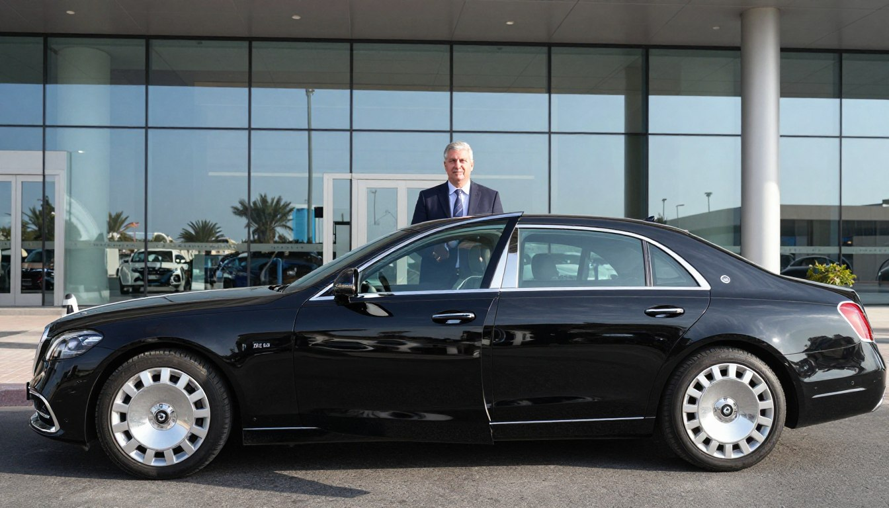

# **Chauffeur Service in Bahrain**

For executive chauffeur service Bahrain journeys are coordinated through AB by booking vetted regional partners on request. Central operations managed from Riyadh oversee every transfer to maintain strict service consistency across the Kingdom of Bahrain.

Each itinerary receives dedicated scheduling support to align vehicle capacity and chauffeur protocol with corporate travel schedules.

[Request a proposal](https://seowriting.ai/quote/tender) [Book a transfer](https://seowriting.ai/locations)

Regional Fleet and Destinations

## **Chauffeur Service Bahrain Coverage and BAH Airport Transfers**

AB structures executive limousine service and private driver itineraries across major business districts through an established network of licensed operators. Clients reserve car with driver options ranging from executive car service on an hourly chauffeur basis for business travel to full day hire for VIP transport delegations. All assignments are dispatched through our central control desk to align vehicle types with passenger requirements. Review Gulf coverage on [Locations](https://seowriting.ai/locations) to coordinate regional transfers.

- Manama: Financial Harbour, diplomatic quarter, and corporate office transfers in executive sedan or luxury car options.
- Muharraq: Heritage sites, coastal logistics districts, and direct connections managed with professional chauffeur standards.
- Riffa: Diplomatic residences, golf club appointments, and executive meetings served by spacious SUV models.
- Bahrain International Airport (BAH): Punctual airport transfer services with terminal meet and greet plus real time flight tracking.

Operational Workflow

## **How Partner Trips Work in Bahrain**

### **Request**

Submit your itinerary through our booking desk with vehicle preferences and passenger details. Our Riyadh dispatch team reviews route specifics, flight numbers, and timing to prepare an accurate proposal.

### **Plan and Vet**

Operations specialists allocate an audited local partner with an insured luxury fleet. Chauffeur credentials, vehicle condition, and licensing receive verification before trip confirmation to maintain duty of care standards.

### **Operate and Report**

The driver arrives before the scheduled time while dispatch monitors progress through 24/7 flight tracking and route management. Your booking coordinator delivers immediate completion reports upon drop off.

Quality Protocol

## **Chauffeur Service Bahrain Partner Fleet Standards**

Every partner vehicle deployed across Bahrain meets strict executive benchmarks for presentation, mechanical safety, and passenger comfort. Local fleets supply premium sedan choices like the Mercedes S Class, executive SUV options including the Cadillac Escalade or GMC Yukon, and group transport in the Mercedes V Class or executive van. Chauffeurs are licensed, background checked, commercially insured, and trained in discreet protocol for corporate transport Bahrain requirements.

## **Frequently Asked Questions**

### **How does AB coordinate airport transfer Bahrain arrivals at Bahrain International Airport (BAH)?**

AB manages every Bahrain International Airport (BAH) transfer by tracking flight status live from the Riyadh operations centre. The allocated chauffeur arrives inside the terminal with an executive meet and greet name board. The driver assists with luggage before escorting passengers to their pre arranged vehicle.

### **What vehicle categories are available for chauffeur service in Bahrain?**

Vetted partners provide a versatile fleet suitable for business travel and VIP transport delegations across the country. Available models include executive sedan options such as the Mercedes S Class, luxury SUV transport like the Cadillac Escalade or GMC Yukon, and spacious Mercedes V Class vans for executive groups.

### **Are cross border transfers between Bahrain and Saudi Arabia possible?**

Yes, cross border transfers connecting Bahrain and Saudi Arabia via the King Fahd Causeway are coordinated upon request. AB plans route timing, vehicle clearance protocols, and driver scheduling from Riyadh. Both point to point transfers and multi city corporate transport itineraries can be arranged with our operations team.

### **How far in advance should corporate travel bookings be requested?**

We recommend booking corporate travel itineraries at least twenty four hours in advance to confirm chauffeur vetting and vehicle readiness. For major events, multi vehicle roadshows, or VIP delegations, earlier reservations allow our central dispatch desk to coordinate detailed scheduling, security requirements, and dedicated dispatch reporting.

### **How does AB verify partner standards for chauffeur service across Bahrain?**

AB audits every local supplier against comprehensive service benchmarks before dispatching client trips. Local chauffeurs must hold valid commercial driving licences, complete background checks, and maintain professional protocol training. Vehicles must be fully insured, meticulously valeted, and under three years of age for reliable operations.

## **Book Chauffeur Service Bahrain for Corporate Travel**

Coordinate executive ground transport across Bahrain with vetted partner fleets and 24/7 Riyadh operations management by submitting your travel itinerary today.

[Request a proposal](https://seowriting.ai/quote/tender) [Book a transfer](https://seowriting.ai/locations)