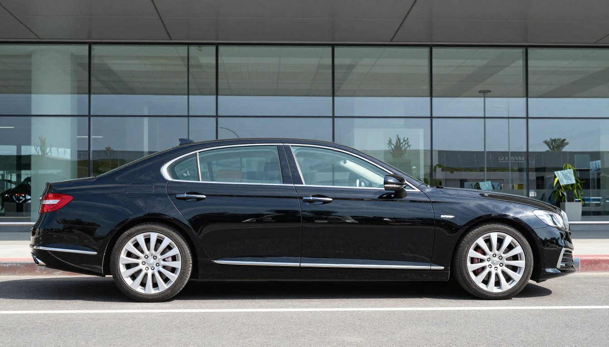
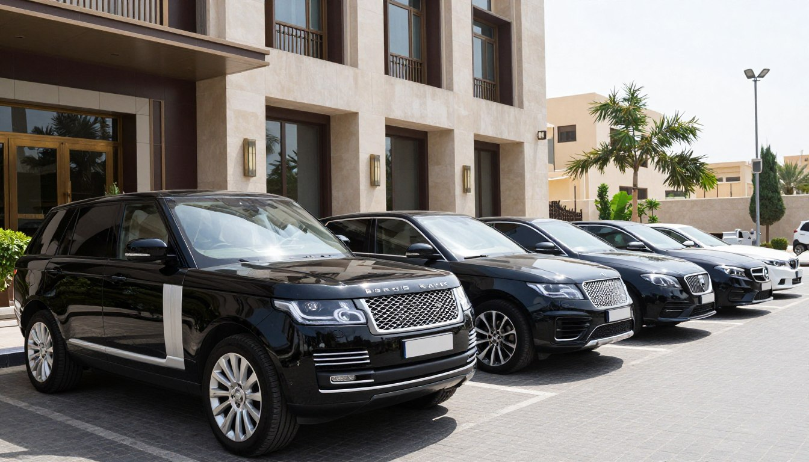
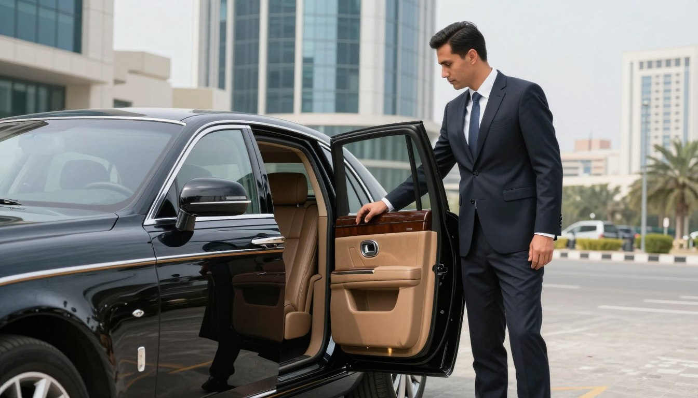

# **Chauffeur Service in Kuwait**

AB coordinates executive chauffeur service Kuwait travel on request through vetted local partners, managed from Riyadh. Operations controllers supervise every schedule to maintain smooth business transport.

Active flight tracking and rigorous vehicle audits support seamless airport transfers for visiting delegations. Central dispatch coordinates each itinerary with 24/7 accountability.

[Request a proposal](https://seowriting.ai/quote/tender) [Book a transfer](https://seowriting.ai/quote/tender)

Executive Fleet and Coverage

## **What Chauffeur Service Kuwait and KWI Transfers Include**

Ground transport coordinators organise executive travel schedules for delegations, corporate roadshows and individual VIP transport across major commercial areas. Available fleets feature the Mercedes S Class sedan, Cadillac Escalade SUV, GMC Yukon SUV and Mercedes V Class luxury van, accompanied by a licensed professional chauffeur. Whether arranging an executive car service or specialized limousine service, coordinators access full regional coverage through the [Locations](https://seowriting.ai/locations) directory.

- Kuwait City: Downtown corporate transport Kuwait assignments, financial district office visits, diplomatic protocol movements and hourly chauffeur hire for executive meetings.
- Hawalli: Commercial transfers, shopping district appointments and flexible private driver car with driver bookings across busy mixed use avenues.
- Farwaniya and Al Ahmadi: Industrial facility visits, oil sector corporate travel, government sites and full day hire itineraries across vital economic zones.
- Kuwait International Airport (KWI): Punctual airport transfer Kuwait solutions, meet and greet arrivals, luggage handling and live flight tracking across terminals.

Premium vehicles selected for executive transfers across Kuwait City and surrounding business districts.

Operating Model

## **How Partner Trips Work in Kuwait**

### **Request**

Submit itinerary details, passenger manifests and vehicle preferences to our central reservation team. Dispatch specialists calculate transfer timings, review regional traffic patterns and assign appropriate luxury car categories tailored to your schedule.

### **Plan and Vet**

The Riyadh operations centre audits local partner compliance, driver credentials and vehicle maintenance standards. Assigned chauffeurs receive full route briefings, while vehicle cleanliness and comprehensive commercial insurance are confirmed prior to passenger collection.

### **Operate and Report**

Chauffeurs arrive ahead of schedule for seamless execution. The 24/7 central desk tracks vehicle progress in real time, delivers passenger movement updates to travel coordinators and generates transparent billing upon mission completion.

Quality Assurance

## **Kuwait Partner Standards for Professional Chauffeur Delivery**

AB enforces demanding criteria for partner networks supporting corporate transport Kuwait operations, requiring late model sedan, SUV and luxury van fleets with comprehensive commercial insurance. Every professional chauffeur demonstrates English proficiency, defensive driving skills and immaculate executive presentation throughout the journey. Central management from the AB Riyadh headquarters at Building 3036, Office 08, 2nd Floor, Umar Ibn Abdulaziz Road, Al Malaz (+966 58 111 8720) maintains continuous compliance for every itinerary.

Central dispatch from Riyadh verifies driver licensing, commercial insurance and vehicle condition before approving any partner trip across Kuwait.

Professional chauffeurs meet rigorous presentation and safety benchmarks for every itinerary.

## **Frequently Asked Questions About Kuwait Chauffeur Services**

### **How does AB coordinate chauffeur service in Kuwait without a local branch?**

AB manages Kuwait operations directly through its 24/7 Riyadh headquarters, partnering with vetted local fleet operators. Central dispatch oversees itinerary scheduling, chauffeur selection, live tracking and corporate invoicing to deliver reliable ground transportation for every booking.

### **What is included in a Kuwait International Airport (KWI) transfer?**

Every Kuwait International Airport (KWI) transfer includes active flight monitoring, terminal meet and greet services and luggage assistance. Chauffeurs adjust arrival times to actual flight landings, welcoming incoming passengers in the arrivals hall before escorting them to their waiting vehicle.

### **Which vehicle classes are available for corporate transport Kuwait bookings?**

Clients can reserve executive sedans like the Mercedes S Class, full size SUVs including the Cadillac Escalade and GMC Yukon, or spacious Mercedes V Class vans. All vehicles are late model units maintained to executive standards with climate control and bottled water.

### **Can corporate clients reserve an hourly chauffeur or full day hire?**

Yes, AB coordinates hourly chauffeur services and full day hire packages across Kuwait for roadshows, multiple client meetings and event travel. Dedicated chauffeurs remain on standby throughout the booked period, offering total schedule flexibility as business requirements evolve.

### **How far in advance should clients book chauffeur service Kuwait itineraries?**

Booking at least 24 hours in advance allows dispatchers to select the optimal vehicle class and complete partner vetting. For large delegation movements or specialized corporate tenders, teams can submit requests through our [Tender and Contract Requests](https://seowriting.ai/quote/tender) department.

## **Book Chauffeur Service Kuwait Travel**

Arrange reliable executive ground transport across Kuwait with central dispatch management from Riyadh and vetted local premium vehicles.

[Request a proposal](https://seowriting.ai/quote/tender) [Book a transfer](https://seowriting.ai/quote/tender)