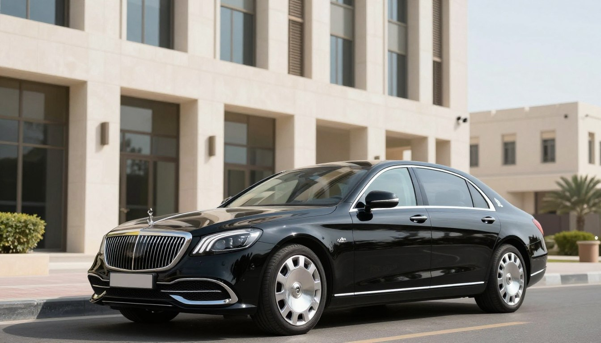

# **Chauffeur Service in Oman**

AB arranges every executive chauffeur service Oman journey on request through vetted partners, planned from Riyadh headquarters for corporate and protocol delegations. This managed network provides reliable ground transport across Oman with continuous trip supervision.

Centralised coordination from the operations centre maintains rigorous service standards for every cross border itinerary.

[Request a proposal](https://seowriting.ai/quote/tender) [Book a transfer](https://seowriting.ai/locations)

Coverage and Fleet

## **Executive Chauffeur Service Oman Capabilities**

AB coordinates executive ground transportation throughout the Sultanate for business travel, VIP transport and official delegations. Partner operations cover major commercial zones, industrial ports and international arrival terminals. Corporate transport Oman solutions include dedicated airport transfers, full day hire and hourly chauffeur bookings. Chauffeurs operate premium limousine service fleets including the Mercedes S Class, Cadillac Escalade, GMC Yukon and Mercedes V Class, supporting travel managers with flight tracking and terminal meet and greet services.

- Muscat: Private driver arrangements and corporate mobility across the capital, linking government ministries, diplomatic quarters and commercial districts.
- Salalah: Executive car service options for southern regional visits, port facilities and commercial operations throughout Dhofar.
- Sohar: Industrial hub transport supporting maritime logistics, trade corridors and corporate visits to northern manufacturing centres.
- Muscat International Airport (MCT): Dedicated airport transfer Oman journeys and MCT arrivals with meet and greet service, flight tracking and direct onward transit.

Operational Workflow

## **How Chauffeur Service Oman Bookings Operate**

### **Request**

Submit itinerary specifications through the central dispatch office or via our portal at [quote/tender](https://seowriting.ai/quote/tender). Detail passenger manifests, vehicle preferences, flight numbers and schedule requirements across Oman.

### **Plan and vet**

The Riyadh operations centre reviews partner availability, audits driver documentation and verifies vehicle maintenance history. Chauffeurs assigned to the trip hold active commercial insurance, clean safety credentials and protocol background clearance.

### **Operate and report**

Local chauffeurs execute journeys with real time flight monitoring and 24/7 central oversight. Dispatchers track transit progression from Riyadh, providing consolidated billing and route completion summaries to travel managers.

Quality Assurance

## **Safety and Fleet Standards for Chauffeur Service Oman**

AB enforces strict operational standards across all partner networks in Oman. Every private driver undergoes comprehensive vetting, identity confirmation and local route assessments. Vehicles in service, including luxury sedan, SUV and executive van models, remain fully licensed, insured and subject to regular mechanical inspections. Operating teams maintain strict non smoking policies, spotless interior presentation and professional etiquette to protect passenger comfort and security on every road.

Client Enquiries

## **Frequently Asked Questions About Oman Travel**

### **How does AB deliver chauffeur service in Oman without a local branch?**

AB manages Oman journeys through rigorously vetted transportation partners while maintaining 24/7 centralised operations from Riyadh. Direct oversight covers driver verification, vehicle selection and schedule tracking. Clients communicate with their dedicated AB account manager and receive single source invoicing without managing secondary suppliers.

### **What does a Muscat International Airport (MCT) transfer include?**

A Muscat International Airport (MCT) transfer includes personalised meet and greet service inside the arrivals terminal, luggage assistance and automated flight tracking. The professional chauffeur adjusts arrival timing for flight delays. Passengers proceed directly to an executive vehicle for onward transit to Muscat hotels or corporate offices.

### **Which vehicle classes are available for corporate transport across Oman?**

Available vehicles include premium sedans such as the Mercedes S Class, full size SUVs such as the Cadillac Escalade and GMC Yukon, and spacious vans such as the Mercedes V Class. Every vehicle meets strict age limits, commercial licensing and insurance standards to support executive business travel across the Sultanate.

### **Can clients arrange full day hire or intercity journeys from Muscat to Sohar?**

Yes, full day hire and intercity transfers are available on advance request. Chauffeurs handle multi stop corporate itineraries between Muscat, Sohar, Nizwa and regional commercial hubs. Central dispatch in Riyadh coordinates timing, driver rotation and logistics to support productive business travel throughout the day.

### **How far in advance should an executive car service booking be requested?**

Because trips in Oman are fulfilled through vetted affiliate partners, submitting booking requests at least \[Confirm: advance notice requirement\] prior to departure is recommended. This window permits central dispatch to verify vehicle readiness, complete driver security checks and coordinate terminal access protocols.

## **Book Your Chauffeur Service Oman Transfer**

Coordinate your executive ground transportation across Oman through AB central operations in Riyadh.

[Request a proposal](https://seowriting.ai/quote/tender) [Book a transfer](https://seowriting.ai/locations)