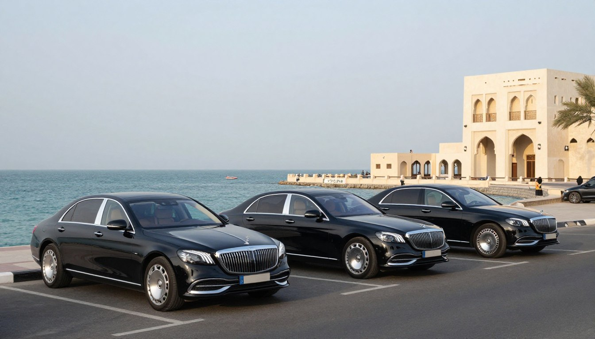
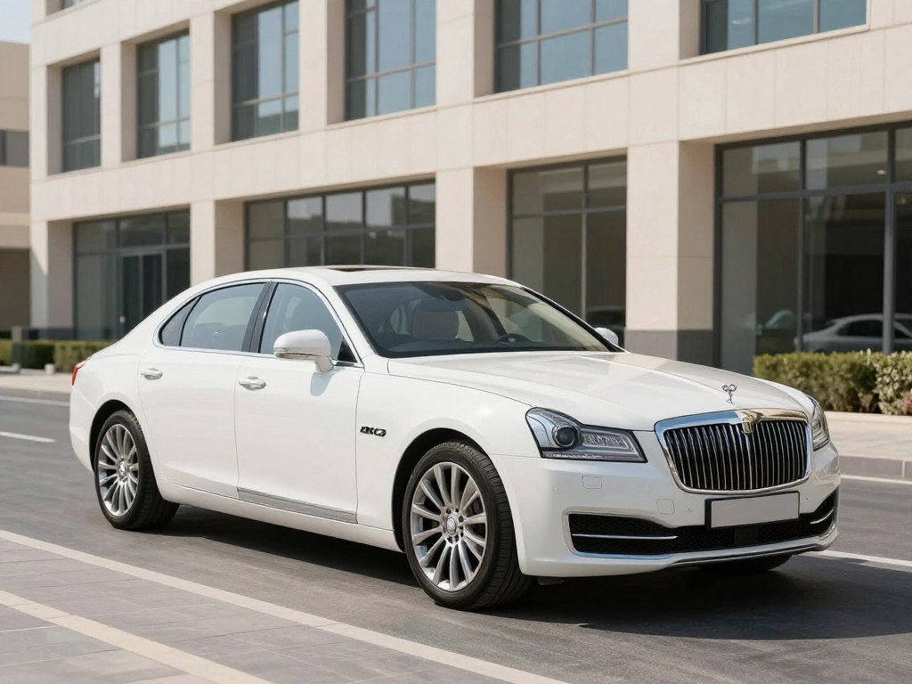
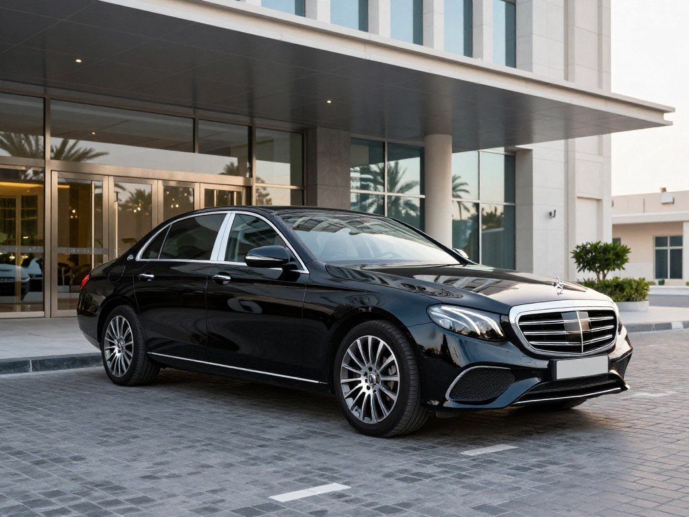
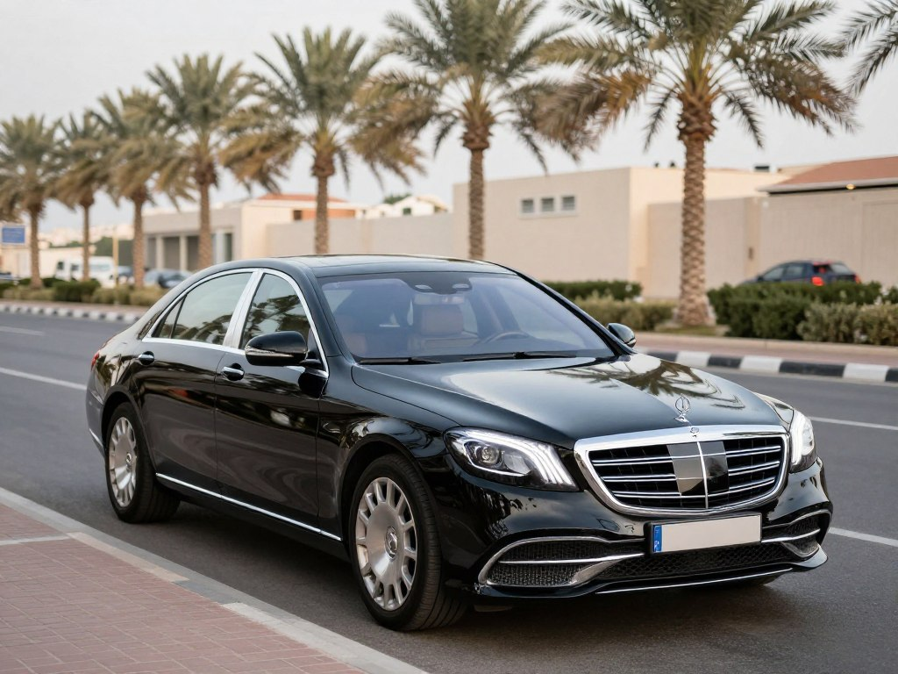
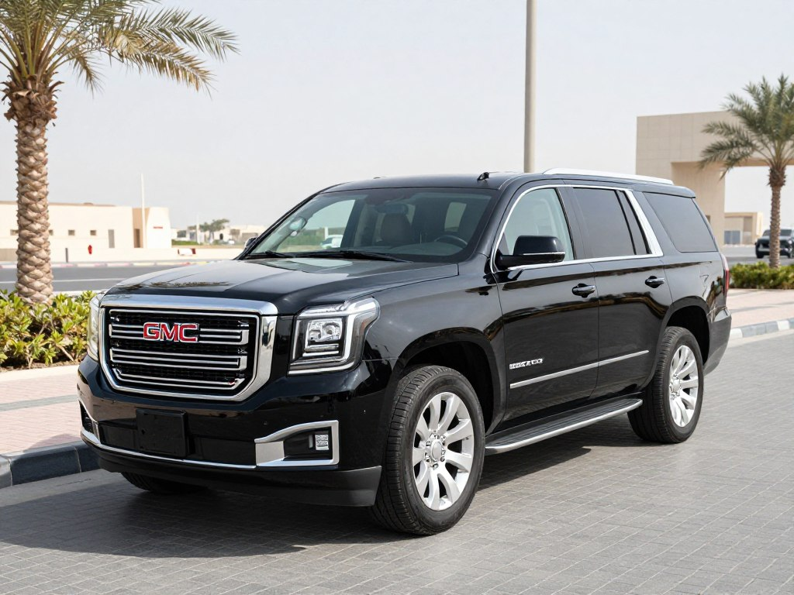
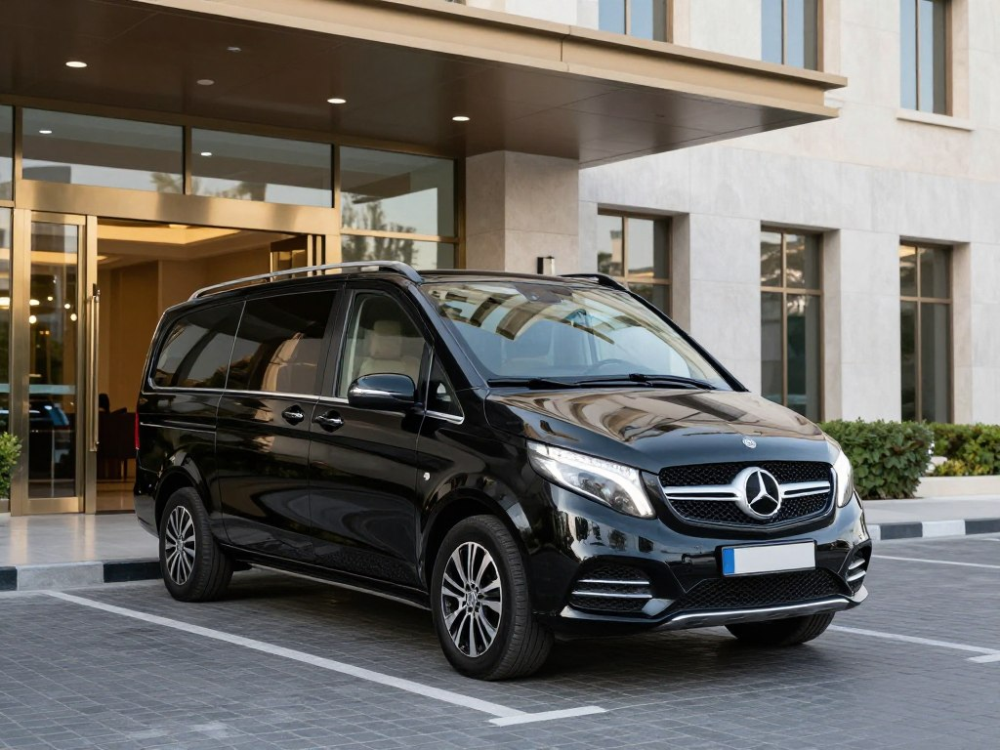
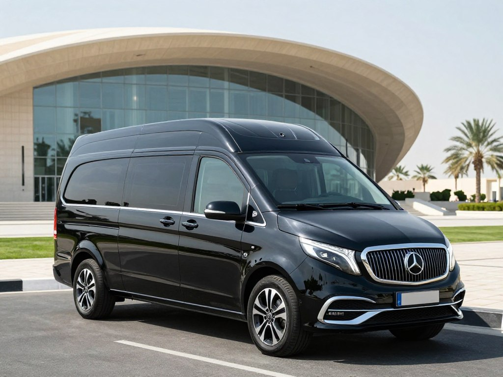

# **Chauffeur Service in Al Wakrah**

Professional chauffeur service Al Wakrah connects corporate travelers and delegations seamlessly between coastal headquarters, local venues and regional transport terminals. AB coordinates every private journey across Al Wakrah and Hamad International Airport (DOH) with meticulous operational control, licensed drivers and pristine executive vehicles.

Direct vehicle dispatch from the regional operations office supports punctual transfers, detailed flight monitoring and tailored transport schedules for business delegations visiting the southern coast of Qatar. Every booking benefits from centralised protocol oversight, comprehensive insurance coverage and discreet chauffeur etiquette.

Book now View the fleet

**Quick Reservation Inquiry:** Pick up: Hamad International Airport (DOH) | Drop off: Al Wakrah Souq, Al Wakrah | Date and time: Scheduled upon request. Get a quote

The Al Wakrah fleet

## **Choose your Al Wakrah chauffeur class**

Vehicles for Al Wakrah are dispatched from the nearest office, AB Doha. Each vehicle undergoes rigorous mechanical inspection and sanitisation before departure to uphold uncompromising safety standards.

### **Standard Sedan**

Sedan · 3 guests · 2 bags

Typical model: Toyota Camry or similar \[Confirm\]

Ideal for: Daily corporate business commutes

Punctual point to point city transfers across Al Wakrah offer dependable comfort and efficiency for business professionals requiring seamless urban transport.

Book this class

### **Business Sedan**

Sedan · 3 guests · 2 bags

Typical model: Mercedes E Class or similar \[Confirm\]

Ideal for: Executive travel and airport runs

This premium saloon delivers refined leather seating, acoustic insulation and quiet working conditions for executives travelling between Doha and Al Wakrah.

Book this class

### **First Class Sedan**

Flagship sedan · 3 guests · 2 bags

Typical model: Mercedes S Class or similar \[Confirm\]

Ideal for: VIP delegations and diplomatic transport

Delivering superior prestige, our flagship saloon provides VIP passengers visiting Al Wakrah with supreme rear cabin climate regulation and ultimate road smoothness.

Book this class

### **Executive SUV**

SUV · 6 guests · 5 bags

Typical model: GMC Yukon, Cadillac Escalade or similar \[Confirm\]

Ideal for: Families, leadership teams and luggage

Spacious luxury utility vehicles accommodate generous luggage capacities while providing commanding road visibility and plush leather seating across southern Qatar.

Book this class

### **Premium MPV**

MPV · 6 guests · 5 bags

Typical model: Mercedes V Class or similar \[Confirm\]

Ideal for: Small working groups and roadshows

Featuring versatile conference seating layouts, this mobile office allows teams to hold discussions comfortably while travelling to meetings throughout Al Wakrah.

Book this class

### **Executive Van**

Van · 14 guests · 10 bags

Typical model: Mercedes Sprinter or similar \[Confirm\]

Ideal for: Corporate delegations and event support

Engineered for large delegations, this executive transporter manages group movements efficiently with generous standing room, individual climate vents and vast cargo volume.

Book this class

Popular journeys

## **Across Al Wakrah and beyond**

Transparent flat rates and fixed schedules simplify journey planning between Al Wakrah, nearby transport terminals and industrial centres. A dedicated private driver Al Wakrah delivers consistent punctuality and local route expertise on every deployment.

Airport transfer

### **DOH to Al Wakrah Souq**

Direct terminal pick up connecting arrivals to historic heritage hotels, seaside dining and the traditional seaside promenade.

From \[QAR price\]

Intercity

### **DOH to Mesaieed**

Seamless industrial transfer connecting international arrivals at the airport directly to the Mesaieed Industrial City facilities.

From \[QAR price\] · \[Confirm\] hours

City

### **Al Wakrah to Al Janoub Stadium**

Rapid point to point event transit serving international sporting fixtures, VIP athletic conferences and corporate hospitality gatherings.

From \[QAR price\]

Intercity

### **Al Wakrah to Doha**

Efficient corridor journeys linking southern residential and commercial quarters to central ministries, West Bay towers and financial districts.

From \[QAR price\] · \[Confirm\] hours

Intercity

### **Al Wakrah to Mesaieed**

Specialised corporate transit designed for engineers, plant supervisors and energy consultants travelling between southern coastal nodes.

From \[QAR price\] · \[Confirm\] hours

Discover regional mobility options and long distance pricing on our [intercity transfers](https://seowriting.ai/services/intercity-transfers) service page.

Services in Al Wakrah

## **One partner for every movement in Al Wakrah**

AB provides coordinated ground transport solutions that fulfill complex enterprise schedules and personal travel itineraries across southern Qatar.

- Chauffeur & VIP in Al Wakrah: Discrete executive saloon hire, diplomatic motorcades and personal protection transport for high profile principals.
- Bus & Coach Hire in Al Wakrah: High capacity transport logistics and group charters arranged through our specialised [bus rental Al Wakrah](https://seowriting.ai/services/bus-coach-hire/qatar/al-wakrah) services.

Whether reserving an hourly chauffeur Al Wakrah for multivenue municipal meetings or scheduling corporate shuttles, ground logistics operate with complete transparency and real time dispatch monitoring.

Airport transfers

## **Arriving at Hamad International Airport (DOH)**

Arriving travelers benefit from integrated flight tracking that monitors inbound air traffic continuously. Chauffeurs adjust pick up timing to match genuine runway touchdown times, eliminating scheduling confusion caused by holding patterns or early arrivals.

Your designated chauffeur provides a formal meet and greet with a personalised name board directly inside the terminal arrivals hall. The driver assists with heavy luggage handling before escorting passengers to their air conditioned vehicle at meeting point \[Confirm\].

Every commercial airport transfer includes free waiting time \[Confirm\] after flight touchdown, allowing ample opportunity to complete customs, immigration and baggage clearance without financial penalties or rushed exits.

| Service Feature       | Standard Parameter  | Operational Scope                                                              |
| --------------------- | ------------------- | ------------------------------------------------------------------------------ |
| Flight tracking       | Every arrival       | Automated flight monitoring tracks inbound schedule changes continuously.      |
| Meet and greet        | Inside the terminal | Chauffeurs stand in the arrivals hall displaying personalised name boards.     |
| DOH to Al Wakrah Souq | \[Confirm\] minutes | Direct coastal highway routes ensure prompt arrivals at heritage destinations. |

Coverage

## **Where we work in Al Wakrah**

Executive transport coverage extends across all commercial, administrative and recreational zones within the municipality. Experienced chauffeurs maintain thorough awareness of southern road corridors, port entry regulations and maritime logistics areas.

### **Business**

Barwa City, Ezdan Mall Al Wakrah, Commercial Avenue South.

### **Events and conferences**

Al Janoub Stadium, Al Wakrah Sports Club, Souq Al Wakra Hotel Conference Suites.

### **Heritage and leisure**

Al Wakrah Old Souq, Al Wakrah Public Beach, Al Wakrah Heritage Village.

**Government and Industry:** Mesaieed Port Access Corridor, Al Wakrah Municipality Complex, Al Wakra Hospital Medical Campus.

Our office

## **Regional dispatch and operations for Al Wakrah**

AB is a managed ground transportation company headquartered in Riyadh with offices in Dubai, Abu Dhabi and Doha. Operations feature 24/7 dispatch coordination from the central Riyadh facility, directly serving Saudi Arabia, all seven UAE emirates and Qatar. Mobility services across Bahrain, Kuwait and Oman are available on request through vetted regional partners.

**AB Doha (Nearest Operating Office):**

Office 110, Building 100, Zone 26, Street 310, Old Airport Road, Doha, Qatar

Direct telephone: +974 7734 3300

Get directions

Questions

## **Chauffeur service in Al Wakrah: your questions**

### **How does your chauffeur service Al Wakrah handle airport pick ups at DOH?**

Flight monitoring systems track your inbound aircraft into Hamad International Airport (DOH) in real time. Your chauffeur meets you in the arrival concourse holding an identification tablet and assists with baggage before escorting you to your vehicle.

### **Can I reserve a car with driver Al Wakrah on an hourly basis?**

Flexible hourly bookings permit clients to retain an executive car with driver Al Wakrah for multivenue itineraries, recurring site visits or municipal meetings. Vehicles remain entirely at your disposal throughout the contracted duration with dedicated route adjustments.

### **What vehicle classes are available for limousine service Al Wakrah?**

Our managed limousine service Al Wakrah provides premium sedans, executive sport utility vehicles and spacious luxury vans. All vehicle categories feature leather seating, advanced climate regulation, complimentary mobile connectivity and bottled mineral water.

### **How are bookings arranged for an intercity transfer Al Wakrah to industrial zones?**

Corporate accounts can schedule an intercity transfer Al Wakrah directly through our Doha operations centre. Chauffeurs facilitate seamless passenger transit from urban Al Wakrah hotels to industrial sectors in Mesaieed, Ras Laffan or central Doha commercial districts.

### **Are private drivers in Al Wakrah fully licensed and commercially insured?**

Every professional private driver Al Wakrah holds official commercial accreditation and comprehensive public liability insurance coverage. Chauffeurs undergo thorough background vetting, executive defensive driving training and rigorous protocol assessments prior to assignment.

## **Your chauffeur is ready in Al Wakrah.**

Reserve an executive car with driver for your upcoming business schedule or coastal itinerary in Qatar. Secure your premium chauffeur service Al Wakrah through our regional dispatch team by calling +974 7734 3300 today.

### **Reserve your executive vehicle in Al Wakrah**

Select your preferred vehicle class or establish a corporate account with dedicated operational oversight.

Request a proposal Book now