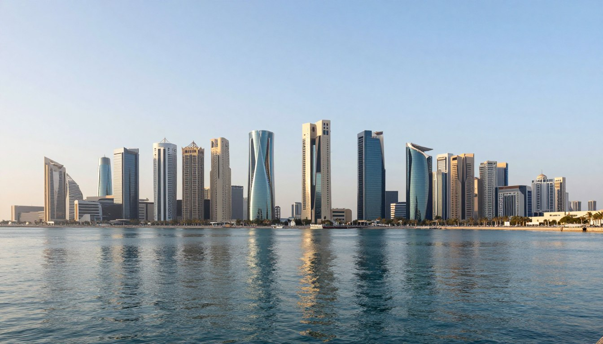
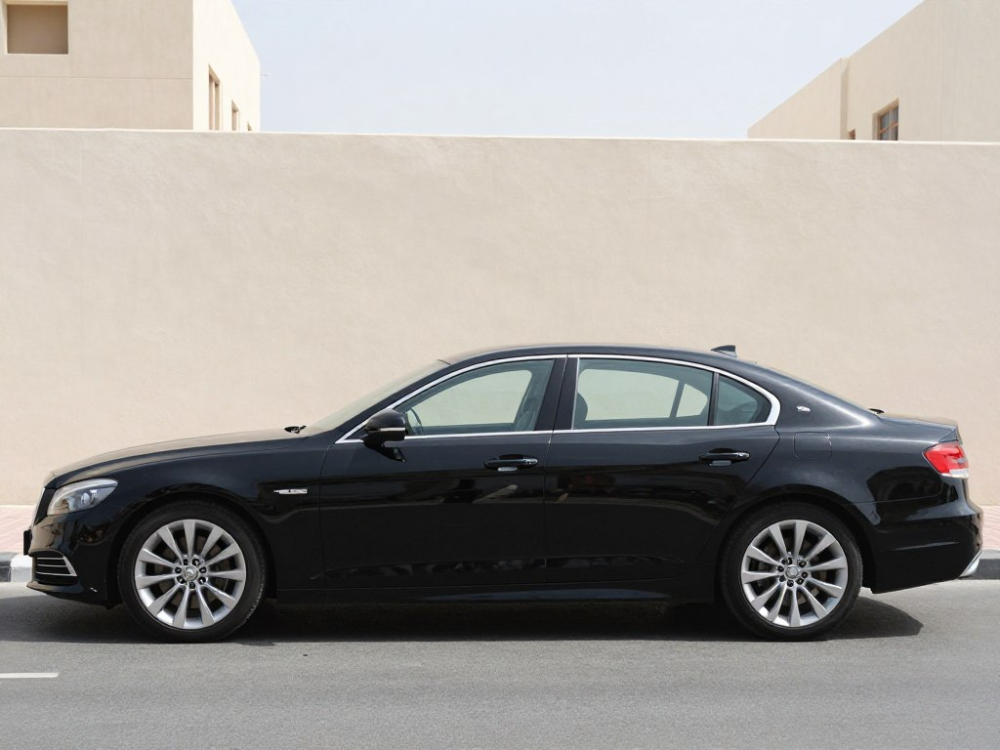
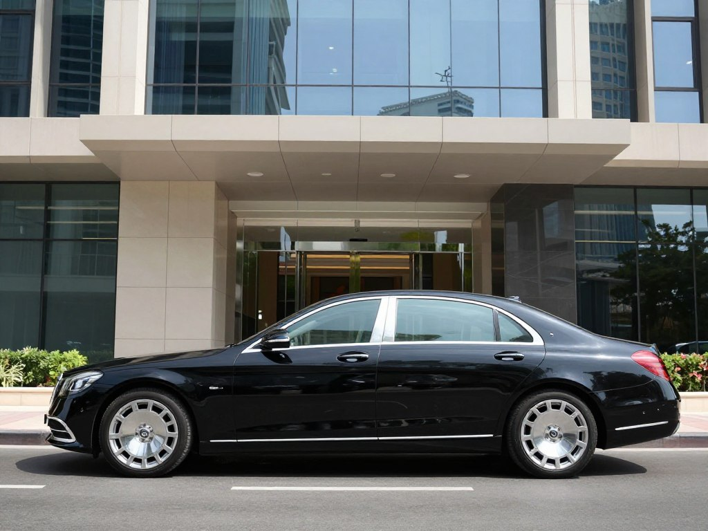
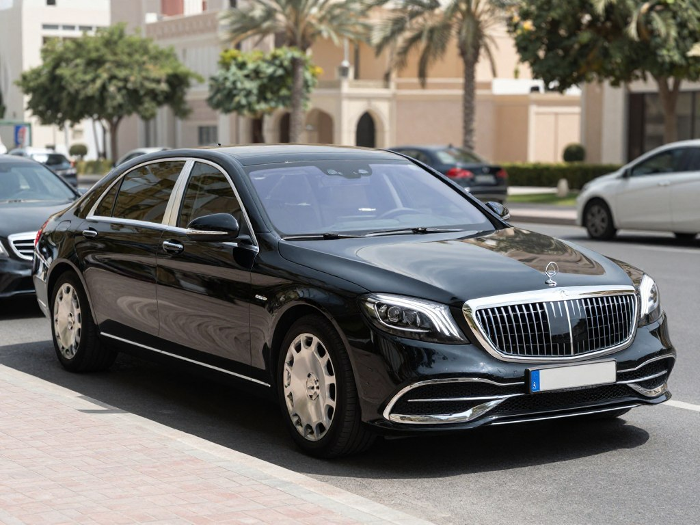
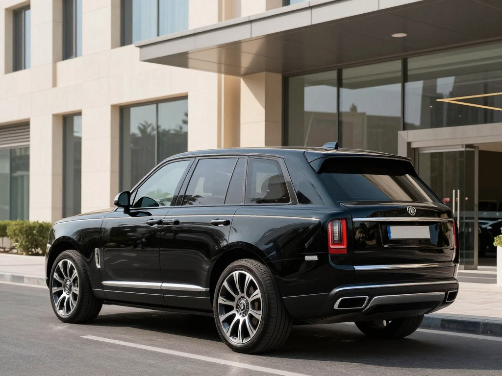
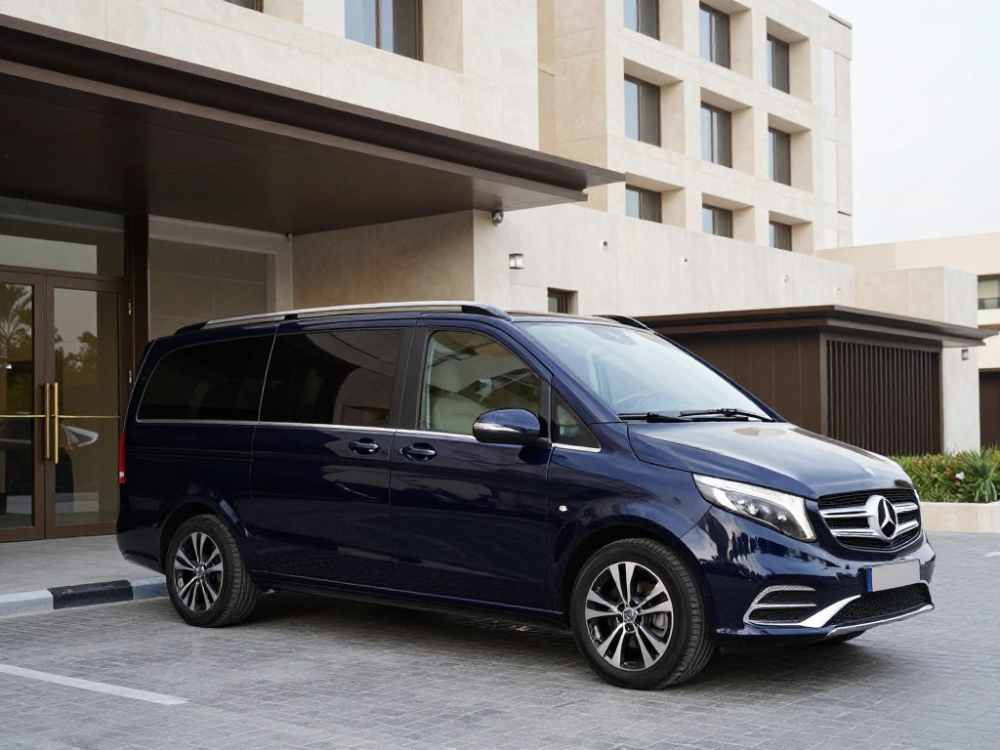
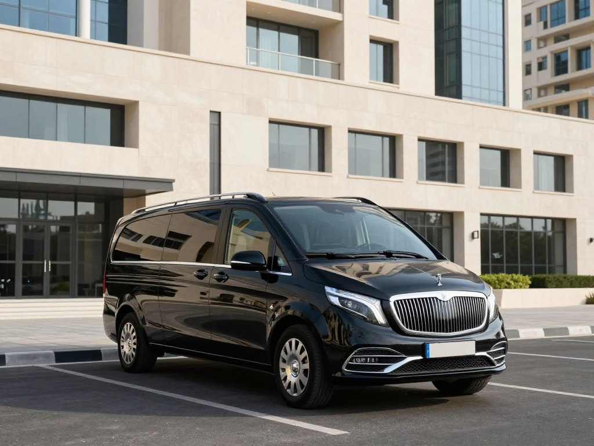

# **Chauffeur Service in Doha**

Professional chauffeur service Doha delivers seamless executive mobility across Qatar, connecting corporate leaders and private guests to key commercial districts with complete discretion. Premium ground travel provides quiet comfort whether arriving for international summits or travelling between downtown boardrooms.

AB coordinates individual and group itineraries from Hamad International Airport (DOH) across the capital. Modern luxury saloons and executive people movers provide pristine cabin environments managed through continuous operational oversight across Doha.

Book now View the fleet

**Pick up:** Hamad International Airport (DOH)

**Drop off:** West Bay, Doha

**Date and time:** Select schedule

Get a quote

The Doha fleet

## **Choose Your Chauffeur Service Doha Fleet Class**

Every vehicle in our Doha fleet is GPS tracked and detailed before each journey to maintain immaculate standards for private and executive travel.

### **Standard Sedan**

Sedan · 3 guests · 2 bags

Typical model: Toyota Camry or similar \[Confirm\]

Ideal for efficient individual business travel

Quiet cabins and courteous drivers deliver smooth transfers across commercial zones in Doha. This category suits routine corporate commuting, hotel transfers and daily city meetings without operational friction.

Book this class

### **Business Sedan**

Sedan · 3 guests · 2 bags

Typical model: Mercedes E Class or similar \[Confirm\]

Ideal for executive and corporate mobility

Refined leather interiors and acoustic insulation create an ideal mobile work environment between commercial meetings. A private driver Doha provides dependable navigation through busy city traffic.

Book this class

### **First Class Sedan**

Flagship sedan · 3 guests · 2 bags

Typical model: Mercedes S Class or similar \[Confirm\]

Ideal for VIP transport and diplomats

Flagship luxury vehicles offer reclining rear seating, rear climate controls and whisper quiet suspension. Reserving a luxury car with driver Doha delivers world class comfort for executive leaders and dignitaries.

Book this class

### **Executive SUV**

SUV · 6 guests · 5 bags

Typical model: Cadillac Escalade or GMC Yukon or similar \[Confirm\]

Ideal for delegations and family travel

Spacious luggage capacity and commanding cabin height accommodate executive teams with heavy baggage. Our premium limousine service Doha meets the highest requirements for comfort and road presence.

Book this class

### **Premium MPV**

MPV · 6 guests · 5 bags

Typical model: Mercedes V Class or similar \[Confirm\]

Ideal for conference teams and roadshows

Face to face conference seating configurations permit uninterrupted team discussions while in transit. Reserving a car with driver Doha allows working groups to maintain productivity throughout regional event schedules.

Book this class

### **Executive Van**

Van · 14 guests · 10 bags

Typical model: Mercedes Sprinter or similar \[Confirm\]

Ideal for group transfers and delegations

High roof cabins, wide aisles and ample rear storage comfortably support larger event groups and support teams. Coordinated transport keeps entire delegations together during major public gatherings.

Book this class

Popular journeys

## **Across Doha and beyond**

Fixed route transfers provide predictable scheduling between airports, major business hubs and industrial facilities throughout Qatar.

Airport transfer

### **DOH to West Bay**

Direct transfer from airport arrivals to the central business towers and high end hotels.

From \[QAR price\]

Airport transfer

### **DOH to Msheireb**

Seamless connectivity to the smart sustainable downtown district and corporate headquarters.

From \[QAR price\]

City

### **Doha to QNCC**

Timely transfers directly to the Qatar National Convention Centre for global congresses.

From \[QAR price\]

City

### **Doha to The Pearl**

Executive transit to waterfront residences, dining precincts and luxury retail destinations.

From \[QAR price\]

City

### **Doha to Lusail**

Fast transport connecting central Doha to Lusail entertainment city and marina districts.

From \[QAR price\]

City

### **Doha to Al Wakrah**

Reliable transfers to southern commercial offices, historic waterfronts and coastal facilities.

From \[QAR price\]

Intercity

### **Doha to Al Khor**

Direct highway journey serving northern administrative offices and industrial energy projects.

From \[QAR price\] · \[Confirm\] hours

Intercity

### **Doha to Mesaieed \[Confirm\]**

Dedicated long distance transit to the southern industrial city and maritime port facilities.

From \[QAR price\] · \[Confirm\] hours

[Intercity transfers](https://seowriting.ai/services/intercity-transfers)

Services in Doha

## **One partner for every movement in Doha**

AB provides integrated managed transportation solutions tailored to executive travellers, enterprise delegations and international event organisations across Qatar.

- Book a [VIP chauffeur Doha](https://seowriting.ai/services/chauffeur-vip/qatar/doha) for high profile guests, or arrange an executive chauffeur Doha for continuous daily business appointments.
- Coordinate dedicated airport arrivals and departures with real time flight tracking and personalised meet and greet services at the terminal.
- Implement an enterprise [corporate chauffeur service Doha](https://seowriting.ai/services/corporate-transportation/qatar/doha) alongside managed staff transportation Doha for permanent workforce logistics.
- Manage delegate transit through bespoke [event transportation Doha](https://seowriting.ai/services/event-transportation/qatar/doha) for conventions, exhibitions and stadium programs.
- Organise group mobility through [bus rental Doha](https://seowriting.ai/services/bus-coach-hire/qatar/doha), flexible bus hire Doha, regional coach hire Doha, private minibus rental Doha, or structured corporate bus rental Doha.

Airport transfers

## **Arriving at Hamad International Airport (DOH)**

Arriving at Hamad International Airport (DOH) requires punctual ground transport and attentive terminal service. Our operations team monitors every inbound commercial and private flight via live tracking systems, automatically adjusting pickup schedules for early landings or air traffic delays. Your chauffeur welcomes you inside the arrivals hall holding an electronic name board at the designated meeting point \[Confirm\].

Complimentary waiting time \[Confirm\] provides ample opportunity to collect luggage and clear immigration customs at your own pace. Chauffeurs assist with all heavy baggage before escorting you to your air conditioned vehicle parked in the executive transit area. Choosing our chauffeur service Doha removes airport transit delays, providing relaxing transport straight to your hotel or corporate office.

### **Flight tracking**

Every arrival is tracked live to match actual touchdown times.

### **Meet and greet**

Inside the terminal with professional name boards and baggage help.

### **DOH to West Bay**

\[Confirm\] minutes to the financial district under normal traffic conditions.

Coverage

## **Where we work in Doha**

AB delivers reliable coverage across Qatar, providing comprehensive ground mobility throughout key administrative, commercial, cultural and industrial hubs across the metropolitan region.

### **Business**

West Bay financial district

Msheireb Downtown Doha

The Pearl commercial precincts

### **Events and conferences**

Qatar National Convention Centre (QNCC)

Doha Exhibition and Convention Center (DECC)

Lusail Multipurpose Hall

### **Heritage and leisure**

Katara Cultural Village

Souq Waqif

Museum of Islamic Art

**Government and Industry:** Hamad International Airport, Education City, and Ras Laffan administrative transit corridors.

Our office

## **AB in Doha: Managed Operations**

AB maintains local operations in Doha to coordinate executive ground transport across Qatar. Supported by central dispatch and experienced logistics managers, our team manages corporate accounts, government protocol travel and international delegations with precision.

### **AB Doha**

Office 110, Building 100, Zone 26, Street 310, Old Airport Road, Doha, Qatar

+974 7734 3300

Get directions

Questions

## **Chauffeur Service Doha: Your Questions**

### **What is included with your chauffeur service Doha?**

Our chauffeur service Doha includes a professional chauffeur, a fully sanitised luxury vehicle, GPS tracking, commercial insurance and fuel. Passengers receive bottled water and complimentary onboard Wi Fi where fitted. Drivers assist with luggage loading and navigate optimal routes to bypass urban congestion.

### **How does airport pickup work at DOH?**

At DOH, chauffeurs track your flight in real time and enter the arrivals terminal once your aircraft touches down. Your driver waits at the designated meeting point holding a digital name board to assist with baggage. Complimentary waiting time accommodates immigration clearance and baggage collection.

### **Can I reserve an hourly chauffeur Doha for corporate meetings?**

Yes, reserving an hourly chauffeur Doha provides complete flexibility for back to back business meetings and roadshows across the city. Your dedicated driver remains on standby throughout the booked duration, adapting instantly to schedule revisions and route changes without requiring individual booking confirmations.

### **Do you offer intercity transfer Doha services across Qatar?**

Yes, we operate long distance intercity transfer Doha services connecting the capital with major industrial and coastal hubs including Al Khor, Mesaieed, Ras Laffan and Dukhan. Vehicles provide spacious legroom, climate control and smooth highway cruising for uninterrupted passenger comfort.

### **Are vehicles and chauffeurs licensed and insured in Qatar?**

All fleet vehicles hold full commercial licensing and comprehensive insurance coverage in compliance with Qatari transport regulations. Chauffeurs undergo extensive defensive driving assessments, background screening and corporate etiquette training to support passenger safety and security at all times.

### **What vehicles are available for luxury car with driver Doha hire?**

Our fleet features premium executive sedans such as the Mercedes S Class, spacious luxury SUVs like the Cadillac Escalade and GMC Yukon, and executive vans such as the Mercedes V Class. Each vehicle category accommodates specific passenger numbers and baggage requirements.

### **How far in advance should I arrange a private driver Doha?**

Advance booking is recommended to secure your preferred vehicle class, particularly during major international conferences, sporting tournaments and peak travel seasons in Doha. While short notice dispatch is supported through our round the clock operations centre, advance reservations assist seamless logistics.

## **Your chauffeur is ready in Doha.**

Connect with AB 24/7 central dispatch to arrange executive ground transport, airport transfers or delegate movements across Qatar with total operational confidence.

+966 58 111 8720

### **Executive Chauffeur Service Doha**

Reserve premium saloons, executive SUVs or luxury people movers for individual transfers and corporate itineraries across Doha.

Book now Request a proposal