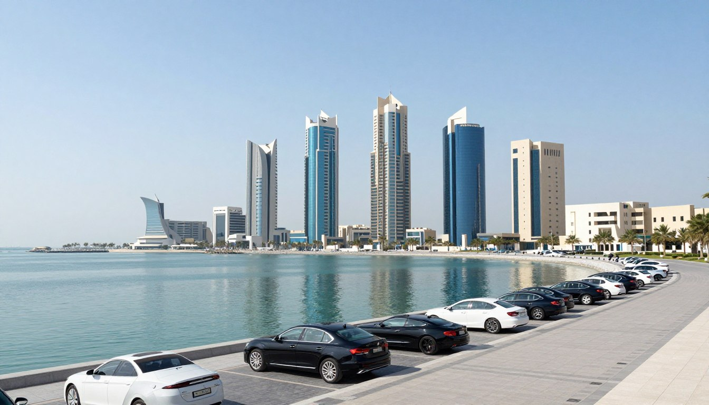
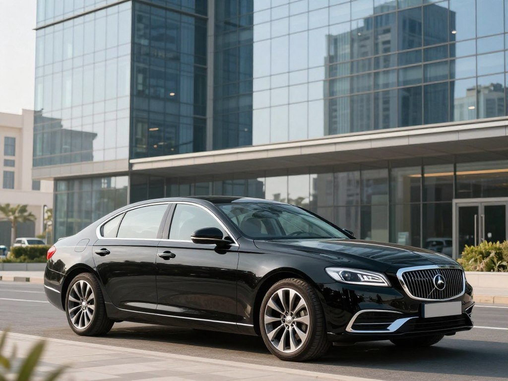
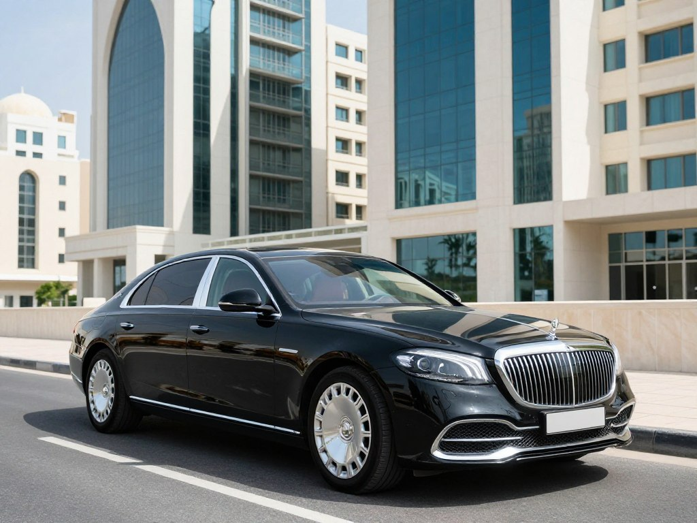
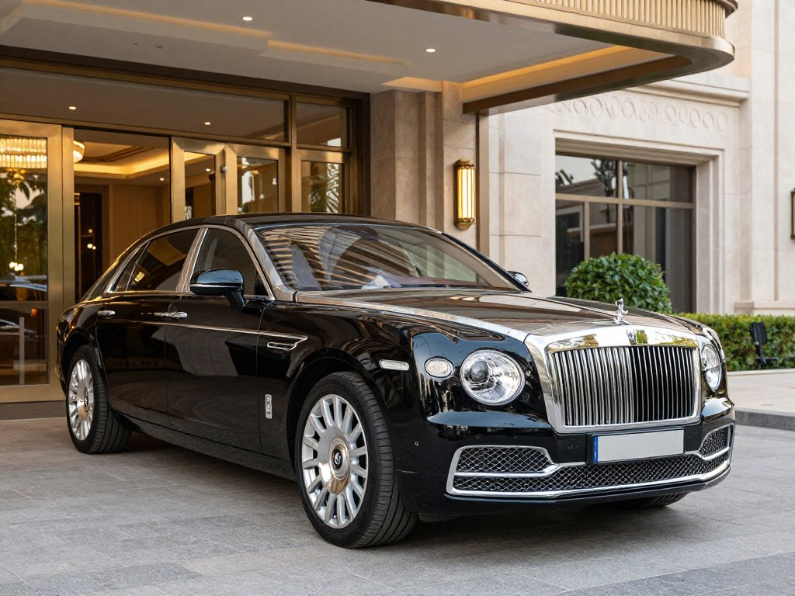
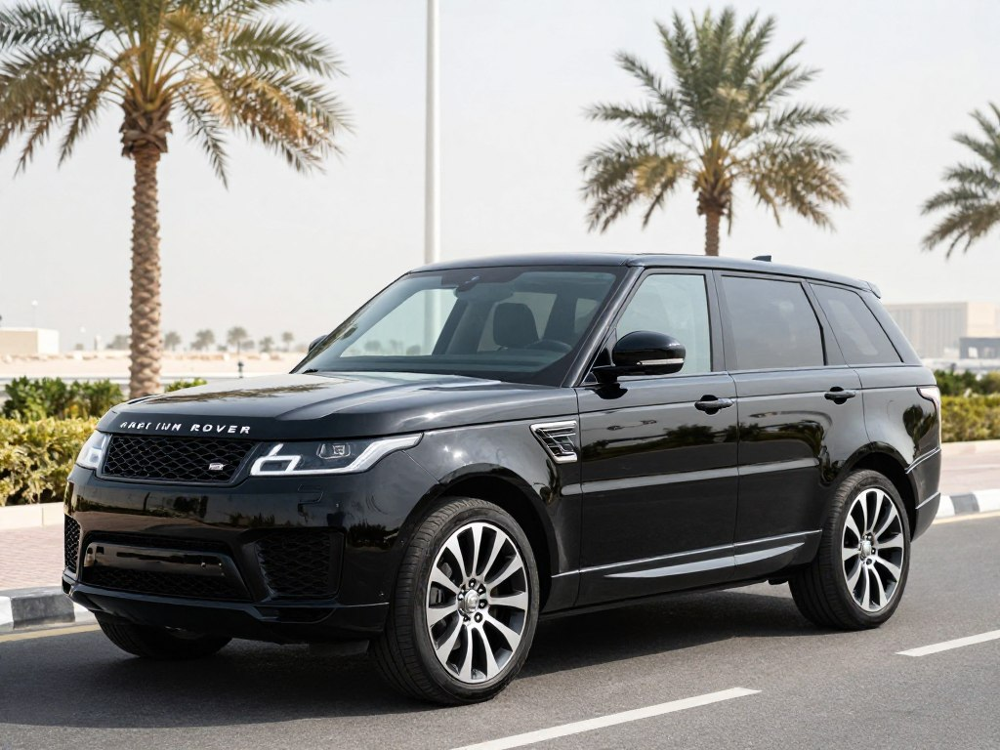
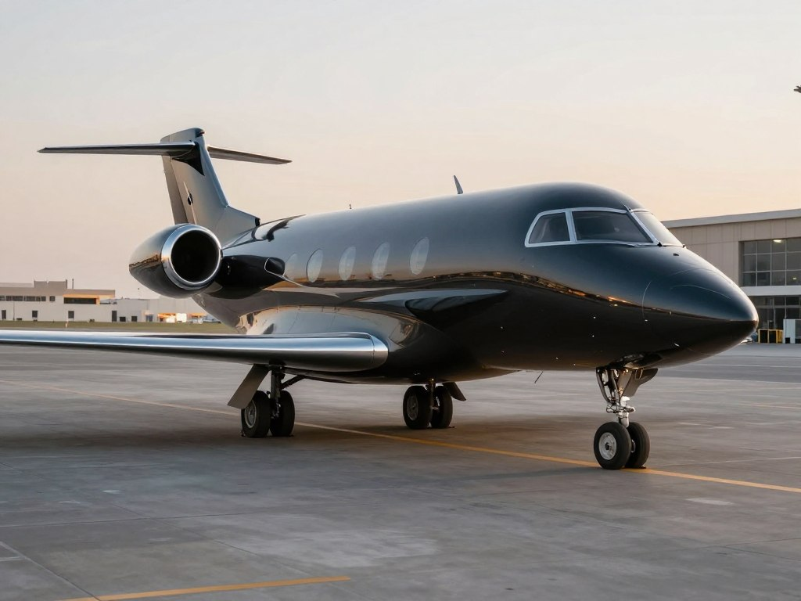
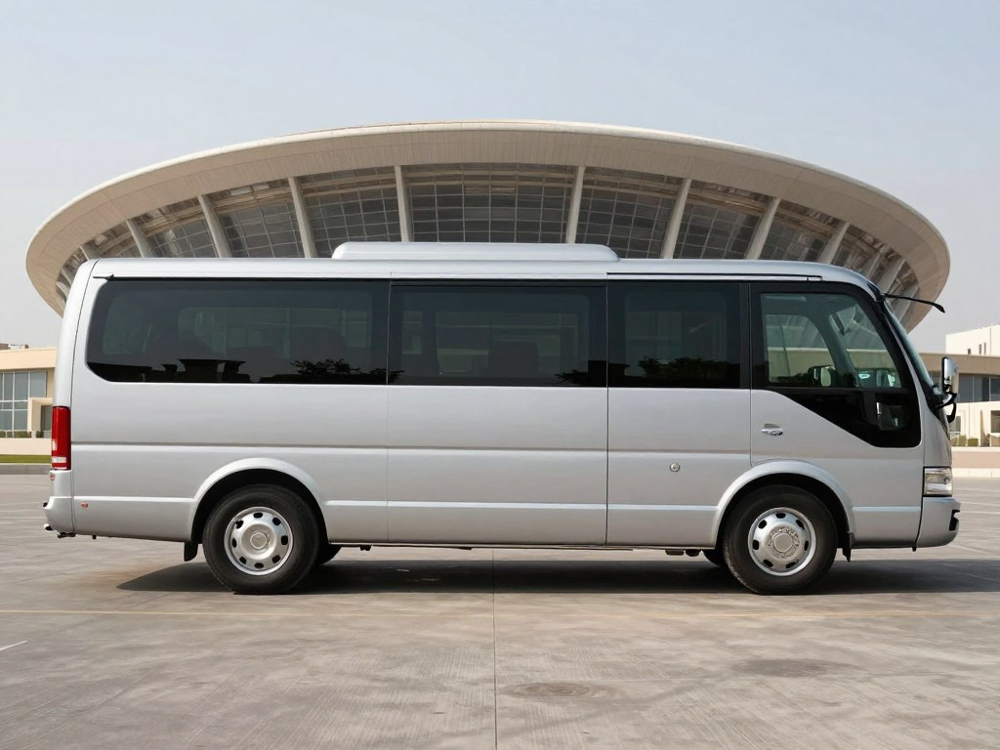

# **Chauffeur Service in Lusail**

AB delivers premium chauffeur service Lusail transport tailored for corporate executives and official delegations across Lusail. Professional drivers connect clients directly to Hamad International Airport (DOH) and central business districts with complete privacy, punctuality and vehicle presentation.

Whether coordinating multi vehicle summits or individual executive transfers, dispatch coordinators align vehicle categories with specific passenger itineraries. Dedicated operations ensure seamless transitions between commercial terminals, private aviation facilities, luxury hotels and conference venues.

[Book now](https://www.ab.limo/locations/qatar/lusail) [View the fleet](https://www.ab.limo/locations/qatar/lusail)

Pick up: Hamad International Airport (DOH)

Drop off: Lusail Marina, Lusail

Date and time: Scheduled upon request

[Get a quote](https://www.ab.limo/locations/qatar/lusail)

The Lusail fleet

## **Choose your Lusail chauffeur class**

Vehicles for Lusail are dispatched from the nearest office, AB Doha, providing impeccably maintained luxury sedans, premium people carriers and executive sport utility vehicles throughout the municipality.

### **Standard Sedan**

Sedan · 3 guests · 2 bags

Typical model: or similar \[Confirm\]

Ideal for: Everyday executive travel and transfers

Quiet and refined travel for individual business visitors arriving in Lusail. Professional drivers manage optimal routing through city avenues, offering leather seating, climate control and bottled water for daily appointments.

[Book this class](https://www.ab.limo/locations/qatar/lusail)

### **Business Sedan**

Sedan · 3 guests · 2 bags

Typical model: or similar \[Confirm\]

Ideal for: Corporate meetings and financial visits

The executive choice for corporate mobility across Lusail commercial precincts. Passengers enjoy mobile charging facilities, generous rear legroom and attentive assistance from an experienced private chauffeur during business visits.

[Request a quote](https://www.ab.limo/locations/qatar/lusail)

### **First Class Sedan**

Flagship sedan · 3 guests · 2 bags

Typical model: or similar \[Confirm\]

Ideal for: VIP hospitality and diplomatic delegations

A flagship saloon providing peerless comfort for ministerial guests and senior executives in Lusail. Features include reclining rear seats, acoustic insulation, fine upholstery and dedicated protocol support.

[Airport transfer](https://www.ab.limo/locations/qatar/lusail)

### **Executive SUV**

SUV · 6 guests · 5 bags

Typical model: or similar \[Confirm\]

Ideal for: Spacious travel with excess luggage

Commanding road presence paired with expansive cargo capacity for families or teams. All wheel drive capability delivers serene transport across modern highways, hotel arrivals and coastal residential developments.

[Hourly chauffeur](https://www.ab.limo/locations/qatar/lusail)

### **Premium MPV**

MPV · 6 guests · 5 bags

Typical model: or similar \[Confirm\]

Ideal for: Executive groups and mobile conferences

Flexible conference seating allows colleagues to collaborate while in transit through Lusail. Luxury appointments, rear privacy glass and effortless boarding suit corporate roadshows and multi stop event itineraries.

[Full specifications](https://www.ab.limo/locations/qatar/lusail)

### **Executive Van**

Van · 14 guests · 10 bags

Typical model: or similar \[Confirm\]

Ideal for: Delegation transport and crew movements

Generous passenger accommodation and luggage space for conference delegations and corporate groups. High roof design and wide aisles allow easy entry for airport pickups and venue transfers.

[Book this class](https://www.ab.limo/locations/qatar/lusail)

Popular journeys

## **Across Lusail and beyond**

Fixed rate transfers connect key transport hubs, administrative districts and sporting facilities across the municipality with absolute schedule adherence.

Airport transfer

### **DOH to Lusail Marina**

Direct transit from Hamad International Airport terminal arrivals to luxury hotels and residential towers overlooking the marina promenade.

From \[QAR price\]

Airport transfer

### **DOH to Lusail Stadium**

Seamless arrivals for international sporting events, major arena fixtures and private corporate hospitality boxes.

From \[QAR price\]

City

### **Lusail to West Bay**

Direct executive transport connecting Lusail corporate offices with Doha primary financial district and ministerial complexes.

From \[QAR price\]

Intercity

### **Lusail to Doha**

Cross municipal transfers connecting coastal Lusail developments with historic central Doha cultural centres and commercial ports.

From \[QAR price\] · \[Confirm\] hours

Airport transfer

### **Lusail to Hamad International Airport (DOH)**

Punctual departures scheduled precisely against airline flight times, delivering passengers straight to departure curbside zones.

From \[QAR price\]

Review scheduling options and vehicle capacities for an [intercity transfer Lusail](https://seowriting.ai/services/intercity-transfers) departure to regional hubs across Qatar.

Services in Lusail

## **One partner for every movement in Lusail**

AB coordinates complete executive mobility, airport transfers and group transit across all commercial zones and leisure waterfronts in Lusail.

- Chauffeur & VIP in Lusail for corporate board members, ministerial delegations and private high net worth individuals.
- Bus & Coach Hire in Lusail for large event shuttles, corporate employee movements and chartered [bus rental Lusail](https://seowriting.ai/services/bus-coach-hire/qatar/lusail) programmes.
- Hourly chauffeur hire providing flexible vehicle and driver availability for fluid business meeting schedules throughout the working day.
- Dedicated event transportation management synchronising multi fleet arrivals for major conventions, sporting championships and brand activations.

Airport transfers

## **Arriving at Hamad International Airport (DOH)**

Stepping off a flight into Hamad International Airport requires smooth ground logistics to reach northern destinations without delay. AB monitors all commercial flights and private aviation movements in real time, automatically adjusting pickup schedules when flight arrival times shift. Upon clearing customs, passengers find their private chauffeur waiting in the arrivals hall with a personalised digital name board.

Your dedicated driver assists with heavy luggage and guides you straight to the vehicle parked at the agreed meeting point \[Confirm\]. To accommodate international arrival procedures and potential immigration queues, every airport pickup includes complimentary free waiting time \[Confirm\]. Travellers experience a relaxing journey directly to corporate towers, residences or luxury waterfront hotels.

Flight tracking: Every arrival

Meet and greet: Inside the terminal

DOH to Lusail Marina: \[Confirm\] minutes

Coverage

## **Where we work in Lusail**

Chauffeurs maintain deep geographical knowledge of all modern developments, residential quarters, commercial parks and road infrastructure throughout Lusail. Strategic route planning avoids peak traffic bottlenecks, delivering swift navigation across the planned smart city.

### **Business**

Lusail Marina corporate precinct

Energy City Qatar headquarters

Marina Twin Towers commercial complex

### **Events and conferences**

Lusail Stadium and surrounding plazas

Lusail Sports Arena

Place Vendôme luxury exhibition corridors

### **Heritage and leisure**

Lusail Boulevard entertainment avenue

Qetaifan Island North beach clubs

Crescent Park landscaped gardens

### **Government or Industry**

Lusail City Hall administrative centre

Ministry of Economy and Commerce building Lusail

Lusail Command and Control Centre

Our office

## **Chauffeur service Lusail operations by AB**

All chauffeured vehicle allocations across Lusail are coordinated through the regional office, AB Doha, supported round the clock by the central operations room. Fleet standards, vehicle sanitisation protocols and driver briefings follow stringent executive hospitality criteria.

### **AB Doha**

Office 110, Building 100, Zone 26, Street 310, Old Airport Road, Doha, Qatar

Telephone: +974 7734 3300

+974 7734 3300

[Get directions](https://www.ab.limo/locations/qatar/lusail)

Questions

## **Chauffeur service Lusail: your questions**

### **How do I book a private driver Lusail service with AB?**

Clients can book transport online by submitting passenger counts, flight details and vehicle preferences through the reservation portal. Alternatively, corporate coordinators can connect with the 24/7 dispatch desk via telephone or email to arrange complex itineraries, recurring executive transfers or multi day roadshow coverage.

### **What is included with an airport transfer from DOH to Lusail?**

Every airport journey includes live flight tracking, personalised terminal meet and greet service, complimentary waiting time \[Confirm\] and professional luggage assistance. Chauffeurs operate immaculately prepared luxury vehicles equipped with bottled water, mobile charging cables and comfortable climate control adjusted to passenger preference.

### **Can I reserve an hourly chauffeur Lusail package for roadshows?**

Yes, AB offers flexible hourly hire arrangements tailored for corporate executives attending multiple meetings across disparate districts. Your private chauffeur remains on site throughout each appointment, ready to depart immediately upon passenger return without the delays associated with point to point rebooking.

### **What vehicles are available for limousine service Lusail bookings?**

The operational fleet incorporates premium German and American vehicles across multiple categories, including executive sedans, flagship luxury saloons, prestige sport utility vehicles and multi passenger executive vans. Every vehicle meets rigorous mechanical and presentation benchmarks prior to dispatch from AB Doha.

### **How does an intercity transfer Lusail booking to other Qatar cities operate?**

A professional car with driver Lusail arrangement provides private, non stop transit between Lusail and key regional hubs such as Al Khor, Mesaieed, Ras Laffan or central Doha. Fixed route pricing provides transparency, allowing corporate travel planners to organise regional staff movements with complete budgetary clarity.

## **Your chauffeur is ready in Lusail.**

Organise dependable ground transport for upcoming visits to Lusail, major conference summits or executive airport arrivals across Qatar. Professional fleet dispatchers ensure each itinerary receives dedicated operational oversight from initial booking confirmation to final curbside destination drop off.

### **Arrange corporate chauffeur service Lusail mobility**

Contact the AB regional dispatch operations team on +974 7734 3300 or submit detailed travel specifications online to confirm your vehicle allocation.

[Book now](https://www.ab.limo/locations/qatar/lusail) [Request a proposal](https://www.ab.limo/locations/qatar/lusail)