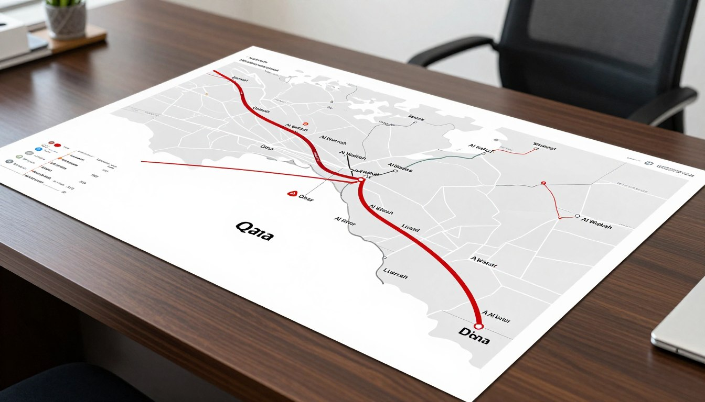
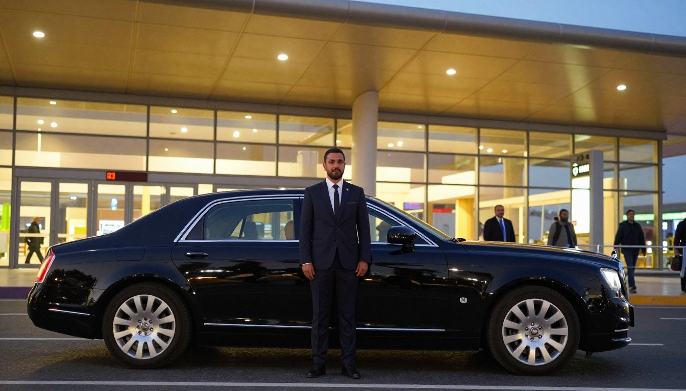
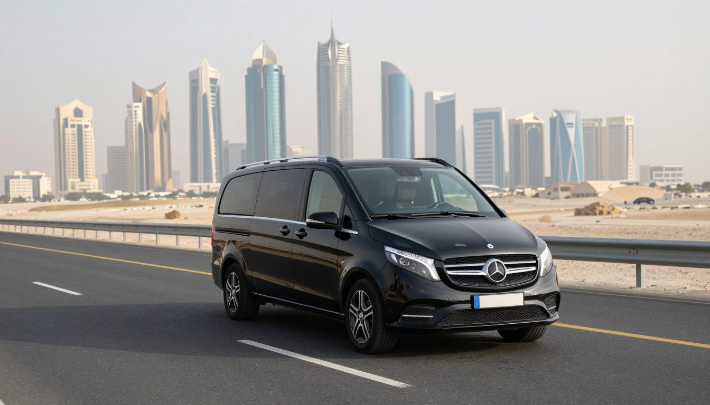

# **Chauffeur Service Qatar**

Professional chauffeur service Qatar operations provide executive transport for corporate leaders and official delegations visiting the country. Managed ground mobility coordinates daily schedules with vetted chauffeurs and immaculate vehicles across Doha and neighbouring commercial centres.

Travel requirements in Qatar depend on punctual coordination between flight arrivals, corporate headquarters and major event venues. AB delivers structured journeys with dedicated dispatch oversight for every transfer.

Request a proposal Book a transfer

### **4 Cities Served**

Comprehensive coverage across Doha, Lusail, Al Wakrah and Al Khor.

### **1 Direct Office**

Local operational base established on Old Airport Road in Doha.

### **1 Commercial Airport**

Continuous flight arrival coverage at Hamad International Airport (DOH).

## **Chauffeur Service Qatar Local Office**

### **AB Doha**

Qatar Operations Desk

AB Doha coordinates corporate transport and VIP delegation movements across the country from its dedicated hub on Old Airport Road.

Office 110, Building 100, Zone 26, Street 310, Old Airport Road, Doha, Qatar

+974 7734 3300

Coverage

## **Executive Chauffeur Coverage Across Qatar Municipalities**

AB provides managed ground transport networks spanning the principal commercial and residential districts of Qatar. Chauffeurs operate across municipal boundaries to connect business districts, maritime centres and industrial developments with executive sedans and spacious passenger vans. Centralised dispatch maintains punctual coordination for all regional journeys.

### **Doha**

Airport Code: \[Confirm if needed\] | Status: \[Confirm: service status if not provided\]

Executive chauffeurs serve commercial districts across Doha including West Bay and Msheireb Downtown. Daily operations support business meetings, government summits and direct airport transfers. Visit the [Doha](https://seowriting.ai/locations/qatar/doha) city hub for regional fleet options.

### **Lusail**

Airport Code: \[Confirm if needed\] | Status: \[Confirm: service status if not provided\]

Chauffeur vehicles connect the modern business towers and entertainment districts of Lusail with the capital. Corporate travellers utilise scheduled daily hire and on demand executive transport. Access dedicated vehicle categories through the [Lusail](https://seowriting.ai/locations/qatar/lusail) service network.

### **Al Wakrah**

Airport Code: \[Confirm if needed\] | Status: \[Confirm: service status if not provided\]

Transportation services cover maritime facilities, commercial ports and coastal residential communities throughout Al Wakrah. Chauffeurs facilitate seamless transfers to central business hubs and hospitality venues. Explore local transfer capabilities on the [Al Wakrah](https://seowriting.ai/locations/qatar/al-wakrah) destination page.

### **Al Khor**

Airport Code: \[Confirm if needed\] | Status: \[Confirm: service status if not provided\]

Fleet operations support energy sector facilities, coastal projects and residential districts across Al Khor. Dedicated transport provides reliable links to northern industrial hubs and southern corporate centres. Discover complete route details on the [Al Khor](https://seowriting.ai/locations/qatar/al-khor) location profile.

Aviation Terminals

## **Hamad International Airport DOH Chauffeur Transfers in Qatar**

Travellers arriving at Hamad International Airport (DOH) receive terminal meet and greet coordination with professional chauffeurs. Flight tracking allows drivers to adapt to schedule variations before aircraft arrival at DOH. Access terminal transfer bookings through the [Hamad International Airport DOH](https://seowriting.ai/airports/hamad-international-doh) transfer desk.

| Airport             | Code | Facility Type  | Chauffeur Service Scope                                                                                      |
| ------------------- | ---- | -------------- | ------------------------------------------------------------------------------------------------------------ |
| Hamad International | DOH  | Commercial Hub | Terminal meet and greet coordination with flight tracking and direct luggage transfer to executive vehicles. |

Mobility Solutions

## **Chauffeur Service Qatar Mobility Capabilities**

AB coordinates comprehensive ground transport arrangements designed for multinational corporations, conference planners and visiting delegations across Qatar. Clients select specific service categories tailored to itinerary duration, passenger volume and protocol requirements.

- **Chauffeur & VIP**: Private driver bookings feature luxury car models such as the Mercedes S Class for executive journeys and diplomatic protocol.
- **Airport Transfers**: Dependable airport transfer Qatar journeys link corporate travellers directly to international flight departures with flight tracking and luggage assistance.
- **Corporate Transportation**: Dedicated corporate transportation Qatar services provide corporate travel solutions for business meetings and multinational executive roadshows.
- **Event Transportation**: Event mobility coordinators manage multi vehicle fleets including the Cadillac Escalade and GMC Yukon for summits, state functions and major exhibitions.
- **Bus & Coach Hire**: Reliable bus rental Qatar solutions transport large delegations, conference attendees and staff shuttles in comfortable passenger coaches.
- **Tourism Transportation**: Premium limousine service Qatar itineraries and flexible intercity transfer Qatar routes allow private guests to explore cultural landmarks at an unhurried pace.

Highway Corridors

## **Intercity Highway Routes Across Qatar**

Intercity transit corridors link key commercial centres, ports and aviation facilities across the country. Chauffeurs navigate primary expressways with precision to support punctual itineraries between urban hubs.

### **Doha to Lusail**

Connecting the capital business centre with Lusail Marina and commercial headquarters along the modern expressway corridor. Chauffeurs operate executive sedans and SUVs for daily meetings. Travel time: \[Confirm: travel time\].

### **Doha to Al Wakrah**

Linking central Doha with southern port developments, logistics hubs and coastal hospitality developments. Private driver hire provides uninterrupted travel for corporate teams. Travel time: \[Confirm: travel time\].

### **Doha to Al Khor**

Direct highway transport between downtown Doha and northern industrial sites, research centres and community sports venues. Full day hire options support multi stop operational visits. Travel time: \[Confirm: travel time\].

### **Hamad International Airport (DOH) to West Bay**

Direct executive arrivals route from Hamad International Airport (DOH) to the diplomatic and commercial skyline of West Bay. Professional chauffeurs handle luggage and flight schedule updates. Travel time: \[Confirm: travel time\].

Governance

## **Licensing and Safety Standards Across Qatar**

AB maintains strict operational standards across Qatar through fully licensed and commercially insured vehicle fleets. All operations comply with statutory transport regulations \[Confirm licence names and numbers\] enforced by national transit authorities. Professional chauffeurs complete protocol and safety training before assignment to corporate travel itineraries. Centralised 24/7 dispatch from the Riyadh operations centre coordinates vehicle telematics and driver schedules, supporting safe and reliable ground mobility for every client journey.

Questions

## **Frequently Asked Questions About Chauffeur Travel in Qatar**

### **How are chauffeur service Qatar bookings arranged for corporate travel?**

Corporate travel bookings are coordinated through the AB operations desk by phone or electronic enquiry. Travel managers specify pickup locations, itinerary schedules and preferred luxury vehicle classes for individual executives or delegation groups. Dispatch teams confirm reservation details, driver contact credentials and route plans prior to departure.

### **What vehicle categories are available for private chauffeur hire in Qatar?**

Clients select from an executive fleet comprising luxury sedan options such as the Mercedes S Class, spacious SUVs including the Cadillac Escalade and GMC Yukon, and multi passenger vans such as the Mercedes V Class. Every vehicle is licensed, commercially insured and maintained to executive standards for corporate transport.

### **How does airport transfer service operate at Hamad International Airport (DOH)?**

Chauffeurs meet incoming passengers directly inside the terminal arrivals hall at Hamad International Airport (DOH) using clear name boards. Dispatch teams utilise flight tracking to monitor commercial flight schedules, allowing chauffeurs to adjust timing for early landings or flight delays before passenger greeting.

### **Can clients reserve an hourly chauffeur or full day hire across Doha?**

AB provides flexible hourly chauffeur hire and full day vehicle hire across the capital and neighbouring municipalities. This arrangement suits executives attending multiple business meetings, diplomatic summits or site inspections throughout the working day. The dedicated professional chauffeur remains on call throughout the reserved itinerary window.

### **What safety and licensing standards apply to AB drivers and vehicles?**

All vehicles and chauffeurs operate under national regulatory transport permits \[Confirm licence names and numbers\] and commercial passenger insurance policies. Chauffeurs undergo background vetting, defensive driving instruction and corporate protocol training. Dispatch supervisors oversee vehicle movements around the clock to support passenger safety on every route.

### **Is intercity transfer service available between Doha and other municipalities?**

AB operates intercity transfer services connecting Doha with Lusail, Al Wakrah, Al Khor and surrounding industrial zones. Private driver transport provides direct highway connections without intermediate stops, allowing business travellers to work comfortably between regional appointments. Advance bookings help schedule optimal vehicle dispatch for long distance itineraries.

### **How is dispatch managed for round the clock transportation across Qatar?**

Continuous operations are coordinated through 24/7 dispatch managed from the primary AB operations centre in Riyadh alongside local operational teams in Doha. Dispatch coordinators track fleet telematics, manage schedule updates and handle special client requests at any hour of the day or night.

## **Book Your Chauffeur Service Qatar Experience**

Reserve premium chauffeur service Qatar transportation with AB for seamless corporate travel, VIP delegation logistics and airport transfers across the country.

Request a proposal Book a transfer