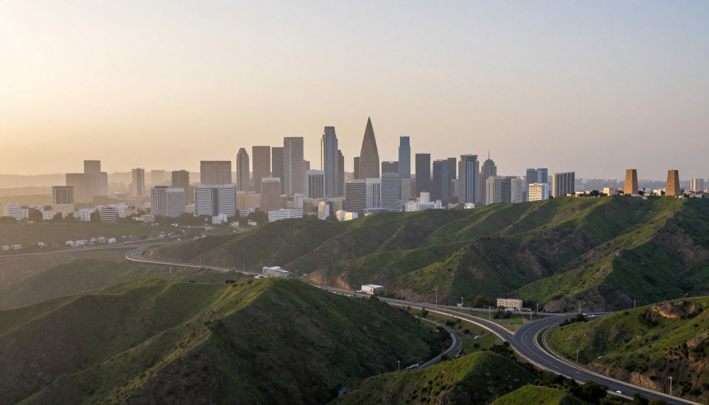
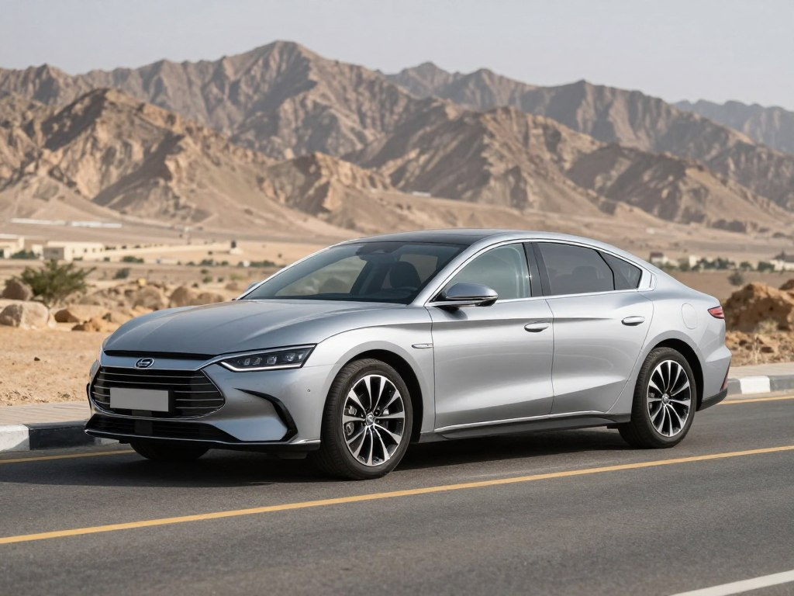
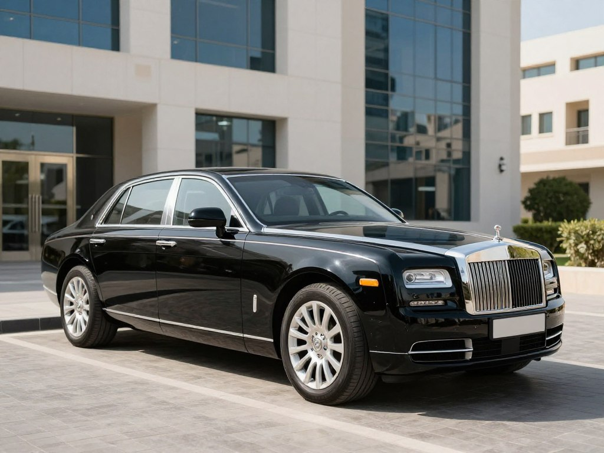
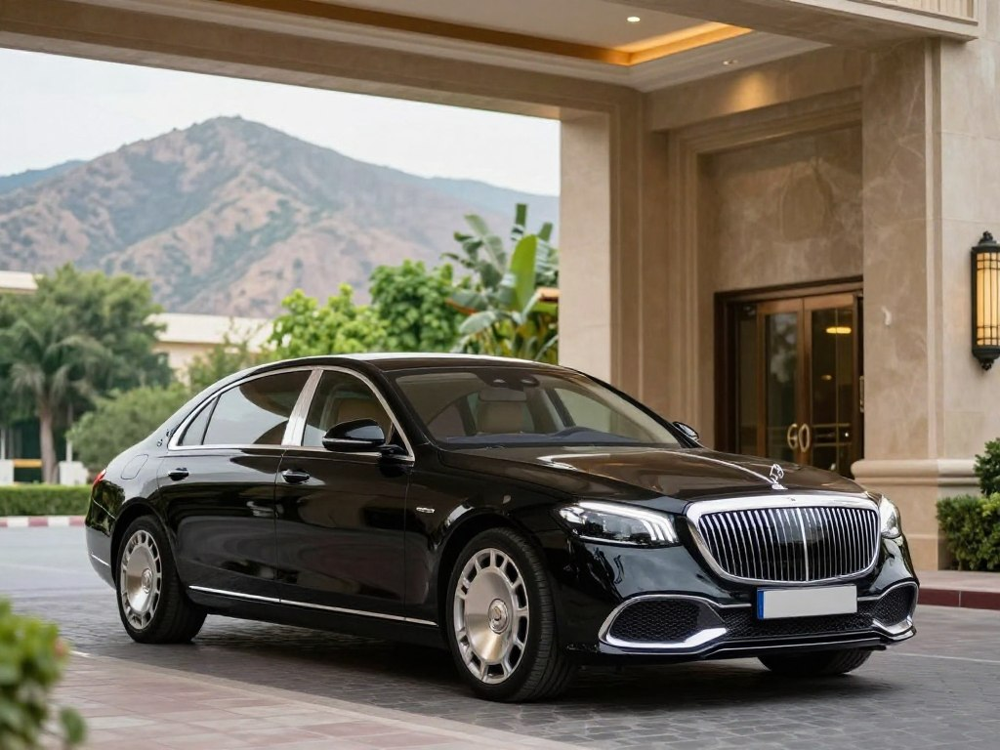
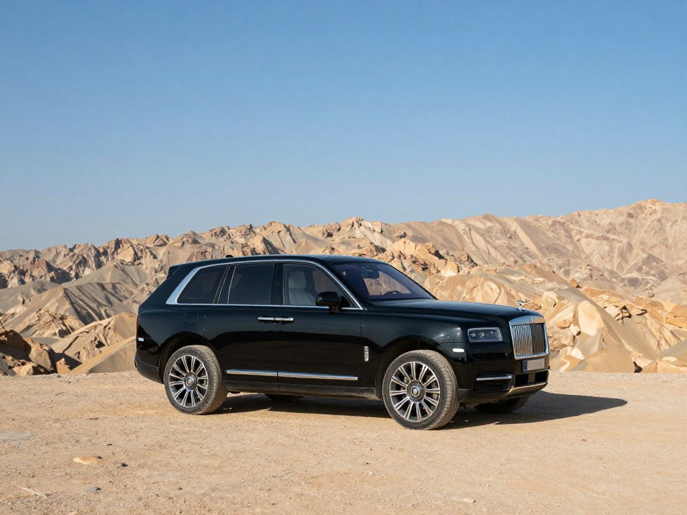
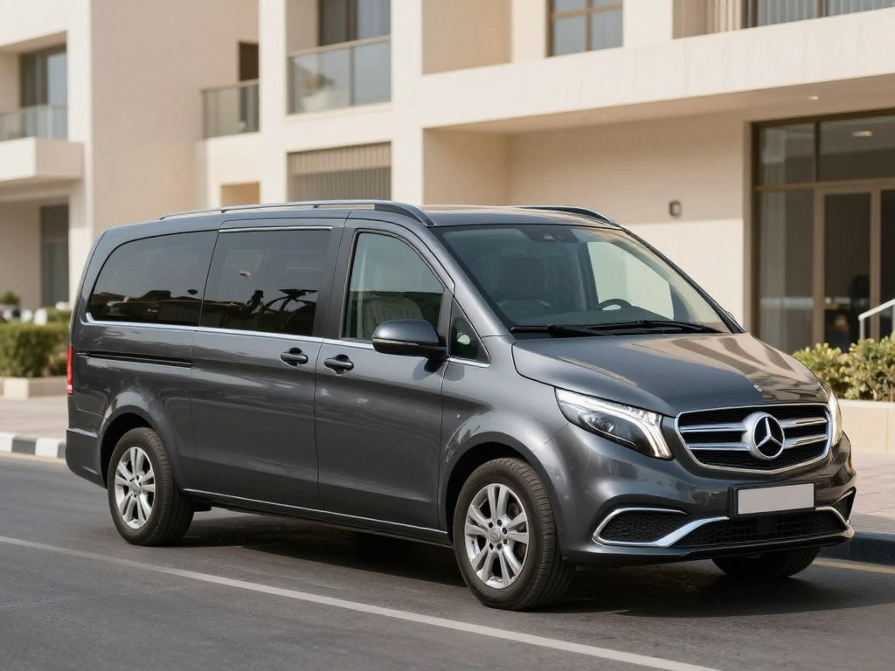
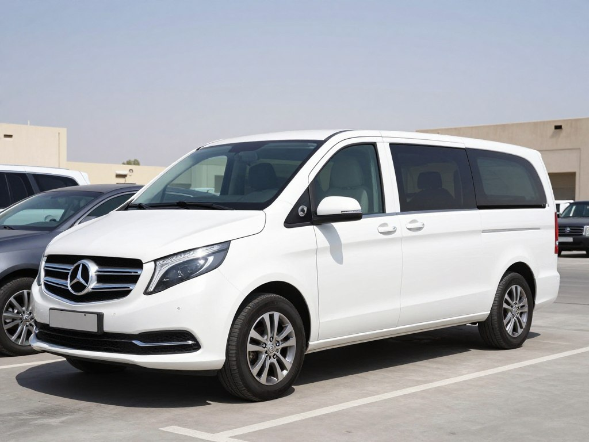

# **Chauffeur service in Abha**

AB provides executive chauffeur service for Abha solutions connecting corporate travellers directly with Abha International Airport (AHB). Our professional drivers manage ground travel across Abha with disciplined operations, punctuality, and immaculate vehicles prepared for demanding mountain terrain.

High elevation geography and winding road networks make dependable ground coordination essential for business visitors. Central dispatch from our regional operations desk maintains continuous vehicle monitoring and punctual transfers across the southern province.

[Book now](https://seowriting.ai/locations/saudi-arabia) [View the fleet](https://seowriting.ai/locations/saudi-arabia)

**Pick up:** Abha International Airport (AHB)

**Drop off:** Abha city centre, Abha

**Date and time:** Scheduled upon reservation

[Get a quote](https://seowriting.ai/locations/saudi-arabia)

The Abha fleet

## **Choose your Abha chauffeur class**

Vehicles for Abha are dispatched from the nearest office, AB Riyadh (headquarters) \[Confirm nearest office\]. Every chauffeur vehicle delivers immaculate executive standards, climate control, and disciplined mechanical maintenance suited for regional elevations.

### **Standard Sedan**

Sedan · 3 guests · 2 bags

Typical model: Executive sedan or similar \[Confirm\]

Ideal for: Efficient point to point transfers

Our standard sedan provides quiet efficiency for individual travellers visiting corporate facilities or government offices in Abha. Passengers enjoy climate control and attentive driving along busy urban corridors.

[Book this class](https://seowriting.ai/locations/saudi-arabia) [Request a quote](https://seowriting.ai/locations/saudi-arabia) [Airport transfer](https://seowriting.ai/locations/saudi-arabia) [Hourly chauffeur](https://seowriting.ai/locations/saudi-arabia) [Full specifications](https://seowriting.ai/locations/saudi-arabia)

### **Business Sedan**

Sedan · 3 guests · 2 bags

Typical model: Mercedes E Class or similar \[Confirm\]

Ideal for: Corporate executives and daily itineraries

The business sedan combines refined styling with productive workspace for executives attending commercial appointments across the region. Generous legroom and acoustic insulation allow undisturbed telephone briefings between destinations.

[Book this class](https://seowriting.ai/locations/saudi-arabia) [Request a quote](https://seowriting.ai/locations/saudi-arabia) [Airport transfer](https://seowriting.ai/locations/saudi-arabia) [Hourly chauffeur](https://seowriting.ai/locations/saudi-arabia) [Full specifications](https://seowriting.ai/locations/saudi-arabia)

### **First Class Sedan**

Flagship sedan · 3 guests · 2 bags

Typical model: Mercedes S Class or similar \[Confirm\]

Ideal for: VIP delegations and diplomatic transport

Flagship luxury provides peerless comfort for distinguished delegates travelling through Abha. Handcrafted upholstery, reclining seating, and superior suspension smooth out winding mountain roads between ceremonial and executive commitments.

[Book this class](https://seowriting.ai/locations/saudi-arabia) [Request a quote](https://seowriting.ai/locations/saudi-arabia) [Airport transfer](https://seowriting.ai/locations/saudi-arabia) [Hourly chauffeur](https://seowriting.ai/locations/saudi-arabia) [Full specifications](https://seowriting.ai/locations/saudi-arabia)

### **Executive SUV**

SUV · 6 guests · 5 bags

Typical model: GMC Yukon or Cadillac Escalade or similar \[Confirm\]

Ideal for: Mountain terrain and executive groups

Commanding performance and elevated ground clearance make this SUV suited for steep mountain ascents around Abha. Spacious leather seating and expansive luggage capacity accommodate delegations with substantial equipment.

[Book this class](https://seowriting.ai/locations/saudi-arabia) [Request a quote](https://seowriting.ai/locations/saudi-arabia) [Airport transfer](https://seowriting.ai/locations/saudi-arabia) [Hourly chauffeur](https://seowriting.ai/locations/saudi-arabia) [Full specifications](https://seowriting.ai/locations/saudi-arabia)

### **Premium MPV**

MPV · 6 guests · 5 bags

Typical model: Mercedes V Class or similar \[Confirm\]

Ideal for: Small teams and mobile conferences

Configured with face to face seating, this premium cabin allows project teams to collaborate while travelling between sites. Smooth access and ample luggage volume support multi passenger airport runs.

[Book this class](https://seowriting.ai/locations/saudi-arabia) [Request a quote](https://seowriting.ai/locations/saudi-arabia) [Airport transfer](https://seowriting.ai/locations/saudi-arabia) [Hourly chauffeur](https://seowriting.ai/locations/saudi-arabia) [Full specifications](https://seowriting.ai/locations/saudi-arabia)

### **Executive Van**

Van · 14 guests · 10 bags

Typical model: Mercedes Sprinter or similar \[Confirm\]

Ideal for: Large delegations and event groups

Designed for larger entourages, this executive carrier offers standing headroom, individual overhead ventilation, and generous luggage compartments. Coordinated group travel proceeds with comfort and disciplined timing.

[Book this class](https://seowriting.ai/locations/saudi-arabia) [Request a quote](https://seowriting.ai/locations/saudi-arabia) [Airport transfer](https://seowriting.ai/locations/saudi-arabia) [Hourly chauffeur](https://seowriting.ai/locations/saudi-arabia) [Full specifications](https://seowriting.ai/locations/saudi-arabia)

Popular journeys

## **Across Abha and beyond**

AB coordinates individual and group transfers connecting commercial hubs, mountain tourist attractions, and neighbouring industrial cities. Our drivers maintain scheduled timing along primary mountain motorways and regional arterial roads.

**Airport transfer**

### **AHB to Abha city centre**

From \[SAR price\]

**Airport transfer**

### **AHB to Khamis Mushait**

From \[SAR price\]

**City**

### **Abha to Al Soudah**

From \[SAR price\]

**City**

### **Abha to Khamis Mushait**

From \[SAR price\]

**Intercity**

### **Abha to Jizan \[Confirm\]**

From \[SAR price\] · \[Confirm\] hours

Arrange regional travel across the Kingdom with [Intercity Transfers](https://seowriting.ai/services/intercity-transfers) for cross province itineraries.

Services in Abha

## **One partner for every movement in Abha**

AB delivers managed ground mobility solutions supporting corporate delegations, flight connections, and chartered group travel across the Asir province.

- [Chauffeur & VIP](https://seowriting.ai/locations/saudi-arabia)
- [Airport Transfers](https://seowriting.ai/locations/saudi-arabia)
- [Bus & Coach Hire arranged in Abha](https://seowriting.ai/locations/saudi-arabia)

Airport transfers

## **Arriving at Abha International Airport (AHB)**

Chauffeurs monitor incoming passenger flights landing at Abha International Airport (AHB) through real time flight tracking. Dispatchers adjust chauffeur positioning whenever incoming regional or international flights encounter unexpected air traffic delays. Your assigned private driver conducts an executive meet and greet with a personalised name board inside the arrivals terminal at meeting point \[Confirm\]. Travellers receive complimentary free waiting time \[Confirm\] following touchdown, allowing calm transit through customs, baggage recovery, and terminal security. Chauffeurs assist with all heavy baggage before escorting passengers directly to their premium sedan or executive SUV. Ground coordination proceeds smoothly without queueing, ride hailing confusion, or uncoordinated kerbside pickups in volatile mountain weather.

Reserving an AHB airport transfer provides complete itinerary predictability for arriving executives and visiting delegations. Flight tracking technology synchronises your driver with actual runway touchdown rather than published schedule estimates. This operational discipline prevents missed connections and avoids unnecessary kerbside waiting times outside the terminal.

Professional drivers possess thorough knowledge of southern regional roads and navigate direct routes to downtown accommodations or commercial offices. Vehicles parked in pre arranged staging areas remain at optimal interior temperatures, providing immediate thermal comfort after stepping out of the terminal. Luggage handling protocols keep travel possessions secure while passengers relax in climate controlled comfort.

### **Flight tracking**

Every arrival

### **Meet and greet**

Inside the terminal

### **AHB to Abha city centre**

\[Confirm\] minutes

Coverage

## **Where we work in Abha**

AB coordinates private ground mobility across all principal sectors of the regional capital. Chauffeurs navigate elevated mountain passes, central commercial districts, administrative complexes, and premier gathering destinations with disciplined local knowledge. Dispatchers monitor regional highway corridors, provincial headquarters, and mountain ridges to maintain punctual movements across every planned itinerary in the metropolitan zone.

Urban transit in the Asir region presents unique operational conditions, including steep road gradients, morning fog, and sudden weather variations. Our drivers plan journey paths with local insight, selecting optimal bypasses during peak traffic periods around central squares. Corporate guests move between government appointments and commercial meetings without experiencing unexpected mountain transit delays.

Operational coordination extends beyond city boundaries into surrounding industrial zones and high elevation development corridors. Scheduled transfers maintain seamless connections between metropolitan boardrooms and remote facility sites across the highlands. This comprehensive operational presence supports extensive regional projects and multi day executive itineraries.

### **Business**

Key commercial locations include Al Khalidiyyah district, King Fahd Road commercial corridor, and Al Andalus business district.

### **Events and conferences**

Premier conference destinations include Abha Palace Event Centre, Asir Chamber of Commerce, and King Khalid University Conference Hall.

### **Heritage and leisure**

Notable cultural landmarks include Al Muftaha Cultural Village, High City and Jabal Al Akhdar, and Al Soudah mountain ridges.

### **Government or Industry**

Key administrative zones include Asir Governorate Headquarters, Abha Regional Municipality, and Aseer Industrial City.

Our office

## **Operations and dispatch for Abha**

Executive travel across Abha is supported directly through central logistics and around the clock fleet dispatch. While operating across the southern highlands, our operations centre in Riyadh coordinates vehicle preparations, driver scheduling, and protocol logistics to maintain seamless ground transport standards throughout Saudi Arabia.

Centralised control protocols verify driver credentials, route planning, and vehicle preparation prior to every scheduled journey. Corporate travel organisers benefit from unified billing, immediate schedule updates, and consistent service delivery across regional travel destinations. Continuous dispatch oversight provides complete operational responsiveness for dynamic business agendas.

### **AB Riyadh (headquarters) \[Confirm nearest office\]**

Building 3036, Office 08, 2nd Floor, Umar Ibn Abdulaziz Road, Al Malaz, Riyadh, Saudi Arabia. Telephone: +966 58 111 8720.

[Get directions](https://seowriting.ai/locations/saudi-arabia)

Questions

## **Chauffeur service in Abha: your questions**

### **How do I arrange an executive chauffeur service in Abha?**

Reservations can be requested online or through our round the clock dispatch desk in Riyadh. Simply submit your travel dates, preferred vehicle category, passenger count, and route details. Our team confirms availability, assigns a certified private driver, and provides full chauffeur identification details prior to departure. Corporate accounts also receive centralised invoicing and flexible itinerary adjustments for regional meetings.

### **What is the protocol for AHB airport collections?**

Every arrival at Abha International Airport (AHB) includes complimentary flight tracking and executive meet and greet service. Your assigned chauffeur monitors flight progress to adjust for early touchdowns or unexpected air delays. The driver waits inside arrivals holding a personalised name board at meeting point \[Confirm\]. Guests receive complimentary waiting time \[Confirm\] to complete baggage collection before a seamless transfer to their destination.

### **Can AB provide a private driver in Abha for high altitude mountain roads?**

Booking a private driver Abha service allows business visitors to navigate steep terrain without personal driving stress. AB provides experienced chauffeurs specifically accustomed to the winding elevations and seasonal weather patterns across Abha and the Asir highlands. All drivers adhere to rigorous defensive driving procedures, while fleet vehicles undergo comprehensive mechanical inspections to handle steep mountain gradients. Passengers enjoy smooth, unhurried journeys whether ascending to panoramic ridge viewpoints or travelling between elevated residential and municipal sectors.

### **How do intercity transfers from Abha to regional destinations work?**

Every intercity transfer Abha connection provides direct transportation to surrounding commercial and industrial centres. AB operates scheduled private intercity transfers from Abha to key destinations including Khamis Mushait, Jizan, and surrounding commercial centres. Passengers travel in premium sedans or executive SUVs configured for long distance comfort, avoiding the inconvenience of regional flight schedules or unvetted taxis. Every intercity journey features door to door pickup, climate control, complimentary bottled refreshments, and professional route planning for optimal efficiency.

### **Which vehicle classes are available for chauffeur bookings in Abha?**

Our regional fleet encompasses standard, business, and first class sedans such as the Mercedes S Class, alongside executive SUVs like the GMC Yukon and Cadillac Escalade. For corporate delegations and private entourages, we supply luxury Mercedes V Class multi purpose vehicles and spacious passenger vans. Every vehicle dispatched in Abha maintains rigorous safety standards, immaculate detailing, and advanced climate control.

## **Your chauffeur is ready in Abha.**

Reserve your private vehicle today or contact our 24/7 Riyadh operations centre at +966 58 111 8720 to arrange tailored chauffeur service Abha itineraries.

[Book now](https://seowriting.ai/locations/saudi-arabia) [Request a proposal](https://seowriting.ai/locations/saudi-arabia)