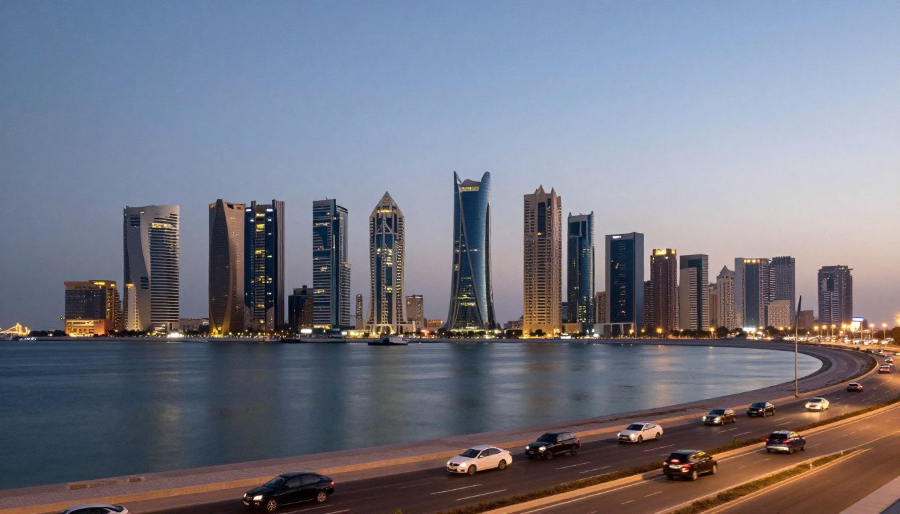
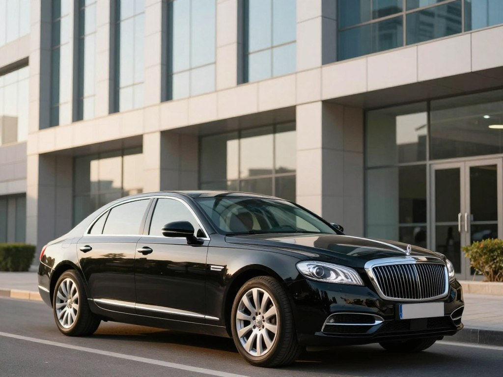
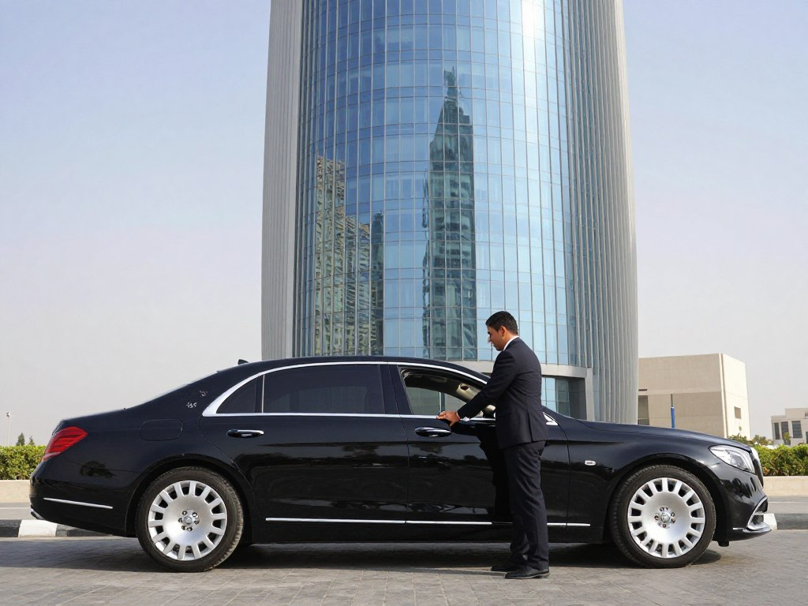
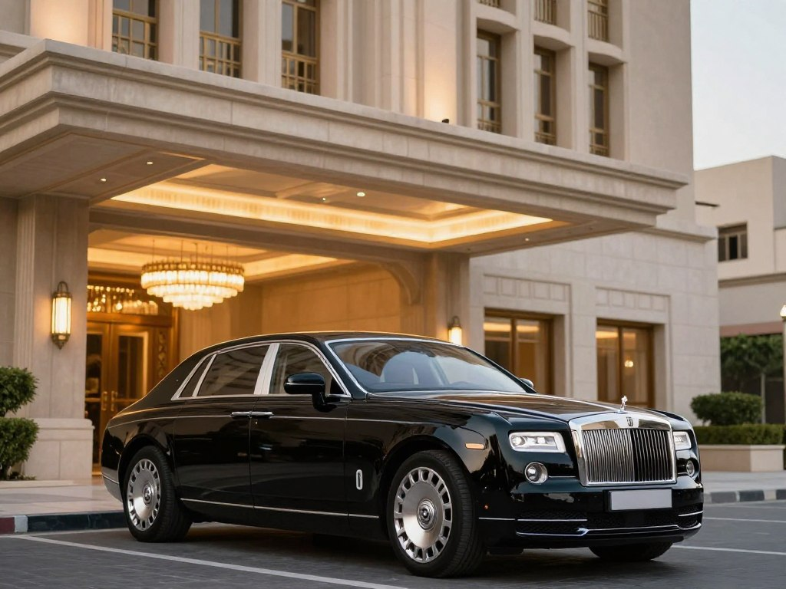
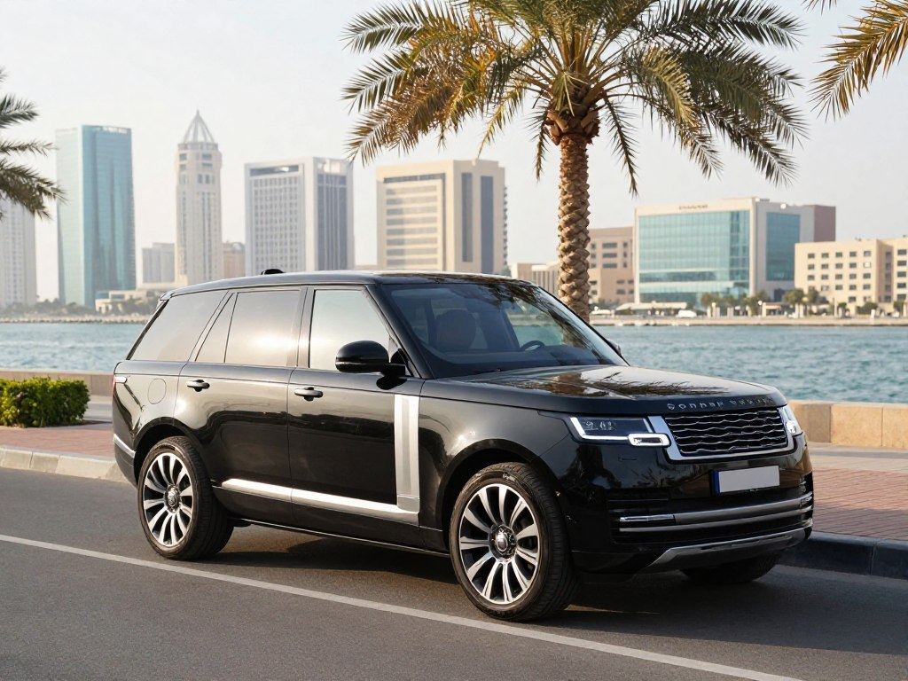
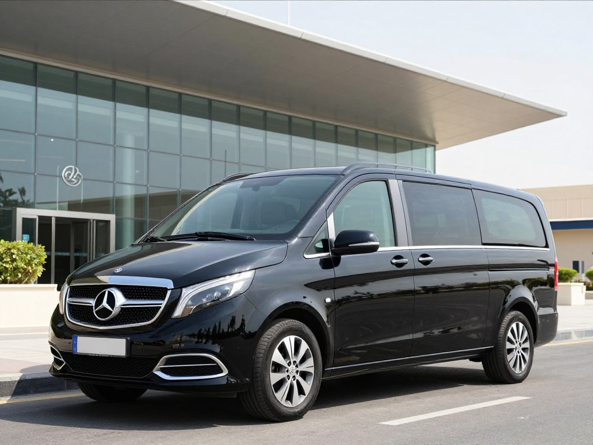
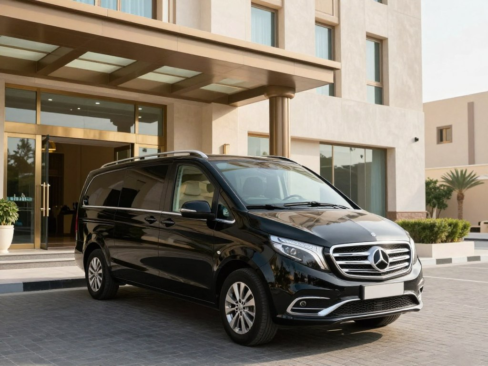

# **Chauffeur service in Al Khobar**

AB delivers executive chauffeur service Al Khobar transport across the Eastern Province. Professional chauffeurs coordinate transfers between King Fahd International Airport (DMM) and corporate addresses in Al Khobar, maintaining punctuality and discretion throughout every business journey.

Executive travel demands punctual coordination, vetted drivers and spotless vehicles prepared for corporate schedules. Our managed transportation network supports executive teams with direct scheduling, live flight monitoring and dedicated regional assistance.

[Book now](https://seowriting.ai/services/chauffeur-vip/saudi-arabia/al-khobar) [View the fleet](https://seowriting.ai/services/chauffeur-vip/saudi-arabia/al-khobar)

**Pick up:** King Fahd International Airport (DMM) | **Drop off:** Al Khobar Corniche, Al Khobar | **Date and time:** Scheduled transfer

[Get a quote](https://seowriting.ai/services/chauffeur-vip/saudi-arabia/al-khobar)

**The Al Khobar fleet**

## **Choose your chauffeur service Al Khobar class**

Every vehicle in our Al Khobar fleet is GPS tracked and detailed before each journey. AB maintains exceptional standards of comfort, mechanical safety and interior presentation for all executive movements.

### **Standard Sedan**

Sedan · 3 guests · 2 bags

**Typical model:** Executive sedan or similar \[Confirm\]

**Ideal for:** Solo business travel and transfers

Experience dependable private transport across Al Khobar for daily corporate meetings and regional appointments. Each vehicle provides quiet cabin comfort, chilled bottled water and mobile device charging for efficient journeys.

[Book this class](https://seowriting.ai/services/chauffeur-vip/saudi-arabia/al-khobar) [Request a quote](https://seowriting.ai/services/chauffeur-vip/saudi-arabia/al-khobar) [Airport transfer](https://seowriting.ai/airports/king-fahd-international-dmm) [Hourly chauffeur](https://seowriting.ai/services/chauffeur-vip/saudi-arabia/al-khobar) [Full specifications](https://seowriting.ai/services/chauffeur-vip/saudi-arabia/al-khobar)

### **Business Sedan**

Sedan · 3 guests · 2 bags

**Typical model:** Mercedes E Class or similar \[Confirm\]

**Ideal for:** Executive business travel in comfort

Travel between regional offices with a professional chauffeur dedicated to your schedule. Premium leather seating and dual zone climate control create a refined working environment suitable for corporate directors on the move.

[Book this class](https://seowriting.ai/services/chauffeur-vip/saudi-arabia/al-khobar) [Request a quote](https://seowriting.ai/services/chauffeur-vip/saudi-arabia/al-khobar) [Airport transfer](https://seowriting.ai/airports/king-fahd-international-dmm) [Hourly chauffeur](https://seowriting.ai/services/chauffeur-vip/saudi-arabia/al-khobar) [Full specifications](https://seowriting.ai/services/chauffeur-vip/saudi-arabia/al-khobar)

### **First Class Sedan**

Flagship sedan · 3 guests · 2 bags

**Typical model:** Mercedes S Class or similar \[Confirm\]

**Ideal for:** VIP corporate protocol and dignitaries

The premier choice for visiting delegations and senior leaders arriving in Al Khobar. Spacious rear seating, acoustic privacy glass and refined ride quality deliver calm comfort throughout every VIP movement.

[Book this class](https://seowriting.ai/services/chauffeur-vip/saudi-arabia/al-khobar) [Request a quote](https://seowriting.ai/services/chauffeur-vip/saudi-arabia/al-khobar) [Airport transfer](https://seowriting.ai/airports/king-fahd-international-dmm) [Hourly chauffeur](https://seowriting.ai/services/chauffeur-vip/saudi-arabia/al-khobar) [Full specifications](https://seowriting.ai/services/chauffeur-vip/saudi-arabia/al-khobar)

### **Executive SUV**

SUV · 6 guests · 5 bags

**Typical model:** Cadillac Escalade, GMC Yukon or similar \[Confirm\]

**Ideal for:** Corporate delegations with generous luggage

Spacious and commanding luxury travel across Al Khobar and Eastern Province highways. Generous boot capacity and elevated seating provide comfortable long distance transport for corporate teams and visiting executives.

[Book this class](https://seowriting.ai/services/chauffeur-vip/saudi-arabia/al-khobar) [Request a quote](https://seowriting.ai/services/chauffeur-vip/saudi-arabia/al-khobar) [Airport transfer](https://seowriting.ai/airports/king-fahd-international-dmm) [Hourly chauffeur](https://seowriting.ai/services/chauffeur-vip/saudi-arabia/al-khobar) [Full specifications](https://seowriting.ai/services/chauffeur-vip/saudi-arabia/al-khobar)

### **Premium MPV**

MPV · 6 guests · 5 bags

**Typical model:** Mercedes V Class or similar \[Confirm\]

**Ideal for:** Mobile meetings and small groups

Featuring face to face conference seating, this spacious vehicle serves executive roadshows and collaborative teams. Flexible cabin arrangements support confidential discussions while travelling between commercial venues in Al Khobar.

[Book this class](https://seowriting.ai/services/chauffeur-vip/saudi-arabia/al-khobar) [Request a quote](https://seowriting.ai/services/chauffeur-vip/saudi-arabia/al-khobar) [Airport transfer](https://seowriting.ai/airports/king-fahd-international-dmm) [Hourly chauffeur](https://seowriting.ai/services/chauffeur-vip/saudi-arabia/al-khobar) [Full specifications](https://seowriting.ai/services/chauffeur-vip/saudi-arabia/al-khobar)

### **Executive Van**

Van · 14 guests · 10 bags

**Typical model:** Luxury passenger van or similar \[Confirm\]

**Ideal for:** Large event delegations and crews

Accommodate larger project teams, conference speakers and event delegates across the Eastern Province. High roof styling and wide aisles offer generous space for passengers and substantial luggage loads during regional transfers.

[Book this class](https://seowriting.ai/services/chauffeur-vip/saudi-arabia/al-khobar) [Request a quote](https://seowriting.ai/services/chauffeur-vip/saudi-arabia/al-khobar) [Airport transfer](https://seowriting.ai/airports/king-fahd-international-dmm) [Hourly chauffeur](https://seowriting.ai/services/chauffeur-vip/saudi-arabia/al-khobar) [Full specifications](https://seowriting.ai/services/chauffeur-vip/saudi-arabia/al-khobar)

**Popular journeys**

## **Across Al Khobar and beyond**

AB provides reliable point to point transfers connecting primary commercial districts, transport hubs and neighbouring cities. Select your route for transparent pricing and punctual execution.

### **DMM to Al Khobar Corniche**

**Service:** Airport transfer

From \[SAR price\]

### **DMM to Dhahran**

**Service:** Airport transfer

From \[SAR price\]

### **Al Khobar to Half Moon Bay**

**Service:** City

From \[SAR price\]

### **Al Khobar to Dammam**

**Service:** City

From \[SAR price\]

### **Al Khobar to Dhahran**

**Service:** City

From \[SAR price\]

### **Al Khobar to Riyadh**

**Service:** Intercity

From \[SAR price\] · \[Confirm\] hours

### **Al Khobar to Bahrain via the King Fahd Causeway \[Confirm cross border service\]**

**Service:** Intercity

From \[SAR price\] · \[Confirm\] hours

For regional travel throughout the Kingdom, reserve your route with [intercity transfers](https://seowriting.ai/services/intercity-transfers).

**Services in Al Khobar**

## **One partner for every movement in Al Khobar**

AB provides executive car hire and limousine service Al Khobar travel for corporate leaders across the Eastern Province.

Our managed ground logistics support multinational corporations, event organisers and government delegations throughout the region. Professional chauffeurs deliver punctual transfers between commercial headquarters, luxury hotels and regional transportation hubs.

- [Chauffeur & VIP in Al Khobar](https://seowriting.ai/services/chauffeur-vip/saudi-arabia/al-khobar)
- [King Fahd International Airport (DMM)](https://seowriting.ai/airports/king-fahd-international-dmm)
- [Intercity Transfers](https://seowriting.ai/services/intercity-transfers)

**Airport transfers**

## **Arriving at King Fahd International Airport (DMM)**

Arriving at King Fahd International Airport (DMM) connects corporate travellers directly to the commercial centres of the Eastern Province. AB monitors every inbound flight using live flight tracking so your driver adjusts immediately to early arrivals or flight delays. Your professional chauffeur provides a personalised meet and greet with name board at the designated terminal meeting point \[Confirm\]. Guests receive attentive luggage assistance between the arrivals hall and the waiting executive vehicle. To support relaxed transit through customs and baggage retrieval, every DMM airport transfer includes free waiting time \[Confirm\]. The direct highway route provides a smooth transition from your flight to your hotel or regional office.

### **Flight tracking**

Every arrival.

### **Meet and greet**

Inside the terminal.

### **DMM to Al Khobar Corniche**

\[Confirm\] minutes.

Arrange your airport arrival directly through our [King Fahd International Airport (DMM)](https://seowriting.ai/airports/king-fahd-international-dmm) service.

**Coverage**

## **Where we work in Al Khobar**

AB provides comprehensive ground transportation across the commercial and coastal districts of Al Khobar. Our professional chauffeurs navigate key corporate sectors, waterfront developments and industrial zones with local route knowledge. From financial offices along King Salman Road to luxury beachfront hotels and major conference venues, our private driver Al Khobar team delivers punctual mobility for business travellers and visiting executive delegations.

| Business         | Events and conferences | Heritage and leisure | Government or Industry |
| ---------------- | ---------------------- | -------------------- | ---------------------- |
| Al Bandariyah    | Dhahran Expo           | Al Khobar Corniche   | Chamber of Commerce    |
| Al Yarmouk       | Grand Hyatt            | Prince Saud Park     | Aramco District        |
| King Salman Road | Kempinski Al Othman    | Sunset Marina        | Second Industrial City |

**Our office**

## **AB Operations Serving Al Khobar**

AB coordinates regional mobility across Al Khobar through our central operations centre. Corporate clients receive 24/7 dispatch coordination, real time itinerary tracking and dedicated account assistance for all executive travel. Local chauffeurs are managed with strict standards to deliver dependable ground logistics throughout the Eastern Province.

### **AB Riyadh, headquarters and 24/7 dispatch \[Confirm nearest office\]**

Building 3036, Office 08, 2nd Floor, Umar Ibn Abdulaziz Road, Al Malaz, Riyadh, Saudi Arabia

+966 58 111 8720

[Get directions](https://seowriting.ai/locations/saudi-arabia)

**Questions**

## **Chauffeur service Al Khobar: your questions**

### **How do I book a chauffeur service Al Khobar transfer with AB?**

Booking your journey with AB is straightforward through our central reservations team. You can submit your itinerary details online or contact our Riyadh dispatch office directly. Please provide your pick up location, destination, flight details if applicable, date, time and preferred vehicle class. Our team confirms reservations promptly and assigns a professional chauffeur with full vehicle details in advance.

### **What does the meet and greet procedure involve for arrivals at DMM?**

When arriving at King Fahd International Airport, your chauffeur tracks your inbound flight status in real time to adapt to any schedule changes. Once you clear baggage collection, your driver welcomes you inside the arrivals hall holding a personalised name board. Your driver assists with all luggage and escorts you directly to your waiting executive car for a calm journey.

### **Does AB provide intercity transfer Al Khobar routes across Saudi Arabia and to Bahrain?**

AB provides comfortable intercity journeys connecting Al Khobar with major regional destinations including Dammam, Dhahran, Jubail, Hofuf and Riyadh. Cross border journeys to Bahrain across the King Fahd Causeway are arranged upon request through vetted partners \[Confirm cross border service\]. Every long distance journey features premium sedans or SUVs equipped with refreshments, climate control and professional drivers.

### **Can I book an hourly chauffeur or full day hire for corporate meetings?**

Yes, AB provides flexible hourly hire and full day chauffeur services tailored to corporate schedules. This option suits executives attending consecutive meetings, roadshows or VIP events across multiple commercial districts. Your dedicated driver remains on standby throughout the day, providing immediate departures between venues without the inconvenience of coordinating separate transport bookings for each individual journey.

### **Which vehicle classes are available for chauffeur services in Al Khobar?**

Our fleet serving Al Khobar includes Standard Sedan, Business Sedan such as the Mercedes E Class, First Class Sedan including the Mercedes S Class, Executive SUV options like the Cadillac Escalade or GMC Yukon, Premium MPV models like the Mercedes V Class, and Executive Vans for up to fourteen guests. Every vehicle is thoroughly detailed and inspected before departure.

### **What safety and vetting standards apply to AB chauffeurs and vehicles?**

AB maintains strict operational safety across all transportation operations. Every chauffeur is professionally trained, licensed, fully insured and selected for discretion, etiquette and advanced driving competence. Each vehicle in the fleet features active GPS tracking and undergoes rigorous mechanical maintenance. Chauffeurs observe regional traffic laws and corporate protocol standards to provide smooth, dependable passenger transit.

### **How does AB support corporate travel managers and travel partners?**

AB offers dedicated ground logistics management for corporate travel coordinators, event organisers and executive assistants. Corporate accounts benefit from centralised invoicing, coordinated group movements and 24/7 dispatch support from our regional headquarters. We manage complex itineraries, delegate movements and VIP protocol transport with precision, allowing business teams to focus entirely on their commercial objectives.

## **Your chauffeur is ready in Al Khobar.**

Reserve your premium chauffeur service Al Khobar transfer today or arrange dedicated corporate transport with our central dispatch team by calling +966 58 111 8720.

+966 58 111 8720

[Book now](https://seowriting.ai/services/chauffeur-vip/saudi-arabia/al-khobar) [Request a proposal](https://seowriting.ai/services/chauffeur-vip/saudi-arabia/al-khobar)