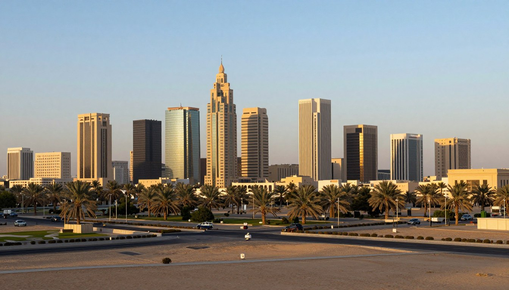
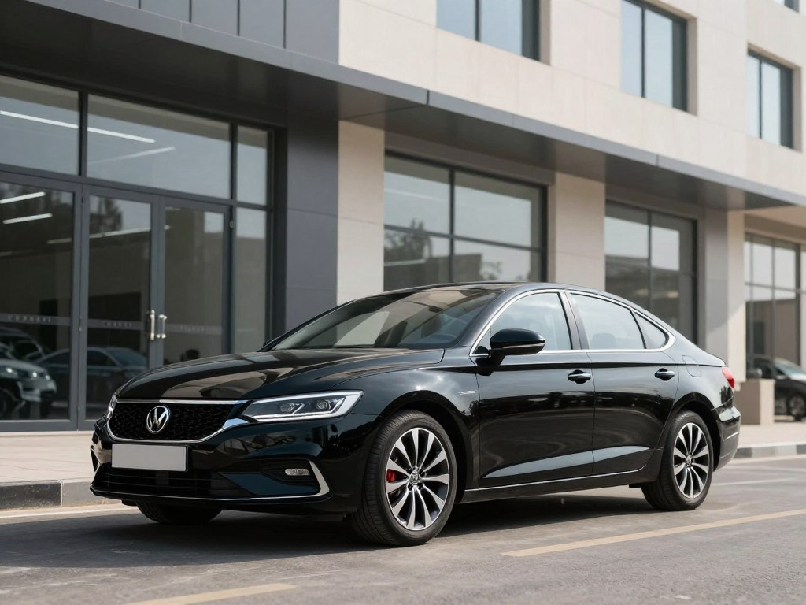
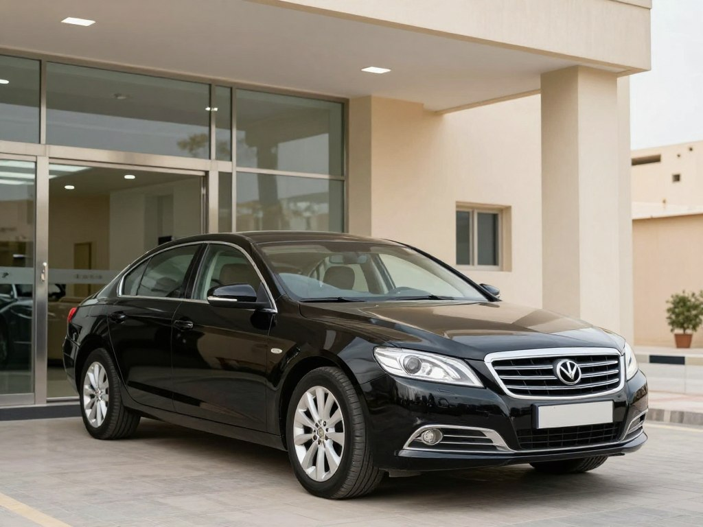
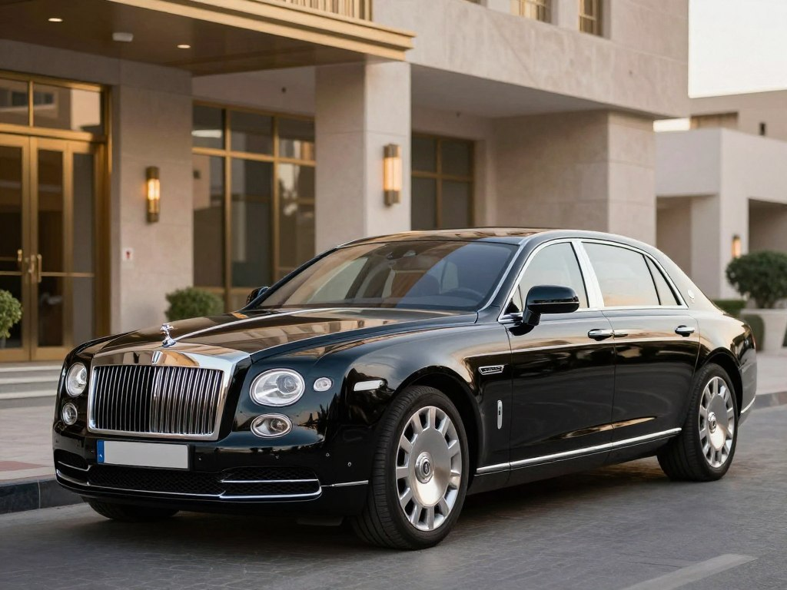
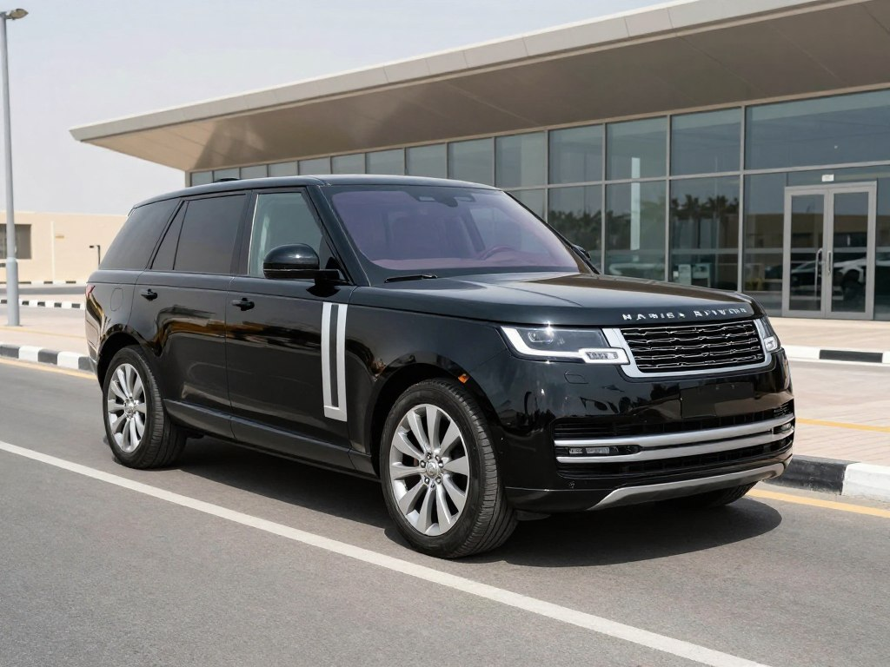
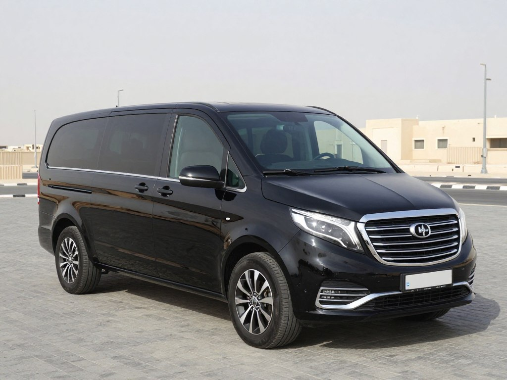
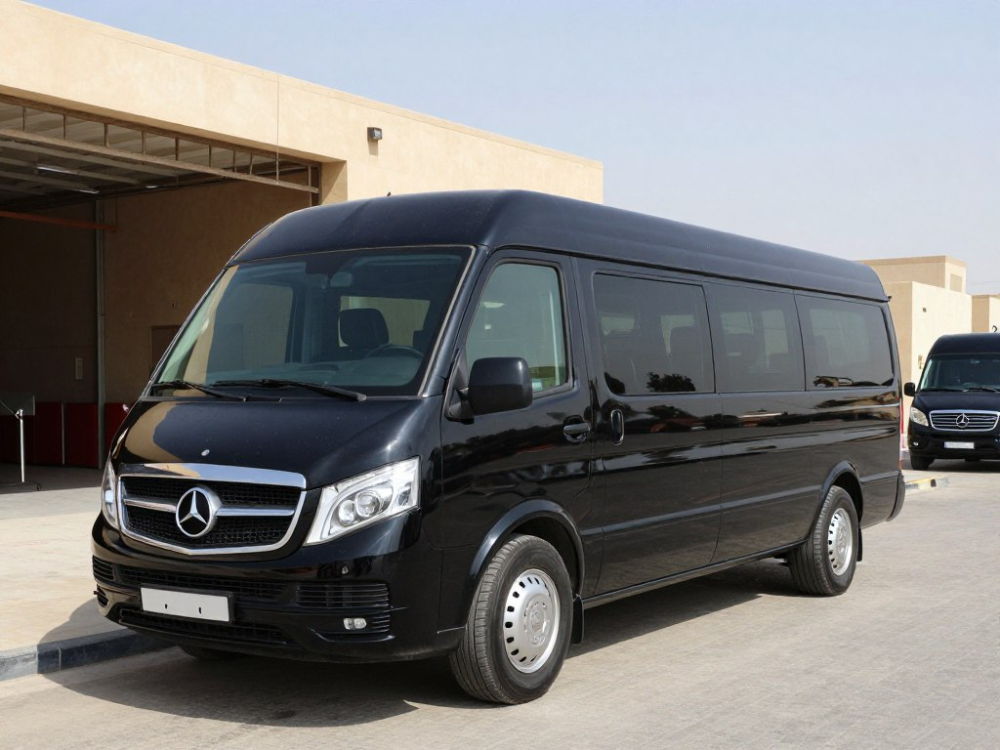
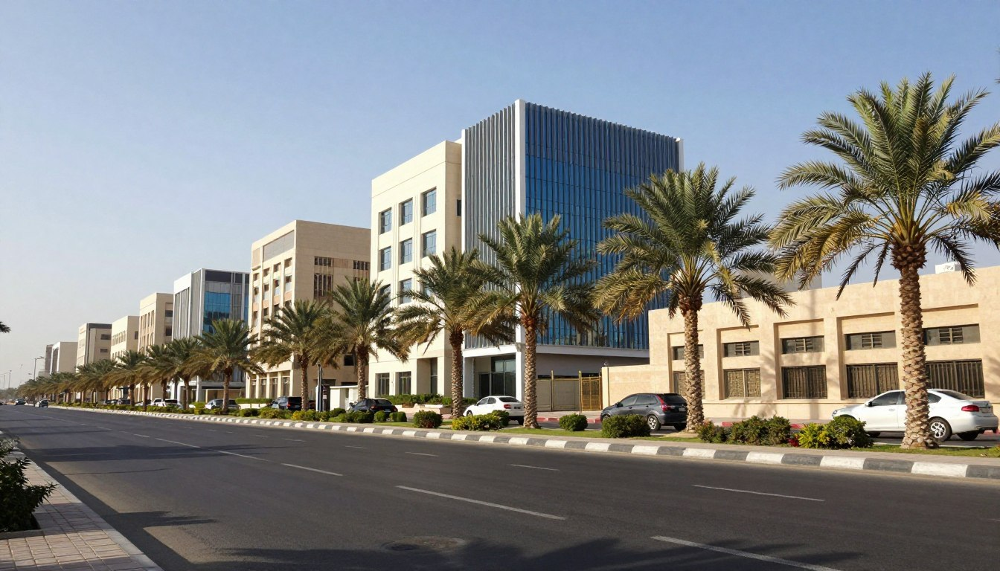

# **Chauffeur service in Al Qassim**

AB provides a dedicated chauffeur service Al Qassim organisations rely on for punctual executive mobility throughout the province. Arriving passengers at Prince Naif bin Abdulaziz International Airport (ELQ) receive professional curbside assistance and seamless transit across Al Qassim destinations.

Corporate travel coordinators choose our managed fleet to support visiting leadership teams, VIP guests and regional business itineraries. Every booking operates under centralised management to maintain consistent transport quality across central Saudi Arabia.

Book now [View the fleet](https://seowriting.ai/locations/saudi-arabia)

**Pick up:** Prince Naif bin Abdulaziz International Airport (ELQ)

**Drop off:** Buraydah, Al Qassim

**Date and time:** Scheduled upon booking

Get a quote

**The Al Qassim fleet**

## **Choose your chauffeur service Al Qassim class**

Vehicles for Al Qassim are dispatched from the nearest office, AB Riyadh (headquarters) \[Confirm nearest office\]. Each executive vehicle category delivers immaculate safety and comfort for business travel, delegations and local transfers.

### **Standard Sedan**

Sedan · 3 guests · 2 bags

Typical model: Toyota Camry or similar \[Confirm\]

Ideal for: executive city journeys in comfort

This class provides efficient point to point travel for corporate executives navigating city meetings. Professional drivers maintain immaculate standards, making everyday business commuting straightforward and comfortable.

Book this class Request a quote Airport transfer Hourly chauffeur [Full specifications](https://seowriting.ai/locations/saudi-arabia)

### **Business Sedan**

Sedan · 3 guests · 2 bags

Typical model: Mercedes E Class or similar \[Confirm\]

Ideal for: corporate travel and business meetings

Business class vehicles deliver refined interiors and quiet rides across Al Qassim business districts. Working passengers can review briefing documents or conduct calls between regional appointments with complete privacy.

Book this class Request a quote Airport transfer Hourly chauffeur [Full specifications](https://seowriting.ai/locations/saudi-arabia)

### **First Class Sedan**

Flagship sedan · 3 guests · 2 bags

Typical model: Mercedes S Class or similar \[Confirm\]

Ideal for: VIP transport and dignitary arrivals

Our premier saloon offers unmatched sophistication for high profile guests travelling in Al Qassim. Handcrafted leather seating, acoustic glass and refined climate controls create a tranquil haven after commercial flights.

Book this class Request a quote Airport transfer Hourly chauffeur [Full specifications](https://seowriting.ai/locations/saudi-arabia)

### **Executive SUV**

SUV · 6 guests · 5 bags

Typical model: Cadillac Escalade, GMC Yukon or similar \[Confirm\]

Ideal for: delegation travel and executive comfort

Commanding SUVs supply substantial cabin space and generous luggage volume across Al Qassim routes. Delegations value the elevated ride height and generous legroom during longer journeys between regional centres.

Book this class Request a quote Airport transfer Hourly chauffeur [Full specifications](https://seowriting.ai/locations/saudi-arabia)

### **Premium MPV**

MPV · 6 guests · 5 bags

Typical model: Mercedes V Class or similar \[Confirm\]

Ideal for: mobile workspace and group itineraries

Configured with adaptable conference seating, this spacious vehicle serves executive teams requiring collaborative travel. Built in power outlets and quiet cabin dynamics allow uninterrupted productivity on the move.

Book this class Request a quote Airport transfer Hourly chauffeur [Full specifications](https://seowriting.ai/locations/saudi-arabia)

### **Executive Van**

Van · 14 guests · 10 bags

Typical model: Mercedes Sprinter or similar \[Confirm\]

Ideal for: larger group and event transport

This vehicle provides coordinated group logistics for corporate conferences and regional event teams. Forward facing leather seats and wide aisles ensure all passengers travel comfortably together with their baggage.

Book this class Request a quote Airport transfer Hourly chauffeur [Full specifications](https://seowriting.ai/locations/saudi-arabia)

**Popular journeys**

## **Across Al Qassim and beyond**

AB supports punctual transfers connecting major transit hubs, commercial centres and industrial facilities. Each fixed route provides transparent planning for travel managers coordinating regional executive schedules.

**Airport transfer**

### **ELQ to Buraydah**

From \[SAR price\]

**Airport transfer**

### **ELQ to Unaizah**

From \[SAR price\]

**City**

### **Buraydah to Unaizah**

From \[SAR price\]

**Intercity**

### **Al Qassim to Ar Rass**

From \[SAR price\] · \[Confirm\] hours

**Intercity**

### **Buraydah to Riyadh**

From \[SAR price\] · \[Confirm\] hours

Explore extended travel options and booking guidelines on our [intercity transfers](https://seowriting.ai/services/intercity-transfers) service page.

**Services in Al Qassim**

## **One partner for every movement in Al Qassim**

AB coordinates comprehensive executive mobility solutions designed to support corporate delegations, VIP guests and private travel requirements across the region.

- Chauffeur & VIP private driver solutions tailored for executive road itineraries
- Airport Transfers providing terminal meet and greet coordination at regional airports
- Bus & Coach Hire arranged in Al Qassim for corporate groups and major events

Review all regional transportation services across [Saudi Arabia](https://seowriting.ai/locations/saudi-arabia) with AB.

**Airport transfers**

## **Arriving at Prince Naif bin Abdulaziz International Airport (ELQ)**

Landing at Prince Naif bin Abdulaziz International Airport (ELQ) connects corporate visitors directly with the agricultural and commercial centre of the Kingdom. Your professional chauffeur monitors incoming flights using automated flight tracking systems, adjusting pickup timings to accommodate runway schedule shifts.

Upon clearing customs, guests receive an executive meet and greet service from our uniformed driver holding a customised name board. The driver assists with all luggage before escorting passengers to their preconditioned vehicle parked at Meeting point \[Confirm\]. Travellers benefit from Free waiting time \[Confirm\], supporting seamless transitions for business travel, corporate travel and VIP transport.

### **Flight tracking**

Every arrival

### **Meet and greet**

Inside the terminal

### **ELQ to Buraydah**

\[Confirm\] minutes

**Coverage**

## **Where we work in Al Qassim**

Our chauffeur operations extend throughout Buraydah, Unaizah and surrounding commercial zones. Chauffeurs possess extensive route familiarity across municipal headquarters, hospitality venues, industrial estates and cultural centres.

| Sector     | Locations             | Description                            |
| ---------- | --------------------- | -------------------------------------- |
| Business   | King Abdulaziz Road   | Buraydah commercial offices and banks  |
| Business   | Al Nakheel district   | Buraydah retail and business parks     |
| Business   | Unaizah Commerce      | Corporate hubs and regional offices    |
| Events     | King Khalid Centre    | Conferences and civic auditorium       |
| Events     | Date Festival Grounds | Seasonal trade pavilions in Buraydah   |
| Events     | Unaizah Village       | Heritage cultural exhibition grounds   |
| Heritage   | Al Bassam House       | Preserved heritage landmark in Unaizah |
| Heritage   | Souq Al Masokaf       | Historic market and artisan alleys     |
| Heritage   | Al Othaim Park        | Urban green parkland in Buraydah       |
| Government | Qassim Governorate    | Provincial administrative headquarters |
| Government | Buraydah Modon        | Industrial city logistics district     |
| Government | Qassim Chamber        | Trade authority and council hall       |

**Our office**

## **AB chauffeur service Al Qassim operations**

Regional journeys across Al Qassim are managed through central dispatch to ensure strict operational compliance, safety oversight and vehicle cleanliness. Our operational coordinators monitor every route around the clock, providing real time driver tracking and rapid dispatch support.

**AB Riyadh, headquarters \[Confirm nearest office\]**

Building 3036, Office 08, 2nd Floor, Umar Ibn Abdulaziz Road, Al Malaz, Riyadh, Saudi Arabia

+966 58 111 8720

Get directions

**Questions**

## **Chauffeur service in Al Qassim: your questions**

### **What does an ELQ airport transfer include?**

An ELQ airport transfer includes flight tracking for your arrival at Prince Naif bin Abdulaziz International Airport (ELQ), terminal meet and greet, luggage assistance and private transport to your Buraydah or Unaizah destination. The driver monitors schedule changes directly to accommodate altered arrival times without administrative complications.

### **Can I hire a private driver Al Qassim for a full day?**

Yes, AB provides hourly chauffeur and full day hire options across Buraydah, Unaizah and surrounding areas. This flexible service suits corporate leaders attending multiple business meetings, allowing your private driver Al Qassim to remain dedicated to your schedule throughout the day.

### **Are chauffeur vehicles licensed and insured across Al Qassim?**

All AB vehicles operating in Al Qassim carry comprehensive commercial passenger insurance and full regulatory registration. Professional drivers undergo thorough vetting and rigorous safety training, upholding passenger safety and discretion on every journey across the region.

### **How are intercity transfers from Al Qassim booked?**

Intercity transfer Al Qassim bookings can be scheduled in advance through our 24/7 central dispatch team. Our long distance service provides private point to point transit between Al Qassim, Riyadh, Ar Rass and adjacent regions in climate controlled comfort.

### **How far in advance should I arrange a chauffeur in Al Qassim?**

We recommend booking your chauffeur service in Al Qassim at least 24 hours prior to departure to secure your preferred vehicle class. For urgent requirements or same day flights into ELQ, contact our dispatch operations directly for rapid vehicle allocation.

## **Your chauffeur is ready in Al Qassim.**

Arrange your executive chauffeur service Al Qassim booking with 24/7 central dispatch on +966 58 111 8720 for punctual corporate transfers.

### **Reserve executive ground transportation**

Connect with our central dispatch desk to coordinate individual transfers or complete delegation transport fleets.

Book now Request a proposal