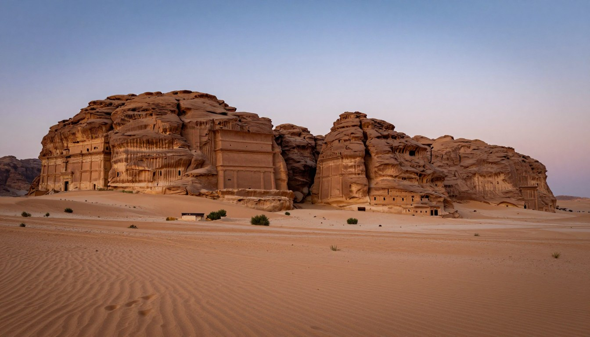
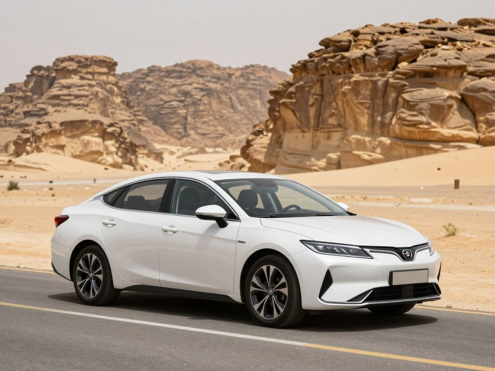
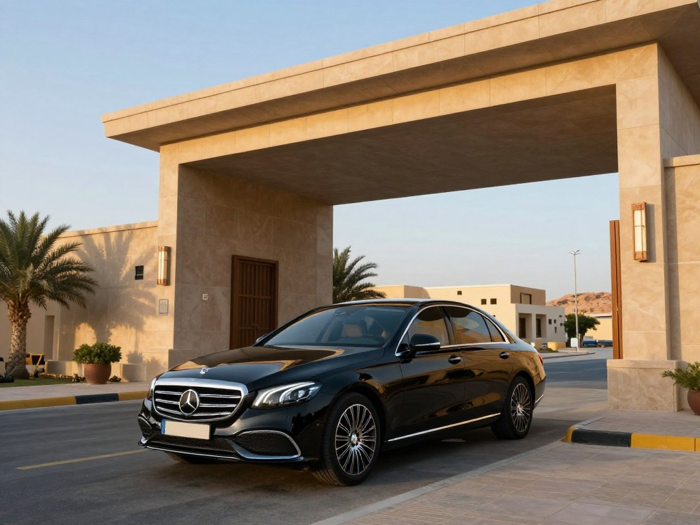
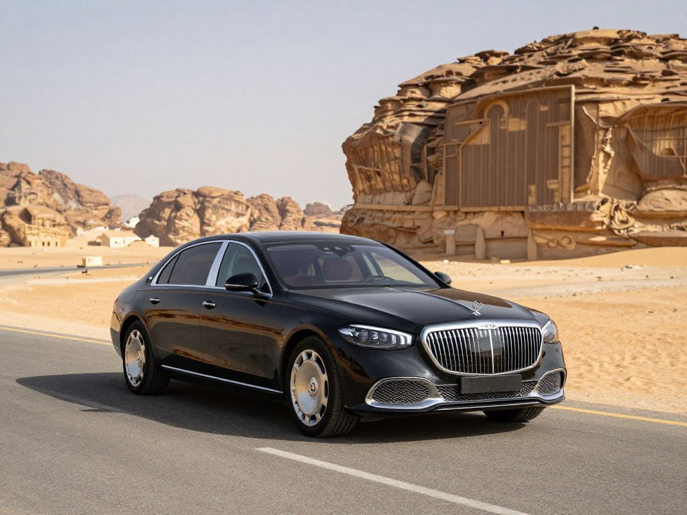
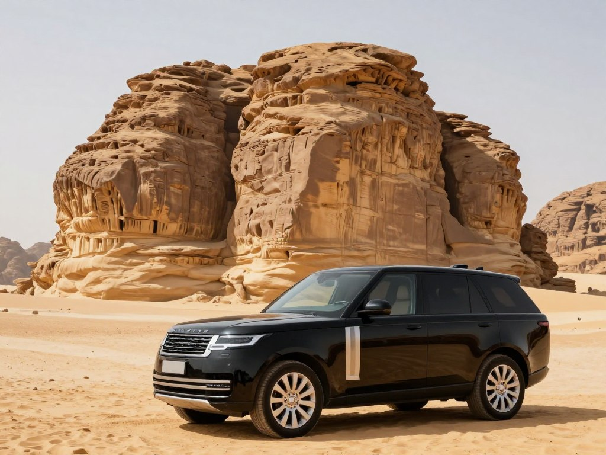
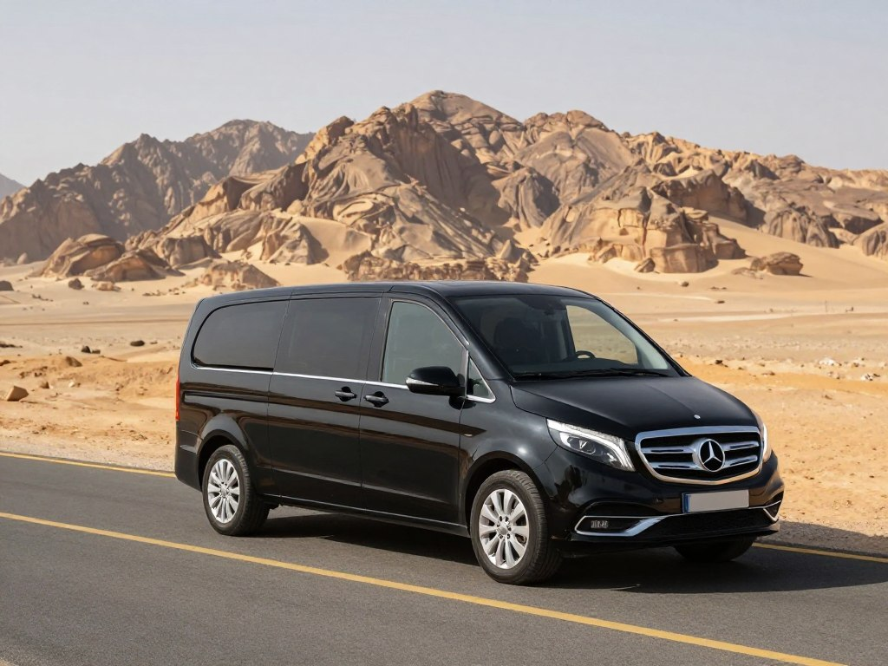
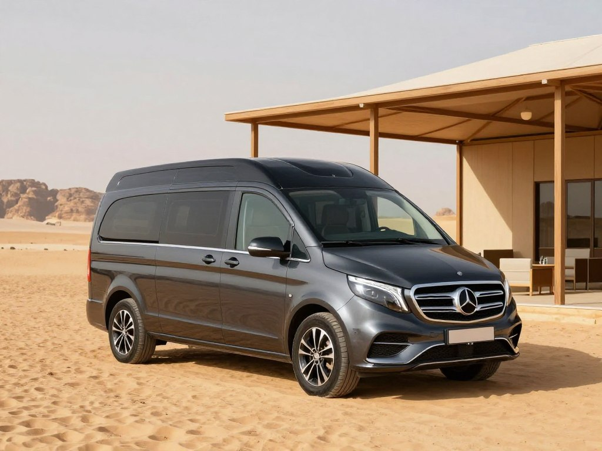

# **Chauffeur service in AlUla**

Professional chauffeur service AlUla connects visitors seamlessly across the historic valley. Arriving travellers at Prince Abdulmajeed bin Abdulaziz International Airport (ULH) receive dedicated assistance directly to hotels, heritage venues and desert resorts across AlUla.

Coordinated ground travel supports executive schedules, cultural exploration and private delegations. AB manages local itineraries through experienced drivers and clean luxury vehicles tailored to the regional landscape.

[Book now](https://seowriting.ai/docs/9247606#fleet) [View the fleet](https://seowriting.ai/docs/9247606#fleet)

Pick up

Drop off

Date and time

Get a quote

The AlUla fleet

## **Choose your AlUla chauffeur class**

Every vehicle in our AlUla fleet is GPS tracked and detailed before each journey. AB maintains immaculate standards across every vehicle category for comfort in the desert climate.

### **Standard Sedan**

Sedan · 3 guests · 2 bags

Typical model: Toyota Avalon or similar \[Confirm\]

Ideal for: Efficient private business transfers

A comfortable, climate controlled choice for individual business visitors moving between scheduled hotel appointments and regional corporate sites across AlUla.

Book this class Request a quote Airport transfer Hourly chauffeur Full specifications

### **Business Sedan**

Sedan · 3 guests · 2 bags

Typical model: Mercedes E Class or similar \[Confirm\]

Ideal for: Corporate meetings and executives

Refined executive travel delivering quiet comfort, rear seat climate adjustment and discreet driving for professional agendas throughout the AlUla region.

Book this class Request a quote Airport transfer Hourly chauffeur Full specifications

### **First Class Sedan**

Flagship sedan · 3 guests · 2 bags

Typical model: Mercedes S Class or similar \[Confirm\]

Ideal for: VIP hospitality and protocol

The flagship choice for state visits, dignitaries and luxury guests demanding superior sound insulation, acoustic privacy and smooth ride dynamics in AlUla.

Book this class Request a quote Airport transfer Hourly chauffeur Full specifications

### **Executive SUV**

SUV · 6 guests · 5 bags

Typical model: Cadillac Escalade, GMC Yukon or similar \[Confirm\]

Ideal for: Spacious travel across desert

Generous cabin proportions with elevated road visibility and superior luggage storage, built to handle longer desert itineraries comfortably.

Book this class Request a quote Airport transfer Hourly chauffeur Full specifications

### **Premium MPV**

MPV · 6 guests · 5 bags

Typical model: Mercedes V Class or similar \[Confirm\]

Ideal for: Family groups and small teams

Conference seating options and ample luggage capacity make this luxury MPV the premier choice for delegation groups and extended touring parties.

Book this class Request a quote Airport transfer Hourly chauffeur Full specifications

### **Executive Van**

Van · 14 guests · 10 bags

Typical model: Mercedes Sprinter or similar \[Confirm\]

Ideal for: Event crews and delegacy transport

Spacious high ceiling transport designed for event production staff, touring delegations and group transfers operating across diverse project sites.

Book this class Request a quote Airport transfer Hourly chauffeur Full specifications

Popular journeys

## **Across AlUla and beyond**

AB coordinates point to point transit, historical sightseeing and intercity transfers connecting north western hubs across Saudi Arabia.

Airport transfer

### **ULH to AlUla Old Town**

Direct transfer from the airport terminal to heritage hotels and cultural districts. From \[SAR price\]

Airport transfer

### **ULH to Hegra**

Private airport reception directly onward to the UNESCO World Heritage visitor gates. From \[SAR price\]

City

### **AlUla to Maraya**

Luxury evening transport to the concert hall and exhibition grounds in Ashar Valley. From \[SAR price\]

Intercity

### **AlUla to Madinah**

Long distance highway transfer connecting the heritage valley with the holy city. From \[SAR price\] · \[Confirm\] hours

Intercity

### **AlUla to Tabuk**

Northern corridor executive transfer serving corporate and government itineraries. From \[SAR price\] · \[Confirm\] hours

Intercity

### **AlUla to Hegra and heritage sites \[Confirm\]**

Full day historical circuit covering primary archaeological landmarks across the region. From \[SAR price\] · \[Confirm\] hours

Explore full route networks and dedicated long distance connections on the [intercity transfers](https://seowriting.ai/services/intercity-transfers) page.

Services in AlUla

## **One partner for every movement in AlUla**

AB coordinates ground fleet operations for corporate travellers, production organisers and international touring partners across the entire valley.

- Book managed protocol travel through [Chauffeur & VIP in AlUla](https://seowriting.ai/services/chauffeur-vip/saudi-arabia/alula).
- Organise festival and production fleets through [Event Transportation in AlUla](https://seowriting.ai/services/event-transportation/saudi-arabia/alula).
- Coordinate heritage site excursions through [Tourism Transportation in AlUla](https://seowriting.ai/services/tourism-transportation/saudi-arabia/alula).

Airport transfers

## **Arriving at Prince Abdulmajeed bin Abdulaziz International Airport (ULH)**

Arriving at Prince Abdulmajeed bin Abdulaziz International Airport (ULH) is straightforward with arranged chauffeur reception. AB monitors regional and international flights so pickup schedules match real arrival times. Your dedicated driver waits inside the arrivals area holding a personalized digital name board. Chauffeurs assist with luggage transfer before escorting passengers to their air-conditioned vehicle. Collection happens at the terminal meeting point \[Confirm\]. The ULH airport transfer service includes a free waiting time \[Confirm\] to allow comfortable customs clearance and baggage collection.

Flight tracking: Every arrival | Meet and greet: Inside the terminal | ULH to AlUla Old Town: \[Confirm\] minutes

Confirm dedicated vehicle allocations and terminal arrival procedures on the [Saudi Arabia locations](https://seowriting.ai/locations/saudi-arabia) guide.

Coverage

## **Where we work in AlUla**

AB maintains extensive operational reach throughout the oasis valley, supporting cultural institutions, hospitality resorts, commercial hubs and government projects. Professional drivers navigate remote canyon locations, desert pavilions and historic districts with complete route familiarity.

### **Business**

- Royal Commission for AlUla Headquarters
- AlUla Innovation Hub
- Ashar Commercial Centre

### **Events and conferences**

- Maraya Concert Hall
- Ashar Valley Conference Pavilion
- AlUla Cultural Oasis Venues

### **Heritage and leisure**

- Hegra Archaeological Site
- AlUla Old Town
- Dadan and Jabal Ikmah

### **Government or Industry**

- AlUla Governorate Offices
- Prince Abdulmajeed bin Abdulaziz International Airport (ULH) Logistics Area
- Ashar Valley Project Development Zone

Our office

## **Centrally managed operations serving AlUla**

AB coordinates ground transport across AlUla through active fleet deployment directed by central regional operations. Our 24/7 central dispatch tracks vehicle statuses continuously, providing seamless chauffeur coordination without requiring a physical customer office locally.

### **AB Riyadh, headquarters and 24/7 dispatch \[Confirm nearest office\]**

Building 3036, Office 08, 2nd Floor, Umar Ibn Abdulaziz Road, Al Malaz, Riyadh, Saudi Arabia

+966 58 111 8720

Get directions

Questions

## **Chauffeur service in AlUla: your questions**

### **What is included in the chauffeur service AlUla?**

Chauffeur service in AlUla includes a professional driver, a sanitised luxury vehicle with GPS tracking, bottled water, and comprehensive passenger insurance. Services accommodate point to point journeys, hourly bookings, or multi day event coordination across the valley. Detailed inclusions for custom itineraries are confirmed during quotation.

### **How does ULH airport transfer meet and greet work?**

When arriving at Prince Abdulmajeed bin Abdulaziz International Airport (ULH), your chauffeur tracks your flight status and greets you inside the terminal with an identification name board. Chauffeurs assist with your baggage and escort you to the awaiting vehicle. Standard complimentary wait times apply for international and domestic arrivals \[Confirm: wait time\].

### **Can I hire a private driver AlUla for full day heritage tours?**

Yes, private driver AlUla hire is available on an hourly or full day basis for touring sites such as Hegra, Dadan, and Elephant Rock. Dedicated drivers remain on standby throughout your visits, following your personal schedule. Daily packages provide flexible tour transport AlUla without transport delays between archaeological landmarks.

### **Does AB provide intercity transfer AlUla to other cities?**

AB provides comfortable intercity transfers connecting AlUla with Madinah, Tabuk, and surrounding regional destinations. Long distance journeys utilise premium sedans and spacious SUVs driven by experienced highway chauffeurs. Travel durations, vehicle specifications, and scheduled rest stops are arranged during booking confirmation.

### **Are vehicles and drivers in AlUla fully licensed and insured?**

Every vehicle in the AB fleet complies with Saudi transport regulations, maintaining full passenger insurance and rigorous safety inspections. Drivers hold valid commercial chauffeur permits and complete defensive driving training for regional road conditions. Fleet operations are monitored continuously by our Riyadh dispatch team.

### **Can AB coordinate event transportation AlUla for large groups?**

AB manages large scale event transportation AlUla for festivals, exhibitions, corporate conferences, and private cultural gatherings. Group transportation integrates executive vans, premium MPVs, and luxury sedans under unified dispatch control. Dedicated coordinators oversee flight arrivals, VIP escorts, and site shuttles throughout your schedule.

### **How far in advance should I book limousine service AlUla?**

We advise reserving limousine service AlUla in advance, especially during winter festival seasons and major concert periods. While dispatch accommodates short notice requests subject to availability, advance reservations secure your preferred vehicle class. Bookings can be confirmed directly online or through our central operations centre.

## **Your chauffeur is ready in AlUla.**

Secure executive ground transport and private driver services tailored to your itinerary. Reserve professional chauffeur service AlUla today by contacting 24/7 central dispatch at +966 58 111 8720.

### **Reserve your private transport**

Confirm individual vehicle transfers or complete event fleet coordination across Saudi Arabia.

Book now Request a proposal