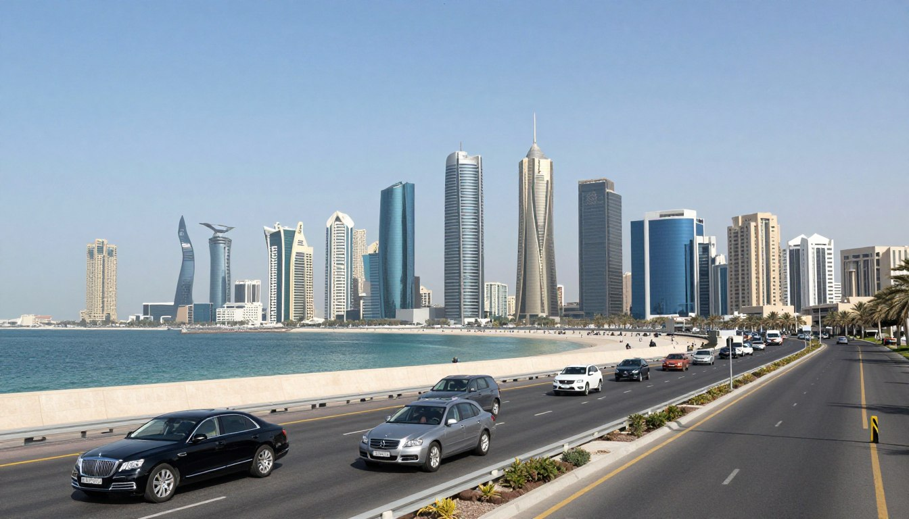
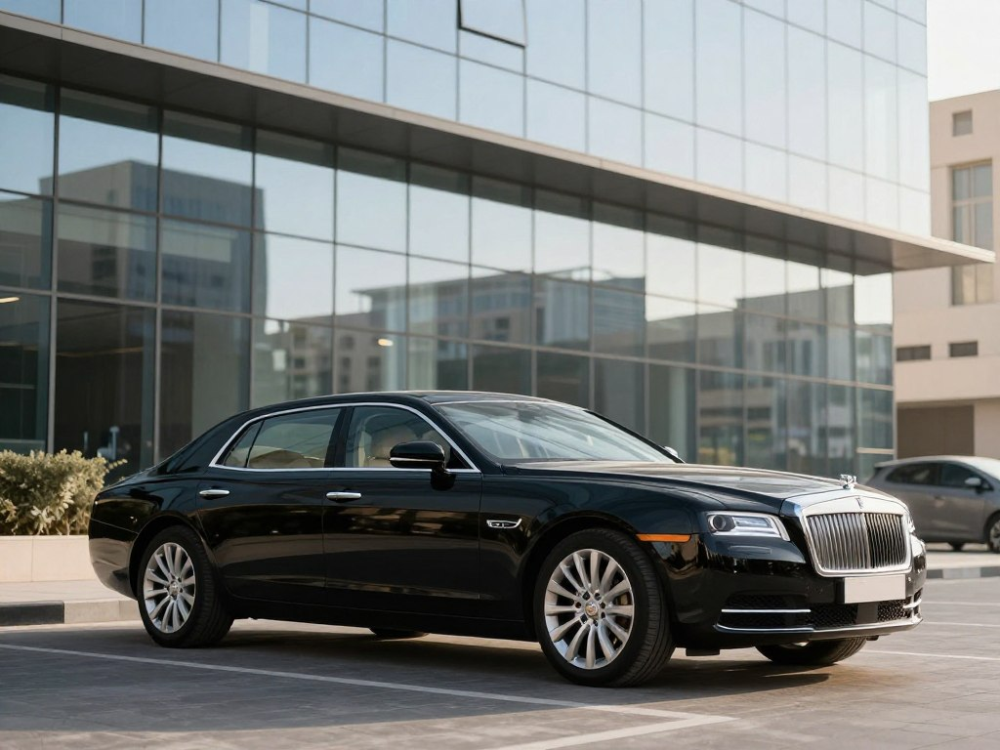
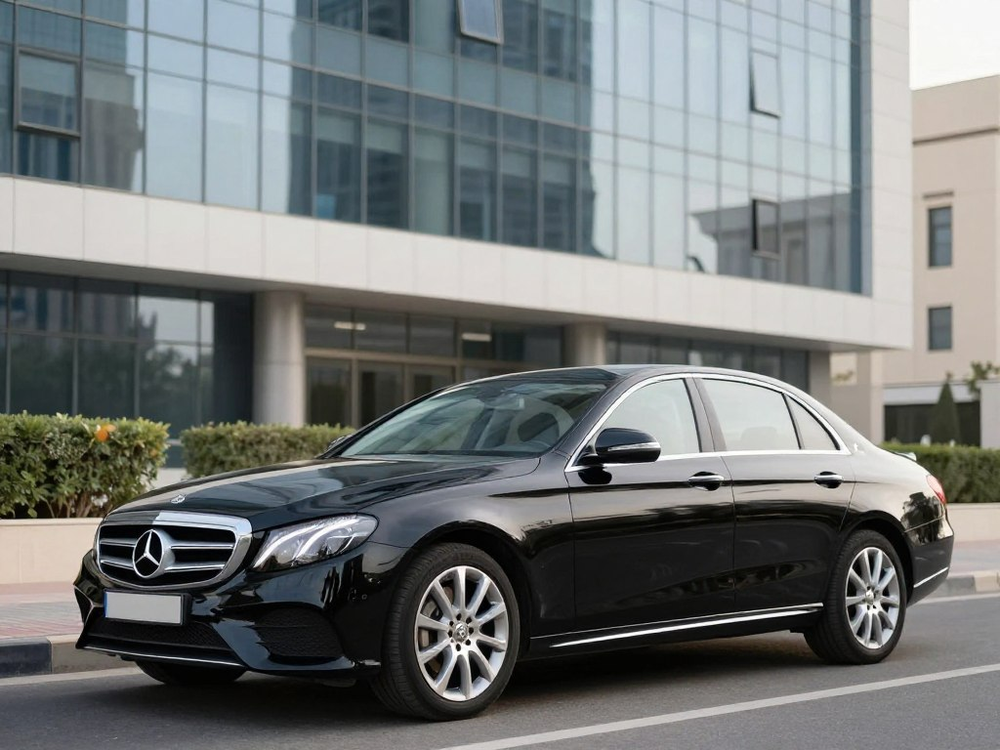
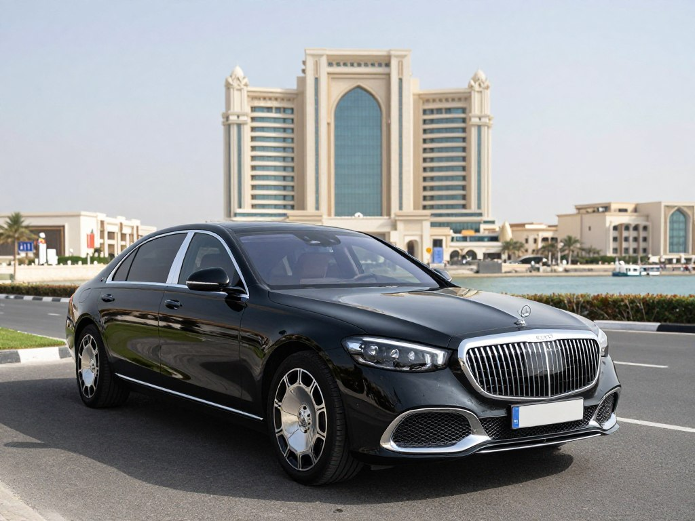
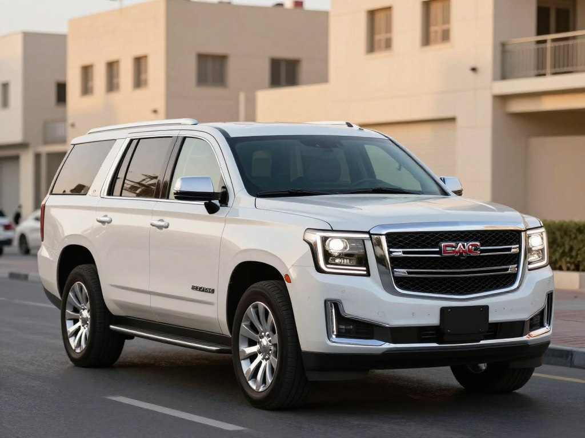
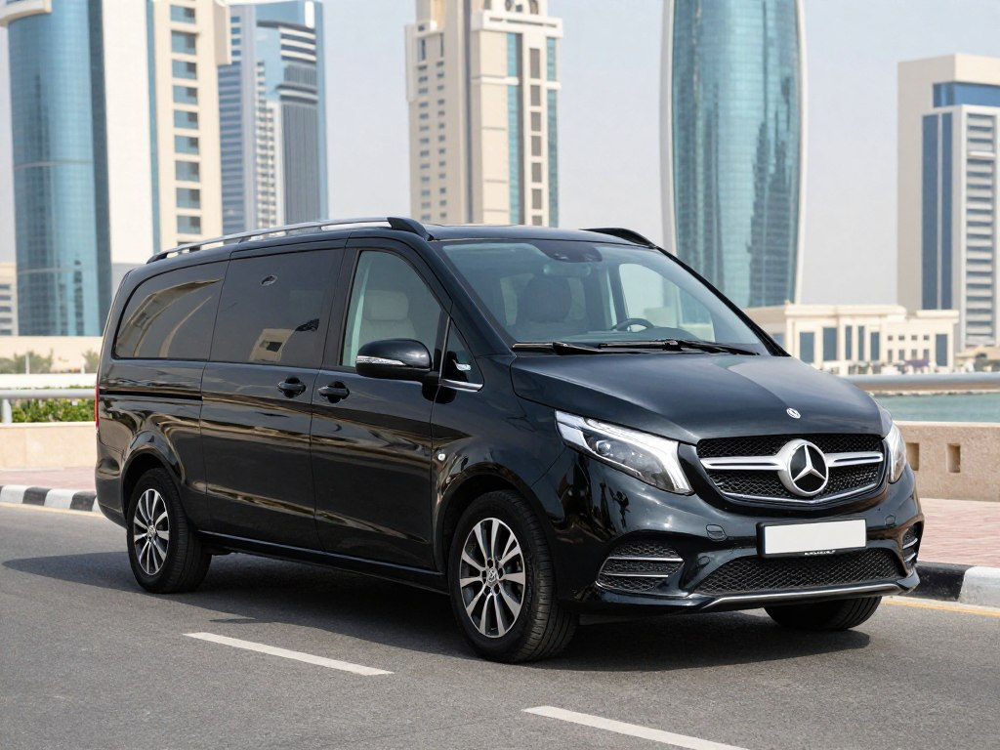
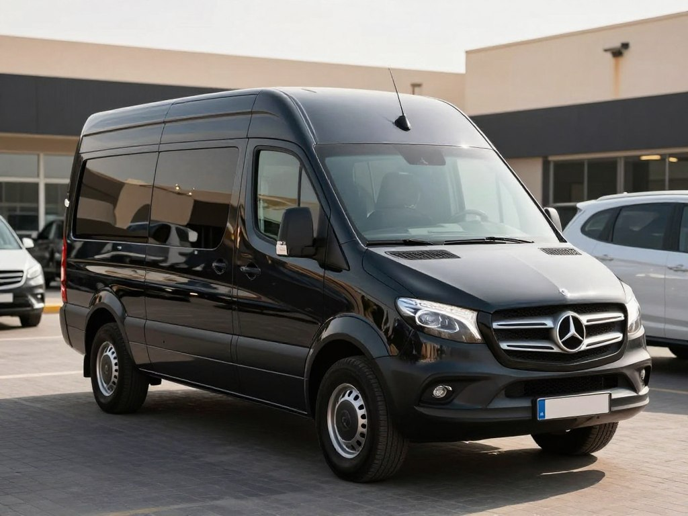

# **Chauffeur service in Dammam**

AB provides dedicated chauffeur service Dammam for corporate executives, official delegations, and private travellers arriving through King Fahd International Airport (DMM).

Experienced drivers manage every itinerary across Dammam with punctual scheduling, premium vehicles, and complete route support for eastern regional commerce.

[Book now](https://seowriting.ai/services/chauffeur-vip/saudi-arabia/dammam) [View the fleet](https://seowriting.ai/services/chauffeur-vip/saudi-arabia/dammam)

**Pick up:** King Fahd International Airport (DMM)

**Drop off:** Dammam Corniche, Dammam

**Date and time:** Selected schedule

[Get a quote](https://seowriting.ai/services/chauffeur-vip/saudi-arabia/dammam)

The Dammam fleet

## **Choose your vehicle for chauffeur service Dammam**

Every vehicle in our Dammam fleet is GPS tracked and detailed before each journey. Select from refined saloons, spacious sport utility vehicles, and executive passenger vans configured for regional business travel.

### **Standard Sedan**

**Specification:** Sedan · 3 guests · 2 bags

**Typical model:** Toyota Camry or similar \[Confirm\]

**Ideal for:** Daily corporate travel and transfers

The standard sedan provides quiet, comfortable city transport across Dammam for individual professionals. Spotless interiors, climate control, and route navigation support efficient travel between local offices, central hotels, and meeting appointments.

[Book this class](https://seowriting.ai/services/chauffeur-vip/saudi-arabia/dammam) [Request a quote](https://seowriting.ai/services/corporate-transportation/saudi-arabia/dammam) [Airport transfer](https://seowriting.ai/services/airport-transfers/saudi-arabia/dammam) [Hourly chauffeur](https://seowriting.ai/services/chauffeur-vip/saudi-arabia/dammam) [Full specifications](https://seowriting.ai/services/chauffeur-vip/saudi-arabia/dammam)

### **Business Sedan**

**Specification:** Sedan · 3 guests · 2 bags

**Typical model:** Mercedes Benz E Class or similar \[Confirm\]

**Ideal for:** Executive commutes and partner meetings

Business sedans combine refined acoustics with leather seating for executive travellers in Dammam. Quiet cabins allow passengers to conduct confidential calls, review presentation files, and unwind between corporate commitments throughout the metropolitan district.

[Book this class](https://seowriting.ai/services/chauffeur-vip/saudi-arabia/dammam) [Request a quote](https://seowriting.ai/services/corporate-transportation/saudi-arabia/dammam) [Airport transfer](https://seowriting.ai/services/airport-transfers/saudi-arabia/dammam) [Hourly chauffeur](https://seowriting.ai/services/chauffeur-vip/saudi-arabia/dammam) [Full specifications](https://seowriting.ai/services/chauffeur-vip/saudi-arabia/dammam)

### **First Class Sedan**

**Specification:** Flagship sedan · 3 guests · 2 bags

**Typical model:** Mercedes Benz S Class or similar \[Confirm\]

**Ideal for:** Senior executives and VIP transport

The flagship saloon represents exceptional prestige for visiting board members and VIP delegations. First class amenities include generous legroom, rear climate settings, and privacy blinds for discreet travel across the eastern commercial capital.

[Book this class](https://seowriting.ai/services/chauffeur-vip/saudi-arabia/dammam) [Request a quote](https://seowriting.ai/services/corporate-transportation/saudi-arabia/dammam) [Airport transfer](https://seowriting.ai/services/airport-transfers/saudi-arabia/dammam) [Hourly chauffeur](https://seowriting.ai/services/chauffeur-vip/saudi-arabia/dammam) [Full specifications](https://seowriting.ai/services/chauffeur-vip/saudi-arabia/dammam)

### **Executive SUV**

**Specification:** SUV · 6 guests · 5 bags

**Typical model:** GMC Yukon or Cadillac Escalade or similar \[Confirm\]

**Ideal for:** Management delegations and extra luggage

Executive sport utility vehicles deliver elevated road commanding views and ample luggage space for visiting project teams in Dammam. The spacious cabin accommodates regional industrial tours and group transfers across coastal oil and gas hubs.

[Book this class](https://seowriting.ai/services/chauffeur-vip/saudi-arabia/dammam) [Request a quote](https://seowriting.ai/services/corporate-transportation/saudi-arabia/dammam) [Airport transfer](https://seowriting.ai/services/airport-transfers/saudi-arabia/dammam) [Hourly chauffeur](https://seowriting.ai/services/chauffeur-vip/saudi-arabia/dammam) [Full specifications](https://seowriting.ai/services/chauffeur-vip/saudi-arabia/dammam)

### **Premium MPV**

**Specification:** MPV · 6 guests · 5 bags

**Typical model:** Mercedes Benz V Class or similar \[Confirm\]

**Ideal for:** Mobile meetings and family delegations

Premium multi purpose vehicles offer versatile seating configurations with conference style arrangements. Passengers can conduct mobile discussions or travel comfortably with personal luggage between corporate hubs, shopping districts, and coastal hospitality resorts.

[Book this class](https://seowriting.ai/services/chauffeur-vip/saudi-arabia/dammam) [Request a quote](https://seowriting.ai/services/corporate-transportation/saudi-arabia/dammam) [Airport transfer](https://seowriting.ai/services/airport-transfers/saudi-arabia/dammam) [Hourly chauffeur](https://seowriting.ai/services/chauffeur-vip/saudi-arabia/dammam) [Full specifications](https://seowriting.ai/services/chauffeur-vip/saudi-arabia/dammam)

### **Executive Van**

**Specification:** Van · 14 guests · 10 bags

**Typical model:** Mercedes Benz Sprinter or similar \[Confirm\]

**Ideal for:** Coordinated group and event transport

Executive vans provide coordinated group transport for conferences, site inspections, and corporate events across Dammam and Dhahran. Generous head height, comfortable seating, and dedicated luggage space accommodate larger delegations with complete logistical efficiency.

[Book this class](https://seowriting.ai/services/chauffeur-vip/saudi-arabia/dammam) [Request a quote](https://seowriting.ai/services/corporate-transportation/saudi-arabia/dammam) [Airport transfer](https://seowriting.ai/services/airport-transfers/saudi-arabia/dammam) [Hourly chauffeur](https://seowriting.ai/services/chauffeur-vip/saudi-arabia/dammam) [Full specifications](https://seowriting.ai/services/chauffeur-vip/saudi-arabia/dammam)

Popular journeys

## **Across Dammam and beyond**

Travellers departing King Fahd International Airport (DMM) access transparent regional transit across commercial corridors in the Eastern Province. Each private itinerary provides direct terminal departures, professional route planning, and dedicated vehicle deployment.

**Airport transfer**

### **DMM to Dammam Corniche**

Direct transit connecting the international arrivals terminal to coastal business hotels and seaside corporate offices.

From \[Confirm: SAR price\]

**Airport transfer**

### **DMM to Dhahran**

Reliable transfers to global energy headquarters, technical academic complexes, and conference exhibition centres.

From \[Confirm: SAR price\]

**City**

### **Dammam to Al Khobar**

Executive city transfers connecting core financial districts, commercial banks, and regional shopping destinations.

From \[Confirm: SAR price\]

**Intercity**

### **Dammam to Riyadh**

Intercity transfer Dammam connection linking Eastern Province corporate hubs directly to ministries and national headquarters in Riyadh.

From \[Confirm: SAR price\] · \[Confirm\] hours

**Intercity**

### **Dammam to Jubail**

Scheduled highway transfers connecting urban Dammam to key manufacturing facilities in Jubail Industrial City.

From \[Confirm: SAR price\] · \[Confirm\] hours

**Intercity**

### **Dammam to Bahrain via the King Fahd Causeway \[Confirm cross border service\]**

Cross border corporate transit supporting regional travel between Saudi eastern commercial offices and Manama business districts.

From \[Confirm: SAR price\] · \[Confirm\] hours

Review comprehensive highway travel options and schedule regional journeys through our [Intercity Transfers](https://seowriting.ai/services/intercity-transfers).

Services in Dammam

## **One partner for every movement in Dammam**

AB provides integrated ground mobility solutions across the Eastern Province to satisfy executive travel requirements with complete professionalism.

- [Chauffeur & VIP in Dammam](https://seowriting.ai/services/chauffeur-vip/saudi-arabia/dammam)
- [Airport Transfers in Dammam](https://seowriting.ai/services/airport-transfers/saudi-arabia/dammam)
- [Corporate Transportation in Dammam](https://seowriting.ai/services/corporate-transportation/saudi-arabia/dammam)
- [Bus & Coach Hire in Dammam](https://seowriting.ai/services/bus-coach-hire/saudi-arabia/dammam)

Airport transfers

## **Arriving at King Fahd International Airport (DMM)**

Arriving at King Fahd International Airport (DMM) connects passengers directly to the industrial heartland of Saudi Arabia. Operations dispatch monitors every incoming flight schedule through active flight tracking, automatically adjusting chauffeur arrival times for early landings or flight delays. Upon clearance through customs, your professional chauffeur welcomes you with an executive meet and greet service holding an official name board at the designated terminal meeting point \[Confirm\]. Travellers enjoy complimentary free waiting time \[Confirm\] after flight arrival, providing relaxed passage through baggage claim. Schedule your direct private terminal pickup through [King Fahd International Airport](https://seowriting.ai/airports/king-fahd-international-dmm) for seamless transfers across Dammam.

Coordinated airport transit eliminates unnecessary roadside delays for corporate teams arriving on international or domestic connections. Chauffeurs assist with luggage transfer directly from terminal trolleys to the vehicle boot before navigating preferred routes toward metropolitan Dammam. Real time traffic monitoring by our operations team supports smooth transit along airport expressways during morning and evening rush hours.

**Flight tracking:** Every arrival

**Meet and greet:** Inside the terminal

**DMM to Dammam Corniche:** \[Confirm\] minutes

Coverage

## **Where we work in Dammam**

AB coordinates executive ground travel across major commercial, governmental, and industrial zones in Dammam. Professional chauffeurs navigate core corporate centres, transport hubs, and leisure destinations throughout the metropolitan area with punctuality. Chauffeurs assist corporate managers travelling between regional headquarters and support operations across maritime terminals and manufacturing districts with comprehensive route knowledge.

Regional transit networks connect central business districts with key industrial areas across the eastern coastline. Dedicated private drivers manage scheduled daily commutes between executive residences, corporate compounds, and governmental institutions. Complete route planning maintains seamless access across coastal expressways and municipal thoroughfares.

- **Business:** Al Shati, Al Faisaliyah, Dammam Central Business District.
- **Events and conferences:** Dhahran Expo, King Fahd Park, Dammam Exhibition Centre.
- **Heritage and leisure:** Dammam Corniche, Murjan Island, Heritage Village Dammam.
- **Government or Industry:** Dammam Second Industrial City, King Abdulaziz Port, First Industrial City Dammam.

Our office

## **Operations supporting chauffeur service Dammam**

AB manages ground logistics across Dammam through centralised operations with round the clock fleet oversight. Dispatch controllers coordinate executive transfers, airport pickups, and regional intercity movements with dedicated chauffeur teams. The regional operations centre provides ongoing itinerary management, vehicle telemetry monitoring, and immediate passenger support for all travel bookings.

Enterprise clients benefit from unified account administration, consolidated billing, and continuous dispatch supervision. Experienced transport managers assist with large event coordination, airport delegation arrivals, and VIP protocol planning throughout the Eastern Province.

**AB Riyadh, headquarters \[Confirm nearest office\]**

Building 3036, Office 08, 2nd Floor, Umar Ibn Abdulaziz Road, Al Malaz, Riyadh, Saudi Arabia

+966 58 111 8720

[Get directions](https://maps.google.com/maps?q=Building+3036,+Office+08,+2nd+Floor,+Umar+Ibn+Abdulaziz+Road,+Al+Malaz,+Riyadh,+Saudi+Arabia)

Questions

## **Chauffeur service in Dammam: your questions**

### **How do passengers book a chauffeur service in Dammam with AB?**

Clients reserve private transport online through our reservation portal or by contacting our 24/7 operations team directly. Specify pickup details, terminal coordinates, destination addresses, and preferred vehicle categories during reservation. Our dispatch office confirms bookings with complete driver details, vehicle registration numbers, and arrival times prior to pickup, supporting punctual execution across Dammam.

### **What arrival procedure applies for airport transfers at DMM?**

Chauffeurs track inbound flight schedules into King Fahd International Airport (DMM) to accommodate flight adjustments automatically. Your driver greets arriving guests inside the terminal arrivals area holding a prominent name board at the designated meeting point \[Confirm\]. The transfer service includes complimentary free waiting time \[Confirm\], allowing passengers ample opportunity to collect baggage and proceed comfortably through customs.

### **Are intercity transfers available from Dammam to other Saudi cities?**

AB delivers scheduled intercity transfers connecting Dammam to major commercial destinations including Riyadh, Jubail, and Al Khobar. Passengers travel in premium sedans or executive sport utility vehicles equipped with climate control, chilled bottled water, and mobile device charging points. Professional drivers manage highway routes with strict adherence to regional road safety standards and scheduled corporate itineraries.

### **Does AB provide cross border chauffeur travel between Dammam and Bahrain?**

AB arranges cross border transfers connecting Dammam with the Kingdom of Bahrain across the King Fahd Causeway \[Confirm cross border service\]. Travel coordinators review passenger documentation and border processing protocols prior to departure. Private vehicles support relaxed transit for corporate executives visiting regional offices, industrial sites, or international connection hubs across the causeway corridor.

### **Which vehicle classes are available for corporate transportation in Dammam?**

Our Dammam fleet features premium standard sedans, business saloons such as the Mercedes Benz E Class, and flagship vehicles like the Mercedes Benz S Class. Groups and corporate delegations can select spacious sport utility vehicles, Mercedes Benz V Class multi purpose vehicles, or executive passenger vans. Every vehicle maintains immaculate interior detailing, active telemetry, and comprehensive commercial passenger insurance coverage.

### **Can clients book a private driver in Dammam on an hourly basis?**

Hourly chauffeur service and full day hire options provide maximum scheduling flexibility for visiting executives with multiple daily appointments. Your dedicated driver remains on standby throughout meetings, factory inspections, or conference events across Dammam and Dhahran. This on demand mobility model allows passengers to adjust routes dynamically without needing individual transfer bookings for separate journeys.

### **What safety standards and licensing apply to chauffeur services in Dammam?**

All AB chauffeurs possess professional commercial driving licences and undergo comprehensive background vetting and defensive driving training. Every fleet vehicle undergoes regular mechanical inspections and carries valid commercial passenger insurance. Onboard satellite tracking connects each car directly to our 24/7 Riyadh operations centre, maintaining constant route oversight, schedule compliance, and rapid dispatch assistance throughout the Eastern Province.

## **Your chauffeur is ready in Dammam.**

Book your chauffeur service Dammam today or call our 24/7 Riyadh dispatch team at +966 58 111 8720 for corporate accounts and tailored itinerary planning.

[Book now](https://seowriting.ai/services/chauffeur-vip/saudi-arabia/dammam) [Request a proposal](https://seowriting.ai/services/corporate-transportation/saudi-arabia/dammam)

+966 58 111 8720