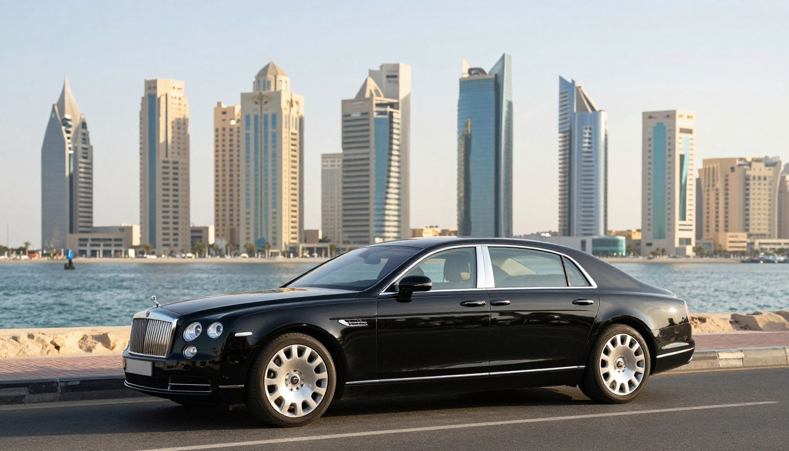
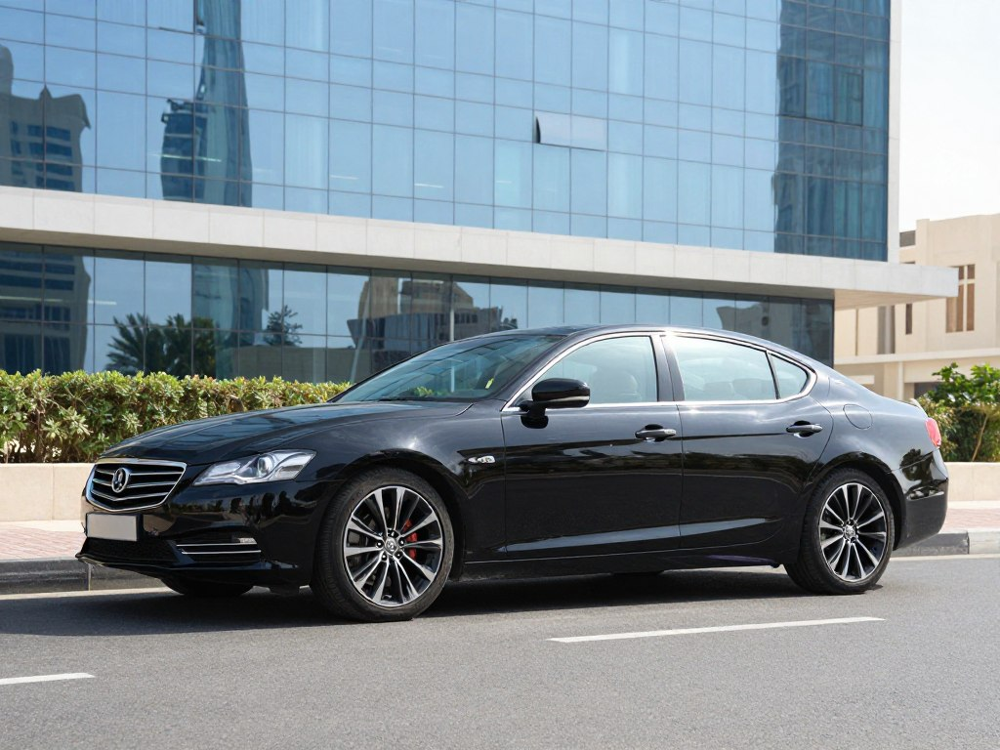
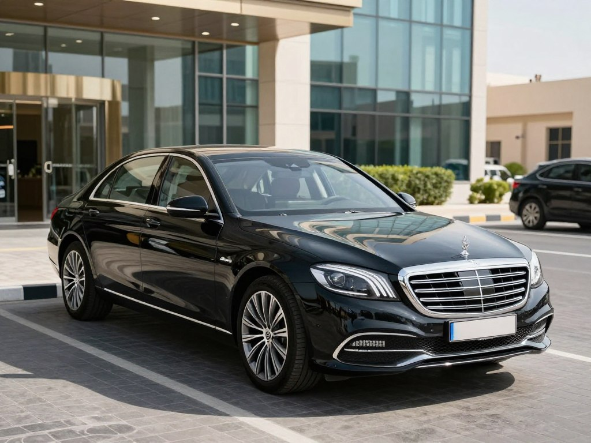
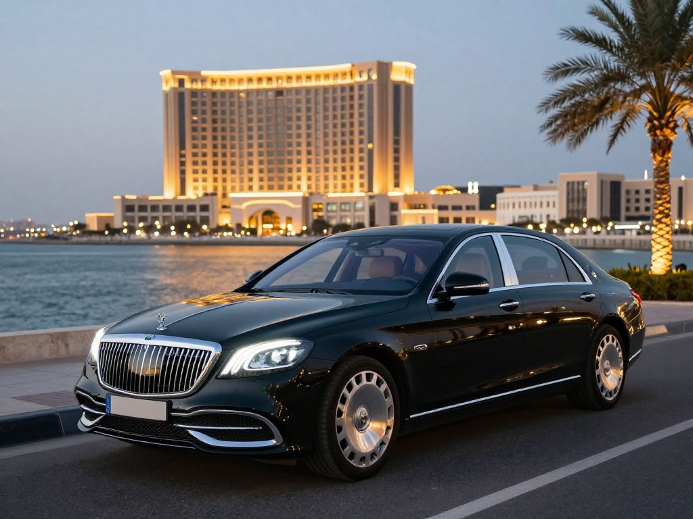
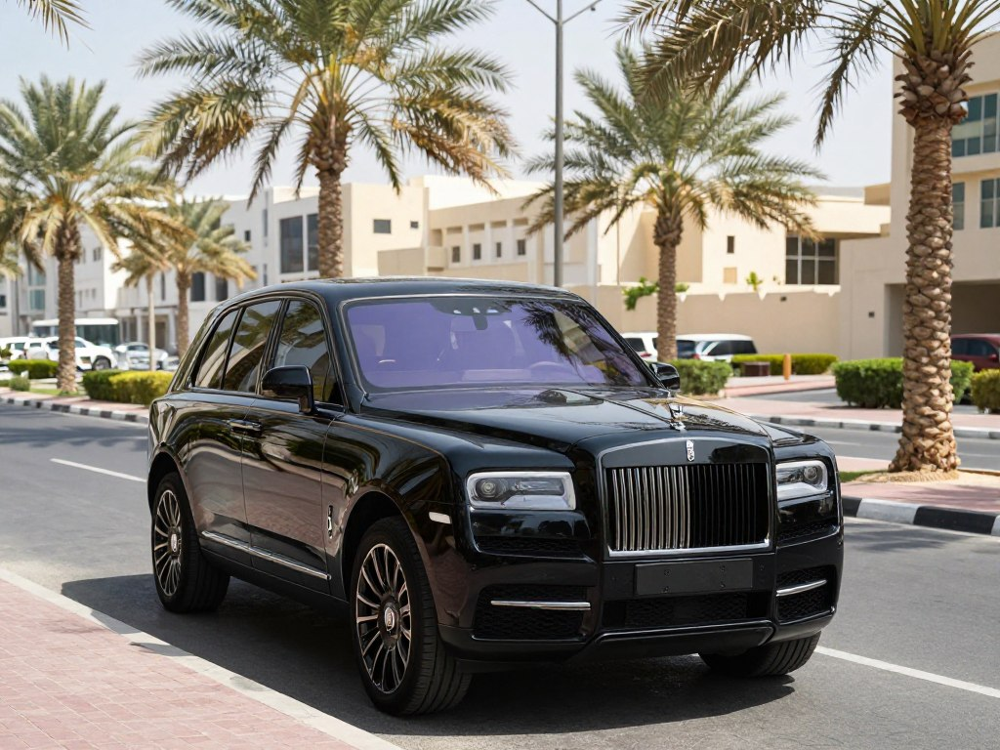
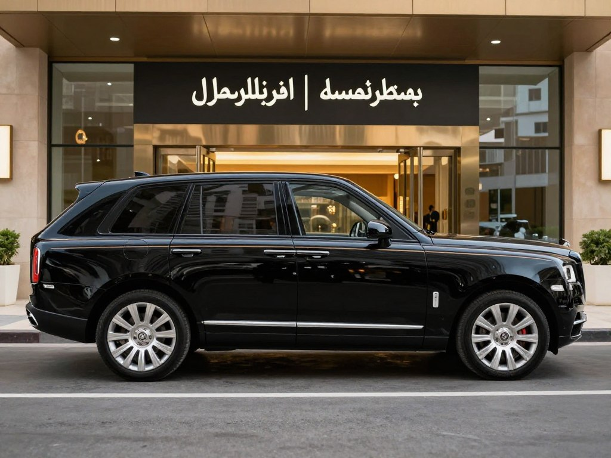
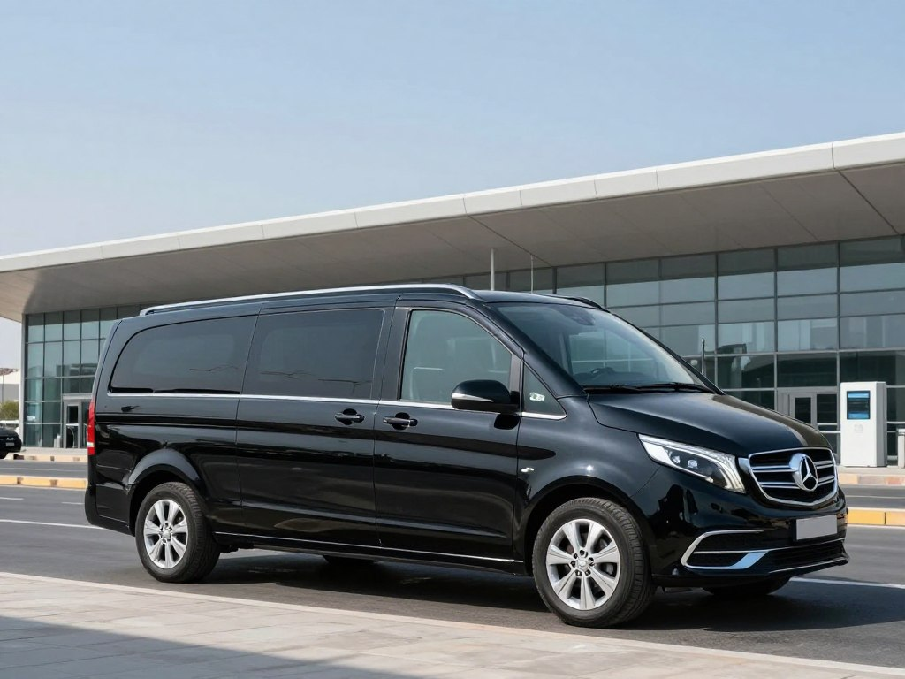

# **Chauffeur Service in Jeddah**

AB provides executive chauffeur service Jeddah solutions connecting King Abdulaziz International Airport (JED) to commercial districts, luxury coastal resorts and major regional hubs. Every itinerary across Jeddah receives central flight tracking, licensed chauffeurs and continuous operational oversight from our central dispatch team.

Corporate travellers, executive delegations and private clients rely on our immaculately prepared fleet for timely city transfers, full day hires and regional journeys along the Red Sea coast.

[Book now](https://seowriting.ai/services/chauffeur-vip/saudi-arabia/jeddah) [View the fleet](https://seowriting.ai/services/corporate-transportation/saudi-arabia/jeddah)

Pick up King Abdulaziz International Airport (JED)

Drop off Jeddah Corniche, Jeddah

Date and time \[Confirm: Date and time\]

[Get a quote](https://seowriting.ai/services/airport-transfers/saudi-arabia/jeddah)

The Jeddah fleet

## **Choose your Jeddah chauffeur class**

Every vehicle in our Jeddah fleet is GPS tracked and detailed before each journey. AB manages rigorous maintenance schedules, comprehensive commercial passenger insurance and vetted chauffeurs to support flawless itineraries across the Kingdom.

### **Standard Sedan**

Sedan · 3 guests · 2 bags

Typical model: Toyota Avalon or similar \[Confirm\]

Ideal for everyday executive city travel

Comfortable standard saloon travel designed for individual business travellers and daily point to point transfers through central Jeddah corporate corridors.

[Book this class](https://seowriting.ai/services/chauffeur-vip/saudi-arabia/jeddah) [Request a quote](https://seowriting.ai/services/corporate-transportation/saudi-arabia/jeddah) [Airport transfer](https://seowriting.ai/services/airport-transfers/saudi-arabia/jeddah) [Hourly chauffeur](https://seowriting.ai/services/chauffeur-vip/saudi-arabia/jeddah) [Full specifications](https://seowriting.ai/locations/saudi-arabia)

### **Business Sedan**

Sedan · 3 guests · 2 bags

Typical model: Mercedes E Class, BMW 5 Series or similar \[Confirm\]

Ideal for corporate roadshows and executives

Premium business comfort offering quiet interiors, leather seating and device charging for visiting management teams moving across commercial Jeddah.

[Book this class](https://seowriting.ai/services/chauffeur-vip/saudi-arabia/jeddah) [Request a quote](https://seowriting.ai/services/corporate-transportation/saudi-arabia/jeddah) [Airport transfer](https://seowriting.ai/services/airport-transfers/saudi-arabia/jeddah) [Hourly chauffeur](https://seowriting.ai/services/chauffeur-vip/saudi-arabia/jeddah) [Full specifications](https://seowriting.ai/locations/saudi-arabia)

### **First Class Sedan**

Flagship sedan · 3 guests · 2 bags

Typical model: Mercedes S Class, BMW 7 Series or similar \[Confirm\]

Ideal for diplomatic and VIP hospitality

The premier tier of ground transport, delivering whisper quiet ride comfort and prestige for dignitaries attending high level summits in Jeddah.

[Book this class](https://seowriting.ai/services/chauffeur-vip/saudi-arabia/jeddah) [Request a quote](https://seowriting.ai/services/corporate-transportation/saudi-arabia/jeddah) [Airport transfer](https://seowriting.ai/services/airport-transfers/saudi-arabia/jeddah) [Hourly chauffeur](https://seowriting.ai/services/chauffeur-vip/saudi-arabia/jeddah) [Full specifications](https://seowriting.ai/locations/saudi-arabia)

### **Executive SUV**

SUV · 6 guests · 5 bags

Typical model: Cadillac Escalade, GMC Yukon or similar \[Confirm\]

Ideal for executive delegations and families

Commanding presence and generous cabin volume, providing ample luggage capacity for long journeys and delegations arriving through the international terminal.

[Book this class](https://seowriting.ai/services/chauffeur-vip/saudi-arabia/jeddah) [Request a quote](https://seowriting.ai/services/corporate-transportation/saudi-arabia/jeddah) [Airport transfer](https://seowriting.ai/services/airport-transfers/saudi-arabia/jeddah) [Hourly chauffeur](https://seowriting.ai/services/chauffeur-vip/saudi-arabia/jeddah) [Full specifications](https://seowriting.ai/locations/saudi-arabia)

### **Premium MPV**

MPV · 6 guests · 5 bags

Typical model: Mercedes V Class or similar \[Confirm\]

Ideal for mobile meetings and conferences

Versatile face to face conference seating configurations that allow corporate teams to conduct productive working discussions between venues across the city.

[Book this class](https://seowriting.ai/services/chauffeur-vip/saudi-arabia/jeddah) [Request a quote](https://seowriting.ai/services/corporate-transportation/saudi-arabia/jeddah) [Airport transfer](https://seowriting.ai/services/airport-transfers/saudi-arabia/jeddah) [Hourly chauffeur](https://seowriting.ai/services/chauffeur-vip/saudi-arabia/jeddah) [Full specifications](https://seowriting.ai/locations/saudi-arabia)

### **Executive Van**

Van · 14 guests · 10 bags

Typical model: Mercedes Sprinter or similar \[Confirm\]

Ideal for large delegate group movements

Spacious group passenger charter for summit support, international sporting entourages and event personnel coordinating complex logistics across Jeddah.

[Book this class](https://seowriting.ai/services/bus-coach-hire/saudi-arabia/jeddah) [Request a quote](https://seowriting.ai/services/corporate-transportation/saudi-arabia/jeddah) [Airport transfer](https://seowriting.ai/services/airport-transfers/saudi-arabia/jeddah) [Hourly chauffeur](https://seowriting.ai/services/chauffeur-vip/saudi-arabia/jeddah) [Full specifications](https://seowriting.ai/locations/saudi-arabia)

Popular journeys

## **Across Jeddah and beyond**

AB coordinates seamless terminal pickups, city business transfers and scheduled long distance regional routes departing from the coastal city.

Airport transfer

### **JED to Jeddah Corniche**

Direct transfer from King Abdulaziz International Airport (JED) to luxury hotels, resorts and commercial residences along the scenic waterfront boulevard.

From \[SAR price\]

Airport transfer

### **JED to Al Balad**

Executive transit from arrivals directly to the historic coral stone heritage quarter and vibrant southern commercial districts.

From \[SAR price\]

City

### **Jeddah to Jeddah Superdome**

Punctual venue access for large scale trade exhibitions, consumer expos and major international sporting entertainment events.

From \[SAR price\]

Intercity

### **Jeddah to Makkah**

Specialised pilgrimage and VIP transfer service operating along the direct expressway corridor to central religious hospitality properties.

From \[SAR price\] · \[Confirm\] hours

Intercity

### **Jeddah to Madinah**

Comfortable long distance highway transit connecting coastal corporate bases with religious sites and regional commercial centres.

From \[SAR price\] · \[Confirm\] hours

Intercity

### **Jeddah to Taif**

Scenic regional transit climbing the Sarawat mountain range toward government facilities, agriculture centres and highland resorts.

From \[SAR price\] · \[Confirm\] hours

Intercity

### **Jeddah to King Abdullah Economic City**

Direct executive transport serving industrial port zones, corporate headquarters and coastal hospitality projects in KAEC.

From \[SAR price\] · \[Confirm\] hours

Explore our full regional coverage and book bespoke long distance routes via [intercity transfers](https://seowriting.ai/services/intercity-transfers) across Saudi Arabia.

Services in Jeddah

## **One partner for every movement in Jeddah**

AB delivers comprehensive ground transport programmes tailored for corporate organisations, government delegations, event planners and discerning private guests across Saudi Arabia.

- [Chauffeur & VIP in Jeddah](https://seowriting.ai/services/chauffeur-vip/saudi-arabia/jeddah)
- [Airport Transfers in Jeddah](https://seowriting.ai/services/airport-transfers/saudi-arabia/jeddah)
- [Corporate Transportation in Jeddah](https://seowriting.ai/services/corporate-transportation/saudi-arabia/jeddah)
- [Event Transportation in Jeddah](https://seowriting.ai/services/event-transportation/saudi-arabia/jeddah)
- [Bus & Coach Hire in Jeddah](https://seowriting.ai/services/bus-coach-hire/saudi-arabia/jeddah)
- [Tourism Transportation in Jeddah](https://seowriting.ai/services/tourism-transportation/saudi-arabia/jeddah)

Airport transfers

## **Arriving at King Abdulaziz International Airport (JED)**

Navigating arrival at King Abdulaziz International Airport (JED) is straightforward with our managed meet and greet protocol. Chauffeurs monitor incoming flights through active commercial tracking systems, adjusting for schedule revisions or gate holds automatically. After clearing customs, guests find their uniformed chauffeur holding an AB branded name board at the designated terminal meeting point \[Confirm\]. Complimenting the service is free waiting time \[Confirm\], allowing unhurried baggage reclaim and smooth transition directly to your waiting vehicle outside the terminal doors.

Flight tracking: Every arrival | Meet and greet: Inside the terminal | JED to Jeddah Corniche: \[Confirm\] minutes

Review comprehensive arrival arrangements, curbside staging procedures and terminal specific services on our dedicated [King Abdulaziz International Airport](https://seowriting.ai/airports/king-abdulaziz-international-jed) guide.

Coverage

## **Where we work in Jeddah**

AB provides licensed, GPS tracked vehicle coverage throughout all key commercial, industrial and cultural zones in metropolitan Jeddah. Our drivers navigate dense city streets, coastal avenues and major transport links with seasoned operational expertise.

### **Business**

- Al Andalus District
- Al Zahra District
- Prince Sultan Street Corridor

### **Events and conferences**

- Jeddah Superdome
- Jeddah Centre for Forums and Events
- Jeddah Corniche Circuit

### **Heritage and leisure**

- Al Balad Historic District
- Jeddah Waterfront Corniche
- Red Sea Mall

### **Government or Industry**

- Jeddah Islamic Port
- Industrial City One
- Al Ruwais Government District

Our office

## **AB Ground Transportation Support for Jeddah**

AB delivers reliable chauffeur service Jeddah coverage coordinated directly through our central Riyadh operations centre and twenty four hour dispatch facility. Continuous real time monitoring and local fleet dispatch support executive movements throughout the Western Province without delay.

### **AB Riyadh, headquarters and 24/7 dispatch \[Confirm nearest office\]**

Building 3036, Office 08, 2nd Floor, Umar Ibn Abdulaziz Road, Al Malaz, Riyadh, Saudi Arabia

+966 58 111 8720

[Get directions](https://seowriting.ai/locations/saudi-arabia)

Questions

## **Chauffeur service in Jeddah: your questions**

### **What is included in the chauffeur service Jeddah airport arrival package?**

Every arrival booked through AB at King Abdulaziz International Airport (JED) includes active flight tracking, inside terminal meet and greet with a personalised name board, luggage handling assistance and an agreed free waiting time \[Confirm\]. Chauffeurs guide guests directly to a climate controlled vehicle staged curbside.

### **How does AB manage flight delays at JED airport?**

Our operations dispatch monitors commercial aviation telemetry in real time. Pickup schedules adjust automatically when incoming passenger flights experience delays or schedule modifications, allowing chauffeurs to coordinate terminal curb staging precisely when the flight arrives at JED.

### **Which vehicle classes are available for corporate travel across Jeddah?**

Corporate clients can reserve Standard Sedans, Business Sedans such as the Mercedes E Class or similar \[Confirm\], First Class flagships including the Mercedes S Class or similar \[Confirm\], Executive SUVs like the Cadillac Escalade or GMC Yukon, Premium MPVs and multi passenger Executive Vans.

### **Can I book an hourly chauffeur service in Jeddah for multiple meetings?**

Yes, AB provides flexible hourly and full day chauffeur hire across Jeddah. Chauffeurs remain on standby between commercial appointments, hotel visits and business roadshows, giving executive travellers uninterrupted mobility without the need to arrange separate on demand rides.

### **Are intercity transfers available from Jeddah to Makkah, Madinah and Taif?**

AB provides licensed intercity private transfers departing from Jeddah to regional destinations including Makkah, Madinah, Taif and King Abdullah Economic City. Vehicles include water, high speed passenger connectivity and seasoned drivers familiar with regional Saudi highways.

### **Are vehicles and chauffeurs in Jeddah fully licensed and insured?**

All fleet vehicles operating in Jeddah carry commercial transport licensing and full passenger liability insurance coverage in accordance with Saudi Arabian regulatory requirements. Chauffeurs complete rigorous security vetting, defensive driving protocols and customer etiquette training.

### **How far in advance should I reserve private transport in Jeddah?**

While AB dispatch manages short notice bookings whenever capacity permits, booking in advance supports preferred vehicle availability during peak exhibition seasons, major religious holiday periods and international sporting events in Jeddah \[Confirm: booking lead time\].

## **Your chauffeur is ready in Jeddah.**

Experience reliable executive chauffeur service Jeddah support with twenty four hour dispatch, vetted professional drivers and premium vehicles across the Western Province. Contact our central operations desk at +966 58 111 8720 to confirm your transfer schedule.

### **Reserve your Jeddah executive vehicle**

Submit your travel schedule or request a bespoke corporate transport contract for upcoming corporate delegations and VIP events in Jeddah.

[Request a proposal](https://seowriting.ai/services/corporate-transportation/saudi-arabia/jeddah) [Book now](https://seowriting.ai/services/chauffeur-vip/saudi-arabia/jeddah)