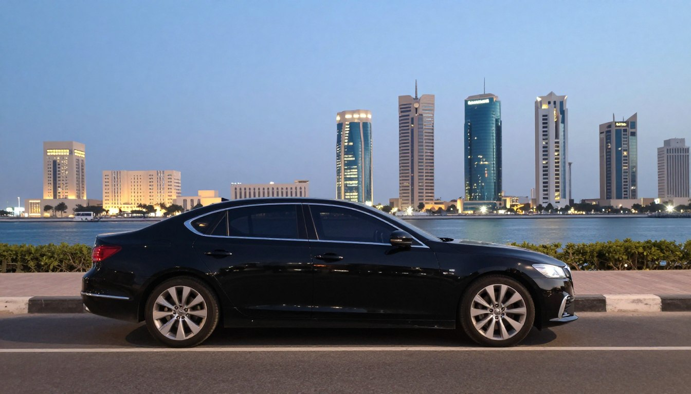
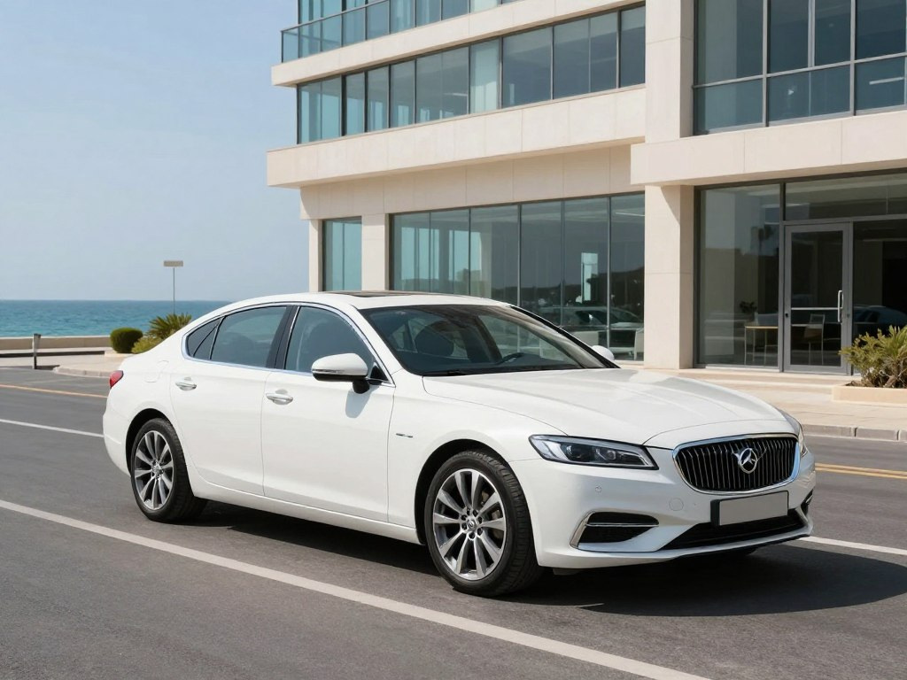
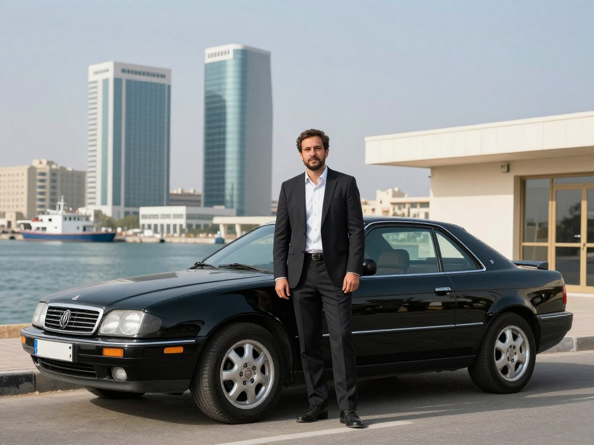
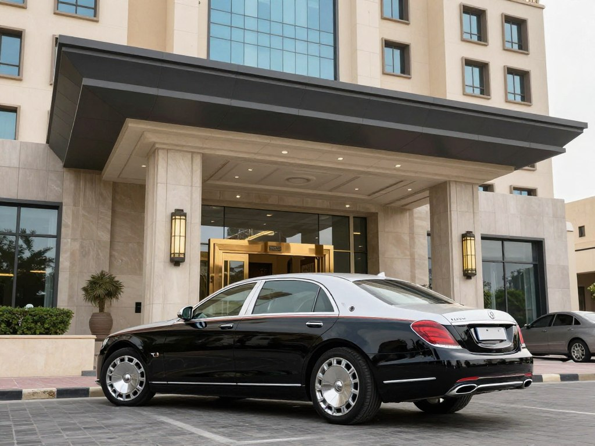
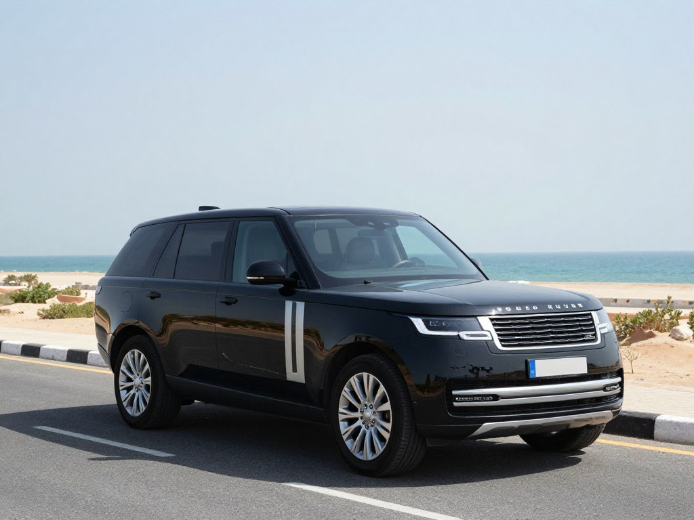
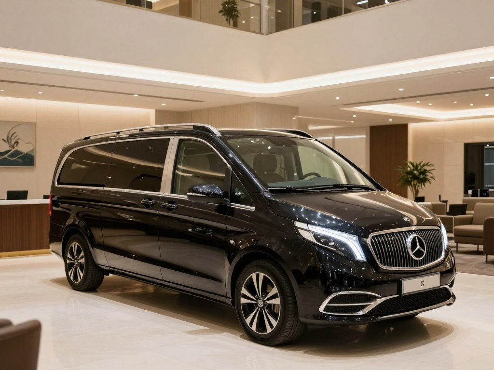
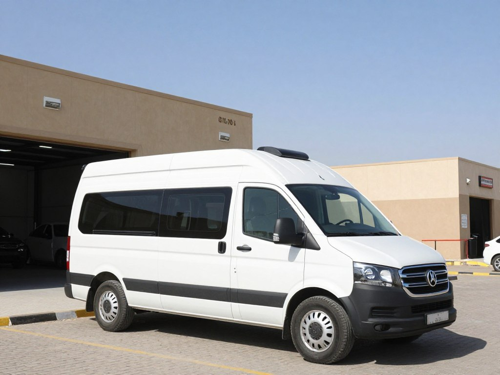

# **Chauffeur Service in Jizan**

AB provides executive chauffeur service Jizan solutions designed for regional commerce and official delegations. Passengers travelling through King Abdullah bin Abdulaziz Airport (GIZ) receive direct terminal reception. Coordinated itineraries across Jizan maintain continuous operations for every scheduled appointment.

[Book now](https://seowriting.ai/locations/saudi-arabia) [View the fleet](https://seowriting.ai/locations/saudi-arabia)

**Pick up:** King Abdullah bin Abdulaziz Airport (GIZ)

**Drop off:** Jizan Corniche, Jizan

**Date and time:** Select travel schedule

[Get a quote](https://seowriting.ai/locations/saudi-arabia)

The Jizan fleet

## **Choose your Jizan chauffeur class**

Vehicles for Jizan are dispatched from the nearest office, AB Riyadh headquarters \[Confirm nearest office\]. Each executive vehicle maintains strict safety standards, complete commercial passenger insurance, and verified comfort appointments.

### **Standard Sedan**

Sedan · 3 guests · 2 bags

Typical model: Toyota Camry or similar \[Confirm\]

Ideal for: Solo business journeys

This vehicle delivers efficient private driver Jizan transit for professionals needing dependable connections between local offices and regional work sites.

[Book this class](https://seowriting.ai/locations/saudi-arabia)

### **Business Sedan**

Sedan · 3 guests · 2 bags

Typical model: Mercedes E Class or similar \[Confirm\]

Ideal for: Corporate executive transit

Executive travellers obtain refined space, quiet cabin comfort, and reliable scheduling throughout urban destinations across Jizan.

[Book this class](https://seowriting.ai/locations/saudi-arabia)

### **First Class Sedan**

Flagship sedan · 3 guests · 2 bags

Typical model: Mercedes S Class or similar \[Confirm\]

Ideal for: VIP and diplomatic delegations

Our flagship option provides distinguished appointments, exceptional acoustic control, and premier protocol standards for demanding VIP itineraries in the province.

[Book this class](https://seowriting.ai/locations/saudi-arabia)

### **Executive SUV**

SUV · 6 guests · 5 bags

Typical model: Cadillac Escalade, GMC Yukon or similar \[Confirm\]

Ideal for: Leadership teams and site visits

Spacious seating and luggage capacity suit visiting leadership teams monitoring industrial developments across Jizan and neighbouring regional facilities.

[Book this class](https://seowriting.ai/locations/saudi-arabia)

### **Premium MPV**

MPV · 6 guests · 5 bags

Typical model: Mercedes V Class or similar \[Confirm\]

Ideal for: Small delegations requiring collaboration

Mobile workspace layouts permit visiting delegations to confer comfortably while moving between meetings across civic and commercial districts.

[Book this class](https://seowriting.ai/locations/saudi-arabia)

### **Executive Van**

Van · 14 guests · 10 bags

Typical model: Luxury Minibus or similar \[Confirm\]

Ideal for: Event crews and staff support

Generous passenger volume supports corporate event groups, crew logistics, and specialized event transport across southern Saudi Arabia.

[Book this class](https://seowriting.ai/locations/saudi-arabia)

Popular journeys

## **Across Jizan and beyond**

AB coordinates single transfers, full day hires, and regional road missions connecting air gateways, commercial nodes, and regional economic zones.

Airport transfer

### **GIZ to Jizan Corniche**

From \[SAR price\]

Direct passenger connection from flight arrivals to coastal commercial hotels and corporate waterfront apartments.

Airport transfer

### **GIZ to Jazan Economic City**

From \[SAR price\]

Dedicated long transit serving engineers, operational specialists, and international executives visiting major industrial installations.

City

### **Jizan to Sabya**

From \[SAR price\]

Reliable metropolitan link connecting the core administrative capital with commercial businesses located in Sabya.

Intercity

### **Jizan to Abha \[Confirm\]**

From \[SAR price\] · \[Confirm\] hours

Comfortable intercity transfer Jizan to the Asir mountain plateau for cross regional corporate travel.

Intercity

### **Jizan city to Jazan Economic City \[Confirm\]**

From \[SAR price\] · \[Confirm\] hours

Point to point executive car service connecting metropolitan offices with manufacturing and port facilities.

[Explore dedicated intercity travel routes](https://seowriting.ai/services/intercity-transfers)

Services in Jizan

## **One partner for every movement in Jizan**

AB delivers reliable corporate ground transportation, VIP logistics, and group passenger solutions tailored to complex business schedules across the region.

- [Chauffeur & VIP](https://seowriting.ai/locations/saudi-arabia)
- [Airport Transfers](https://seowriting.ai/locations/saudi-arabia)
- [Bus & Coach Hire arranged in Jizan](https://seowriting.ai/locations/saudi-arabia)

Airport transfers

## **Arriving at King Abdullah bin Abdulaziz Airport (GIZ)**

Arriving passengers step into an organised reception workflow handled by licensed professional chauffeurs. Every booking includes active flight tracking to monitor scheduled landing adjustments and arrival gate updates. Chauffeurs provide a formal meet and greet with name boards positioned at the terminal arrivals exit \[Confirm meeting point\]. Passengers benefit from inclusive free waiting time \[Confirm free waiting time\] allowing complete ease during luggage retrieval and customs processing. Corporate travel planners and executive assistants gain peace of mind through central dispatch updates confirming chauffeur on site status and passenger pickup confirmation.

**Flight tracking:** Every arrival

**Meet and greet:** Inside the terminal

**GIZ to Jizan Corniche:** \[Confirm\] minutes

[Review full airport transfer specifications](https://seowriting.ai/locations/saudi-arabia)

Coverage

## **Where we work in Jizan**

AB maintains extensive operational knowledge of regional municipal roads, private industrial security entries, and hospitality complexes across the Jizan province. Executive chauffeurs execute scheduled journeys with meticulous route navigation and local awareness.

### **Business**

Al Shati District

Courtyard Jazan Commercial Hub

Al Safa Financial Zone

### **Events and conferences**

Jazan Cultural Centre

Grand Millennium Conference Hall

Jazan Heritage Village Pavilion

### **Heritage and leisure**

Jazan Corniche Promenade

Al Dosariyah Castle

Farasan Islands Ferry Terminal

### **Government or Industry**

Jazan Economic City

Jazan Port Authority

Jazan University Administrative Complex

Our office

## **Central dispatch coordination for Jizan**

Ground operations in Jizan are actively supervised through our central headquarters. Our dispatch desk oversees driver schedules, fleet compliance, and real time passenger movements around the clock.

### **AB Riyadh (headquarters) \[Confirm nearest office\]**

Building 3036, Office 08, 2nd Floor, Umar Ibn Abdulaziz Road, Al Malaz, Riyadh, Saudi Arabia

+966 58 111 8720

[Get directions](https://seowriting.ai/locations/saudi-arabia)

Questions

## **Chauffeur service in Jizan: your questions**

### **What vehicle options are available for chauffeur service Jizan?**

AB provides standard sedans, executive business saloons, flagship luxury sedans like the Mercedes S Class, and spacious premium SUVs such as the Cadillac Escalade or GMC Yukon. For delegations, premium MPVs and executive vans accommodate larger corporate groups. Every vehicle is fully insured and licensed for commercial passenger carriage.

### **How are arrivals handled at King Abdullah bin Abdulaziz Airport (GIZ)?**

Your professional chauffeur tracks inbound flight status in real time to adapt to schedule variations. Upon arrival, the driver welcomes passengers inside the terminal with a personalized name board. Chauffeurs assist with luggage before escorting passengers to their awaiting vehicle for a smooth GIZ airport transfer.

### **Can I book an intercity transfer Jizan to other regional centres?**

Yes, AB coordinates direct intercity journeys from Jizan to destinations including Abha, Sabya, and Jazan Economic City. Chauffeurs manage route planning across regional highways, delivering relaxed travel without the delays of scheduled regional connections. Long distance itineraries may be booked as one way transfers or round trips.

### **Can corporate clients reserve an hourly private driver Jizan for full day meetings?**

Executive clients can reserve an hourly chauffeur or complete full day hire for complex schedules in Jizan. The assigned private driver remains on standby throughout the itinerary to accommodate multi stop agendas, changing meeting venues, and executive site visits. Central dispatch oversees ongoing route coordination.

### **What safety and insurance standards apply to AB operations in Jizan?**

All operations supervised by AB adhere to strict transport authority regulations within Saudi Arabia. Every chauffeur is professionally vetted, commercially licensed, and trained in passenger safety and discrete executive protocol. Vehicles undergo routine safety inspections and carry comprehensive commercial passenger insurance coverage.

### **Your chauffeur is ready in Jizan.**

Connect directly with our 24/7 central dispatch team at +966 58 111 8720 to confirm your executive chauffeur service Jizan booking.

[Book now](https://seowriting.ai/locations/saudi-arabia) [Request a proposal](https://seowriting.ai/locations/saudi-arabia)