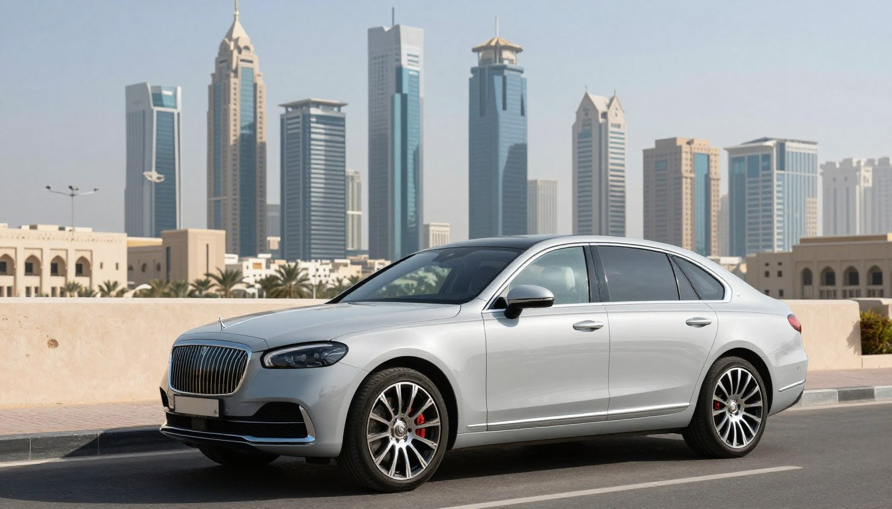
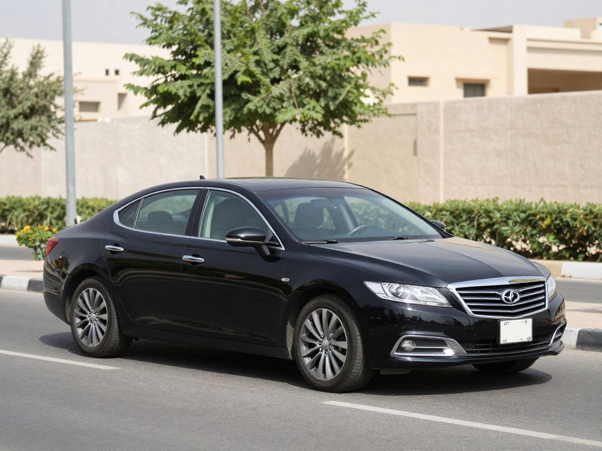
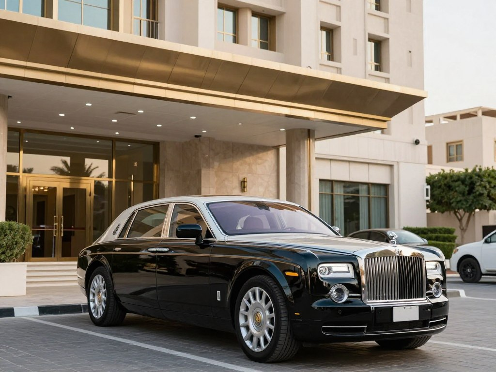
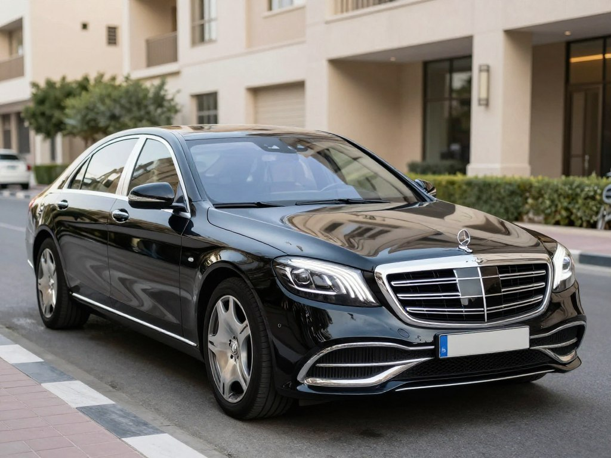
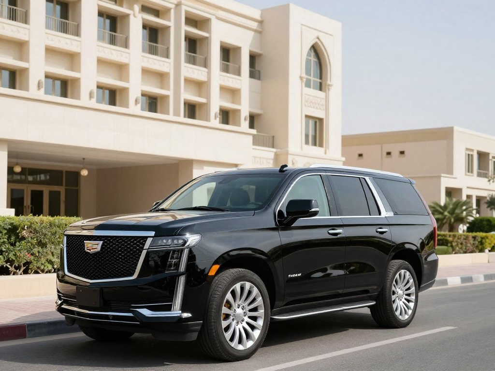
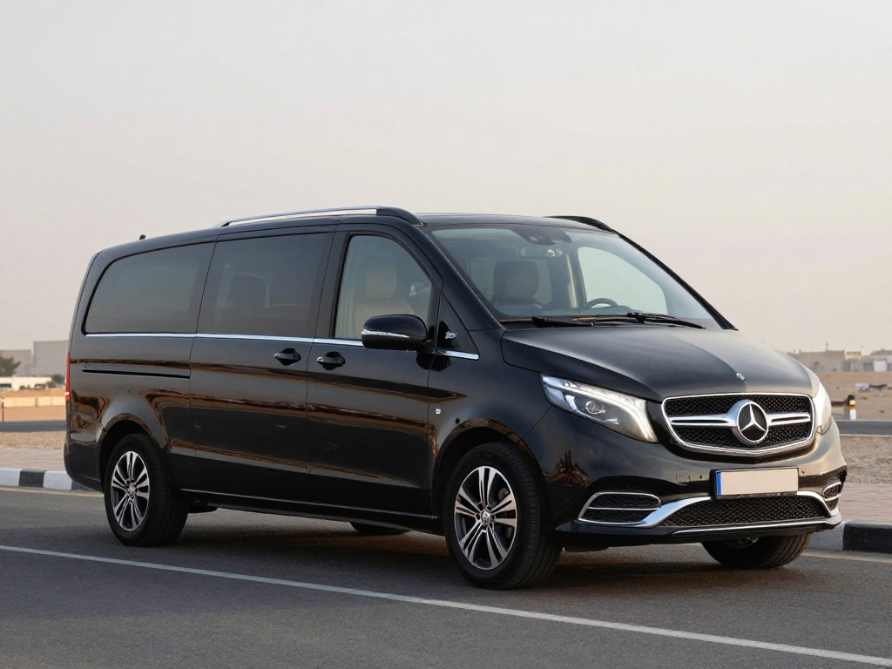
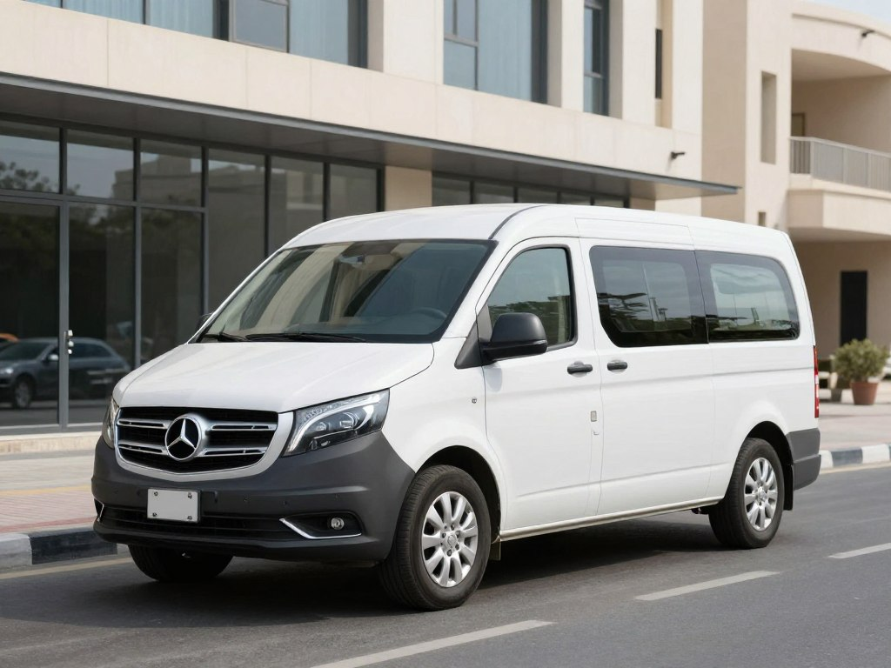

# **Chauffeur Service in Makkah**

AB provides executive ground mobility and professional chauffeur service Makkah for private delegations, business visitors, and pilgrims. Our discreet private driver team manages transfers between King Abdulaziz International Airport (JED) and prestigious hotels across Makkah with seamless coordination.

Each journey delivers exceptional punctuality, refined comfort, and operational precision throughout the holy city.

[Book now](https://seowriting.ai/services/chauffeur-vip/saudi-arabia/mecca) [View the fleet](https://seowriting.ai/services/bus-coach-hire/saudi-arabia/mecca)

**Pick up:** King Abdulaziz International Airport (JED)

**Drop off:** Makkah hotels near the Haram, Makkah

**Date and time:** Select travel schedule

[Get a quote](https://seowriting.ai/services/chauffeur-vip/saudi-arabia/mecca)

The Makkah fleet

## **Choose your Makkah chauffeur class**

Every vehicle in our Makkah fleet is GPS tracked and detailed before each journey. Our fleet options accommodate corporate executives, diplomatic visits, and extended family groups travelling together.

### **Standard Sedan**

Sedan · 3 guests · 2 bags

Typical model: Toyota Camry or similar \[Confirm\]

Ideal for: Solo business travellers and short transfers

Enjoy reliable urban transit and swift point to point journeys with our dependable standard sedan option across central Makkah.

[Book this class](https://seowriting.ai/services/chauffeur-vip/saudi-arabia/mecca)

### **Business Sedan**

Sedan · 3 guests · 2 bags

Typical model: Mercedes E Class or similar \[Confirm\]

Ideal for: Corporate meetings and daily transfers

Our business class vehicle provides leather seating, climate control, and generous legroom for productive business travel throughout Makkah districts.

[Request a quote](https://seowriting.ai/services/chauffeur-vip/saudi-arabia/mecca)

### **First Class Sedan**

Flagship sedan · 3 guests · 2 bags

Typical model: Mercedes S Class or similar \[Confirm\]

Ideal for: VIP delegates and senior executives

Experience premier automotive craftsmanship with acoustic insulation and supreme comfort tailored for prestigious journeys and discreet executive movement in Makkah.

[Airport transfer](https://seowriting.ai/services/chauffeur-vip/saudi-arabia/mecca)

### **Executive SUV**

SUV · 6 guests · 5 bags

Typical model: Cadillac Escalade, GMC Yukon or similar \[Confirm\]

Ideal for: Small delegations and family pilgrimage

Spacious luggage capacity combined with elevated ride height provides effortless regional transfers and comfortable group travel from Makkah to neighbouring destinations.

[Hourly chauffeur](https://seowriting.ai/services/chauffeur-vip/saudi-arabia/mecca)

### **Premium MPV**

MPV · 6 guests · 5 bags

Typical model: Mercedes V Class or similar \[Confirm\]

Ideal for: Executive teams and luggage flexibility

Face to face conference seating configurations and easy boarding make this luxury people carrier an exceptional choice for collaborative corporate delegations.

[Full specifications](https://seowriting.ai/services/chauffeur-vip/saudi-arabia/mecca)

### **Executive Van**

Van · 14 guests · 10 bags

Typical model: Mercedes Sprinter or similar \[Confirm\]

Ideal for: Large delegations and hospitality groups

Coordinated transport for large groups with ample baggage stowage and dedicated professional driver logistics across regional highway routes.

[Book this class](https://seowriting.ai/services/bus-coach-hire/saudi-arabia/mecca)

Popular journeys

## **Across Makkah and beyond**

AB coordinates individual city connections and extensive cross province routes with fixed transparent scheduling.

Airport transfer

### **JED to Makkah hotels near the Haram**

From \[SAR price\]

Direct private transfer from the airport terminal to luxury hotel towers in central Makkah.

City or Intercity

### **JED to Al Aziziyah**

From \[SAR price\]

Convenient scheduled service connecting arriving flights directly to residential and commercial quarters in Al Aziziyah.

City or Intercity

### **Makkah to Madinah**

From \[SAR price\] · \[Confirm\] hours

Seamless intercity transfer Makkah connection along the primary highway corridor linking both holy cities in complete comfort.

City or Intercity

### **Makkah to Jeddah**

From \[SAR price\] · \[Confirm\] hours

Executive ground transport between hospitality suites in Makkah and corporate headquarters or diplomatic offices in Jeddah.

Airport transfer

### **Jeddah airport (JED) to Makkah**

From \[SAR price\]

Full arrival assistance and rapid onward dispatch for regional international passengers arriving at terminal facilities.

City or Intercity

### **Makkah to Taif**

From \[SAR price\] · \[Confirm\] hours

Scenic and tranquil mountain route transit between Makkah and the highland city of Taif with experienced chauffeurs.

Explore comprehensive multi city travel options through our dedicated [Intercity Transfers](https://seowriting.ai/services/intercity-transfers) programme.

Services in Makkah

## **One partner for every movement in Makkah**

AB delivers comprehensive ground logistics including corporate transfers, executive events, and private pilgrimage travel across the Kingdom.

- Book our tailored [Chauffeur & VIP in Makkah](https://seowriting.ai/services/chauffeur-vip/saudi-arabia/mecca) service for high profile executives and private dignitaries.
- Coordinate large event movements through our dedicated [Bus & Coach Hire in Makkah](https://seowriting.ai/services/bus-coach-hire/saudi-arabia/mecca) fleet.
- Organise specialised pilgrim transfers via our professional [Religious Tourism](https://seowriting.ai/services/religious-tourism) logistics team.

Airport transfers

## **Arriving at King Abdulaziz International Airport (JED)**

Arriving at King Abdulaziz International Airport (JED) represents the start of your spiritual or professional mission in the western province. AB provides flight tracking on every flight, adjusting immediately for advance arrivals or unexpected airborne delays. Your professional chauffeur conducts a formal meet and greet with a personalised name board inside the terminal hall. The designated meeting point is \[Confirm\], where your luggage is handled with utmost care. Guests benefit from inclusive free waiting time of \[Confirm\] to clear immigration and baggage reclaim smoothly. Your dedicated vehicle then embarks on an unhindered journey to your accommodation in Makkah.

### **Flight tracking**

Every arrival is monitored in real time through our operations platform.

### **Meet and greet**

Inside the terminal with professional identification boards.

### **JED to Makkah hotels**

\[Confirm\] minutes to destinations near the Haram.

For additional details regarding arrival procedures, consult our dedicated [King Abdulaziz International Airport JED](https://seowriting.ai/airports/king-abdulaziz-international-jed) arrival resource.

Coverage

## **Where we work in Makkah**

AB supports corporate transport, religious movements, and government protocol assignments across Makkah. Our operational network covers major financial districts, conference facilities, and hospitality towers. Drivers strictly respect regulatory boundaries, acknowledging that non Muslims cannot enter the Haram area and re-routing appropriately across commercial sectors.

### **Business and Events**

- Al Aziziyah business district
- Makkah Chamber of Commerce
- Jabal Omar commercial centre
- Abraj Al Bait conference halls
- Umm Al Qura University convention centres
- Makkah Clock Royal Tower event venues

### **Heritage and Government**

- Makkah Museum in Al Zahir
- Hira Cultural District
- Mina and Arafat pilgrimage corridors
- Makkah Municipality Headquarters
- Emirate of Makkah Province offices
- Ministry of Hajj and Umrah facilities

Review additional regional mobility options across the country on our [Saudi Arabia Locations](https://seowriting.ai/locations/saudi-arabia) overview.

Our office

## **AB operations supporting Makkah**

AB supports Makkah through its integrated regional operations network and continuous 24/7 dispatch infrastructure. Central vehicle tracking and journey coordination are managed directly through our primary operations centre in the capital city. The nearest administrative base is AB Riyadh headquarters, subject to confirmation.

### **AB Riyadh, headquarters and 24/7 dispatch \[Confirm nearest office\]**

Building 3036, Office 08, 2nd Floor, Umar Ibn Abdulaziz Road, Al Malaz, Riyadh, Saudi Arabia

+966 58 111 8720

[Get directions](https://maps.google.com/maps?q=Building+3036+Office+08+Umar+Ibn+Abdulaziz+Road+Al+Malaz+Riyadh+Saudi+Arabia&output=embed)

Questions

## **Chauffeur service in Makkah: your questions**

### **How do I book a private chauffeur service in Makkah?**

You can reserve ground transport by submitting your flight and itinerary details through our online portal or contacting our central dispatch team. We confirm vehicle availability, dispatch details, and chauffeur contact information well before your departure. Our operations team remains available continuously to handle schedule changes and adjustments.

### **What is included with a JED airport transfer to Makkah?**

Every airport transfer from King Abdulaziz International Airport (JED) includes active flight tracking, terminal meet and greet, luggage assistance, and complimentary waiting time of \[Confirm\]. Your assigned driver greets you holding an official name board and assists with bags before departing directly for Makkah.

### **Can I reserve a private driver Makkah for hourly or daily hire?**

Yes, AB provides flexible hourly and full day hire packages designed for corporate meetings, delegation site visits, and multi stop itineraries across Makkah. Your dedicated vehicle and driver remain at your disposal throughout the contracted duration, assisting with unscheduled stops and route adjustments.

### **What vehicle options and luggage capacities are available in Makkah?**

Our fleet encompasses standard sedans, luxury business saloons such as the Mercedes S Class, executive SUVs like the Cadillac Escalade and GMC Yukon, and multi passenger vans including the Mercedes Sprinter. Standard sedans hold two bags while executive vans comfortably accommodate up to ten pieces of luggage.

### **How are intercity transfer Makkah journeys to Madinah or Taif arranged?**

Intercity transfers are scheduled with point to point precision between hotels, airports, and private residences. Chauffeurs familiar with long distance highways manage transit to Madinah, Jeddah, or Taif, incorporating planned rest breaks. Fixed pricing and transparent schedules provide predictability without unexpected roadside expenses.

### **Are AB vehicles and drivers licensed and insured for commercial service?**

All AB vehicles operate with comprehensive commercial passenger insurance, valid regulatory permits, and regular safety inspections. Our professional chauffeurs possess commercial driving licences, local geographic knowledge, and extensive etiquette training to support VIP delegations and corporate executives with supreme discretion.

### **What access rules apply to the Haram zone for private transport?**

Strict religious regulations designate the central Haram perimeter solely for Muslim visitors. Non Muslim passengers are safely routed to external commercial districts, corporate headquarters, and regional venues outside sacred boundaries. Chauffeurs possess required credentials to access authorised hotel forecourts near the Grand Mosque.

## **Your chauffeur is ready in Makkah.**

Reserve executive chauffeur service Makkah with our central dispatch team on +966 58 111 8720 for dependable corporate and VIP transport.

[Book now](https://seowriting.ai/services/chauffeur-vip/saudi-arabia/mecca) [Request a proposal](https://seowriting.ai/services/chauffeur-vip/saudi-arabia/mecca)