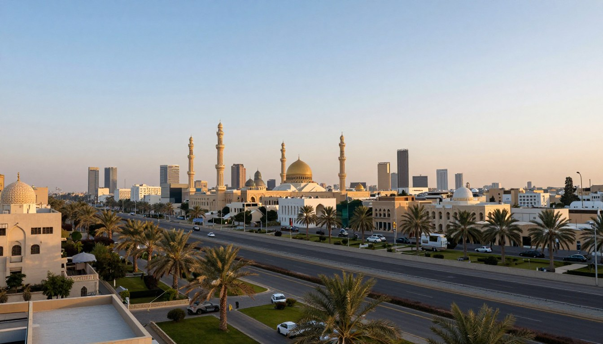
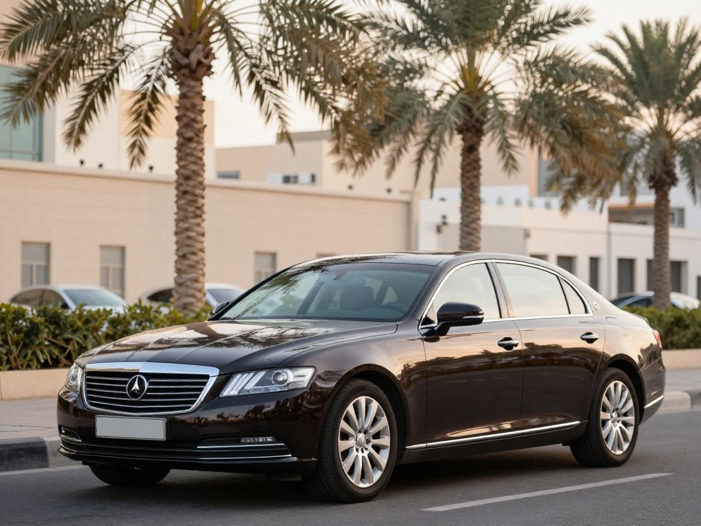
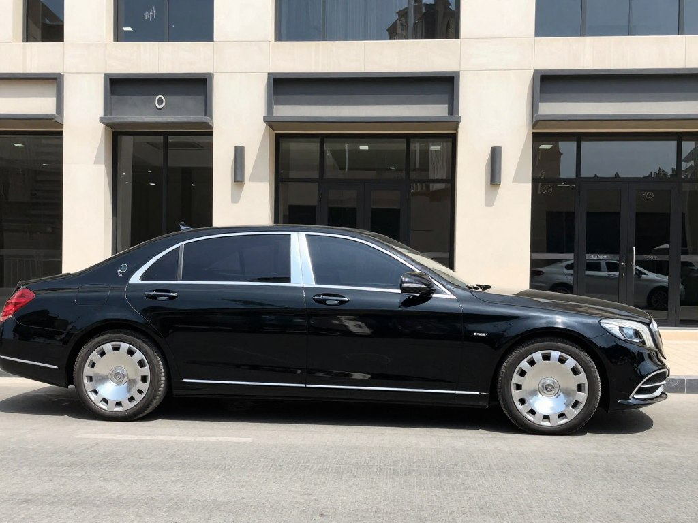
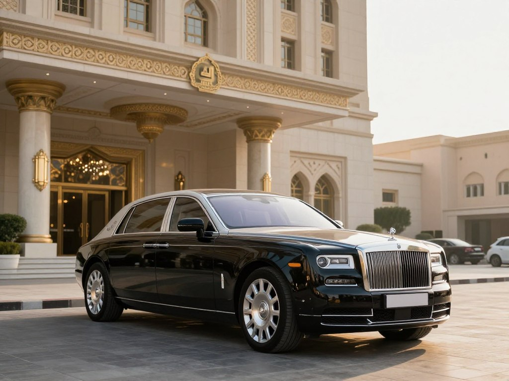
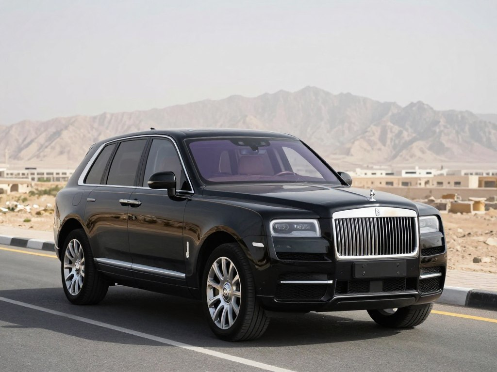
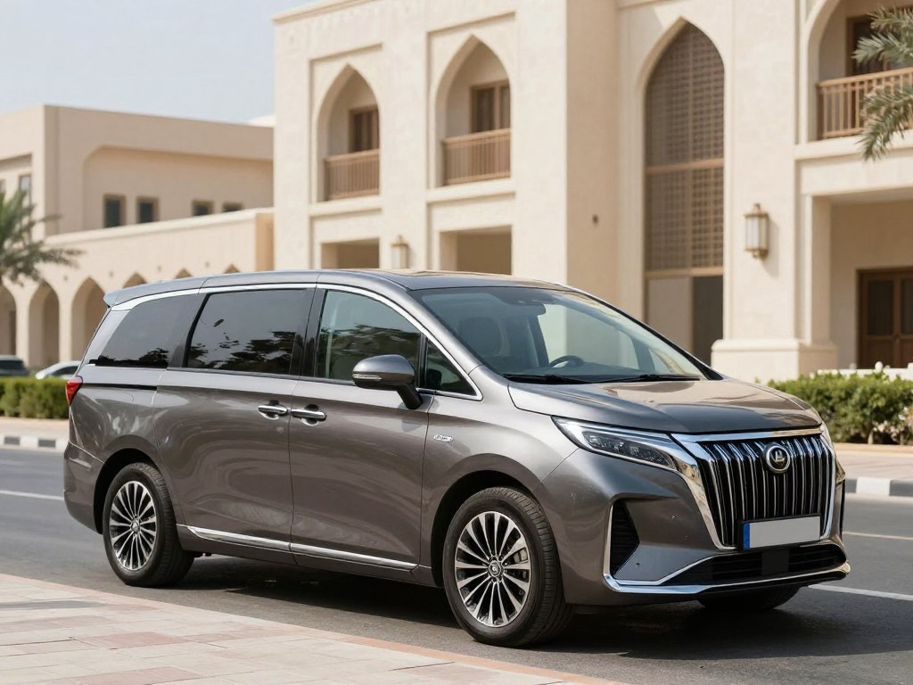
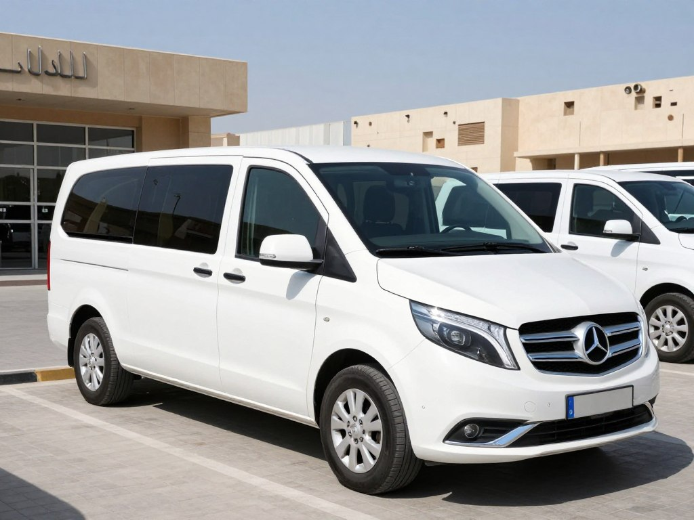
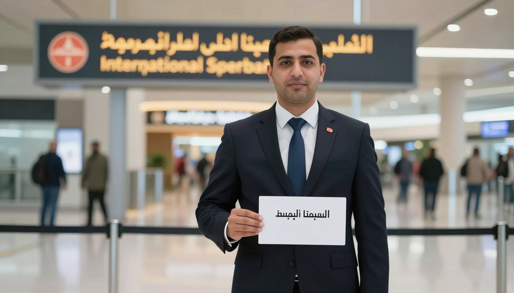

# **Chauffeur Service in Madinah**

AB provides a professional chauffeur service Madinah visitors and corporate delegations rely on for punctual ground transport. We deliver executive travel between Prince Mohammad bin Abdulaziz International Airport (MED), central business zones, holy landmarks and luxury hotels across Madinah.

[Book now](https://seowriting.ai/services/chauffeur-vip/saudi-arabia/medina) [View the fleet](https://seowriting.ai/services/bus-coach-hire/saudi-arabia/medina)

**Pick up:** Prince Mohammad bin Abdulaziz International Airport (MED)

**Drop off:** the Prophet's Mosque area, Madinah

**Date and time:** Scheduled upon reservation

[Get a quote](https://seowriting.ai/services/chauffeur-vip/saudi-arabia/medina)

The Madinah fleet

## **Choose your Madinah chauffeur class**

Every vehicle in our Madinah fleet is GPS tracked and detailed before each journey. AB maintains immaculate standards across all vehicle categories to support private passenger travel and delegation logistics.

### **Standard Sedan**

Sedan · 3 guests · 2 bags

Typical model: or similar \[Confirm\]

Ideal for: Solo business and airport transfers

This category delivers reliable private driver Madinah solutions for visiting executives needing swift city transfers. Guests enjoy calm interiors, climate control and dedicated luggage space for daily business appointments.

[Book this class](https://seowriting.ai/services/chauffeur-vip/saudi-arabia/medina)

### **Business Sedan**

Sedan · 3 guests · 2 bags

Typical model: or similar \[Confirm\]

Ideal for: Corporate executives and daily itineraries

Our business class option represents an elite limousine service Madinah professionals select for productive road travel. Passengers can work comfortably using onboard amenities while a professional chauffeur navigates local traffic.

[Book this class](https://seowriting.ai/services/chauffeur-vip/saudi-arabia/medina)

### **First Class Sedan**

Flagship sedan · 3 guests · 2 bags

Typical model: or similar \[Confirm\]

Ideal for: Dignitaries and VIP protocol transport

Experience premier VIP transport featuring flagship models such as the Mercedes S Class. Discretion, whisper quiet cabins and refined appointments create the finest travel environment available across the city.

[Book this class](https://seowriting.ai/services/chauffeur-vip/saudi-arabia/medina)

### **Executive SUV**

SUV · 6 guests · 5 bags

Typical model: or similar \[Confirm\]

Ideal for: Families and small executive teams

Spacious models like the Cadillac Escalade and GMC Yukon offer generous room for family groups or diplomatic details. High seating positions and ample luggage capacity make every city transit effortless.

[Book this class](https://seowriting.ai/services/chauffeur-vip/saudi-arabia/medina)

### **Premium MPV**

MPV · 6 guests · 5 bags

Typical model: or similar \[Confirm\]

Ideal for: Delegation transport and flexible meetings

Featuring vehicles like the Mercedes V Class, this category provides face to face conference seating options in Madinah. Delegations can coordinate schedules easily while moving between venues in total privacy.

[Book this class](https://seowriting.ai/services/chauffeur-vip/saudi-arabia/medina)

### **Executive Van**

Van · 14 guests · 10 bags

Typical model: or similar \[Confirm\]

Ideal for: Group transfers and event delegations

When standard cars are insufficient, this vehicle fulfills bus rental Madinah requirements for large groups. Generous overhead headroom and dedicated rear boot space accommodate luggage for extended pilgrim or corporate visits.

[Book this class](https://seowriting.ai/services/bus-coach-hire/saudi-arabia/medina)

[Request a quote](https://seowriting.ai/services/chauffeur-vip/saudi-arabia/medina) [Airport transfer](https://seowriting.ai/airports/prince-mohammad-bin-abdulaziz-med) [Hourly chauffeur](https://seowriting.ai/services/chauffeur-vip/saudi-arabia/medina) [Full specifications](https://seowriting.ai/services/chauffeur-vip/saudi-arabia/medina)

Popular journeys

## **Across Madinah and beyond**

AB provides fixed route precision for arrivals, local historic tours and direct highway journeys connecting key regional destinations.

Airport transfer

### **MED to the Prophet's Mosque area**

From \[SAR price\]

Direct transfer from the terminal gates to central district hotels with meet and greet service.

City

### **MED to Quba**

From \[SAR price\]

Dedicated driver transit to historic spiritual sites and surrounding residential quarters.

Intercity

### **Madinah to Makkah**

From \[SAR price\] · \[Confirm\] hours

Direct intercity transfer Madinah travellers reserve for comfortable highway travel between holy sanctuaries.

Intercity

### **Madinah to Jeddah**

From \[SAR price\] · \[Confirm\] hours

Smooth road connection to commercial headquarters, diplomatic missions and coastal marine terminals.

Intercity

### **Madinah to AlUla**

From \[SAR price\] · \[Confirm\] hours

Chauffeured regional itinerary to historic desert landscapes, heritage sites and luxury resorts.

Explore all cross province routes via our dedicated [intercity transfers](https://seowriting.ai/services/intercity-transfers) service network.

Services in Madinah

## **One partner for every movement in Madinah**

AB delivers comprehensive ground logistics across Saudi Arabia, supporting VIP visitors, corporate executives, event organisers and pilgrimage groups.

- Book our executive [Chauffeur & VIP in Madinah](https://seowriting.ai/services/chauffeur-vip/saudi-arabia/medina) service for private luxury transport.
- Organise high capacity fleet movements with [Bus & Coach Hire in Madinah](https://seowriting.ai/services/bus-coach-hire/saudi-arabia/medina) for large delegations.
- Coordinate dedicated pilgrim transport through our specialised [religious tourism](https://seowriting.ai/services/religious-tourism) itineraries.

Airport transfers

## **Arriving at Prince Mohammad bin Abdulaziz International Airport (MED)**

Arriving at Prince Mohammad bin Abdulaziz International Airport (MED) is simple when your private transfer is prearranged. AB provides an efficient MED airport transfer with real time flight tracking on every inbound journey. Your professional chauffeur greets you inside the terminal holding an official personalised name board. The driver assists with all luggage and escorts you directly to your waiting luxury car at the designated meeting point \[Confirm\]. Travellers benefit from free waiting time \[Confirm\] following international flight touchdown, allowing ample opportunity to complete customs and immigration procedures without haste.

**Flight tracking:** Every arrival

**Meet and greet:** Inside the terminal

**MED to the Prophet's Mosque area:** \[Confirm\] minutes

Learn detailed arrival guidance on our dedicated [Prince Mohammad bin Abdulaziz International Airport](https://seowriting.ai/airports/prince-mohammad-bin-abdulaziz-med) guide.

Coverage

## **Where we work in Madinah**

Our transport network operates throughout metropolitan Madinah, serving primary administrative areas, holy sanctuaries, business districts and hospitality destinations. AB chauffeurs possess extensive knowledge of municipal access routes and local protocol.

| Category               | Key Location               | Coverage Details                                                                                    |
| ---------------------- | -------------------------- | --------------------------------------------------------------------------------------------------- |
| Business               | Knowledge Economic City    | Executive transport serving corporate offices, technology parks and regional financial facilities.  |
| Business               | Madinah Chamber            | Scheduled mobility for trade delegates and international business leadership meetings.              |
| Business               | King Fahd District         | Commercial district chauffeuring for regional corporate headquarters and retail management centres. |
| Events and conferences | Madinah Meridian Hotel     | Event delegate shuttles and keynote speaker arrivals for major hotel conventions.                   |
| Events and conferences | Taibah University Hall     | Chauffeured ground logistics for academic symposiums and government educational forums.             |
| Events and conferences | Al Multaqa Center          | Private vehicle dispatch for civic exhibitions and professional corporate summits.                  |
| Heritage and leisure   | Al Masjid an Nabawi        | Dignified transit to the Prophet Mosque perimeter and neighbouring premier hotel plazas.            |
| Heritage and leisure   | Quba Mosque                | Private ziyarah tours and historic landmark excursions for visiting dignitaries.                    |
| Heritage and leisure   | Mount Uhud                 | Guided route transfers to cultural heritage sites and historic memorial grounds.                    |
| Government or Industry | Madinah Governorate        | Strict protocol transport for ministerial visitors and official diplomatic delegations.             |
| Government or Industry | Madinah Industrial City    | Secure transfers for technical consultants, site supervisors and industrial plant managers.         |
| Government or Industry | Al Munawwarah Municipality | Punctual transport serving civic governance complexes and urban planning offices.                   |

Our office

## **AB operations supporting Madinah**

AB manages comprehensive ground mobility across Madinah through our central regional infrastructure. As a premier provider headquartered in Riyadh, our centralised dispatch team coordinates licensed drivers, flight monitoring and on demand fleet allocations across the Kingdom.

### **AB Riyadh, headquarters \[Confirm nearest office\]**

Building 3036, Office 08, 2nd Floor, Umar Ibn Abdulaziz Road, Al Malaz, Riyadh, Saudi Arabia

Telephone: +966 58 111 8720

[Get directions](https://seowriting.ai/locations/saudi-arabia)

Questions

## **Chauffeur service in Madinah: your questions**

### **How do I book a chauffeur service Madinah transfer?**

Reservations can be submitted online or arranged directly through our round the clock dispatch team. Provide your travel date, pickup location, passenger count and preferred vehicle class to receive instant itinerary coordination.

### **What airport transfer services operate at Prince Mohammad bin Abdulaziz International Airport (MED)?**

AB provides scheduled terminal meet and greet arrivals, flight monitoring and direct hotel transfers at MED. Chauffeurs assist with baggage handling and guide passengers to premium vehicles parked in designated airport pickup bays.

### **Can I arrange an intercity transfer Madinah to Makkah or Jeddah?**

Yes, we operate long distance intercity transfers connecting Madinah to Makkah, Jeddah and AlUla. Passengers travel in premium sedans, luxury SUVs or spacious passenger vans with professional chauffeurs experienced on Saudi highway corridors.

### **Are chauffeurs in Madinah licensed and commercially insured?**

All AB chauffeurs hold full regulatory commercial licences and undergo comprehensive background vetting and defensive driving instruction. Every vehicle maintains comprehensive commercial passenger insurance in accordance with Saudi transport authorities.

### **Is hourly chauffeur hire available for ziyarah tours in Madinah?**

AB offers dedicated hourly and full day hire packages for ziyarah itineraries visiting historic landmarks throughout Madinah. Your private driver remains on standby throughout the duration of your visits to holy locations.

### **What vehicle options exist for large delegations needing transport in Madinah?**

For groups exceeding passenger car capacities, AB supplies executive passenger vans and luxury coaches. These group options ensure coordinated arrivals for conferences, large family groups and government delegations visiting Madinah venues.

### **How does AB monitor delayed flights arriving at MED?**

Our Riyadh dispatch centre tracks commercial and private aviation arrivals in real time using automated flight monitoring systems. Driver pickup times automatically adjust to actual landing times, preserving your complimentary waiting window.

## **Your chauffeur is ready in Madinah.**

Experience the premier chauffeur service Madinah relies on by contacting our twenty four hour dispatch office on +966 58 111 8720.

[Book now](https://seowriting.ai/services/chauffeur-vip/saudi-arabia/medina) [Request a proposal](https://seowriting.ai/services/chauffeur-vip/saudi-arabia/medina)