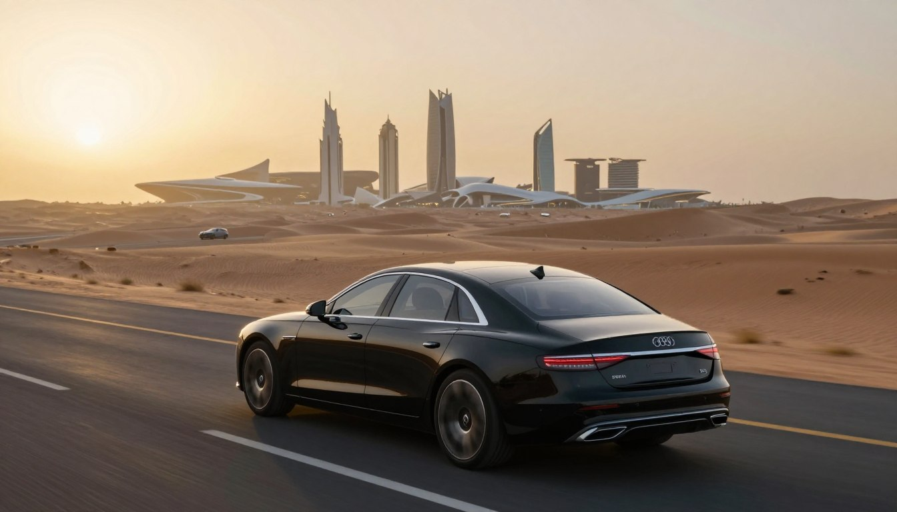
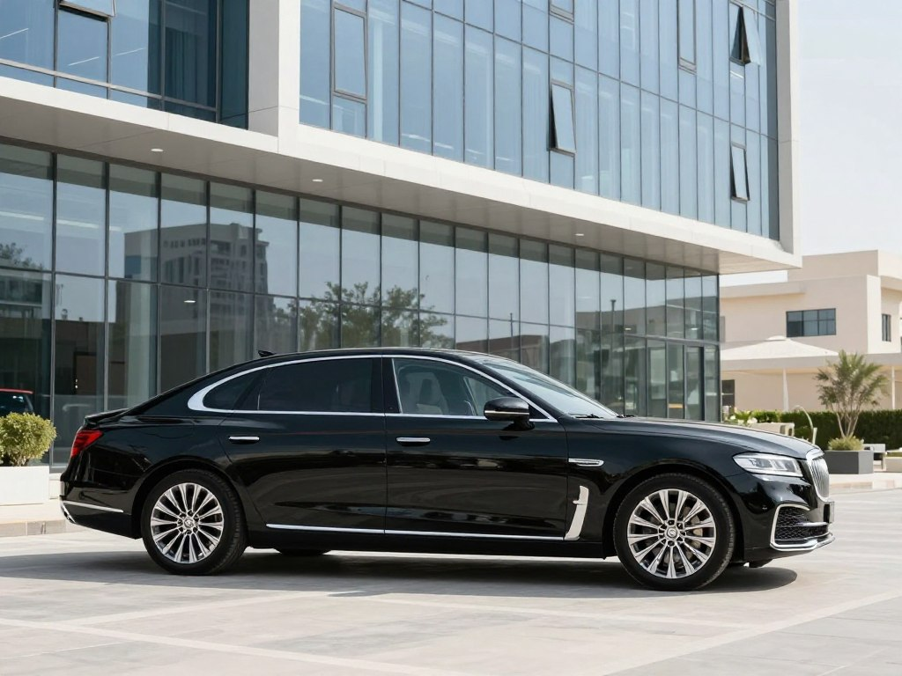
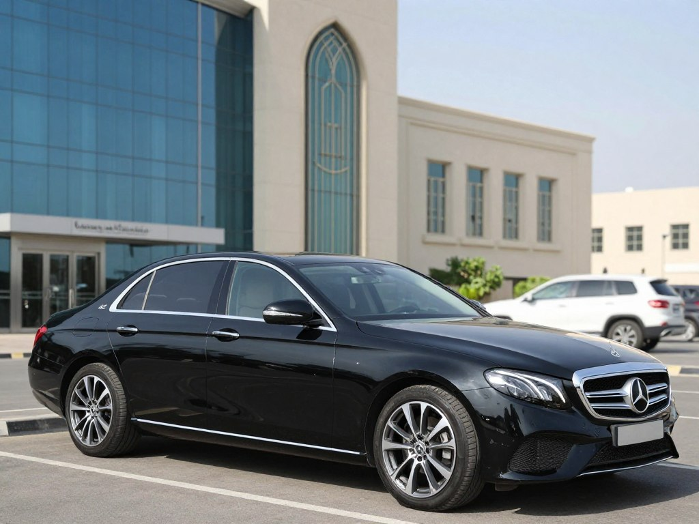
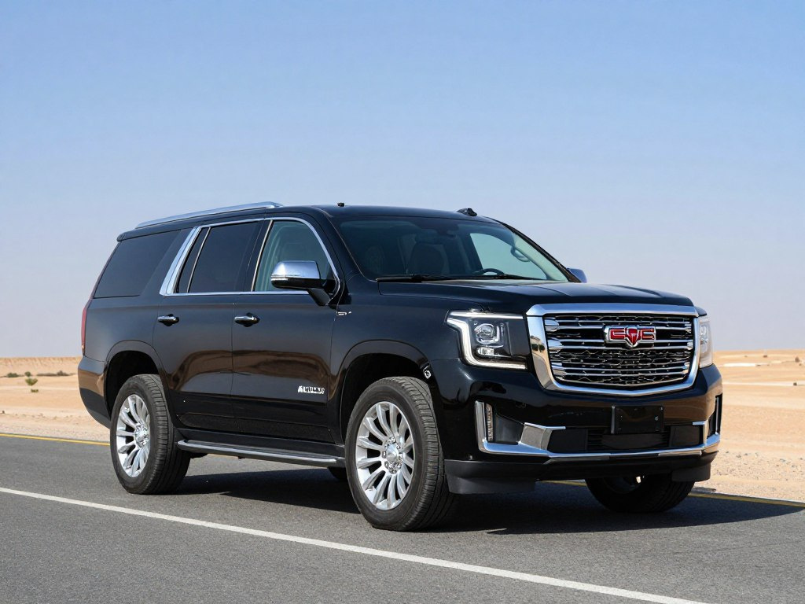
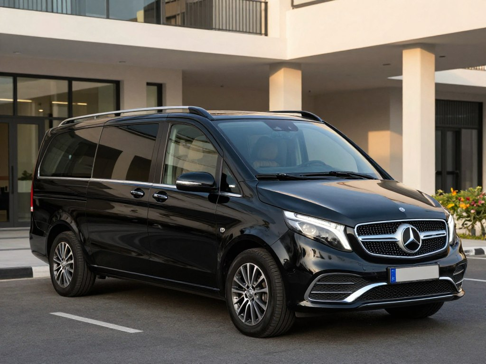
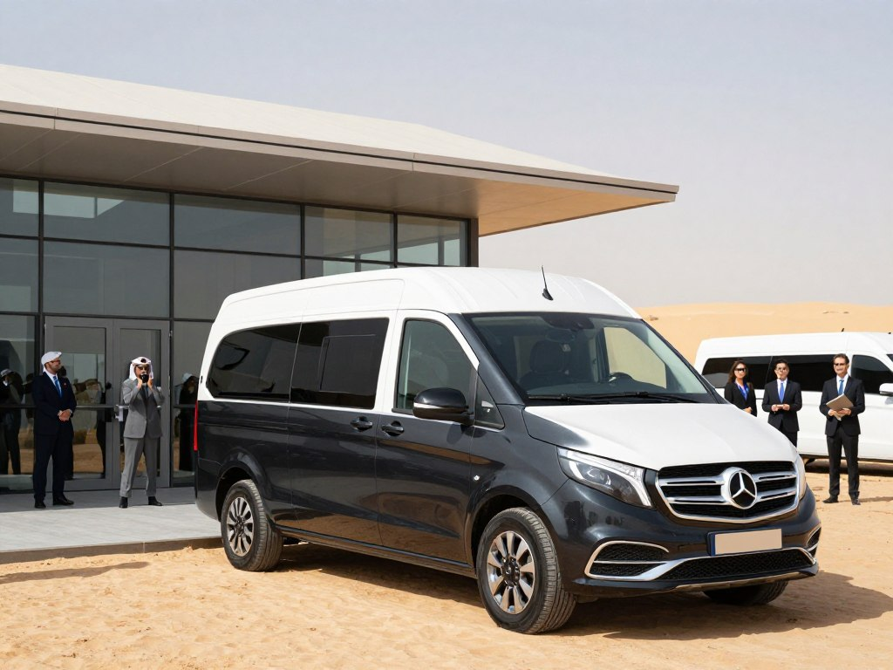

# **NEOM**

AB provides executive ground mobility and professional chauffeur service NEOM for global leadership teams and corporate visitors. Reliable transfers connect arrivals from NEOM Bay Airport (NUM) directly to regional project sectors across NEOM without delay. Every booking delivers refined comfort and coordinated executive travel across the northwest region of Saudi Arabia.

Ground operations in remote development areas demand structured fleet coordination, verified drivers and continuous operational communication. AB combines central dispatch capability with premium vehicles to manage individual journeys and complex delegation transfers throughout the region.

[Book now](https://seowriting.ai/services/chauffeur-vip/saudi-arabia/neom) [View the fleet](https://seowriting.ai/services/corporate-transportation/saudi-arabia/neom)

Pick up NEOM Bay Airport (NUM)

Drop off NEOM site offices, NEOM

Date and time \[Confirm date and time\]

[Get a quote](https://seowriting.ai/services/chauffeur-vip/saudi-arabia/neom)

The NEOM fleet

## **Choose your NEOM chauffeur class**

Every vehicle in our NEOM fleet is GPS tracked and detailed before each journey. AB deploys pristine executive cars, spacious sport utility vehicles and executive passenger vans configured for executive comfort across long desert distances.

### **Standard Sedan**

Sedan · 3 guests · 2 bags

Toyota Camry or similar \[Confirm\]

Ideal for individual business transfers

Comfortable daily transport for individual consultants and specialists moving between accommodation centres and operational offices across NEOM work sites.

[Book this class](https://seowriting.ai/services/chauffeur-vip/saudi-arabia/neom)

### **Business Sedan**

Sedan · 3 guests · 2 bags

Mercedes E Class or similar \[Confirm\]

Ideal for executive business meetings

Refined executive travel tailored for visiting corporate executives, project directors and technical consultants attending corporate conferences in NEOM.

[Book this class](https://seowriting.ai/services/chauffeur-vip/saudi-arabia/neom)

### **First Class Sedan**

Flagship sedan · 3 guests · 2 bags

Mercedes S Class or similar \[Confirm\]

Ideal for dignitary VIP travel

Flagship luxury car transport providing superior cabin quietness, executive seating and prestige mobility for government officials and VIP delegations visiting NEOM.

[Book this class](https://seowriting.ai/services/chauffeur-vip/saudi-arabia/neom)

### **Executive SUV**

SUV · 6 guests · 5 bags

Cadillac Escalade, GMC Yukon or similar \[Confirm\]

Ideal for site inspection tours

Spacious all terrain capability and luggage capacity suited for project site tours, leadership teams and cross sector regional travel throughout northwest Saudi Arabia.

[Book this class](https://seowriting.ai/services/chauffeur-vip/saudi-arabia/neom)

### **Premium MPV**

MPV · 6 guests · 5 bags

Mercedes V Class or similar \[Confirm\]

Ideal for mobile team discussions

Face to face conference seating configurations that allow management delegations and visiting investor teams to work comfortably while travelling across project destinations.

[Book this class](https://seowriting.ai/services/chauffeur-vip/saudi-arabia/neom)

### **Executive Van**

Van · 14 guests · 10 bags

Mercedes Sprinter or similar \[Confirm\]

Ideal for delegation group transfers

High capacity corporate transport built for technical delegations, media teams and event support personnel requiring coordinated transfers between remote camps and work sites.

[Book this class](https://seowriting.ai/services/corporate-transportation/saudi-arabia/neom)

Popular journeys

## **Across NEOM and beyond**

AB provides fixed point to point transfers, scheduled corporate shuttles and long distance intercity transfer NEOM routes connecting work sites, marine gateways and regional airports.

### **NUM to NEOM site offices**

Airport transfer

Direct terminal reception from NEOM Bay Airport (NUM) through to main administrative offices and project sector headquarters.

From \[SAR price\]

### **NUM to Sindalah**

Airport transfer

Dedicated private transfers connecting airport arrivals to island ferry departure terminals and coastal hospitality centres.

From \[SAR price\]

### **NEOM to Magna**

City or Intercity

Coastal corridor transport between central project operations and development clusters situated along the Gulf of Aqaba.

From \[SAR price\] · \[Confirm\] hours

### **NEOM to Tabuk**

City or Intercity

Regional highway connections linking construction sites and offices to commercial centres and Prince Sultan bin Abdulaziz Airport (TUU).

From \[SAR price\] · \[Confirm\] hours

### **NEOM project sites to accommodation \[Confirm\]**

City or Intercity

Structured shuttle services moving executive staff and specialist personnel between base camps, residential communities and active work sites.

From \[SAR price\] · \[Confirm\] hours

### **NEOM to AlUla**

City or Intercity

Scenic long distance transfers connecting major development sectors with heritage centres, luxury resorts and regional tourism hubs.

From \[SAR price\] · \[Confirm\] hours

Explore complete regional journey planning and booking options for [intercity transfers](https://seowriting.ai/services/intercity-transfers) across the Kingdom.

Services in NEOM

## **One partner for every movement in NEOM**

AB coordinates complete executive mobility programmes across northwest Saudi Arabia, supporting giga project delivery with managed fleets and experienced local drivers.

- [Chauffeur & VIP in NEOM](https://seowriting.ai/services/chauffeur-vip/saudi-arabia/neom) for dignitary protocol, leadership travel and discreet executive car service.
- [Corporate Transportation in NEOM](https://seowriting.ai/services/corporate-transportation/saudi-arabia/neom) for contractor mobility, workforce site movements and multi vehicle corporate programmes.
- [Bus & Coach Hire in NEOM](https://seowriting.ai/services/bus-coach-hire/saudi-arabia/neom) providing high capacity passenger coaches and staff bus rental NEOM solutions.

Airport transfers

## **Arriving at NEOM Bay Airport (NUM)**

Landing at NEOM Bay Airport (NUM) connects visitors directly to the future economic engine of Saudi Arabia. AB eliminates terminal delays by assigning an experienced private driver NEOM to track your inbound flight status in real time. Your professional chauffeur greets you inside the arrivals terminal displaying a digital name board, assists with heavy luggage and escorts you directly to an air conditioned vehicle parked in the executive collection area. Drivers monitor operational schedules continuously, providing comfortable transfers to project offices or accommodation camps.

Meeting point: \[Confirm\]. Free waiting time: \[Confirm\]. AB central dispatch coordinates every airport transfer with terminal security to support smooth vehicle access.

### **Flight tracking**

Every arrival is monitored automatically for early landings or flight diversions.

### **Meet and greet**

Inside the terminal with professional name boards and direct luggage assistance.

### **NUM to NEOM site offices**

\[Confirm\] minutes transit time depending on target sector and security checkpoint clearance.

Review comprehensive arrival procedures and terminal services on our [Saudi Arabia](https://seowriting.ai/locations/saudi-arabia) network page.

Coverage

## **Where we work in NEOM**

AB provides licensed, insured ground transport coverage across all active sectors, remote development clusters and residential communities in NEOM. Our drivers navigate complex project highway networks, maritime access roads and desert routes with precision.

### **Business**

- The Line operational sectors
- Oxagon industrial administration offices
- Trojena mountain planning offices

### **Events and conferences**

- Sindalah island visitor gateway
- NEOM Community innovation centres
- Regional investment pavilions

### **Heritage and leisure**

- Magna coastal development
- Gulf of Aqaba discovery points
- Sharma coastal leisure corridor

### **Government or Industry**

- NEOM Port and maritime logistics base
- Clean energy research facilities
- Regional workforce communities

### **Regional connections**

- Prince Sultan bin Abdulaziz Airport (TUU) in Tabuk
- Dubba coastal transit corridor
- Haql border entry zones

Our office

## **Managed Chauffeur Operations in NEOM**

AB coordinates ground transport across NEOM through our central 24/7 operations dispatch centre. While operations on the ground are managed by field dispatchers across northwest project sectors, regional management and administrative oversight are anchored at our headquarters in Riyadh.

### **AB Riyadh, headquarters \[Confirm nearest office\]**

Building 3036, Office 08, 2nd Floor, Umar Ibn Abdulaziz Road, Al Malaz, Riyadh, Saudi Arabia

Dispatch and customer reservations: +966 58 111 8720

[Get directions](https://maps.google.com/maps?q=Building+3036+Office+08+Al+Malaz+Riyadh+Saudi+Arabia&output=embed)

+966 58 111 8720

Questions

## **Chauffeur service in NEOM: your questions**

### **What vehicles are available for chauffeur service NEOM bookings?**

AB provides executive sedans, flagship luxury sedans, premium multi purpose vehicles and executive SUVs across NEOM. The fleet includes models like the Mercedes S Class, Mercedes E Class, Cadillac Escalade, GMC Yukon and Mercedes V Class or similar \[Confirm\]. All vehicles are maintained to strict corporate standards, featuring climate control, comprehensive insurance and tracking systems.

### **How does AB coordinate an NUM airport transfer?**

Arrival transfers from NEOM Bay Airport (NUM) include automated flight monitoring to accommodate early or delayed flights. Your allocated chauffeur waits inside the terminal holding a personalised name board. The driver assists with your luggage and guides you to an executive vehicle prepared for immediate departure.

### **Can I book an intercity transfer NEOM to Tabuk or AlUla?**

AB arranges dedicated intercity transfers from NEOM to major regional destinations including Tabuk, Prince Sultan bin Abdulaziz Airport (TUU) and AlUla. Journeys feature experienced chauffeurs familiar with northwest highway regulations, checkpoint protocols and desert driving conditions. Vehicles carry bottled water and mobile charging facilities for travel comfort.

### **Do you offer hourly chauffeur and full day hire in NEOM?**

AB offers flexible hourly hire and dedicated full day chauffeur services for visiting delegations, project inspections and corporate leadership itineraries. Your assigned driver remains at your disposal throughout the day to navigate between project sectors, client meetings and site base camps on a flexible schedule.

### **How are drivers vetted and licensed for project travel across NEOM?**

Every professional chauffeur operating with AB holds proper commercial driving credentials, local road knowledge and required security clearances for major industrial sites. Drivers adhere to rigorous defensive driving standards and client confidentiality protocols, providing safe corporate travel for senior executives and project partners.

### **What corporate transportation NEOM options exist for large delegations?**

AB manages comprehensive ground mobility programmes for large corporate groups, engineering teams and international delegations. Services include luxury Mercedes V Class multi purpose vehicles, executive passenger vans and high capacity bus rental NEOM coaches. Central dispatch coordinates complex multi vehicle logistics for conferences and workforce mobilization.

### **How do corporate clients arrange booking and billing with AB?**

Clients can book individual transfers or establish consolidated corporate accounts with monthly invoicing, centralized reporting and dedicated account management. The 24/7 Riyadh operations centre handles immediate reservations, itinerary adjustments and urgent dispatch requirements via telephone, email and corporate procurement channels.

## **Your chauffeur is ready in NEOM.**

Connect with our 24/7 central dispatch team on +966 58 111 8720 to reserve your luxury chauffeur service NEOM or coordinate comprehensive group transportation.

[Book now](https://seowriting.ai/services/chauffeur-vip/saudi-arabia/neom) [Request a proposal](https://seowriting.ai/services/corporate-transportation/saudi-arabia/neom)