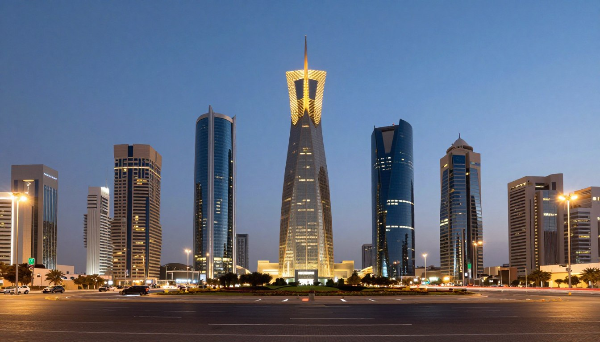
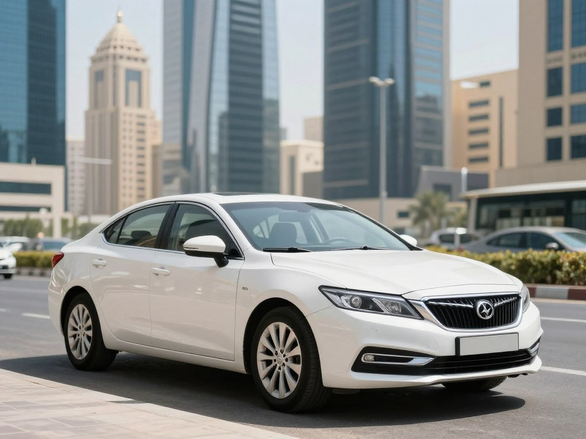
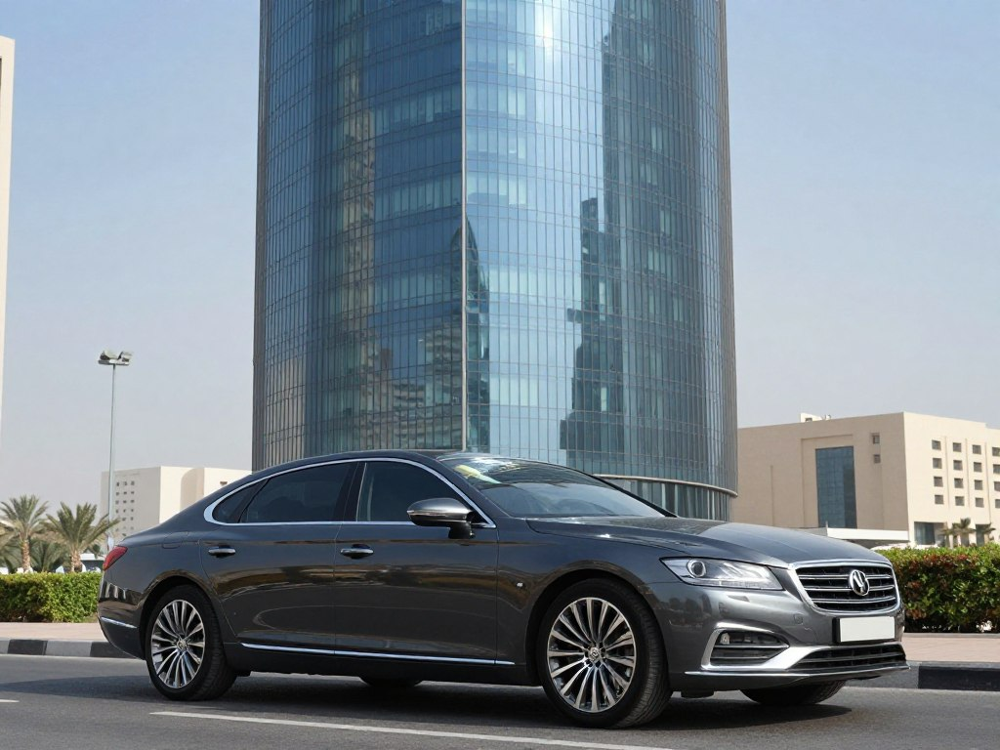
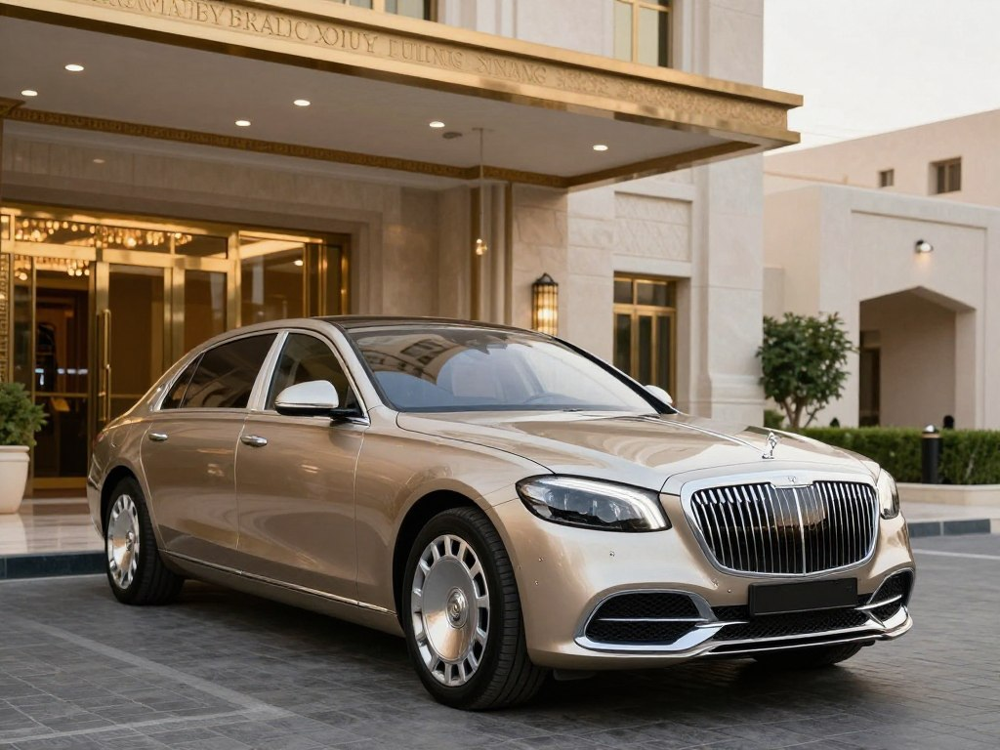
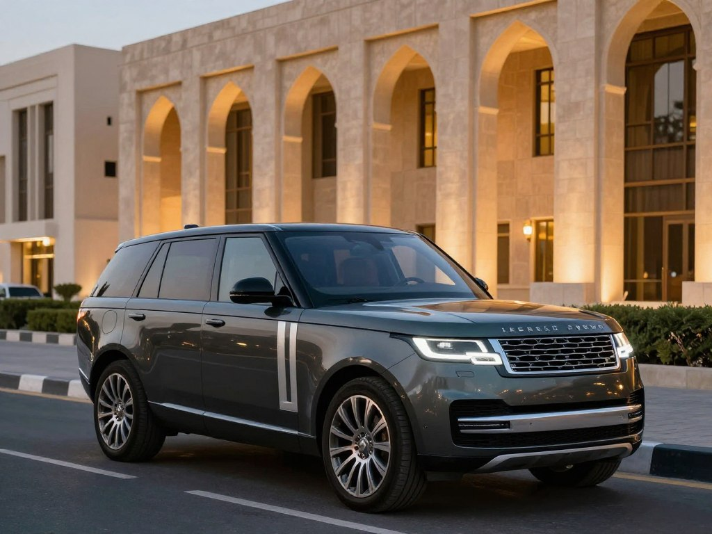
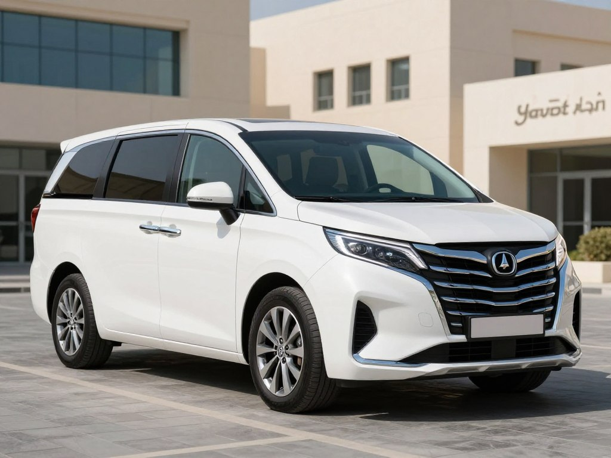
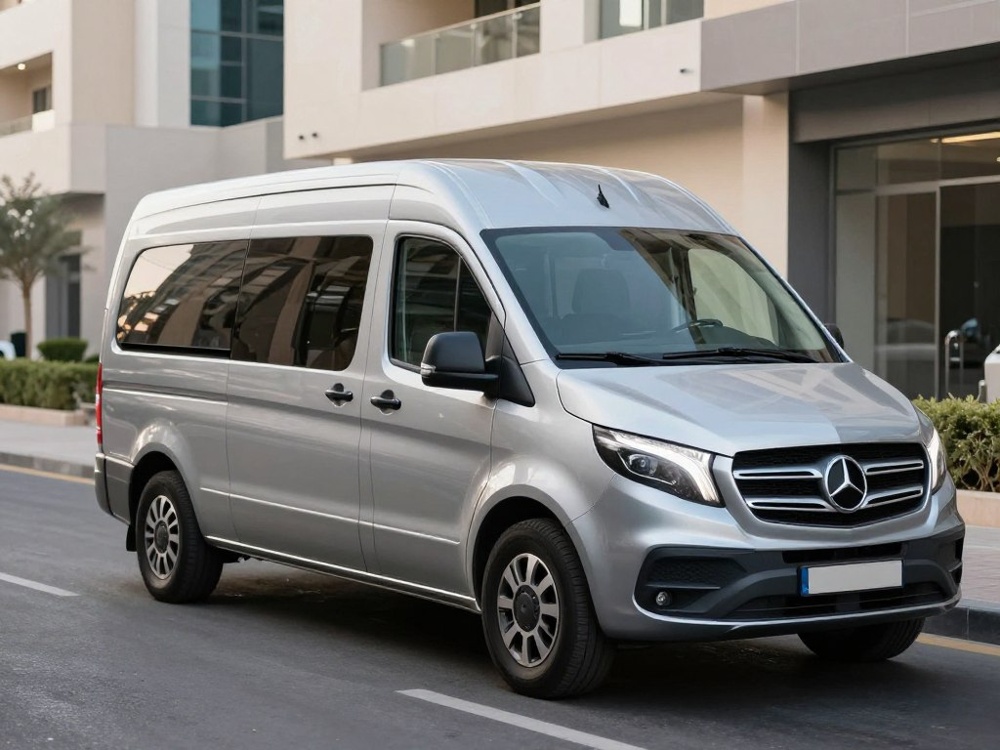

# **Chauffeur Service in Riyadh**

AB delivers executive chauffeur service Riyadh solutions tailored for corporate leaders, diplomatic delegations and international visitors. Our Riyadh network connects King Khalid International Airport (RUH) directly with central commercial hubs, private residences and government ministries.

Every itinerary across Riyadh operates under active central dispatch supervision to maintain absolute punctuality, refined passenger comfort and discreet execution.

[Book now](https://seowriting.ai/services/chauffeur-vip/saudi-arabia/riyadh) [View the fleet](https://seowriting.ai/services/corporate-transportation/saudi-arabia/riyadh)

**Pick up:** King Khalid International Airport (RUH)

**Drop off:** KAFD, Riyadh

**Date and time:** Select schedule

[Get a quote](https://seowriting.ai/services/airport-transfers/saudi-arabia/riyadh)

The Riyadh fleet

## **Choose your Riyadh chauffeur class**

Every vehicle in our Riyadh fleet is GPS tracked and detailed before each journey. Our fleet structure accommodates solo executive travel, visiting delegations, high profile delegations and coordinated corporate summit logistics across the capital.

### **Standard Sedan**

Sedan · 3 guests · 2 bags

**Typical model:** or similar \[Confirm\]

**Ideal for:** Individual corporate business travel

Comfortable executive travel across central Riyadh districts with climate control, bottled water and refined seating for daily meetings or city transfers.

[Book this class](https://seowriting.ai/services/chauffeur-vip/saudi-arabia/riyadh) [Request a quote](https://seowriting.ai/services/corporate-transportation/saudi-arabia/riyadh) [Airport transfer](https://seowriting.ai/services/airport-transfers/saudi-arabia/riyadh) [Hourly chauffeur](https://seowriting.ai/services/chauffeur-vip/saudi-arabia/riyadh) [Full specifications](https://seowriting.ai/services/corporate-transportation/saudi-arabia/riyadh)

### **Business Sedan**

Sedan · 3 guests · 2 bags

**Typical model:** or similar \[Confirm\]

**Ideal for:** Senior managers and visiting executives

Premium German saloons engineered for quiet productivity between corporate engagements in Riyadh financial hubs, equipped with device charging and plush upholstery.

[Book this class](https://seowriting.ai/services/chauffeur-vip/saudi-arabia/riyadh) [Request a quote](https://seowriting.ai/services/corporate-transportation/saudi-arabia/riyadh) [Airport transfer](https://seowriting.ai/services/airport-transfers/saudi-arabia/riyadh) [Hourly chauffeur](https://seowriting.ai/services/chauffeur-vip/saudi-arabia/riyadh) [Full specifications](https://seowriting.ai/services/corporate-transportation/saudi-arabia/riyadh)

### **First Class Sedan**

Flagship sedan · 3 guests · 2 bags

**Typical model:** Mercedes S Class or similar \[Confirm\]

**Ideal for:** Diplomatic protocol and VIP passengers

Flagship luxury vehicles offering supreme acoustic isolation, rear executive legroom and bespoke private driver Riyadh service for state guests and corporate leaders.

[Book this class](https://seowriting.ai/services/chauffeur-vip/saudi-arabia/riyadh) [Request a quote](https://seowriting.ai/services/corporate-transportation/saudi-arabia/riyadh) [Airport transfer](https://seowriting.ai/services/airport-transfers/saudi-arabia/riyadh) [Hourly chauffeur](https://seowriting.ai/services/chauffeur-vip/saudi-arabia/riyadh) [Full specifications](https://seowriting.ai/services/corporate-transportation/saudi-arabia/riyadh)

### **Executive SUV**

SUV · 6 guests · 5 bags

**Typical model:** Cadillac Escalade, GMC Yukon or similar \[Confirm\]

**Ideal for:** Small executive teams and delegations

Commanding cabin space, ample luggage volume and elevated safety for executive delegations navigating Riyadh expressways and regional transfer corridors.

[Book this class](https://seowriting.ai/services/chauffeur-vip/saudi-arabia/riyadh) [Request a quote](https://seowriting.ai/services/corporate-transportation/saudi-arabia/riyadh) [Airport transfer](https://seowriting.ai/services/airport-transfers/saudi-arabia/riyadh) [Hourly chauffeur](https://seowriting.ai/services/chauffeur-vip/saudi-arabia/riyadh) [Full specifications](https://seowriting.ai/services/corporate-transportation/saudi-arabia/riyadh)

### **Premium MPV**

MPV · 6 guests · 5 bags

**Typical model:** Mercedes V Class or similar \[Confirm\]

**Ideal for:** Roadshow teams and conference groups

Configured with face to face conference seating, spacious sliding access and silent cabin climate systems for business roadshows across the Kingdom capital.

[Book this class](https://seowriting.ai/services/chauffeur-vip/saudi-arabia/riyadh) [Request a quote](https://seowriting.ai/services/corporate-transportation/saudi-arabia/riyadh) [Airport transfer](https://seowriting.ai/services/airport-transfers/saudi-arabia/riyadh) [Hourly chauffeur](https://seowriting.ai/services/chauffeur-vip/saudi-arabia/riyadh) [Full specifications](https://seowriting.ai/services/corporate-transportation/saudi-arabia/riyadh)

### **Executive Van**

Van · 14 guests · 10 bags

**Typical model:** or similar \[Confirm\]

**Ideal for:** Corporate group transit and summits

Specialised group transport offering generous head clearance, individual seating and dedicated luggage bays for summit delegations travelling throughout Riyadh.

[Book this class](https://seowriting.ai/services/chauffeur-vip/saudi-arabia/riyadh) [Request a quote](https://seowriting.ai/services/corporate-transportation/saudi-arabia/riyadh) [Airport transfer](https://seowriting.ai/services/airport-transfers/saudi-arabia/riyadh) [Hourly chauffeur](https://seowriting.ai/services/chauffeur-vip/saudi-arabia/riyadh) [Full specifications](https://seowriting.ai/services/corporate-transportation/saudi-arabia/riyadh)

Popular journeys

## **Across Riyadh and beyond**

AB coordinates scheduled point to point transfers, airport arrivals and regional intercity itineraries. Each route features dedicated vehicle preparation, active GPS navigation and professional chauffeurs familiar with local traffic patterns.

Airport transfer

### **RUH to KAFD**

Direct connection from King Khalid International Airport terminal to the financial towers of King Abdullah Financial District.

**From \[SAR price\]**

Airport transfer

### **RUH to Diplomatic Quarter**

Discreet transit from airport arrival halls to embassies, international organisations and residences in the Diplomatic Quarter.

**From \[SAR price\]**

City

### **Riyadh to Diriyah**

Seamless transfers between central Riyadh hotels and the historic cultural precinct of At Turaif in Diriyah.

**From \[SAR price\]**

City

### **Riyadh to Riyadh Front**

Fast corporate mobility linking downtown commercial offices with exhibition centres and corporate campuses at Riyadh Front.

**From \[SAR price\]**

Intercity

### **Riyadh to Dammam**

Long distance highway transit across the Eastern Province corridor with spacious executive seating and verified rest halts.

**From \[SAR price\] · \[Confirm\] hours**

Intercity

### **Riyadh to Al Khobar**

Dedicated chauffeured intercity transfer connecting central Riyadh corporate offices directly with Al Khobar waterfront business districts.

**From \[SAR price\] · \[Confirm\] hours**

Intercity

### **Riyadh to Al Qassim (Buraydah)**

Direct northern transit serving agricultural and commercial headquarters in Buraydah with comfortable cabin amenities.

**From \[SAR price\] · \[Confirm\] hours**

Intercity

### **Riyadh to Jeddah**

Transpeninsular long distance chauffeur service linking the political capital with the commercial hub on the Red Sea coast.

**From \[SAR price\] · \[Confirm\] hours**

Review comprehensive booking parameters and fleet allocations for regional journeys through our [intercity transfers](https://seowriting.ai/services/intercity-transfers) service schedule.

Services in Riyadh

## **One partner for every movement in Riyadh**

AB coordinates comprehensive ground mobility programs designed to support executive travel, corporate events, large groups and specialised leisure itineraries throughout the capital.

- [Chauffeur & VIP in Riyadh](https://seowriting.ai/services/chauffeur-vip/saudi-arabia/riyadh) for executive discretion, luxury sedans and bespoke daily driver arrangements.
- [Airport Transfers in Riyadh](https://seowriting.ai/services/airport-transfers/saudi-arabia/riyadh) for terminal meet and greet coordination, luggage handling and punctual terminal departures.
- [Corporate Transportation in Riyadh](https://seowriting.ai/services/corporate-transportation/saudi-arabia/riyadh) for recurring executive commutes, multi stop roadshows and financial district client shuttles.
- [Event Transportation in Riyadh](https://seowriting.ai/services/event-transportation/saudi-arabia/riyadh) for trade exhibitions, governmental summits, international conferences and private corporate galas.
- [Bus & Coach Hire in Riyadh](https://seowriting.ai/services/bus-coach-hire/saudi-arabia/riyadh) for large delegate movements, staff transport contracts and high capacity charter requirements.
- [Tourism Transportation in Riyadh](https://seowriting.ai/services/tourism-transportation/saudi-arabia/riyadh) for guided heritage excursions, architectural visits and cultural travel programs.

Airport transfers

## **Arriving at King Khalid International Airport (RUH)**

Inbound flights at King Khalid International Airport (RUH) receive real time monitoring through our operations desk. Your professional chauffeur tracks flight movements, adjusts pickup timing for landing variances and conducts an indoor meet and greet with a clear passenger name board. The designated airport meeting point \[Confirm\] provides immediate visual orientation once you exit customs into the terminal arrival concourse.

Every commercial airport transfer includes generous complimentary waiting time \[Confirm\] to accommodate immigration lines and luggage reclaim. Chauffeurs assist with bags before escorting guests directly to the pre positioned executive car service outside the terminal curbside.

**Flight tracking:** Every arrival

**Meet and greet:** Inside the terminal

**RUH to KAFD:** \[Confirm\] minutes

Book your direct terminal transit or explore operational procedures through our dedicated [King Khalid International Airport](https://seowriting.ai/airports/king-khalid-international-ruh) transfer desk.

Coverage

## **Where we work in Riyadh**

AB operates round the clock across all urban sectors, commercial districts, exhibition campuses and heritage landmarks of the Saudi capital. Our dispatch system maintains active vehicle coverage across high density corporate zones and outlying government compounds.

### **Business**

King Abdullah Financial District (KAFD)

Olaya Business District

Digital City

### **Events and conferences**

Riyadh International Convention and Exhibition Center

The Arena Riyadh

Riyadh Front Exhibition Center

### **Heritage and leisure**

Diriyah Historic District

Al Bujairi Heritage District

Kingdom Centre Sky Bridge

**Government and Industry coverage:** Diplomatic Quarter, Digital City Government Complex, King Abdullah Petroleum Studies and Research Center.

Our office

## **AB operations in Riyadh**

Headquartered in Riyadh, AB provides centralised control for managed ground transportation throughout the Kingdom and the wider Gulf region. Our regional operations centre maintains continuous flight tracking, fleet dispatch and chauffeur coordination round the clock.

### **AB Riyadh**

Headquarters and 24/7 dispatch

Building 3036, Office 08, 2nd Floor, Umar Ibn Abdulaziz Road, Al Malaz, Riyadh, Saudi Arabia

+966 58 111 8720

[Get directions](https://maps.google.com/maps?q=Building+3036+Office+08+2nd+Floor+Umar+Ibn+Abdulaziz+Road+Al+Malaz+Riyadh+Saudi+Arabia)

Questions

## **Chauffeur service in Riyadh: your questions**

### **How does AB coordinate an airport transfer at King Khalid International Airport (RUH)?**

Our operations team monitors inbound flight numbers in real time for schedule modifications. Chauffeurs position vehicles prior to landing, hold personalised name boards inside the arrivals terminal and guide passengers to the curbside pickup lane with complimentary waiting time included.

### **What vehicle classes are available for chauffeur service in Riyadh?**

The Riyadh fleet includes standard sedans, business sedans, first class sedans such as the Mercedes S Class, executive SUVs such as the Cadillac Escalade, premium MPVs like the Mercedes V Class and executive vans. Every vehicle is detailed before dispatch and equipped with modern amenities.

### **Can corporate clients reserve an hourly chauffeur service in Riyadh?**

Yes, corporate clients can book an hourly chauffeur or full day hire arrangement for multi stop executive roadshows, diplomatic visits and financial district meetings. Your private driver remains on standby throughout the booked period to handle dynamic route adjustments.

### **Are vehicles and drivers in Riyadh fully licensed and insured?**

All vehicles across our Riyadh operations comply with commercial transport regulations within Saudi Arabia and carry comprehensive insurance coverage. Chauffeurs undergo extensive route training, background verification and professional protocol assessments to uphold passenger safety standards.

### **Does AB provide intercity transfer Riyadh journeys to other Saudi cities?**

AB provides chauffeured highway travel between Riyadh and key destinations including Dammam, Al Khobar, Buraydah and Jeddah. Regional transfers feature executive sedans or spacious SUVs with direct door to door pickup and verified transit coordination.

### **How do corporate travel managers establish billing accounts with AB in Riyadh?**

Corporate travel managers, executive assistants and event coordinators can open managed accounts through our Riyadh headquarters. Corporate agreements provide centralised monthly invoicing, priority vehicle allocation, direct dispatch access and consolidated itinerary reporting across Saudi Arabia.

### **What is the procedure for scheduling group event transportation in Riyadh?**

Organisers submit passenger manifests and event timelines to our central coordination desk. AB allocates coordinated fleets of executive vans, premium MPVs and coaches, deploying on site coordinators to oversee delegate boarding and venue departures efficiently.

## **Your chauffeur is ready in Riyadh.**

Contact our round the clock operations centre at +966 58 111 8720 to confirm your chauffeur service Riyadh booking or reserve executive ground fleets across Saudi Arabia.

### **Reserve your Riyadh executive transport**

Select your vehicle class or submit delegate transit schedules for complete corporate mobility management.

[Book now](https://seowriting.ai/services/chauffeur-vip/saudi-arabia/riyadh) [Request a proposal](https://seowriting.ai/services/corporate-transportation/saudi-arabia/riyadh)