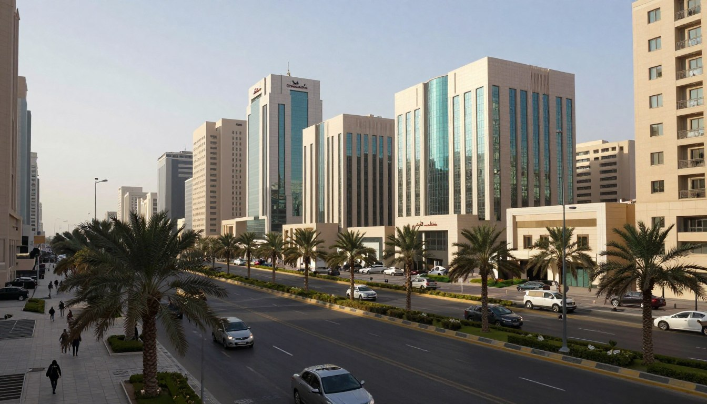
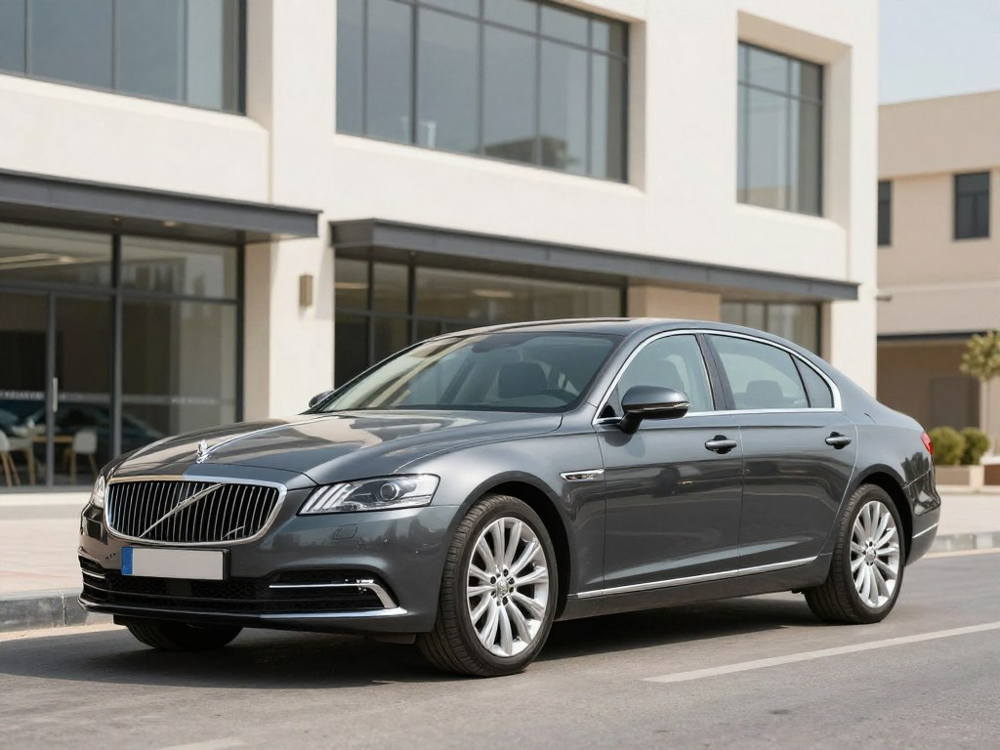
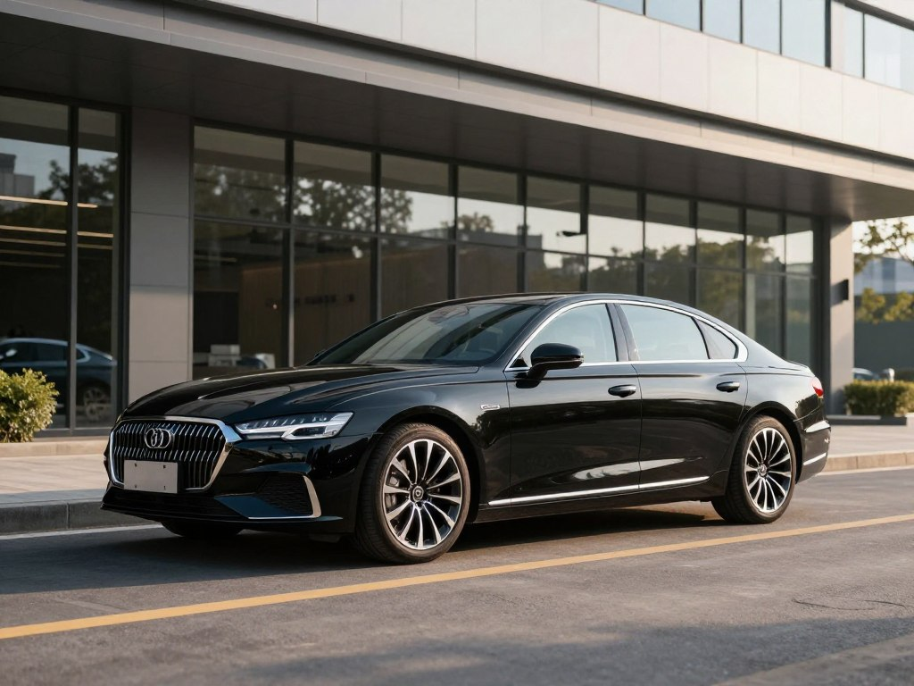
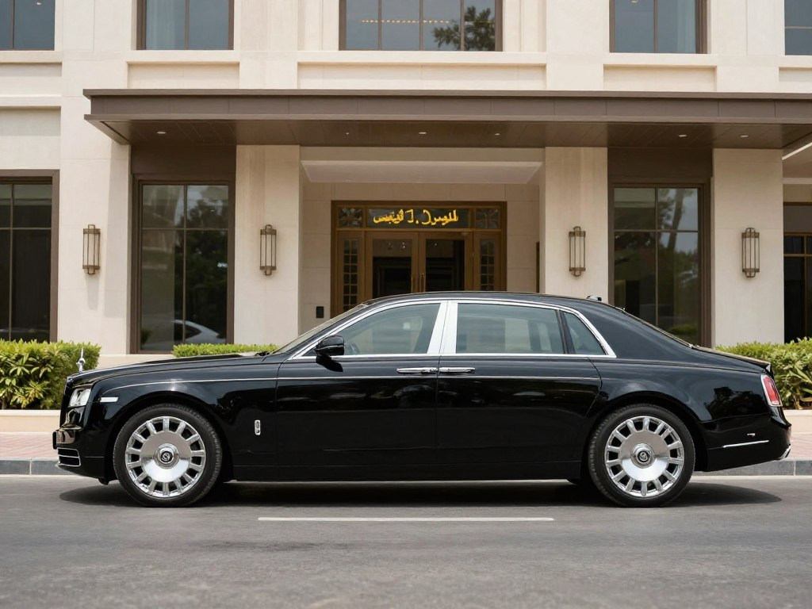
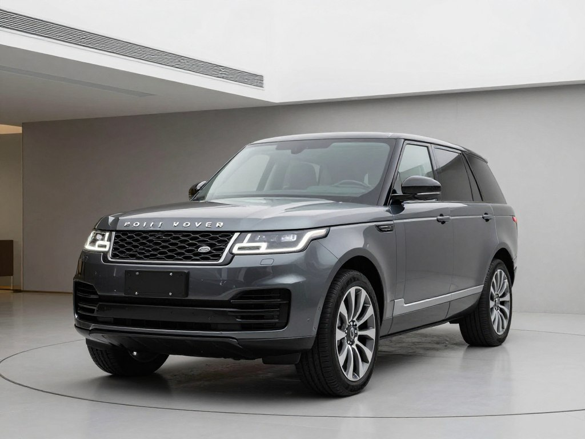
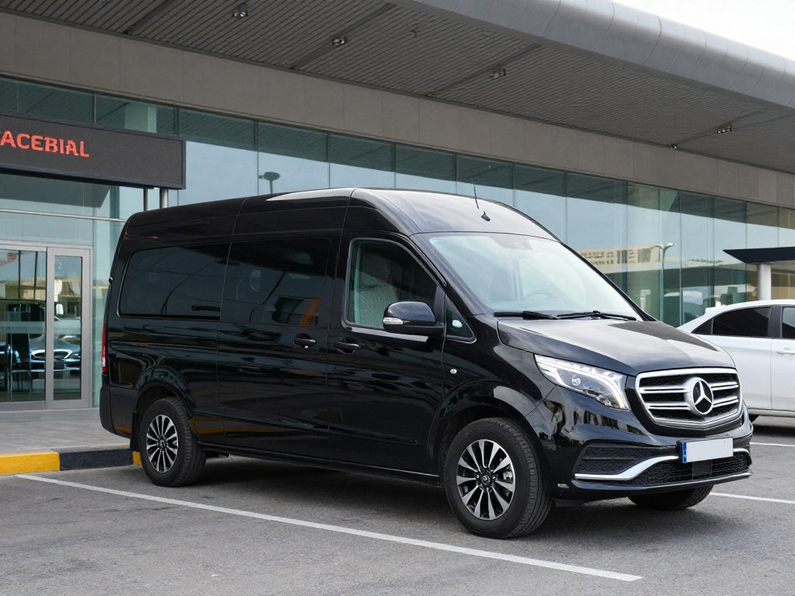
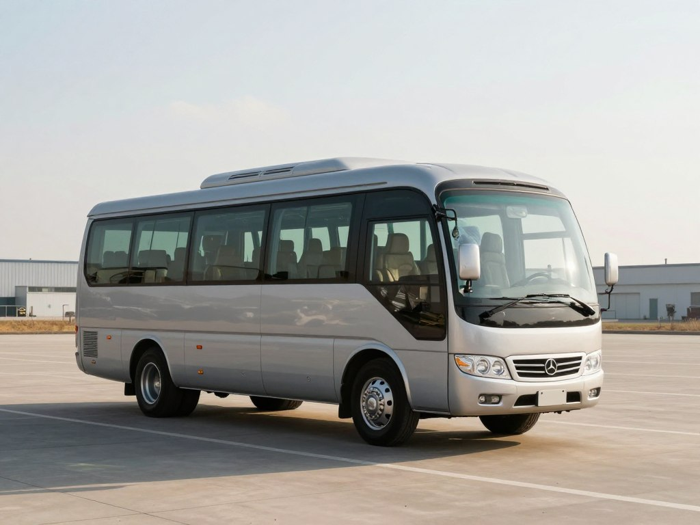

# **Chauffeur Service in Tabuk**

Professional chauffeur service Tabuk provides seamless corporate travel and VIP transport across the regional capital. AB supports executive arrivals at Prince Sultan bin Abdulaziz Airport (TUU) with punctual transfers, refined vehicles, and experienced local drivers. Travellers moving across Tabuk receive dedicated ground transport tailored to demanding schedules and regional project requirements.

Coordinated from our central operations centre, every journey delivers discreet mobility for corporate delegations, executive teams, and official visitors. Select your travel tier or schedule an airport connection with our operations team.

[Book now](https://seowriting.ai/locations/saudi-arabia) [View the fleet](https://seowriting.ai/locations/saudi-arabia)

Pick up Prince Sultan bin Abdulaziz Airport (TUU)

Drop off Tabuk city centre, Tabuk

Date and time \[Confirm: Date and time\]

[Get a quote](https://seowriting.ai/locations/saudi-arabia)

The Tabuk fleet

## **Choose your Tabuk chauffeur class**

Every vehicle in our Tabuk fleet is GPS tracked and detailed before each journey. AB deploys immaculate sedans, premium sports utility vehicles, and executive passenger vans configured for executive comfort, road safety, and seamless corporate mobility.

### **Standard Sedan**

Sedan · 3 guests · 2 bags

Typical model: Toyota Camry or similar \[Confirm\]

Ideal for: Daily business travel journeys

Quiet and efficient transport for individual professionals travelling between commercial appointments across central Tabuk. Clean interiors and climate control create a restful working atmosphere for every urban transit.

[Book this class](https://seowriting.ai/locations/saudi-arabia) [Request a quote](https://seowriting.ai/locations/saudi-arabia) [Airport transfer](https://seowriting.ai/locations/saudi-arabia) [Hourly chauffeur](https://seowriting.ai/locations/saudi-arabia) [Full specifications](https://seowriting.ai/locations/saudi-arabia)

### **Business Sedan**

Sedan · 3 guests · 2 bags

Typical model: Mercedes E Class, BMW 5 Series or similar \[Confirm\]

Ideal for: Corporate meetings and executives

The standard choice for corporate transportation Tabuk, offering refined leather seating, acoustic insulation, and onboard device charging. Chauffeurs maintain direct communication with regional operations for precise punctuality.

[Book this class](https://seowriting.ai/locations/saudi-arabia) [Request a quote](https://seowriting.ai/locations/saudi-arabia) [Airport transfer](https://seowriting.ai/locations/saudi-arabia) [Hourly chauffeur](https://seowriting.ai/locations/saudi-arabia) [Full specifications](https://seowriting.ai/locations/saudi-arabia)

### **First Class Sedan**

Flagship sedan · 3 guests · 2 bags

Typical model: Mercedes S Class or similar \[Confirm\]

Ideal for: VIP transport and dignitaries

Our flagship limousine service Tabuk tier provides exceptional luxury, generous rear legroom, and refined materials. Suited for ministerial guests, visiting directors, and high profile executive protocol across the region.

[Book this class](https://seowriting.ai/locations/saudi-arabia) [Request a quote](https://seowriting.ai/locations/saudi-arabia) [Airport transfer](https://seowriting.ai/locations/saudi-arabia) [Hourly chauffeur](https://seowriting.ai/locations/saudi-arabia) [Full specifications](https://seowriting.ai/locations/saudi-arabia)

### **Executive SUV**

SUV · 6 guests · 5 bags

Typical model: Cadillac Escalade, GMC Yukon or similar \[Confirm\]

Ideal for: Delegations and project teams

Spacious and commanding, this luxury car platform handles intercity travel toward regional mega projects with ease. Elevated ride height and extensive luggage volume accommodate multi passenger business groups and support staff comfortably.

[Book this class](https://seowriting.ai/locations/saudi-arabia) [Request a quote](https://seowriting.ai/locations/saudi-arabia) [Airport transfer](https://seowriting.ai/locations/saudi-arabia) [Hourly chauffeur](https://seowriting.ai/locations/saudi-arabia) [Full specifications](https://seowriting.ai/locations/saudi-arabia)

### **Premium MPV**

MPV · 6 guests · 5 bags

Typical model: Mercedes V Class or similar \[Confirm\]

Ideal for: Mobile meetings and groups

Configured with conference style face to face seating, this vehicle allows executive teams to consult between appointments in Tabuk. Deep tinted windows maintain full privacy for sensitive business discussions on the road.

[Book this class](https://seowriting.ai/locations/saudi-arabia) [Request a quote](https://seowriting.ai/locations/saudi-arabia) [Airport transfer](https://seowriting.ai/locations/saudi-arabia) [Hourly chauffeur](https://seowriting.ai/locations/saudi-arabia) [Full specifications](https://seowriting.ai/locations/saudi-arabia)

### **Executive Van**

Van · 14 guests · 10 bags

Typical model: Mercedes Sprinter or similar \[Confirm\]

Ideal for: Large crew site movements

The primary solution for corporate site visits and bus rental Tabuk needs across the northwest. Generous standing room, dedicated cargo space, and climate control support comprehensive technical and event team deployments.

[Book this class](https://seowriting.ai/locations/saudi-arabia) [Request a quote](https://seowriting.ai/locations/saudi-arabia) [Airport transfer](https://seowriting.ai/locations/saudi-arabia) [Hourly chauffeur](https://seowriting.ai/locations/saudi-arabia) [Full specifications](https://seowriting.ai/locations/saudi-arabia)

Popular journeys

## **Across Tabuk and beyond**

Tabuk serves as the central commercial hub and travel gateway to NEOM and major northwest development corridors. AB coordinates point to point transit, corporate shuttles, and intercity corridors with fully vetted professional chauffeurs.

Airport transfer

### **TUU to Tabuk city centre**

From \[SAR price\]

Intercity

### **TUU to NEOM**

From \[SAR price\] · \[Confirm\] hours

Intercity

### **Tabuk to NEOM**

From \[SAR price\] · \[Confirm\] hours

Intercity

### **Tabuk to AlUla**

From \[SAR price\] · \[Confirm\] hours

Intercity

### **Tabuk to Duba \[Confirm\]**

From \[SAR price\] · \[Confirm\] hours

Review comprehensive highway options and long distance pricing on our [Intercity Transfers](https://seowriting.ai/services/intercity-transfers) booking schedule.

Services in Tabuk

## **One partner for every movement in Tabuk**

AB coordinates individual VIP journeys, recurring enterprise fleets, and comprehensive delegate transport programs throughout the northwest province with operational rigour.

- [Chauffeur & VIP in Tabuk](https://seowriting.ai/services/chauffeur-vip/saudi-arabia/tabuk)
- [Corporate Transportation in Tabuk](https://seowriting.ai/services/corporate-transportation/saudi-arabia/tabuk)
- [Bus & Coach Hire in Tabuk](https://seowriting.ai/services/bus-coach-hire/saudi-arabia/tabuk)

Airport transfers

## **Arriving at Prince Sultan bin Abdulaziz Airport (TUU)**

Landing at Prince Sultan bin Abdulaziz Airport (TUU) connects business travellers directly to regional governance hubs and industrial development sites. AB tracks every scheduled flight arrival automatically, adjusting chauffeur dispatch for early touches or air traffic delays. Your assigned driver conducts a personal meet and greet with a customised name board at the designated arrival meeting point \[Confirm\]. Travellers benefit from inclusive free waiting time \[Confirm\] following flight touchdown, allowing ample opportunity to collect baggage and clear customs without haste. The chauffeur assists with all luggage before escorting guests to a climate controlled vehicle stationed directly at the terminal curb.

### **Flight tracking**

Every arrival

### **Meet and greet**

Inside the terminal

### **TUU to Tabuk city centre**

\[Confirm\] minutes

Organise seamless airport connections through our dedicated [TUU Airport Transfer](https://seowriting.ai/docs/%5BConfirm:%20airport%20page%20URL%5D) service portal.

Coverage

## **Where we work in Tabuk**

AB provides licensed, insured transportation across major administrative quarters, corporate offices, historical destinations, and industrial logistics facilities in the Tabuk region. Centralised coordination supports punctual travel throughout the municipal boundary and surrounding project sectors.

### **Business**

- Al Muruj Commercial District
- Al Faisaliyah Business Area
- King Fahd Road Office Zone

### **Events and conferences**

- Grand Millennium Tabuk Conference Hall
- Tabuk Exhibition Centre
- Park Inn by Radisson Meeting Venues

### **Heritage and leisure**

- Tabuk Castle Heritage Precinct
- Al Tawba Mosque Quarter
- Souq Twaheen Historic Market

Government or Industry: AB regularly supports transportation corridors connecting the Tabuk Industrial City, Prince Sultan Military City, and the Regional Governorate Headquarters.

Our office

## **Managed operations for Tabuk**

Regional ground transportation across Tabuk is monitored and scheduled through our central headquarters. Our dispatch team coordinates vehicle staging, road safety compliance, and chauffeur manifests around the clock to maintain reliable service delivery across Saudi Arabia.

### **AB Riyadh, headquarters \[Confirm nearest office\]**

Building 3036, Office 08, 2nd Floor, Umar Ibn Abdulaziz Road, Al Malaz, Riyadh, Saudi Arabia

+966 58 111 8720

[Get directions](https://seowriting.ai/locations/saudi-arabia)

Questions

## **Chauffeur service in Tabuk: your questions**

### **What vehicles are available for chauffeur service Tabuk bookings?**

AB operates executive sedans, luxury flagship saloons, full size sports utility vehicles, and high capacity vans across Tabuk. Fleet choices include the Mercedes E Class, Mercedes S Class, Cadillac Escalade, GMC Yukon, and Mercedes Sprinter, all maintained under strict detailing and maintenance standards.

### **How does AB coordinate an airport transfer at Prince Sultan bin Abdulaziz Airport (TUU)?**

Chauffeurs track inbound flights to Prince Sultan bin Abdulaziz Airport (TUU) in real time to adapt to timing alterations. Your driver greets arriving passengers inside the terminal holding an official name board, helps carry baggage, and escorts guests directly to their ready vehicle.

### **Can I reserve a private driver Tabuk for intercity transit to NEOM?**

Yes, AB provides direct intercity transfer Tabuk corridors linking local accommodation and airports to project sites across NEOM. These long distance journeys utilise comfortable, high specification vehicles driven by professional chauffeurs familiar with regional highways and route requirements.

### **Can corporate teams arrange hourly chauffeur and full day hire in Tabuk?**

Corporate travellers can book vehicles by the hour or reserve full day hire across Tabuk for back to back meetings and site inspections. This setup provides dedicated access to a car with driver, keeping itineraries entirely flexible while our central dispatch manages logistical timing.

### **Are all vehicles and chauffeurs licensed and insured in Saudi Arabia?**

Every vehicle in our operational fleet is fully insured and licensed in compliance with Saudi transport authority standards. Chauffeurs undergo vetting, professional defensive driving checks, and security protocol preparation to deliver safe executive car service throughout the region.

### **How do corporate clients manage booking and invoicing for group travel?**

Corporate travel managers can centralise bookings through consolidated account facilities managed by our dispatch headquarters. We provide clear digital itineraries, automated reporting, and transparent billing schedules suited for corporate travel programs, event delegations, and multi vehicle movements.

### **What is the standard procedure for flight delays at TUU airport?**

Our dispatch system continuously tracks incoming flight telemetry into TUU airport. Chauffeur dispatch times update automatically when commercial flights experience delays, preserving the agreed complimentary waiting period from the moment your aircraft lands on the runway.

## **Your chauffeur is ready in Tabuk.**

Coordinate executive mobility, airport transfers, and project transfers across the northwest through our dedicated 24/7 operations team on +966 58 111 8720.

### **Reserve your professional chauffeur service Tabuk**

Experience reliable executive transport and punctual airport arrivals across Tabuk and connecting regional commercial corridors.

[Book now](https://seowriting.ai/locations/saudi-arabia) [Request a proposal](https://seowriting.ai/locations/saudi-arabia)