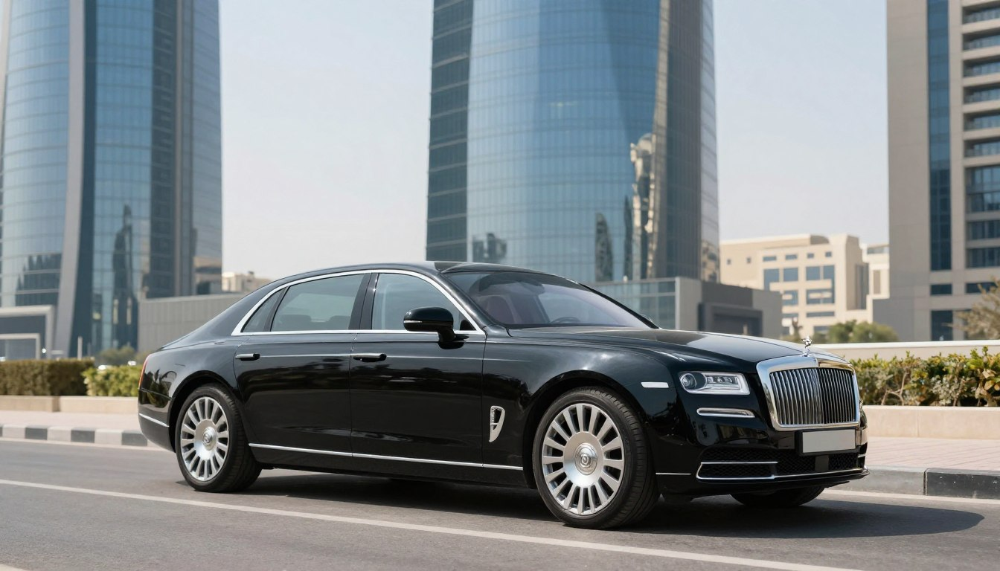

# **Chauffeur Service in Saudi Arabia**

Deploying a professional chauffeur service Saudi Arabia provides corporate leaders, visiting delegations and international enterprises with punctual ground transport across the Kingdom. Centralised dispatch operates round the clock from the capital to coastal commercial centres, deploying vetted drivers and premium vehicles for demanding itineraries. Every reservation delivers coordinated travel designed for the operational schedules of institutional clients.

Travel requirements across the Arabian Peninsula call for strict compliance, geographic familiarity and route flexibility. Fleet management coordinators monitor terminal logistics, regional highway connections and diplomatic protocol standards to support seamless executive movements. Selecting a dedicated private transport provider establishes direct operational control for corporate engagements and complex event programmes.

[Request a proposal](https://seowriting.ai/locations/saudi-arabia/riyadh) [Book a transfer](https://seowriting.ai/locations/saudi-arabia/jeddah)

### **12 Cities**

Comprehensive operational coverage across primary commercial, governmental and industrial destinations nationwide.

### **1 Central Office**

Headquarters and twenty four seven dispatch operations based in Riyadh to manage regional movements.

### **10 Airports**

Direct terminal pickups and airside coordination across all major domestic and international aviation hubs.

## **AB Operations Centre in Saudi Arabia**

AB coordinates all regional journeys from its operational headquarters located in the capital. The central facility manages active driver tracking, corporate account reservations, protocol movements and multi city route assignments across the Kingdom. Professional dispatchers supervise fleet deployment day and night to maintain strict timing across every commercial corridor.

### **AB Riyadh Headquarters**

Headquarters and 24/7 dispatch centre managing Kingdom wide transfers, VIP movements and corporate fleet logistics.

Building 3036, Office 08, 2nd Floor, Umar Ibn Abdulaziz Road, Al Malaz, Riyadh, Saudi Arabia

+966 58 111 8720

Coverage

## **Executive Car Service Across Saudi Arabia Cities**

AB maintains an active operational presence throughout the commercial, cultural and administrative centres of the country. Chauffeur assignments span metropolitan business districts, historic destinations, industrial zones and emerging economic developments. Dedicated local teams support uninterrupted transport for institutional clients across all key urban regions.

### **Riyadh**

Airport Code: RUH. Operational Status: Headquarters and Full Operational Hub. AB delivers premium executive mobility, government protocol transport and financial district transfers throughout the capital city.

[Riyadh Chauffeur Service](https://seowriting.ai/locations/saudi-arabia/riyadh)

### **Jeddah**

Airport Code: JED. Operational Status: Active Commercial Hub. Chauffeurs support Red Sea commercial enterprises, coastal trade offices, diplomatic missions and regional corporate meetings with luxury sedans and spacious SUVs.

[Jeddah Chauffeur Service](https://seowriting.ai/locations/saudi-arabia/jeddah)

### **Dammam**

Airport Code: DMM. Operational Status: Active Industrial Hub. Dedicated drivers handle corporate transfers across the Eastern Province administrative centres, deepwater ports and major commercial supply facilities.

[Dammam Chauffeur Service](https://seowriting.ai/locations/saudi-arabia/dammam)

### **Al Khobar**

Airport Code: DMM. Operational Status: Active Corporate Hub. Providing executive car service solutions for energy sector headquarters, international business parks and interstate commercial travel connecting regional industrial complexes.

[Al Khobar Chauffeur Service](https://seowriting.ai/locations/saudi-arabia/al-khobar)

### **Makkah**

Airport Code: JED. Operational Status: Full Route Coverage. Specialised intercity arrivals and hospitality transfers tailored for institutional groups, diplomatic guests and official delegations requiring dedicated private driver arrangements.

[Makkah Chauffeur Service](https://seowriting.ai/locations/saudi-arabia/mecca)

### **Madinah**

Airport Code: MED. Operational Status: Full Route Coverage. Coordinated passenger transport for official delegations, visiting dignitaries and executive travellers connecting between urban terminals and central hospitality quarters.

[Madinah Chauffeur Service](https://seowriting.ai/locations/saudi-arabia/medina)

### **AlUla**

Airport Code: ULH. Operational Status: Heritage and Event Coverage. High specification executive SUVs and premium sedans operating across luxury resort developments, global cultural summits and desert conference destinations.

[AlUla Chauffeur Service](https://seowriting.ai/locations/saudi-arabia/al-ula)

### **Tabuk**

Airport Code: TUU. Operational Status: Regional Gateway Coverage. Professional chauffeurs handle business transit, industrial consultations and developmental travel across the expansive northwestern transport corridors.

[Tabuk Chauffeur Service](https://seowriting.ai/locations/saudi-arabia/tabuk)

### **NEOM**

Airport Code: NUM. Operational Status: Project Corridor Coverage. Managed ground transportation supporting sustainable development leadership, engineering consultancies and international project teams across forward operating sites.

[NEOM Chauffeur Service](https://seowriting.ai/locations/saudi-arabia/neom)

### **Abha**

Airport Code: AHB. Operational Status: Southern Province Coverage. Transport solutions operating through the Asir highland territory, serving regional administrative bodies, seasonal symposiums and institutional travel needs.

[Abha Chauffeur Service](https://seowriting.ai/locations/saudi-arabia/abha)

### **Al Qassim**

Airport Code: ELQ. Operational Status: Central Agricultural and Commercial Hub. Reliable corporate transportation connecting regional food production leadership, university forums and trade centres with the central capital.

[Al Qassim Chauffeur Service](https://seowriting.ai/locations/saudi-arabia/al-qasim)

### **Jizan**

Airport Code: GIZ. Operational Status: Port and Logistics Corridor Coverage. Executive vehicle services serving maritime trading offices, economic city industrial complexes and southern provincial administrative headquarters.

[Jizan Chauffeur Service](https://seowriting.ai/locations/saudi-arabia/jizan)

Airport Coverage

## **Airport Transfer Saudi Arabia and RUH Chauffeur Service**

Navigating major commercial aviation gateways requires active flight tracking, scheduled curb arrivals and terminal meet and greet procedures. Chauffeurs monitor incoming flight schedules directly through flight tracking systems to accommodate early arrivals or unexpected airspace delays. Clients receive prompt greetings inside the arrivals terminal before moving smoothly to their awaiting luxury vehicle.

AB coordinates individual executive pickups alongside large scale delegation arrivals across primary international and regional airport hubs. Dedicated luggage assistance, private terminal coordination and discreet gate transfers support corporate leaders upon landing. Consistent standards apply whether scheduling an airport transfer in the capital or coordinating travel through coastal terminals.

| Airport Name                                                 | Code | Primary City | Service Scope                                           |
| ------------------------------------------------------------ | ---- | ------------ | ------------------------------------------------------- |
| King Khalid International Airport (RUH)                      | RUH  | Riyadh       | Terminal meet and greet with premium business transfers |
| King Abdulaziz International Airport (JED)                   | JED  | Jeddah       | Flight tracking and coastal corporate transit           |
| Prince Mohammad bin Abdulaziz International Airport (MED)    | MED  | Madinah      | Dedicated arrivals for institutional delegations        |
| King Fahd International Airport (DMM)                        | DMM  | Dammam       | Eastern Province energy corridor pickups                |
| Prince Abdulmajeed bin Abdulaziz International Airport (ULH) | ULH  | AlUla        | High end luxury resort and event transfers              |
| Prince Sultan bin Abdulaziz Airport (TUU)                    | TUU  | Tabuk        | Northwestern industrial and corporate transfers         |
| NEOM Bay Airport (NUM)                                       | NUM  | NEOM         | Development site access and VIP logistics               |
| Abha International Airport (AHB)                             | AHB  | Abha         | Highland administrative and hospitality transport       |
| Prince Naif bin Abdulaziz International Airport (ELQ)        | ELQ  | Al Qassim    | Central province business schedule transit              |
| King Abdullah bin Abdulaziz Airport (GIZ)                    | GIZ  | Jizan        | Southern maritime and industrial site transfers         |

Direct terminal reservations are accessible through our dedicated airport location pages, including [King Khalid International Airport RUH](https://seowriting.ai/airports/king-khalid-international-ruh), [King Abdulaziz International Airport JED](https://seowriting.ai/airports/king-abdulaziz-international-jed), [Prince Mohammad bin Abdulaziz International Airport MED](https://seowriting.ai/airports/prince-mohammad-bin-abdulaziz-med), and [King Fahd International Airport DMM](https://seowriting.ai/airports/king-fahd-international-dmm).

Our Capabilities

## **Corporate Transportation and Chauffeur Services in Saudi Arabia**

AB delivers managed road transport solutions designed for corporate organisations, state entities and event planners. Fleets comprise luxury sedans such as the Mercedes S Class, executive SUVs including the Cadillac Escalade and GMC Yukon, alongside the Mercedes V Class for executive group travel. Every category provides climate controlled interiors, professional drivers and comprehensive commercial insurance for total operational peace of mind.

Arrangements range from single airport transfers to full day hire and multi week project bookings. Corporate travel accounts benefit from itemised billing, direct dispatch desk access and custom itinerary coordination. Group movements operate smoothly through dedicated bus rental Saudi Arabia options matching larger delegate counts.

- Chauffeur and VIP: Executive travel utilizing prestige sedans and SUVs with professional protocol trained chauffeurs for executive roadshows and board level mobility.
- Airport Transfers: Punctual arrivals and departures featuring flight monitoring, baggage handling and courteous terminal reception across the country.
- Corporate Transportation: Enterprise ground transport offering structured corporate accounts, recurring staff shuttles and multi city business itineraries.
- Event Transportation: Coordinated vehicle fleets, on site movement coordinators and managed staging areas for major summits, exhibitions and official conferences.
- Bus and Coach Hire: Scalable group transport solutions utilising modern passenger coaches and minibuses for corporate events, staff transfers and site visits.
- Tourism Transportation: Chauffeured regional travel and cultural site transfers delivering comfortable long distance travel for visiting delegations.

Highway corridors

## **Intercity Transfer Saudi Arabia Route Connections**

Long distance intercity transit across modern highway networks requires experienced drivers, comfortable luxury vehicles and rigorous vehicle maintenance. AB coordinates direct point to point intercity transfer Saudi Arabia services, removing the delays associated with regional airport connections and crowded domestic terminals. Passengers can conduct business meetings, review documents or rest within quiet vehicle cabins during regional transit.

### **Riyadh to Dammam**

Connecting the political capital with the Eastern Province commercial centre along Highway 40. Travel time: \[Confirm: travel time\].

### **Riyadh to Al Qassim**

Direct transit linking corporate headquarters in Riyadh with central commercial and agricultural districts. Travel time: \[Confirm: travel time\].

### **Jeddah to Makkah**

Smooth road connection between coastal commercial offices and the holy city for institutional delegations. Travel time: \[Confirm: travel time\].

### **Makkah to Madinah**

Intercity highway passage facilitating official guest transport between the two holy cities. Travel time: \[Confirm: travel time\].

### **Madinah to AlUla**

Scenic northern transit route transporting international conference attendees and cultural delegations. Travel time: \[Confirm: travel time\].

### **Tabuk to NEOM**

Crucial development corridor connecting northwestern aviation facilities with forward project zones. Travel time: \[Confirm: travel time\].

### **Dammam to Al Khobar**

Rapid metropolitan corridor linking major energy corporate parks, regional commercial offices and marine ports. Travel time: \[Confirm: travel time\].

Compliance

## **Operating Licences and Vehicle Standards in Saudi Arabia**

Operating commercial passenger fleets across the Kingdom requires strict adherence to national transport authority regulations, municipal permits and comprehensive commercial insurance frameworks. AB operates fully within regulatory parameters \[Confirm licence names and numbers\] to uphold passenger safety and operational legality on every route. Every vehicle undergoes routine mechanical inspections and safety verification before deployment.

Professional chauffeurs complete rigorous background verifications, defensive driving instruction and protocol training. Fleet units feature real time tracking systems and safety monitoring equipment to support secure travel for executive passengers across regional highways.

Questions

## **Frequently Asked Questions About Chauffeur Service Saudi Arabia**

### **What vehicles are available for chauffeur service Saudi Arabia bookings?**

Our fleet features premium executive sedans including the Mercedes S Class, spacious luxury SUVs such as the Cadillac Escalade and GMC Yukon, and executive vans like the Mercedes V Class. Group journeys utilise luxury coaches and modern minibuses. All vehicles provide climate control, leather upholstery and meticulous presentation for executive travellers.

### **How does airport transfer meet and greet operate at RUH and regional airports?**

Chauffeurs track incoming flights into King Khalid International Airport (RUH) and other national hubs in real time to adapt to flight timing changes. Drivers greet arriving passengers in the terminal arrivals hall holding a personalised name board. The chauffeur assists with luggage before guiding passengers directly to the waiting vehicle.

### **Can corporate travel managers book hourly chauffeur and full day hire?**

Yes, corporate clients can arrange hourly bookings, full day hire and continuous multi day coverage across all major Saudi cities. Chauffeurs remain on standby throughout your itinerary, accommodating unscheduled route changes, business meetings and administrative errands without delay. Reservations are managed through dedicated corporate accounts with consolidated monthly invoicing.

### **What standards apply to drivers delivering limousine service Saudi Arabia?**

Chauffeurs represent the highest professional standards, possessing thorough local geographic knowledge, defensive driving credentials and corporate protocol etiquette. Drivers are fully licensed under Kingdom transport regulations and undergo regular background checks. Multilingual drivers are available upon request to assist foreign commercial delegations and international executive teams.

### **How are intercity transfers coordinated between major business centres?**

Intercity transfers operate as private, non stop road journeys connecting urban centres such as Riyadh, Dammam, Jeddah and regional industrial locations. Central dispatch tracks vehicle movements continuously across highway corridors to maintain scheduling precision. Passengers enjoy quiet cabins equipped with phone charging facilities, climate management and ample luggage capacity.

### **How does AB manage large scale event transportation and bus rental in Saudi Arabia?**

AB coordinates comprehensive ground logistics for summits, trade expos and state functions with dedicated dispatchers and on site staging controllers. Fleets combine executive sedans for speakers with luxury coaches for attendees, managing coordinated shuttle schedules between hotels, airports and venues. Account managers oversee real time routing and vehicle positioning throughout the event.

### **What is the reservation process and operating schedule for chauffeur dispatch?**

Reservations can be submitted online or directly to our central Riyadh operations centre, operating twenty four hours a day, seven days a week. Dispatchers assign vehicles, share chauffeur contact details prior to pickup, and supervise route progress. Institutional accounts receive priority scheduling and dedicated transport coordination for urgent executive requirements.

### **Are all vehicles and passengers covered by commercial insurance?**

All fleet vehicles maintain comprehensive commercial insurance policies meeting all regulatory mandates established by the transport general authority in Saudi Arabia. Regular safety audits and preventive maintenance programmes ensure fleet reliability. Corporate travel managers receive full documentation verifying compliance and driver credentials upon account activation.

## **Reserve Your Chauffeur Service Saudi Arabia With AB**

Coordinate your executive travel across the Kingdom through our central operations centre, delivering punctual arrivals, premium vehicles and licensed professional drivers for every corporate schedule.

### **Plan Your Executive Journey**

Speak with our central dispatch team in Riyadh to coordinate corporate fleet requirements, airport transfers or VIP delegation transport.

[Request a proposal](https://seowriting.ai/locations/saudi-arabia/riyadh) [Book a transfer](https://seowriting.ai/locations/saudi-arabia/jeddah)