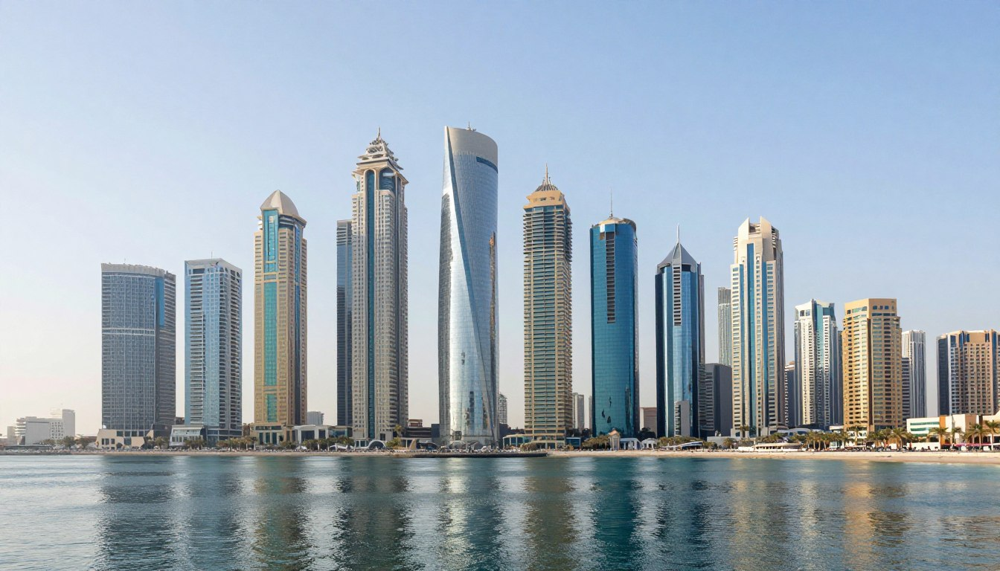
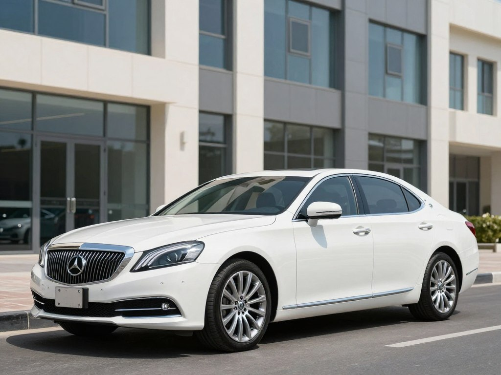
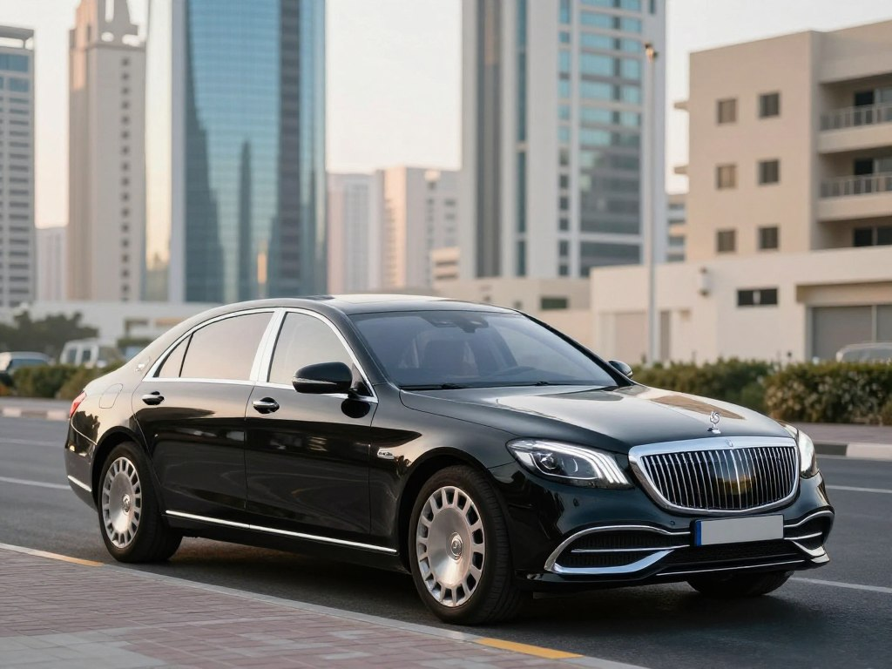
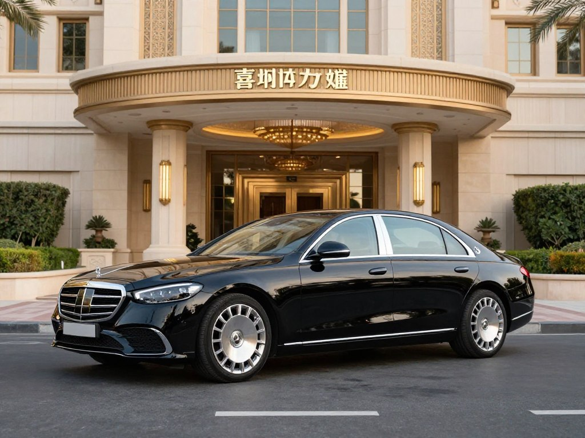
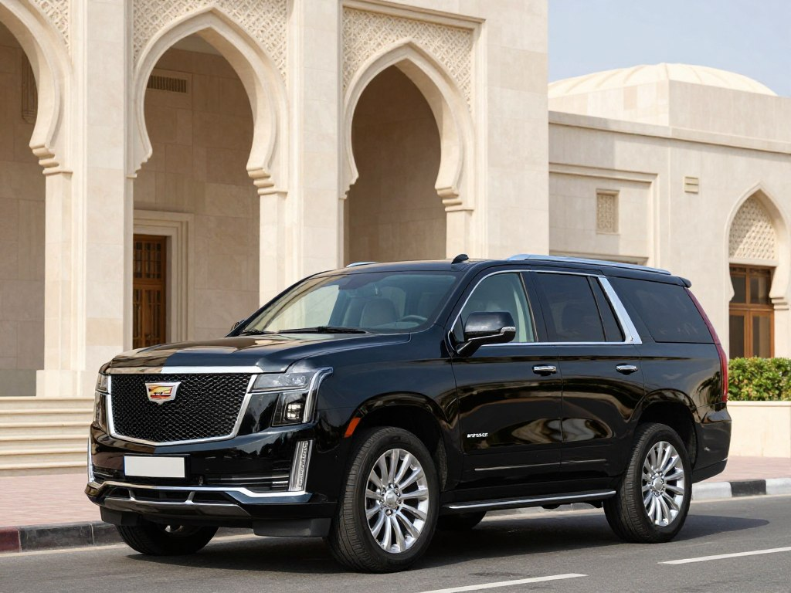
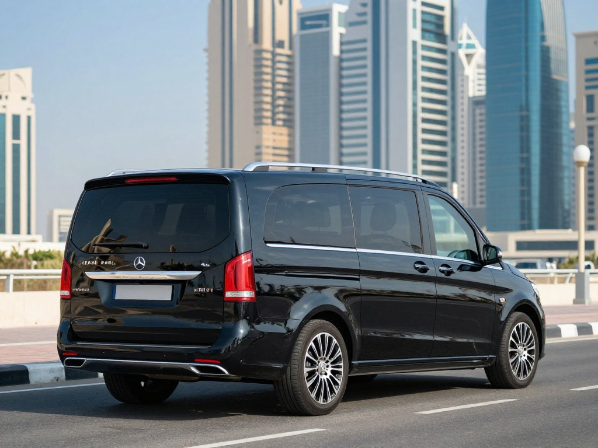
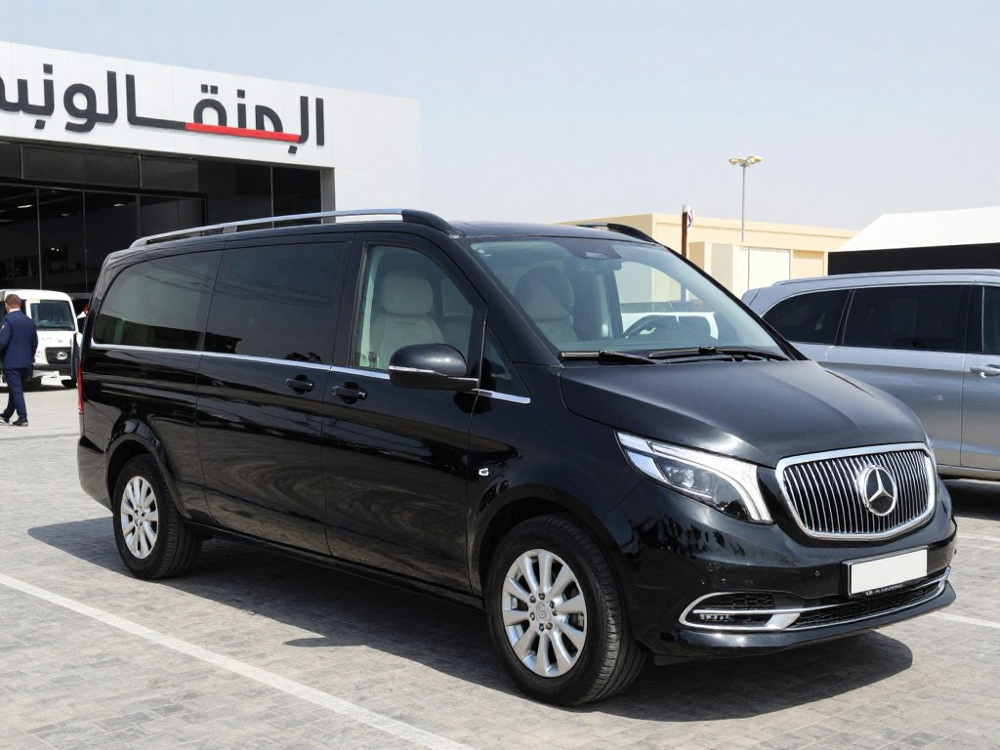

# **Chauffeur service in Abu Dhabi**

AB delivers professional chauffeur service Abu Dhabi solutions for corporate delegations, VIP visitors and diplomatic movements across the United Arab Emirates capital. Every journey connects seamlessly from Zayed International Airport (AUH) to the premier hotels, financial centres and cultural venues of Abu Dhabi.

Travellers navigate the capital with seasoned private chauffeurs who manage regional routes with discretion and poise. AB operates continuous vehicle monitoring to maintain punctuality and personal safety for every guest.

[Book now](https://seowriting.ai/services/chauffeur-vip/uae/abu-dhabi) [View the fleet](https://seowriting.ai/services/chauffeur-vip/uae/abu-dhabi)

Pick up Zayed International Airport (AUH)

Drop off Abu Dhabi Corniche, Abu Dhabi

Date and time Select date and time

[Get a quote](https://seowriting.ai/services/chauffeur-vip/uae/abu-dhabi)

The Abu Dhabi fleet

## **Choose Your Chauffeur Service Abu Dhabi Fleet**

Every vehicle in our Abu Dhabi fleet is GPS tracked and detailed before each journey. AB maintains immaculate standards across sedans, luxury SUVs and passenger vans to support private and corporate mobility.

### **Standard Sedan**

Sedan · 3 guests · 2 bags

Toyota Camry or similar \[Confirm\]

Ideal for daily business commutes

Comfortable point to point transfers across Abu Dhabi business parks. This option provides reliable city journeys for independent business travellers seeking smooth transport.

[Book this class](https://seowriting.ai/services/chauffeur-vip/uae/abu-dhabi)

### **Business Sedan**

Sedan · 3 guests · 2 bags

Mercedes E Class or similar \[Confirm\]

Ideal for corporate executive travel

Refined executive travel between downtown meetings and luxury hotels. The vehicle provides quiet interior comfort for working professionals moving across the central business district.

[Book this class](https://seowriting.ai/services/chauffeur-vip/uae/abu-dhabi)

### **First Class Sedan**

Flagship sedan · 3 guests · 2 bags

Mercedes S Class or similar \[Confirm\]

Ideal for diplomatic and VIP guests

Uncompromising luxury and state hospitality transport in Abu Dhabi. Chauffeurs maintain the highest protocol for embassy leaders, state guests and visiting corporate directors.

[Book this class](https://seowriting.ai/services/chauffeur-vip/uae/abu-dhabi)

### **Executive SUV**

SUV · 6 guests · 5 bags

Cadillac Escalade, GMC Yukon or similar \[Confirm\]

Ideal for families and delegations

Expansive luggage capacity paired with commanding road presence. The executive SUV delivers peerless comfort for long intercity journeys and family travel across the emirate.

[Book this class](https://seowriting.ai/services/chauffeur-vip/uae/abu-dhabi)

### **Premium MPV**

MPV · 6 guests · 5 bags

Mercedes V Class or similar \[Confirm\]

Ideal for executive project teams

Face to face mobile conference seating ideal for business roadshows in Abu Dhabi. Colleagues coordinate itineraries and prepare presentations in complete mobile privacy.

[Book this class](https://seowriting.ai/services/chauffeur-vip/uae/abu-dhabi)

### **Executive Van**

Van · 14 guests · 10 bags

Mercedes Sprinter or similar \[Confirm\]

Ideal for event guest shuttles

Generous passenger volume and luggage hold for conference groups. Our private driver Abu Dhabi teams coordinate coordinated arrivals across major hospitality and exhibition hubs.

[Book this class](https://seowriting.ai/services/chauffeur-vip/uae/abu-dhabi)

Popular journeys

## **Across Abu Dhabi and beyond**

AB provides fixed route pricing for direct airport pickups, city excursions and intercity transfers. All journeys are handled by professional chauffeurs in licensed, insured vehicles.

Airport transfer

### **AUH to Abu Dhabi Corniche**

From \[AED price\]

Airport transfer

### **AUH to Yas Island**

From \[AED price\]

City or Intercity

### **Abu Dhabi to ADNEC**

From \[AED price\]

City or Intercity

### **Abu Dhabi to Saadiyat Island**

From \[AED price\]

City or Intercity

### **Abu Dhabi to Dubai**

From \[AED price\] · \[Confirm\] hours

City or Intercity

### **Abu Dhabi to Al Ain**

From \[AED price\] · \[Confirm\] hours

City or Intercity

### **Abu Dhabi to Al Maktoum International Airport (DWC)**

From \[AED price\] · \[Confirm\] hours

Discover regional mobility options with our dedicated [Intercity Transfers](https://seowriting.ai/services/intercity-transfers).

Services in Abu Dhabi

## **One partner for every movement in Abu Dhabi**

AB coordinates individual and fleet transport solutions that adapt to corporate schedules, private itineraries and complex event operations.

- [Chauffeur & VIP in Abu Dhabi](https://seowriting.ai/services/chauffeur-vip/uae/abu-dhabi)
- [Airport Transfers in Abu Dhabi](https://seowriting.ai/services/airport-transfers/uae/abu-dhabi)
- [Corporate Transportation in Abu Dhabi](https://seowriting.ai/services/corporate-transportation/uae/abu-dhabi)
- [Event Transportation in Abu Dhabi](https://seowriting.ai/services/event-transportation/uae/abu-dhabi)
- [Bus & Coach Hire in Abu Dhabi](https://seowriting.ai/services/bus-coach-hire/uae/abu-dhabi)

Airport transfers

## **Arriving at Zayed International Airport (AUH)**

Arriving travellers receive dedicated meet and greet support upon landing at Zayed International Airport (AUH). AB flight operations track incoming flights in real time to adjust chauffeur arrival schedules automatically when schedules change.

Your chauffeur welcomes you directly at meeting point \[Confirm\] inside the arrivals terminal holding a customised name board. Guests benefit from complimentary waiting time \[Confirm\] to collect luggage and clear immigration customs comfortably.

Our AUH airport transfer service connects incoming passengers directly with premier hotels and corporate offices across the capital without delay. Chauffeurs assist with all heavy baggage and guide travellers straight to their waiting air conditioned luxury vehicle.

Flight tracking: Every arrival

Meet and greet: Inside the terminal

AUH to Abu Dhabi Corniche: \[Confirm\] minutes

Review comprehensive arrival protocols on our [Zayed International Airport AUH](https://seowriting.ai/airports/zayed-international-auh) page.

Coverage

## **Where we work in Abu Dhabi**

AB maintains regular chauffeur operations throughout the commercial, civic and cultural quarters of Abu Dhabi. Chauffeurs know regional avenues, security gates and hotel access protocols thoroughly.

| Sector                 | Key Location              | Coverage Details                                                                                              |
| ---------------------- | ------------------------- | ------------------------------------------------------------------------------------------------------------- |
| Business               | Al Maryah Island          | Financial hub access serving Abu Dhabi Global Market headquarters and international commercial firms.         |
| Business               | Downtown Abu Dhabi        | Central corporate offices, commercial banks and business towers along primary capital thoroughfares.          |
| Business               | Al Reem Island            | Executive residential developments and satellite commercial hubs across the northern waterfront.              |
| Events and conferences | ADNEC Centre              | High volume trade shows, international exhibitions and VIP delegate transit coordination.                     |
| Events and conferences | Yas Marina Circuit        | Motorsport hospitality, race team transport and luxury leisure movement during international sporting events. |
| Events and conferences | Etihad Arena              | Global entertainment performances, arena conventions and corporate hospitality shuttle operations.            |
| Heritage and leisure   | Sheikh Zayed Grand Mosque | Premier cultural visits requiring polite protocol, discreet waiting and coordinated guest collection.         |
| Heritage and leisure   | Louvre Abu Dhabi          | Cultural district visits across Saadiyat Island for international tourists and private delegations.           |
| Heritage and leisure   | Qasr Al Watan             | Palace grounds transportation managed with official driver etiquette and vehicle presentation.                |
| Government or Industry | Ministries Complex        | Official ministry buildings and foreign embassy precincts requiring discreet executive access.                |
| Government or Industry | Khalifa Industrial Zone   | Industrial manufacturing corridors and logistics parks situated near Khalifa Port.                            |
| Government or Industry | Mussafah Industrial       | Commercial logistics zones and regional industrial facilities across the southern mainland.                   |

Explore transport across the Emirates on our [UAE Locations](https://seowriting.ai/locations/uae) page.

Our office

## **AB Chauffeur Service Abu Dhabi Office**

AB provides managed ground transport across the UAE capital from our dedicated office in Abu Dhabi. Supported by central operations, our local fleet coordination team handles executive schedules, VIP roadshows and emergency booking requests with precision.

**AB Abu Dhabi**

Office 03, Mezzanine Floor, Building C57, Abu Dhabi, UAE

+971 50 918 0556

[Get directions](https://maps.google.com/maps?q=Office+03,+Mezzanine+Floor,+Building+C57,+Abu+Dhabi,+UAE)

Questions

## **Chauffeur Service Abu Dhabi: Your Questions**

### **How do I book a chauffeur service in Abu Dhabi with AB?**

Clients can book private chauffeur transfers online through our web booking portal or by submitting corporate travel requests directly to our team. Provide your collection point, final destination, preferred vehicle class and flight numbers where relevant. Our operations team confirms reservations promptly with clear itinerary documentation and chauffeur contact details.

### **What is included in an AUH airport transfer?**

An AUH airport transfer includes flight tracking, an in terminal meet and greet with a name board, luggage handling and comfortable transit in an executive vehicle. Your private driver monitors flight schedules to adapt to early landings or unexpected airline delays. Chauffeurs greet passengers immediately after customs clearance at the arrivals hall.

### **How does flight tracking and complimentary waiting time work?**

AB monitors commercial flight data in real time from our central operations centre. Chauffeur dispatch adjusts automatically to incoming aircraft arrival times. Passengers enjoy complimentary waiting time \[Confirm\] for airport pickups, allowing ample time to clear border control and claim personal baggage.

### **Which vehicle classes are available for chauffeur service Abu Dhabi journeys?**

AB provides Standard Sedans, Business Sedans such as the Mercedes E Class, First Class Sedans including the Mercedes S Class, Executive SUVs like the Cadillac Escalade, Premium MPVs and Executive Vans. Every vehicle is GPS tracked, thoroughly cleaned before dispatch and driven by a licensed professional chauffeur. Select the model class matching your group count and luggage load.

### **Can corporate transportation Abu Dhabi itineraries be booked by the hour?**

Corporate clients can reserve chauffeur services on an hourly or full day charter basis for executive roadshows and board meetings. This provides an on call vehicle and dedicated driver for the exact duration of your appointments across Abu Dhabi. Changes to multi stop itineraries are accommodated flexibly by our central dispatch desk.

### **Do you offer intercity transfer Abu Dhabi services to Dubai and other Emirates?**

AB operates direct intercity transfers connecting Abu Dhabi with Dubai, Al Ain, Sharjah and other emirates across the UAE. Travellers relax in luxury vehicles on long distance highway routes with professional drivers experienced in intercity motorways. We also provide direct transfers between Abu Dhabi and Al Maktoum International Airport (DWC).

### **What event transportation Abu Dhabi services does AB coordinate?**

AB manages comprehensive event transportation logistics for trade expos at ADNEC, major gatherings on Yas Island and high level corporate summits. Our team coordinates executive sedans, luxury passenger vans and larger bus rental Abu Dhabi options for large delegate groups. Dispatch teams manage fleet schedules continuously to ensure smooth guest movement.

## **Your chauffeur is ready in Abu Dhabi.**

Contact our continuous operations centre on +966 58 111 8720 to schedule your executive transport across the capital today.

### **Reserve your capital transport**

Select your executive vehicle or discuss tailored delegate mobility with our operations desk.

[Book now](https://seowriting.ai/services/chauffeur-vip/uae/abu-dhabi) [Request a proposal](https://seowriting.ai/services/corporate-transportation/uae/abu-dhabi)