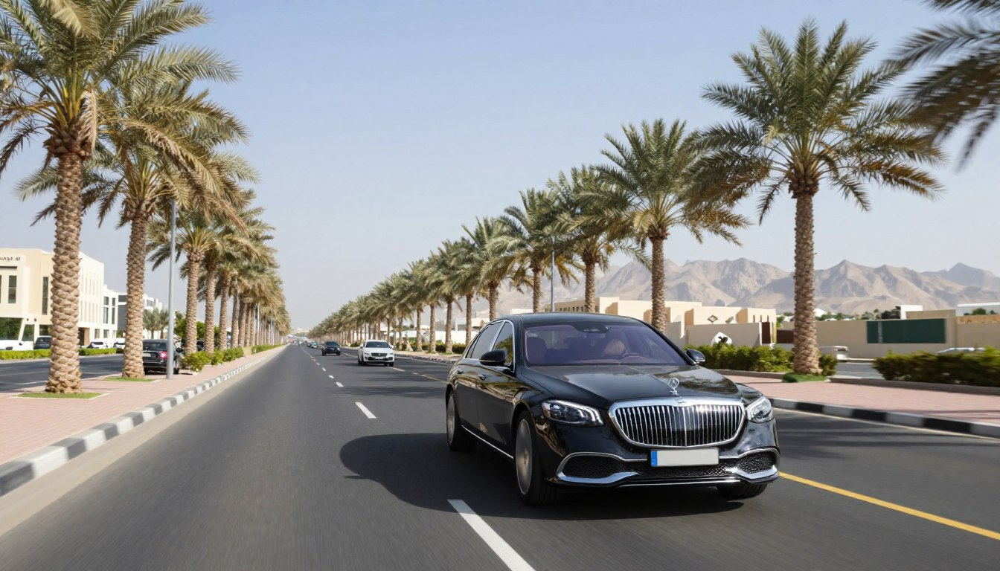
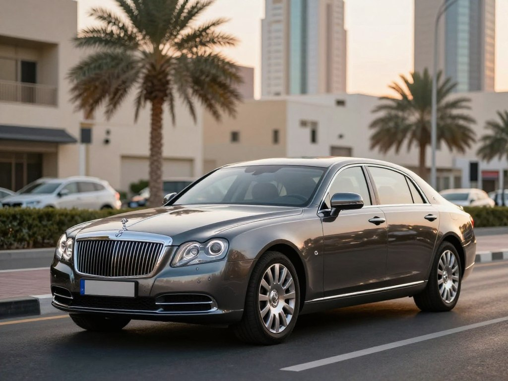
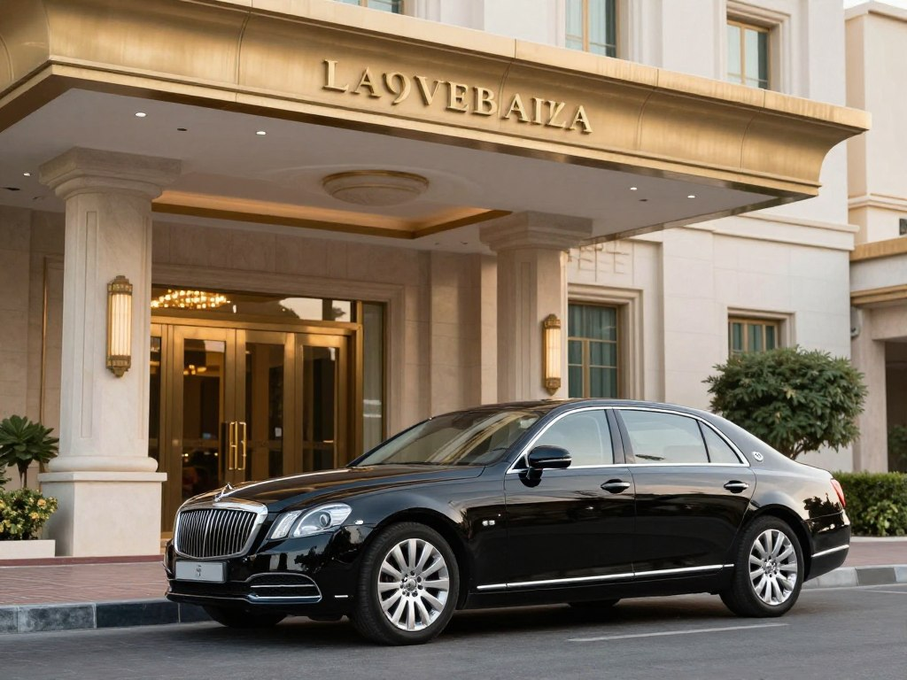
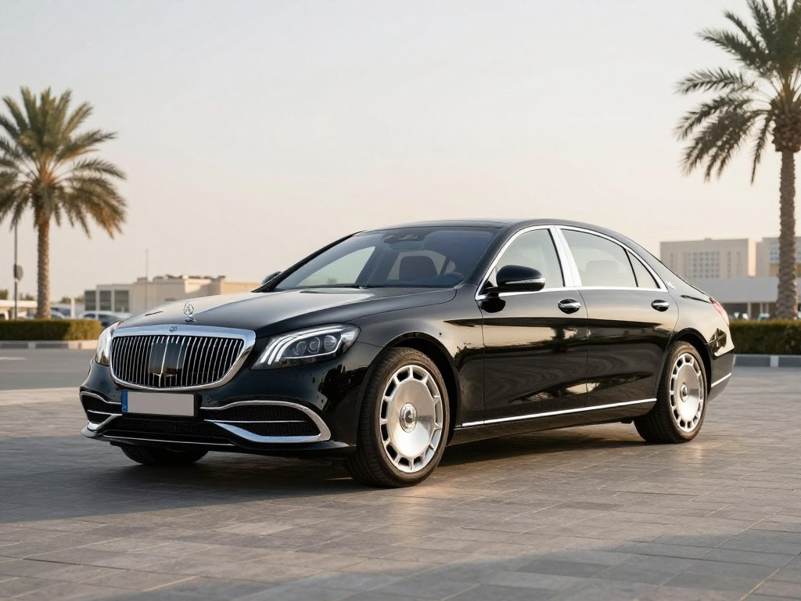
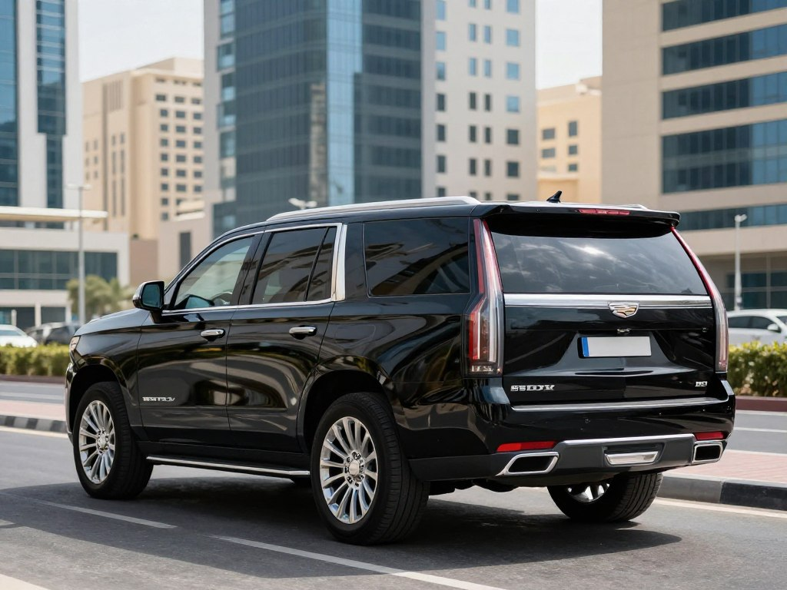
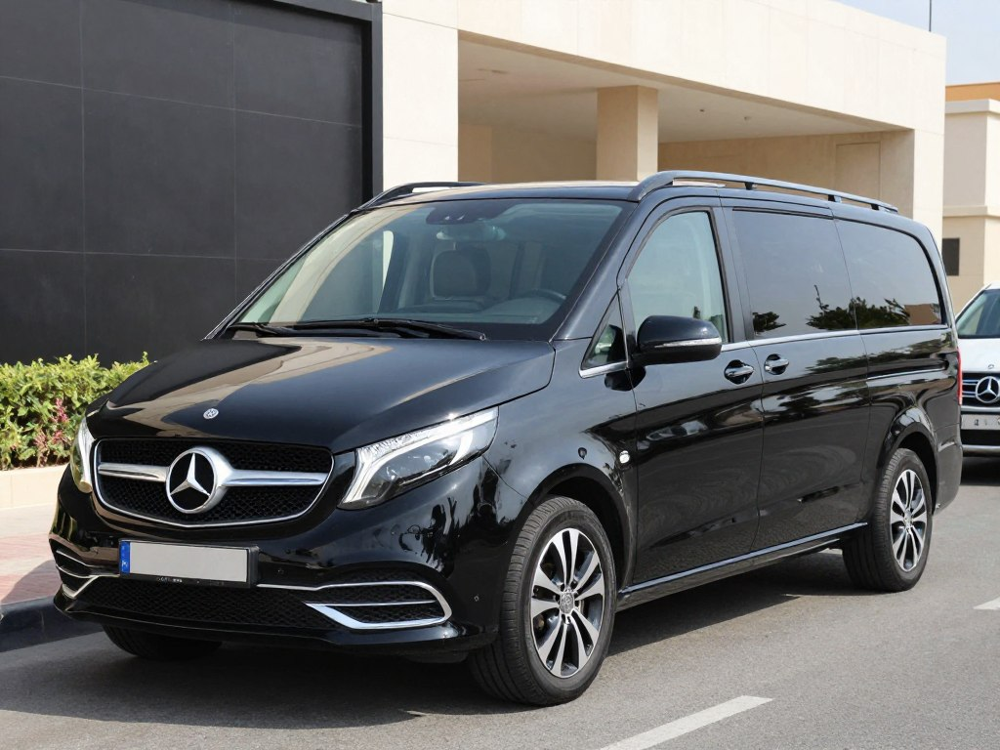
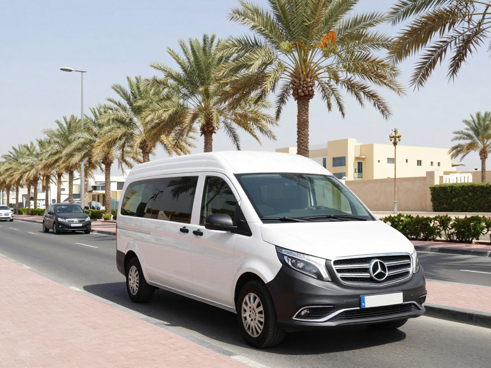

# **Chauffeur Service in Al Ain**

Professional chauffeur service Al Ain delivers executive ground transportation for corporate leaders, private delegations and visiting professionals across the Garden City. AB coordinates punctual transfers connecting Al Ain International Airport (AAN) directly with principal regional venues and commercial properties in Al Ain.

Corporate travel coordinators and executive planners receive dedicated service coordination backed by round the clock flight tracking and professional local chauffeurs.

[Book now](https://seowriting.ai/locations/uae) [View the fleet](https://seowriting.ai/locations/uae)

**Pick up:** Al Ain International Airport (AAN) | **Drop off:** Al Ain city centre, Al Ain | **Date and time:** Selected schedule

[Get a quote](https://seowriting.ai/locations/uae)

The Al Ain fleet

## **Choose your Al Ain chauffeur class**

Vehicles for Al Ain are dispatched from the nearest office, AB Abu Dhabi. Every vehicle meets exacting standards of passenger safety, pristine cabin presentation and mechanical reliability.

### **Standard Sedan**

Sedan · 3 guests · 2 bags

Typical model: Toyota Camry or similar \[Confirm\]

Ideal for individual business travel assignments.

Provides dependable point to point transportation in Al Ain for individual corporate guests and business colleagues requiring efficient city transit.

[Book this class](https://seowriting.ai/locations/uae)

### **Business Sedan**

Sedan · 3 guests · 2 bags

Typical model: Mercedes E Class or similar \[Confirm\]

Ideal for senior corporate professionals.

Presents a refined working environment complete with leather upholstery, climate control and onboard comfort suited for travel across Al Ain.

[Book this class](https://seowriting.ai/locations/uae)

### **First Class Sedan**

Flagship sedan · 3 guests · 2 bags

Typical model: Mercedes S Class or similar \[Confirm\]

Ideal for VIP transport requirements.

Supplies distinguished appointments and whisper quiet ride quality for visiting dignitaries and executive leaders across destinations in Al Ain.

[Book this class](https://seowriting.ai/locations/uae)

### **Executive SUV**

SUV · 6 guests · 5 bags

Typical model: Cadillac Escalade, GMC Yukon or similar \[Confirm\]

Ideal for executive delegations and families.

Offers generous legroom and extensive luggage capacity suited for intercity transfers or full day hire visiting multiple venues in the region.

[Book this class](https://seowriting.ai/locations/uae)

### **Premium MPV**

MPV · 6 guests · 5 bags

Typical model: Mercedes V Class or similar \[Confirm\]

Ideal for small collaborative team movements.

Features versatile seating arrangements allowing business passengers to hold meetings on the road while touring corporate hubs throughout Al Ain.

[Book this class](https://seowriting.ai/locations/uae)

### **Executive Van**

Van · 14 guests · 10 bags

Typical model: Mercedes Sprinter or similar \[Confirm\]

Ideal for event groups and delegations.

Accommodates larger passenger contingents attending summits, institutional visits and sporting programs across the wider municipal district.

[Book this class](https://seowriting.ai/locations/uae)

Popular journeys

## **Across Al Ain and beyond**

AB provides fixed route precision across metropolitan destinations and key intercity links throughout the United Arab Emirates.

### **AAN to Al Ain city centre**

Airport transfer

From \[AED price\]

Direct arrival service linking the airport terminal to central business districts and hospitality properties.

### **AAN to Jebel Hafeet**

City

From \[AED price\]

Seamless transit from flight arrival up to summit resorts and elevated tourist sites.

### **Al Ain to Abu Dhabi**

Intercity

From \[AED price\] · \[Confirm\] hours

Regular corporate connection linking Al Ain administrative centres directly with the capital emirate.

### **Al Ain to Dubai**

Intercity

From \[AED price\] · \[Confirm\] hours

Direct highway transfer providing comfortable transit into Dubai international financial centres and hotel complexes.

Explore all intercity transfer Al Ain options with continuous support by visiting our [Intercity Transfers](https://seowriting.ai/services/intercity-transfers) service directory.

Services in Al Ain

## **One partner for every movement in Al Ain**

AB coordinates comprehensive passenger transport itineraries ranging from solo executive transfers to complex conference logistical operations throughout the city.

- [Chauffeur & VIP](https://seowriting.ai/locations/uae) tailored for state delegations, corporate leadership and official visits.
- [Airport Transfers](https://seowriting.ai/locations/uae) delivering flight tracked terminal greetings across regional airports.
- [Bus & Coach Hire arranged in Al Ain](https://seowriting.ai/locations/uae) accommodating large scale groups and conference shuttles.

Airport transfers

## **Arriving at Al Ain International Airport (AAN)**

Stepping off your flight at Al Ain International Airport (AAN) connects you immediately with your professional private driver Al Ain. Our team manages flight tracking for every inbound itinerary to adjust automatically for early arrivals or operational delays on the tarmac. Your chauffeur provides a professional meet and greet in the arrivals area holding a personalised name board for swift passenger identification.

Guests proceed smoothly to designated collection points with complimentary waiting allowances designed to allow leisurely customs clearance and baggage retrieval. For travelers arriving via regional hubs, AB also provides coordinated transfers from [Zayed International Airport (AUH)](https://seowriting.ai/airports/zayed-international-auh) into Al Ain properties without interruption.

**Flight tracking:** Every arrival | **Meet and greet:** Inside the terminal | **AAN to Al Ain city centre:** \[Confirm\] minutes

Meeting point: \[Confirm\] | Free waiting time: \[Confirm\]

Coverage

## **Where we work in Al Ain**

Our transport operations span municipal headquarters, business addresses, cultural reserves and premier industrial areas. Chauffeurs possess thorough territorial knowledge across major road arteries to facilitate prompt arrival times.

- **Business:** Al Ain Square, Civic Centre Commercial District, Al Jimi Mall Corporate Offices
- **Events and conferences:** Al Ain Convention Centre, Hazza Bin Zayed Stadium, Rotana Convention Venues
- **Heritage and leisure:** Al Ain Oasis, Qasr Al Muwaiji, Jebel Hafeet Mountain Resort
- **Government or Industry:** Al Ain Industrial City, Tawam Hospital Zone, Al Foah Agricultural District

Our office

## **Operations serving Al Ain**

Ground operations throughout Al Ain are coordinated and dispatched through our regional office facility located in Abu Dhabi. Chauffeur vehicles are prepared and monitored via our centralised Riyadh dispatch hub to guarantee strict schedule adherence \[Confirm\].

### **AB Abu Dhabi**

Office 03, Mezzanine Floor, Building C57, Abu Dhabi, UAE

+971 50 918 0556

[Get directions](https://seowriting.ai/locations/uae)

Questions

## **Chauffeur service in Al Ain: your questions**

### **What vehicles are available for chauffeur service in Al Ain?**

AB provides standard executive sedans, premium business sedans, flagship luxury sedans, spacious executive SUVs, multi passenger MPVs and full size passenger vans across Al Ain. Each vehicle undergoes thorough detailing, safety checks and routine maintenance prior to dispatch from our regional office facility.

### **How does an AAN airport transfer handle delayed flights?**

Every AAN airport transfer reservation includes active flight tracking managed by our operations control room. Arrival schedules adjust automatically to flight delays so that your chauffeur is in position inside the terminal with your name board when your plane touches down.

### **Can I book an intercity transfer from Al Ain to other emirates?**

Yes, AB coordinates direct highway transfers connecting Al Ain with Abu Dhabi, Dubai, Sharjah and the northern emirates. Passengers travel in air conditioned executive comfort with fixed route pricing, generous luggage accommodation and dedicated chauffeurs licensed for long distance travel.

### **Is hourly chauffeur hire available in Al Ain?**

Hourly chauffeur hire and full day vehicle hire are readily arranged for corporate site visits, diplomatic programs and extended meetings across Al Ain. Your private driver remains on standby throughout the booked period to adapt to flexible schedule adjustments.

### **Are chauffeurs serving Al Ain licensed and commercially insured?**

All chauffeurs serving Al Ain are licensed transport professionals who undergo background vetting, safety protocol training and customer etiquette coaching. Every vehicle maintains full commercial passenger transport insurance coverage meeting strict United Arab Emirates regulatory standards.

## **Your chauffeur is ready in Al Ain.**

Secure a dependable chauffeur service Al Ain by contacting our central dispatch team on +966 58 111 8720 today.

### **Reserve executive ground transportation**

Submit your complete trip details for corporate account support or personal reservations.

[Request a proposal](https://seowriting.ai/locations/uae) [Book now](https://seowriting.ai/locations/uae)