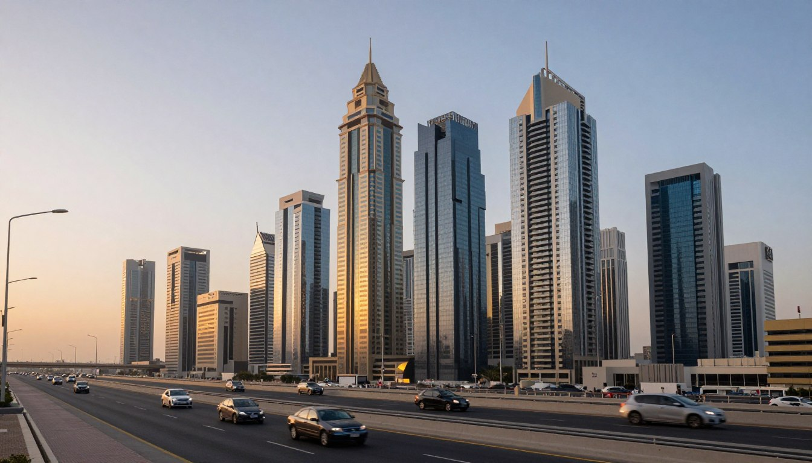
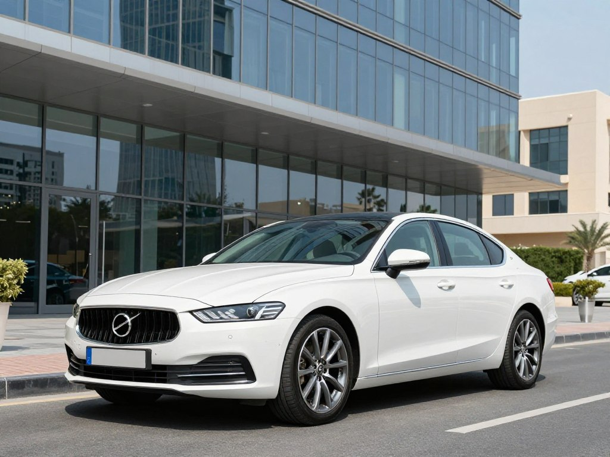
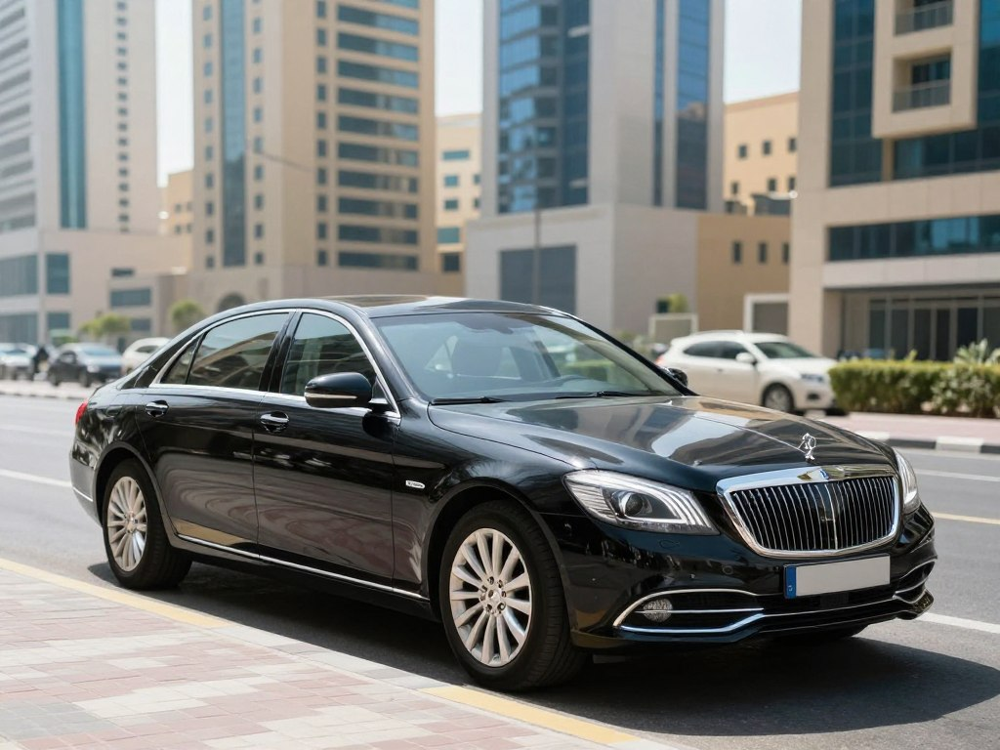
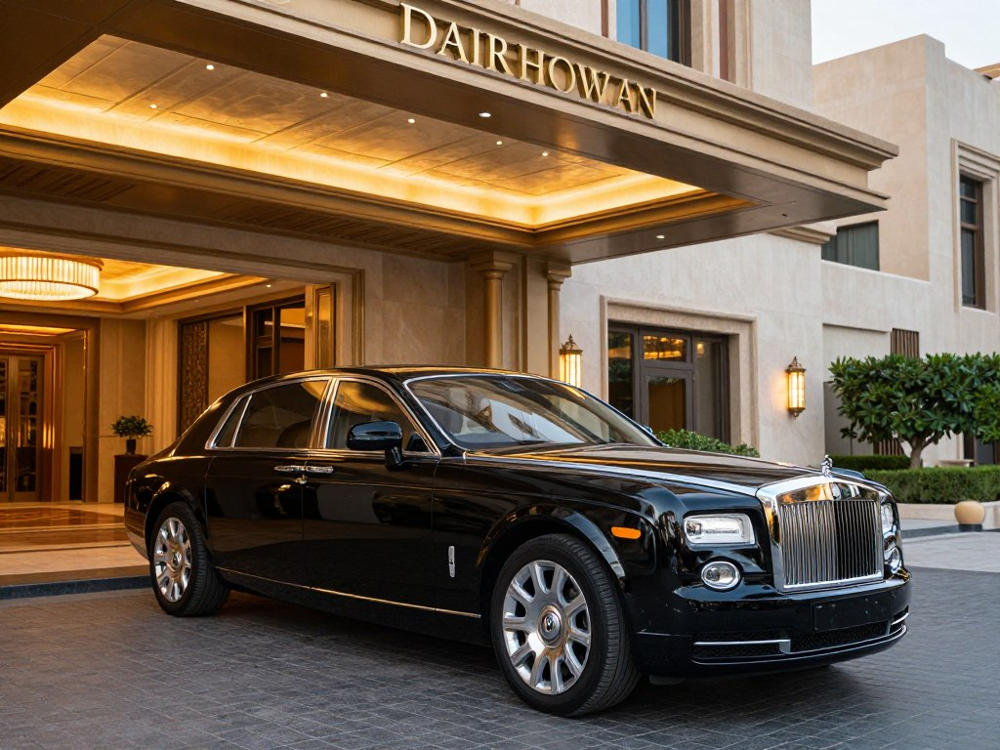
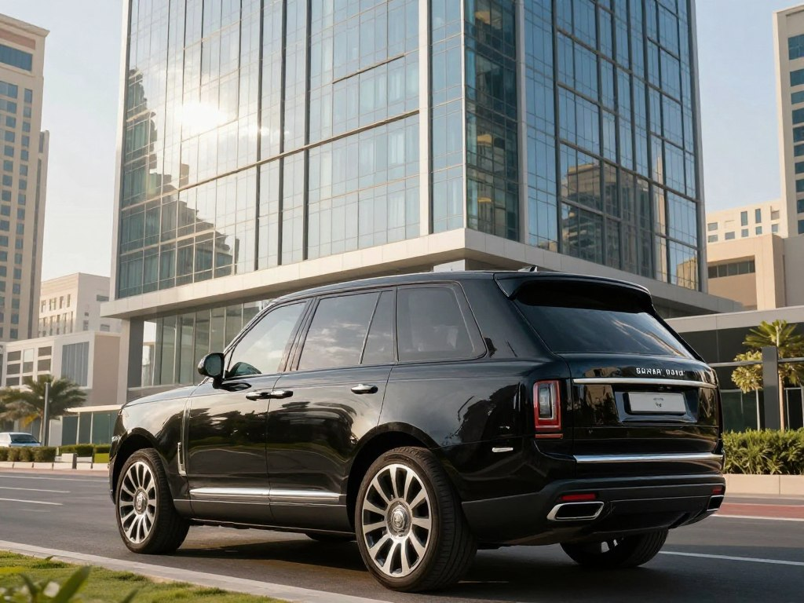
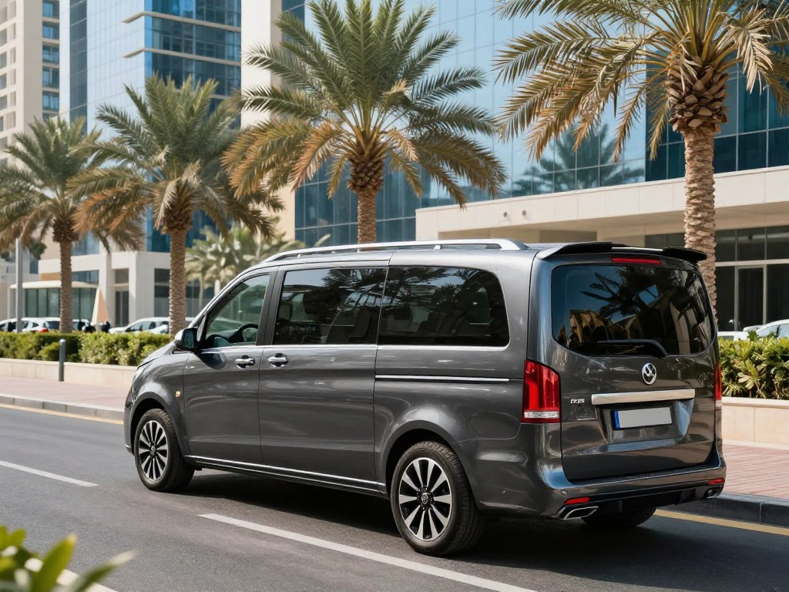
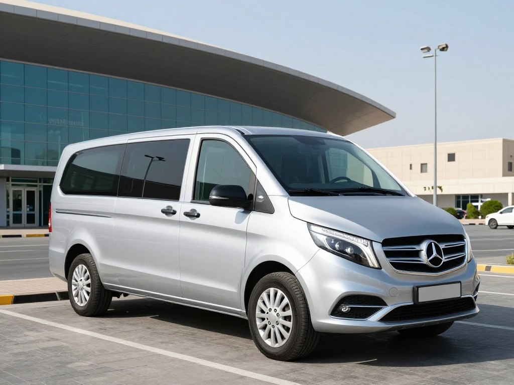
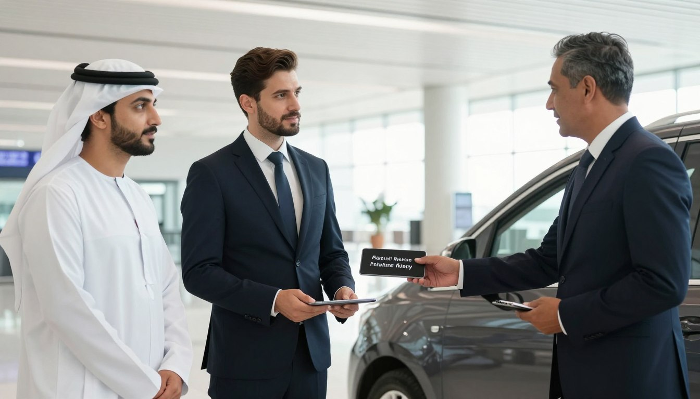
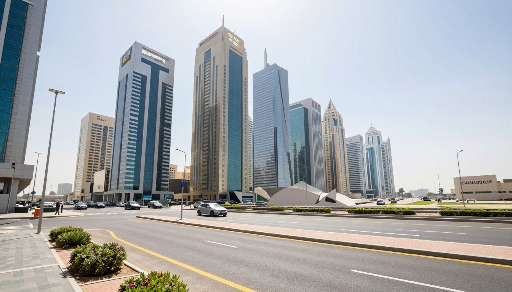

# **Chauffeur service in Dubai**

Professional chauffeur service Dubai delivers punctual executive mobility across the city for business executives and delegations. Arriving travellers at Dubai International Airport (DXB) receive direct terminal reception, personal luggage assistance, and private transit to central corporate addresses across Dubai with complete schedule reliability.

[Book now](https://seowriting.ai/services/chauffeur-vip/uae/dubai) [View the fleet](https://seowriting.ai/services/chauffeur-vip/uae/dubai)

### **Pick up**

Dubai International Airport (DXB)

### **Drop off**

DIFC, Dubai

### **Date and time**

\[Confirm: Date and time\]

[Get a quote](https://seowriting.ai/services/chauffeur-vip/uae/dubai)

The Dubai fleet

## **Chauffeur Service Dubai Fleet Classes**

Every vehicle in our Dubai fleet is GPS tracked and detailed before each journey. AB maintains immaculate standards across all vehicle categories to support punctual, comfortable executive mobility throughout Dubai.

### **Standard Sedan**

Sedan · 3 guests · 2 bags

Typical model: Toyota Camry or similar \[Confirm\]

Ideal for: Individual transfers and daily commutes

Comfortable saloon travel provides efficient city transport for individual business travellers moving between offices. Professional chauffeurs handle busy routes across Dubai with reliable scheduling, quiet cabin workspace, and complete climate control.

[Book this class](https://seowriting.ai/services/chauffeur-vip/uae/dubai) [Request a quote](https://seowriting.ai/services/chauffeur-vip/uae/dubai) [Airport transfer](https://seowriting.ai/services/airport-transfers/uae/dubai) [Hourly chauffeur](https://seowriting.ai/services/chauffeur-vip/uae/dubai) [Full specifications](https://seowriting.ai/services/chauffeur-vip/uae/dubai)

### **Business Sedan**

Sedan · 3 guests · 2 bags

Typical model: Mercedes E Class or similar \[Confirm\]

Ideal for: Executive roadshows and client meetings

Premium business sedans offer refined comfort and discreet transport for corporate executives. High grade leather seating and dedicated charging ports keep passengers productive between meetings in Dubai financial centres.

[Book this class](https://seowriting.ai/services/chauffeur-vip/uae/dubai) [Request a quote](https://seowriting.ai/services/chauffeur-vip/uae/dubai) [Airport transfer](https://seowriting.ai/services/airport-transfers/uae/dubai) [Hourly chauffeur](https://seowriting.ai/services/chauffeur-vip/uae/dubai) [Full specifications](https://seowriting.ai/services/chauffeur-vip/uae/dubai)

### **First Class Sedan**

Flagship sedan · 3 guests · 2 bags

Typical model: Mercedes S Class or similar \[Confirm\]

Ideal for: VIP transport and diplomatic delegations

Flagship luxury sedans provide ultimate passenger comfort with extended legroom and acoustic insulation. Experienced private drivers deliver prestige ground mobility for distinguished guests attending major summits across Dubai.

[Book this class](https://seowriting.ai/services/chauffeur-vip/uae/dubai) [Request a quote](https://seowriting.ai/services/chauffeur-vip/uae/dubai) [Airport transfer](https://seowriting.ai/services/airport-transfers/uae/dubai) [Hourly chauffeur](https://seowriting.ai/services/chauffeur-vip/uae/dubai) [Full specifications](https://seowriting.ai/services/chauffeur-vip/uae/dubai)

### **Executive SUV**

SUV · 6 guests · 5 bags

Typical model: Cadillac Escalade, GMC Yukon or similar \[Confirm\]

Ideal for: Senior management and family travel

Spacious luxury utility vehicles deliver commanding road presence, generous luggage capacity, and elevated passenger comfort. The quiet cabin provides abundant room for executive teams or families travelling with substantial luggage.

[Book this class](https://seowriting.ai/services/chauffeur-vip/uae/dubai) [Request a quote](https://seowriting.ai/services/chauffeur-vip/uae/dubai) [Airport transfer](https://seowriting.ai/services/airport-transfers/uae/dubai) [Hourly chauffeur](https://seowriting.ai/services/chauffeur-vip/uae/dubai) [Full specifications](https://seowriting.ai/services/chauffeur-vip/uae/dubai)

### **Premium MPV**

MPV · 6 guests · 5 bags

Typical model: Mercedes V Class or similar \[Confirm\]

Ideal for: Small delegations and corporate teams

Conference seating layouts and flexible passenger space allow small groups to collaborate comfortably while on the move. Generous storage compartments easily accommodate multiple large travel bags without crowding passenger legroom.

[Book this class](https://seowriting.ai/services/chauffeur-vip/uae/dubai) [Request a quote](https://seowriting.ai/services/chauffeur-vip/uae/dubai) [Airport transfer](https://seowriting.ai/services/airport-transfers/uae/dubai) [Hourly chauffeur](https://seowriting.ai/services/chauffeur-vip/uae/dubai) [Full specifications](https://seowriting.ai/services/chauffeur-vip/uae/dubai)

### **Executive Van**

Van · 14 guests · 10 bags

Typical model: Mercedes Sprinter or similar \[Confirm\]

Ideal for: Conference groups and event logistics

High capacity executive vans provide comfortable group transport for event teams, flight crews, and conference delegations. Reclining individual seats, dedicated climate zones, and ample luggage bays support smooth shared transit.

[Book this class](https://seowriting.ai/services/chauffeur-vip/uae/dubai) [Request a quote](https://seowriting.ai/services/chauffeur-vip/uae/dubai) [Airport transfer](https://seowriting.ai/services/airport-transfers/uae/dubai) [Hourly chauffeur](https://seowriting.ai/services/chauffeur-vip/uae/dubai) [Full specifications](https://seowriting.ai/services/chauffeur-vip/uae/dubai)

Popular journeys

## **Across Dubai and beyond**

Airport transfer

### **DXB to DIFC**

From \[AED price\]

Airport transfer

### **DXB to Dubai Marina**

From \[AED price\]

City

### **Dubai to Dubai World Trade Centre**

From \[AED price\]

City

### **Dubai to Expo City Dubai**

From \[AED price\]

Intercity

### **Dubai to Abu Dhabi**

From \[AED price\] · \[Confirm\] hours

Intercity

### **Dubai to Sharjah**

From \[AED price\] · \[Confirm\] hours

Intercity

### **Dubai to Al Ain**

From \[AED price\] · \[Confirm\] hours

Intercity

### **Dubai to Ras Al Khaimah**

From \[AED price\] · \[Confirm\] hours

Explore scheduled intercity routes and executive travel options through our dedicated [intercity transfers](https://seowriting.ai/services/intercity-transfers) service.

Services in Dubai

## **One partner for every movement in Dubai**

AB coordinates complete private ground transport solutions across Dubai for executive travellers, commercial organisations, and international delegations.

- [Chauffeur & VIP in Dubai](https://seowriting.ai/services/chauffeur-vip/uae/dubai)
- [Airport Transfers in Dubai](https://seowriting.ai/services/airport-transfers/uae/dubai)
- [Corporate Transportation in Dubai](https://seowriting.ai/services/corporate-transportation/uae/dubai)
- [Event Transportation in Dubai](https://seowriting.ai/services/event-transportation/uae/dubai)
- [Bus & Coach Hire in Dubai](https://seowriting.ai/services/bus-coach-hire/uae/dubai)

Airport transfers

## **Arriving at Dubai International Airport (DXB)**

Arriving at Dubai International Airport (DXB) requires reliable ground arrangements to navigate busy passenger terminals without unnecessary delays. Dedicated chauffeurs monitor live flight arrival times continuously, adjusting immediately for early arrivals or flight schedule adjustments. Upon landing, guests receive a professional meet and greet service inside the terminal arrivals hall, where the assigned driver displays a clear personalised name board. The driver assists with all luggage before escorting passengers to their vehicle at the designated terminal meeting point \[Confirm\]. Bookings include complimentary waiting time \[Confirm\], allowing ample opportunity to complete customs clearance and luggage collection.

### **Flight tracking**

Every arrival

### **Meet and greet**

Inside the terminal

### **DXB to DIFC**

\[Confirm\] minutes

For dedicated terminal details and arrivals guidance, view our operational summary for [Dubai International Airport](https://seowriting.ai/airports/dubai-international-dxb). Travellers using southern aviation hubs can also review our transfer logistics for [Al Maktoum International Airport](https://seowriting.ai/airports/al-maktoum-international-dwc).

Coverage

## **Where we work in Dubai**

AB provides comprehensive operational coverage throughout all central districts, commercial centres, and major venues across the emirate. Our chauffeurs navigate high density business clusters and leisure destinations with professional local route knowledge.

| Sector   | Primary hub   | Secondary hub   | Coverage details                                           |
| -------- | ------------- | --------------- | ---------------------------------------------------------- |
| Business | DIFC          | Downtown Dubai  | Business Bay executive offices and commercial headquarters |
| Events   | DWTC          | Expo City Dubai | Madinat Jumeirah conference halls and international venues |
| Heritage | Palm Jumeirah | Dubai Marina    | Al Fahidi historical district and waterfront promenades    |
| Industry | JAFZA         | Silicon Oasis   | Dubai Internet City technology parks and logistics centres |

Travellers requiring nationwide logistics across all seven emirates can consult our wider network guide for [United Arab Emirates](https://seowriting.ai/locations/uae) ground mobility.

Our office

## **AB Chauffeur Service Dubai Regional Office**

AB maintains an active local operational office in Dubai to supervise vehicle quality, driver schedules, and corporate account coordination. Supported by central 24/7 dispatch from headquarters in Riyadh, our Dubai office manages regional transport logistics across the northern emirates.

**AB Dubai**  
Suite 206, DBC Building, Al Khabaisi, Deira, Dubai, UAE

+971 50 781 3880

<https://maps.google.com/maps?q=Suite+206,+DBC+Building,+Al+Khabaisi,+Deira,+Dubai,+UAE&output=embed>

Questions

## **Chauffeur Service Dubai: Your Questions**

### **How do I book a private chauffeur service Dubai with AB?**

Booking a private driver Dubai transfer or full day service requires choosing your vehicle tier, entering journey details, and confirming passenger requirements through our reservations portal. Travel coordinators receive rapid confirmations, verified chauffeur contact details, and complete billing documentation. Dedicated corporate account managers also arrange continuous passenger logistics for commercial roadshows or diplomatic itineraries.

### **What procedures apply for DXB airport transfer meet and greet services?**

Every DXB airport transfer includes continuous flight tracking, so chauffeurs adjust immediately for schedule changes or early arrivals. Your professional chauffeur greets passengers inside Dubai International Airport (DXB) arrivals halls holding a clear personalised name sign. Drivers handle all luggage, assist passengers through the terminal, and guide them directly to their waiting executive vehicle.

### **Can corporate travel managers reserve an hourly chauffeur service in Dubai?**

Hourly chauffeur hire provides complete flexibility for executives attending multiple meetings across Dubai financial districts or conference centres. Your dedicated vehicle and driver remain on standby between appointments, adapting immediately as meeting schedules evolve. This dedicated hire service supports multi stop business itineraries without the administrative burden of coordinating separate single journey bookings.

### **What vehicle classes are available for corporate transportation Dubai?**

AB provides an extensive fleet ranging from standard executive saloons to high capacity vehicles for corporate transportation Dubai. Options include Business Sedans, First Class Sedans like the Mercedes S Class, luxury SUVs such as the Cadillac Escalade, and Mercedes V Class MPVs. Large groups can select executive vans or book larger capacity coaches through our bus rental Dubai service.

### **How does AB coordinate executive event transportation Dubai?**

Event transportation Dubai projects receive dedicated ground coordination managed directly by our experienced operations team. We oversee delegate airport transfers, venue shuttles at locations like Dubai World Trade Centre, and VIP motorcade movements. Real time dispatch monitoring keeps multi vehicle fleets running strictly to your planned summit or conference timetable.

### **Are all AB vehicles and professional chauffeurs fully licensed and insured?**

All vehicles in the AB fleet operate under strict commercial transport licensing, comprehensive insurance coverage, and regular mechanical testing. Chauffeurs undergo extensive background vetting, defensive driving instruction, and protocol training for executive and diplomatic passenger transport. Every vehicle features continuous GPS monitoring to support passenger safety across every journey.

### **How are executive intercity transfer Dubai journeys arranged to other emirates?**

An executive intercity transfer Dubai provides private point to point transit between Dubai and destinations including Abu Dhabi, Sharjah, Al Ain, or Ras Al Khaimah. Passengers enjoy quiet, air conditioned comfort with fixed pricing and experienced drivers familiar with regional UAE highways. Intercity transfers eliminate public transit transfers and airport waiting times for regional business travel.

## **Your chauffeur is ready in Dubai.**

Contact our 24/7 operations dispatch team directly on +966 58 111 8720 to reserve your chauffeur service Dubai or coordinate complex corporate passenger transport schedules throughout Dubai.

### **Reserve your executive journey**

Select your vehicle category online or contact our regional operations desk to arrange managed corporate transport across the emirates.

[Book now](https://seowriting.ai/services/chauffeur-vip/uae/dubai) [Request a proposal](https://seowriting.ai/services/corporate-transportation/uae/dubai)