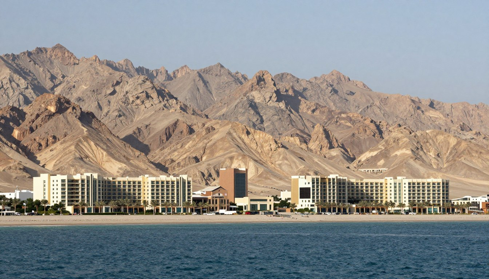
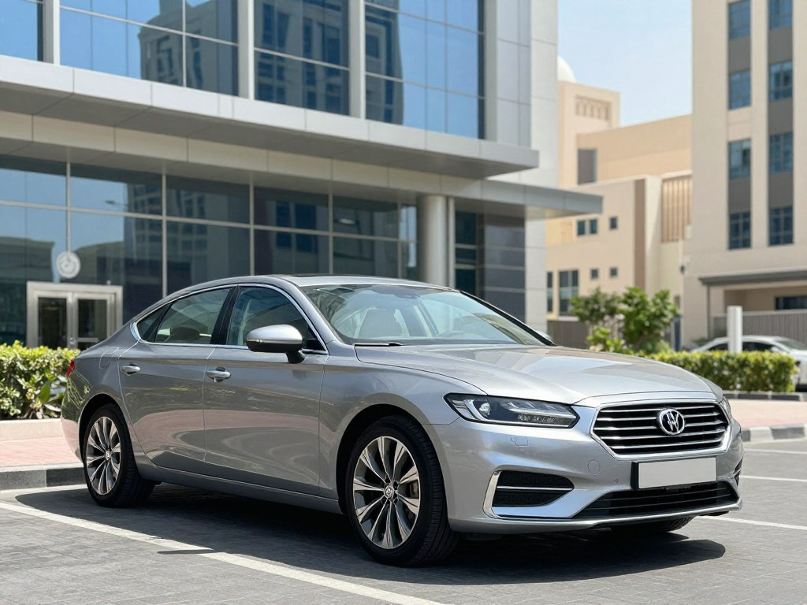
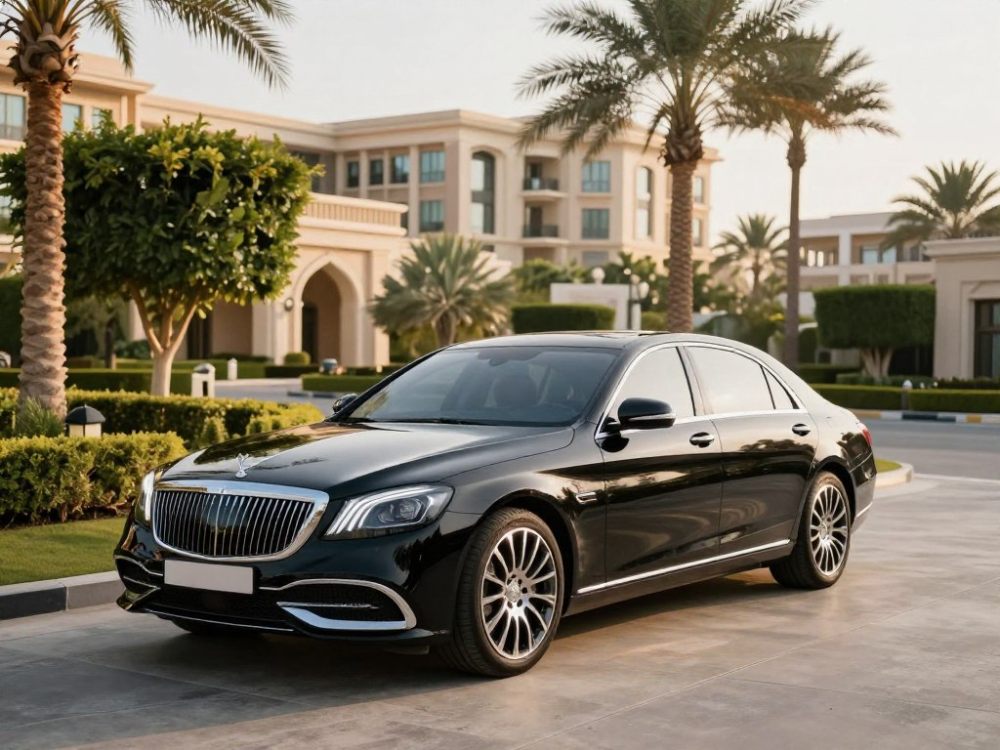
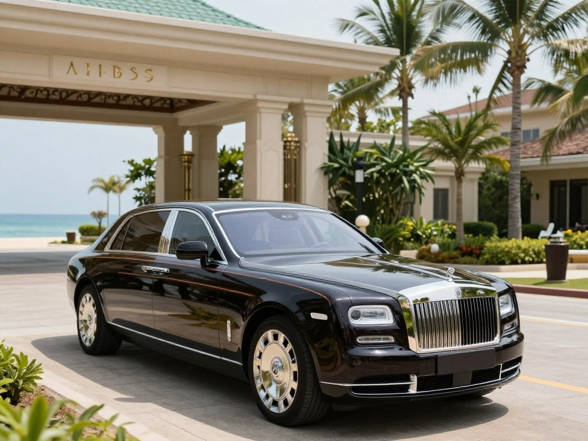
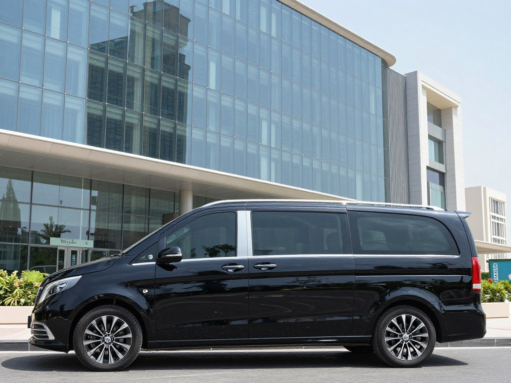
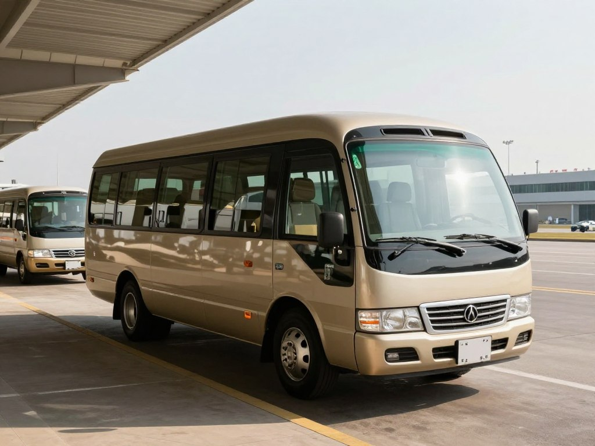
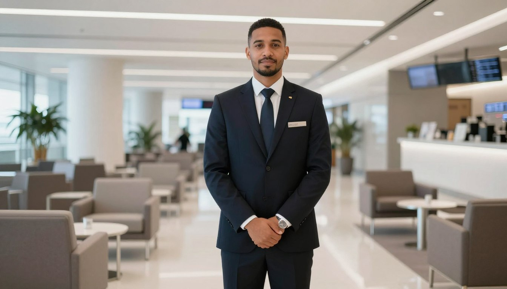
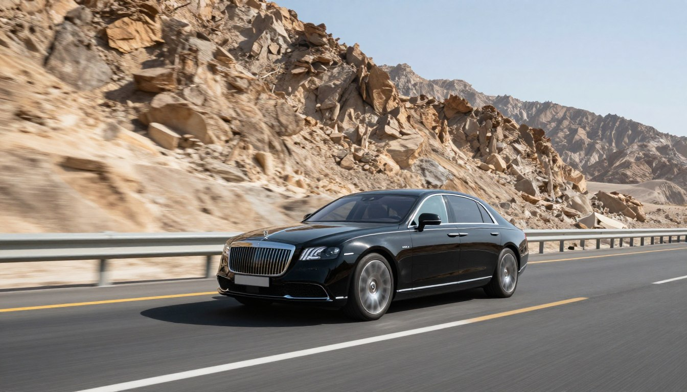

# **Chauffeur service in Ras Al Khaimah**

AB provides an executive chauffeur service Ras Al Khaimah for corporate executives, event delegations and private visitors travelling throughout the northern emirates. Ground travel connects Ras Al Khaimah International Airport (RKT) with coastal resorts, free zones and mountain attractions across Ras Al Khaimah.

Professional operations coordinate every transfer through experienced drivers and pristine vehicles dispatched across the emirate. Punctual scheduling, discreet conduct and transparent coordination define each private journey from arrival to final departure.

[Book now](https://seowriting.ai/services/chauffeur-vip/uae/ras-al-khaimah) [View the fleet](https://seowriting.ai/services/chauffeur-vip/uae/ras-al-khaimah)

**Pick up:** Ras Al Khaimah International Airport (RKT)

**Drop off:** Al Marjan Island, Ras Al Khaimah

**Date and time:** Scheduled transfer

[Get a quote](https://seowriting.ai/services/chauffeur-vip/uae/ras-al-khaimah)

The Ras Al Khaimah fleet

## **Choose your Ras Al Khaimah chauffeur class**

Vehicles for Ras Al Khaimah are dispatched from the nearest office, AB Dubai. Every car arrives immaculate, fully prepared for desert climate travel and driven by a licensed, professionally presented chauffeur.

### **Standard Sedan**

Sedan · 3 guests · 2 bags

Typical model: Toyota Camry or similar \[Confirm\]

**Ideal for:** Efficient business and individual transfers

Comfortable travel for individual executives requiring an efficient private driver Ras Al Khaimah between local business districts and hotels. Clean interiors and climate control maintain relaxed transit on every route.

[Book this class](https://seowriting.ai/services/chauffeur-vip/uae/ras-al-khaimah)

### **Business Sedan**

Sedan · 3 guests · 2 bags

Typical model: Mercedes Benz E Class or similar \[Confirm\]

**Ideal for:** Corporate meetings and executive transit

Sophisticated transport tailored for corporate managers visiting industrial parks and free trade zones. Quiet passenger cabins allow passengers to review briefs or conduct calls between appointments.

[Book this class](https://seowriting.ai/services/chauffeur-vip/uae/ras-al-khaimah)

### **First Class Sedan**

Flagship sedan · 3 guests · 2 bags

Typical model: Mercedes S Class or similar \[Confirm\]

**Ideal for:** VIP protocol and luxury hospitality

The premier flagship saloon for state delegations and luxury hospitality across Ras Al Khaimah. Extended legroom, ambient lighting and refined sound insulation provide an uncompromising travel standard.

[Book this class](https://seowriting.ai/services/chauffeur-vip/uae/ras-al-khaimah)

### **Executive SUV**

SUV · 6 guests · 5 bags

Typical model: Cadillac Escalade, GMC Yukon or similar \[Confirm\]

**Ideal for:** Mountain excursions and family travel

Substantial luggage volume and elevated seating make this limousine service Ras Al Khaimah option well suited for journeys toward Jebel Jais. Spacious leather seating accommodates families and executive security teams effortlessly.

[Book this class](https://seowriting.ai/services/chauffeur-vip/uae/ras-al-khaimah)

### **Premium MPV**

MPV · 6 guests · 5 bags

Typical model: Mercedes V Class or similar \[Confirm\]

**Ideal for:** Small delegations and roadshow teams

Conference style seating creates a mobile workspace for touring project teams and event committees in Ras Al Khaimah. Wide automatic sliding doors facilitate smooth passenger entry at busy event entrances.

[Book this class](https://seowriting.ai/services/chauffeur-vip/uae/ras-al-khaimah)

### **Executive Van**

Van · 14 guests · 10 bags

Typical model: Mercedes Benz Sprinter or similar \[Confirm\]

**Ideal for:** Corporate staff and delegate groups

High capacity group transit designed for international conference guests, venue transfers and corporate retreats. Generous headroom and ample cargo storage handle multi delegate airport arrivals with ease.

[Book this class](https://seowriting.ai/services/chauffeur-vip/uae/ras-al-khaimah)

Popular journeys

## **Across Ras Al Khaimah and beyond**

Direct routes link international airports, coastal island developments, industrial free zones and neighbouring emirates with transparent pricing structures.

Airport transfer

### **RKT to Al Marjan Island**

Direct terminal collection heading to luxury resorts and residences along the Marjan shoreline.

From \[AED price\]

Airport transfer

### **RKT to Al Hamra**

Smooth road connection between the airport arrivals area and the Al Hamra Village marina and residential precinct.

From \[AED price\]

City or Intercity

### **Ras Al Khaimah to Jebel Jais**

Ascent from central city districts up the scenic mountain highway to the viewing deck and outdoor attractions.

From \[AED price\] · \[Confirm\] hours

City or Intercity

### **Ras Al Khaimah to Dubai**

Intercity link connecting northern accommodation and offices directly with downtown Dubai financial hubs.

From \[AED price\] · \[Confirm\] hours

City or Intercity

### **Ras Al Khaimah to Sharjah**

Regional corridor transfer between corporate facilities in the northern emirates and Sharjah commercial quarters.

From \[AED price\] · \[Confirm\] hours

Explore full intercity routing options through our specialised [intercity transfers](https://seowriting.ai/services/intercity-transfers) service.

Services in Ras Al Khaimah

## **One partner for every movement in Ras Al Khaimah**

AB coordinates ground transport requirements across the emirate for private flights, regional corporate engagements, delegations and private leisure itineraries.

- Dedicated private driver Ras Al Khaimah services on an hourly chauffeur or full day hire basis.
- Executive airport collections with active terminal flight tracking and meet and greet services.
- Point to point intercity transfer Ras Al Khaimah travel into Dubai, Sharjah and Abu Dhabi.
- Access our comprehensive [Chauffeur & VIP in Ras Al Khaimah](https://seowriting.ai/services/chauffeur-vip/uae/ras-al-khaimah) programme for personalised VIP transport.

Airport transfers

## **Arriving at Ras Al Khaimah International Airport (RKT)**

Arriving passengers at Ras Al Khaimah International Airport (RKT) receive direct personal attention from their assigned professional chauffeur upon clearing customs. AB monitors all incoming commercial flights and private aviation movements through real time tracking systems to accommodate early arrivals or unexpected air traffic delays.

Your chauffeur welcomes you inside the arrivals hall displaying a personalised name board at the designated meeting point \[Confirm\]. Guests receive courteous luggage assistance before walking to their vehicle parked in the immediate executive terminal zone. Each scheduled arrival includes generous complimentary waiting time \[Confirm\] so you navigate immigration and baggage collection at a relaxed, unhurried pace.

Travelers connecting between northern resorts and international departures in Dubai can coordinate transfers to [Dubai International Airport (DXB)](https://seowriting.ai/airports/dubai-international-dxb) through our regional dispatch team. Consistent booking standards protect schedules across all UAE airports.

**Flight tracking:** Every arrival

**Meet and greet:** Inside the terminal

**RKT to Al Marjan Island:** \[Confirm\] minutes

Coverage

## **Where we work in Ras Al Khaimah**

AB maintains extensive ground transportation coverage across industrial, financial, hospitality and cultural zones in the emirate. Dedicated vehicles navigate coastal developments, municipal centres and mountain territories with verified route knowledge and disciplined timing.

Drivers stay updated on regional road conditions, seasonal resort traffic and conference access protocols. Dedicated coordination supports business travel itineraries that require multiple stops throughout a single working day.

**Coverage corridors across the emirate:**

- **Business:** Al Hamra Business Village, RAKEZ Business Zone, Ras Al Khaimah Economic Zone Boulevard
- **Events and conferences:** Al Hamra International Exhibition and Conference Centre, Waldorf Astoria Ras Al Khaimah Convention Centre, Marjan Island Resort Ballroom
- **Heritage and leisure:** Jebel Jais Viewing Deck Park, Dhayah Fort, National Museum of Ras Al Khaimah
- **Government or Industry:** Ras Al Khaimah Municipality, Saqr Port Authority, Stevin Rock Industrial Zone

Our office

## **Chauffeur service Ras Al Khaimah regional dispatch**

Vehicles operating throughout Ras Al Khaimah are dispatched and coordinated directly through our Dubai regional hub. The operations team manages vehicle detailing, route planning and round the clock communications for all assignments in the northern emirates.

Centralised fleet coordination supports high corporate standards, immediate dispatch flexibility and direct contact with operations managers for private clients and corporate travel coordinators alike.

### **AB Dubai Regional Office**

Serving Ras Al Khaimah and the northern emirates \[Confirm\].

Suite 206, DBC Building, Al Khabaisi, Deira, Dubai, UAE

+971 50 781 3880

[Get directions](https://seowriting.ai/services/chauffeur-vip/uae/ras-al-khaimah)

Questions

## **Chauffeur service in Ras Al Khaimah: your questions**

### **How do I book a chauffeur service Ras Al Khaimah for corporate travel?**

Corporate travel managers can request a reservation through the AB booking portal or by contacting our operations centre directly. Provide your flight schedule, passenger manifest and vehicle class preference to receive a prompt proposal. Accounts team members coordinate centralised billing and itinerary confirmation for single trips or multi day corporate assignments.

### **What does an RKT airport transfer include upon arrival?**

An RKT airport transfer includes active flight tracking, terminal meet and greet service and personalised luggage assistance. Your chauffeur waits inside the arrivals area holding a name board for swift recognition. Complimentary waiting time \[Confirm\] provides ample buffer against customs or baggage delays before departure to your hotel or office.

### **Can I book an intercity transfer Ras Al Khaimah to Dubai or other emirates?**

Yes, AB provides direct point to point intercity transfer Ras Al Khaimah services connecting the emirate to Dubai, Sharjah and Abu Dhabi. Vehicles depart at your preferred schedule from any residence, hotel or corporate address with fixed, transparent pricing. Passenger sedans, executive SUVs and group vans support both individual executive trips and large delegation travel.

### **Is an hourly chauffeur service available throughout Ras Al Khaimah?**

AB provides flexible hourly chauffeur and full day hire options throughout Ras Al Khaimah and nearby desert territories. An hourly hire keeps a dedicated car and private driver on standby throughout complex itineraries, client meetings and recreational excursions. You retain complete flexibility to adjust stops, meeting times and routes as your schedule develops.

### **Are AB chauffeurs in Ras Al Khaimah licensed and commercially insured?**

Every chauffeur operating with AB holds commercial licensing and extensive training in passenger safety, route navigation and defensive driving standards. All fleet vehicles maintain full commercial passenger insurance coverage complying with United Arab Emirates regulatory authorities. Chauffeurs observe strict protocol discretion, executive grooming and immaculate vehicle presentation on every booking.

## **Your chauffeur is ready in Ras Al Khaimah.**

Contact our round the clock dispatch team on +971 50 781 3880 to confirm your chauffeur service Ras Al Khaimah with AB today.

### **Reserve executive ground transportation**

Select your vehicle class or submit delegate transfer requirements to our regional reservations team.

[Request a proposal](https://seowriting.ai/services/chauffeur-vip/uae/ras-al-khaimah) [Book a transfer](https://seowriting.ai/services/chauffeur-vip/uae/ras-al-khaimah)