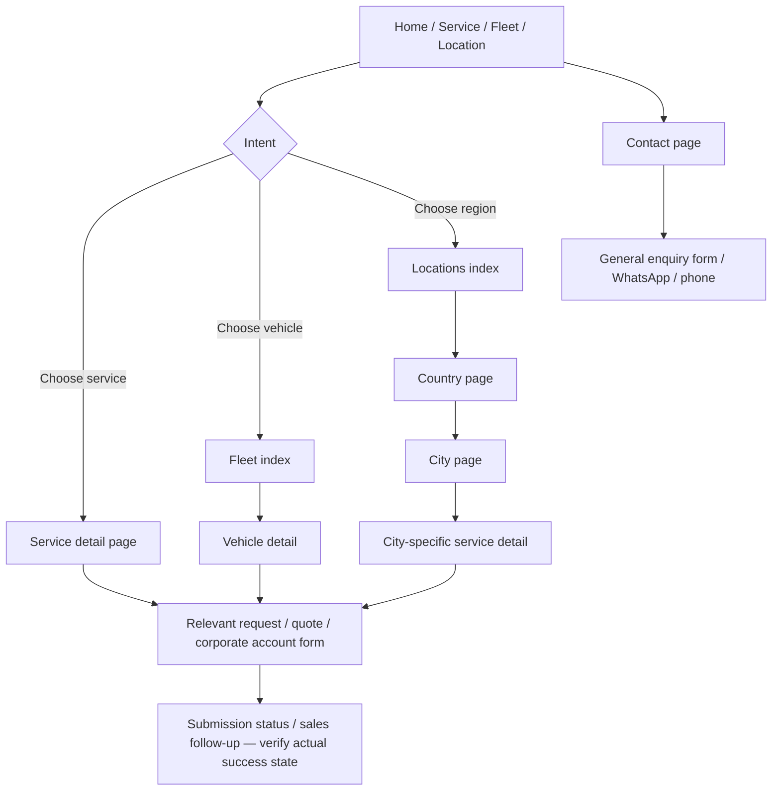
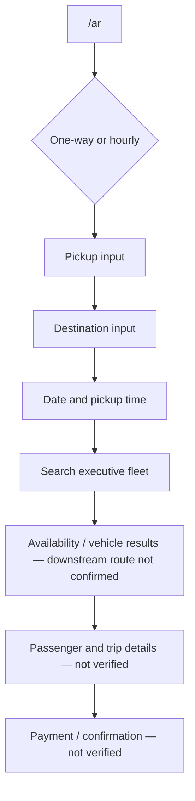

# AB.Limo — Live Website Hierarchy & Interaction Mapping

**Research snapshot:** 23 October 2026

## Scope and confidence labels

- **Verified**: page/route or visible interaction was found in the live-site crawl or navigation.
- **Route pattern**: generated from working country/city/service cross-links. The specific URL is plausible and structurally supported, but not every combination was individually opened.
- **Needs browser QA**: the UI label exists, but the exact click result, form submission behavior, or destination could not be reliably established by the text-only crawl.

Important: The current English root is an enterprise mobility / lead-generation site. The `/ar` branch exposes a more consumer-style ride search form. Treat these as two observed experiences, not one verified booking checkout. The public sitemap/robots endpoints were not accessible to the research tool, so this is a deep crawl of the linked and indexed routes, not a guarantee of hidden/authenticated pages.

## 1. High-level information architecture

```text

/  Home — enterprise mobility landing page
├── /services
│   ├── /services/chauffeur-vip
│   ├── /services/airport-transfers
│   ├── /services/corporate-transportation
│   ├── /services/event-transportation
│   ├── /services/bus-coach-hire  [base page needs browser QA]
│   └── /services/tourism-transportation
│       └── Each service also has country and city variants (see matrices below)
├── /fleet
│   ├── /fleet/luxury-sedan
│   ├── /fleet/business-sedan
│   ├── /fleet/luxury-suv
│   ├── /fleet/business-van
│   ├── /fleet/mpv
│   └── /fleet/mini-bus
├── /locations
│   ├── /locations/cities
│   └── Country pages
│       └── City pages
│           └── Six local service pages per city
├── /about
├── /partners  (chauffeur/service-provider recruitment)
├── /career
├── /press/releases
├── /blogs
│   ├── /blogs/orchestrating-ground-logistics-fii
│   ├── /blogs/roi-outsourcing-executive-fleets
│   └── /blogs/live-telemetry-inside-its
├── /sustainability
├── /faqs
├── /contact
├── /terms
├── /privacy-policy
└── /accessibility

/ar  [parallel Arabic/consumer-style branch; see separate section]
```

## 2. Core page inventory — verified / linked routes

| Section | Page | URL | Interaction / route role |
|---|---|---|---|
| Verified | Home | [/](https://www.ab.limo/) | Top navigation menus; in-page CTAs; fleet; location and service cards; contact/quote entry. |
| Verified | Services index | [/services](https://www.ab.limo/services) | Six service-category cards route to service verticals; Start a Consultation CTA (target/anchor needs QA). |
| Verified | Executive & Corporate Mobility / Chauffeur & VIP | [/services/chauffeur-vip](https://www.ab.limo/services/chauffeur-vip) | Service detail, anchor CTAs, fleet section, corporate/quote inquiry form, FAQ. |
| Verified | Airport Transfers & Meet & Greet | [/services/airport-transfers](https://www.ab.limo/services/airport-transfers) | Book transfer, process/flight-support CTAs, airport-specific inquiry path; exact form result needs QA. |
| Verified | Corporate Fleet & Workforce Mobility | [/services/corporate-transportation](https://www.ab.limo/services/corporate-transportation) | Enterprise transport, shuttle audit, executive account, RFP, compliance, fleet, quote CTAs. |
| Verified | Event Transportation & MICE | [/services/event-transportation](https://www.ab.limo/services/event-transportation) | Plan event, event solutions, event quote, case study, demo and event-fleet CTAs. |
| Needs browser QA | Group & Coach Charter | [/services/bus-coach-hire](https://www.ab.limo/services/bus-coach-hire) | Country/city variants exist; base page could not be fetched reliably; verify before implementation. |
| Verified | Tourism & Leisure | [/services/tourism-transportation](https://www.ab.limo/services/tourism-transportation) | Tourism/leisure service, itinerary and quote CTAs. |
| Verified | Our Fleet | [/fleet](https://www.ab.limo/fleet) | Six vehicle detail links; Talk to the Mobility Team → /contact. |
| Verified | Luxury Sedan (S-Class) | [/fleet/luxury-sedan](https://www.ab.limo/fleet/luxury-sedan) | Request This Vehicle scrolls/targets inquiry area; quick inquiry form; other fleet links. |
| Verified | Business Sedan | [/fleet/business-sedan](https://www.ab.limo/fleet/business-sedan) | Quick inquiry; related fleet links. |
| Verified | Luxury SUV (Escalade/GMC) | [/fleet/luxury-suv](https://www.ab.limo/fleet/luxury-suv) | Quick inquiry; related fleet links. |
| Verified | Business Van (V-Class) | [/fleet/business-van](https://www.ab.limo/fleet/business-van) | Quick inquiry; related fleet links. |
| Verified | MPV (Hyundai Staria) | [/fleet/mpv](https://www.ab.limo/fleet/mpv) | Quick inquiry; related fleet links. |
| Verified | Mini Bus / Coach / VIP Luxury Bus | [/fleet/mini-bus](https://www.ab.limo/fleet/mini-bus) | Quick inquiry; related fleet links. |
| Verified | Global Availability / Countries | [/locations](https://www.ab.limo/locations) | Search countries input; country cards; Book Now/Book Your Ride links (booking destination requires QA). |
| Verified | All Cities | [/locations/cities](https://www.ab.limo/locations/cities) | Country filter buttons plus 32 city links; Book Now CTA. |
| Verified | About AB.Limo | [/about](https://www.ab.limo/about) | How-it-works sections, vehicle classes, FAQ content, View All Cities. |
| Verified | Become a service provider / Chauffeur Recruitment | [/partners](https://www.ab.limo/partners) | Apply now, Onboarding/Requirements controls and partner inquiry CTA; real application endpoint needs QA. |
| Verified | Corporate Careers | [/career](https://www.ab.limo/career) | Teams/opportunities content and Become a Chauffeur Partner link. |
| Verified | Press Releases | [/press/releases](https://www.ab.limo/press/releases) | Category select, release cards and Show more button; card destinations require QA. |
| Verified | Blogs / Articles index | [/blogs](https://www.ab.limo/blogs) | Article cards route to 3 currently surfaced posts. |
| Verified | FII event logistics article | [/blogs/orchestrating-ground-logistics-fii](https://www.ab.limo/blogs/orchestrating-ground-logistics-fii) | Article page, navigation and footer links. |
| Verified | Executive fleet outsourcing ROI article | [/blogs/roi-outsourcing-executive-fleets](https://www.ab.limo/blogs/roi-outsourcing-executive-fleets) | Article page, navigation and footer links. |
| Verified | Live Telemetry / ITS article | [/blogs/live-telemetry-inside-its](https://www.ab.limo/blogs/live-telemetry-inside-its) | Article page, navigation and footer links. |
| Verified | Sustainability | [/sustainability](https://www.ab.limo/sustainability) | Book a ride CTA, informational content and footer links. |
| Verified | Enterprise Mobility FAQs | [/faqs](https://www.ab.limo/faqs) | Category controls, Load More Answers (10 of 28 shown), contact/RFP CTA. |
| Verified | Contact Us | [/contact](https://www.ab.limo/contact) | WhatsApp/phone, enquiry form, FAQ and services links. |
| Verified | Terms of Use | [/terms](https://www.ab.limo/terms) | Table-of-contents anchor links to 16 sections. |
| Verified | Privacy Policy | [/privacy-policy](https://www.ab.limo/privacy-policy) | Legal content, shared navigation/footer. |
| Verified | Accessibility Statement | [/accessibility](https://www.ab.limo/accessibility) | Legal/accessibility content, shared navigation/footer. |

## 3. Country landing pages

Country pages link onward to their city pages and six country-level service detail routes. The country URL for UAE uses `/uae`.

| Country | Country URL | Cities listed in directory |
|---|---|---|
| Bahrain | [/locations/bahrain](https://www.ab.limo/locations/bahrain) | Manama, Riffa, Muharraq |
| Kuwait | [/locations/kuwait](https://www.ab.limo/locations/kuwait) | Kuwait City, Hawalli, Farwaniya, Al Ahmadi |
| Oman | [/locations/oman](https://www.ab.limo/locations/oman) | Muscat, Salalah, Sohar |
| Qatar | [/locations/qatar](https://www.ab.limo/locations/qatar) | Doha, Al Khor, Lusail, Al Wakrah |
| Saudi Arabia | [/locations/saudi-arabia](https://www.ab.limo/locations/saudi-arabia) | Riyadh, Jeddah, Mecca, Medina, Dammam, Tabuk, Al Ula, Al Khobar, Al Qasim, Abha, Jizan, NEOM |
| United Arab Emirates | [/locations/uae](https://www.ab.limo/locations/uae) | Dubai, Abu Dhabi, Sharjah, Ajman, Ras Al Khaimah, Al Ain |

## 4. All city landing-page URLs

The 32 cities below are listed on `/locations/cities`. A city landing page generally contains a repeated enquiry form, six service links, descriptive city/airport sections, intercity route links when available, FAQs, and shared footer navigation. Exact form submit outcomes need browser testing.

| Country | City | URL |
|---|---|---|
| Bahrain | Manama | [/locations/bahrain/manama](https://www.ab.limo/locations/bahrain/manama) |
| Bahrain | Riffa | [/locations/bahrain/riffa](https://www.ab.limo/locations/bahrain/riffa) |
| Bahrain | Muharraq | [/locations/bahrain/muharraq](https://www.ab.limo/locations/bahrain/muharraq) |
| Kuwait | Kuwait City | [/locations/kuwait/kuwait-city](https://www.ab.limo/locations/kuwait/kuwait-city) |
| Kuwait | Hawalli | [/locations/kuwait/hawalli](https://www.ab.limo/locations/kuwait/hawalli) |
| Kuwait | Farwaniya | [/locations/kuwait/farwaniya](https://www.ab.limo/locations/kuwait/farwaniya) |
| Kuwait | Al Ahmadi | [/locations/kuwait/al-ahmadi](https://www.ab.limo/locations/kuwait/al-ahmadi) |
| Oman | Muscat | [/locations/oman/muscat](https://www.ab.limo/locations/oman/muscat) |
| Oman | Salalah | [/locations/oman/salalah](https://www.ab.limo/locations/oman/salalah) |
| Oman | Sohar | [/locations/oman/sohar](https://www.ab.limo/locations/oman/sohar) |
| Qatar | Doha | [/locations/qatar/doha](https://www.ab.limo/locations/qatar/doha) |
| Qatar | Al Khor | [/locations/qatar/al-khor](https://www.ab.limo/locations/qatar/al-khor) |
| Qatar | Lusail | [/locations/qatar/lusail](https://www.ab.limo/locations/qatar/lusail) |
| Qatar | Al Wakrah | [/locations/qatar/al-wakrah](https://www.ab.limo/locations/qatar/al-wakrah) |
| Saudi Arabia | Riyadh | [/locations/saudi-arabia/riyadh](https://www.ab.limo/locations/saudi-arabia/riyadh) |
| Saudi Arabia | Jeddah | [/locations/saudi-arabia/jeddah](https://www.ab.limo/locations/saudi-arabia/jeddah) |
| Saudi Arabia | Mecca | [/locations/saudi-arabia/mecca](https://www.ab.limo/locations/saudi-arabia/mecca) |
| Saudi Arabia | Medina | [/locations/saudi-arabia/medina](https://www.ab.limo/locations/saudi-arabia/medina) |
| Saudi Arabia | Dammam | [/locations/saudi-arabia/dammam](https://www.ab.limo/locations/saudi-arabia/dammam) |
| Saudi Arabia | Tabuk | [/locations/saudi-arabia/tabuk](https://www.ab.limo/locations/saudi-arabia/tabuk) |
| Saudi Arabia | Al Ula | [/locations/saudi-arabia/al-ula](https://www.ab.limo/locations/saudi-arabia/al-ula) |
| Saudi Arabia | Al Khobar | [/locations/saudi-arabia/al-khobar](https://www.ab.limo/locations/saudi-arabia/al-khobar) |
| Saudi Arabia | Al Qasim | [/locations/saudi-arabia/al-qasim](https://www.ab.limo/locations/saudi-arabia/al-qasim) |
| Saudi Arabia | Abha | [/locations/saudi-arabia/abha](https://www.ab.limo/locations/saudi-arabia/abha) |
| Saudi Arabia | Jizan | [/locations/saudi-arabia/jizan](https://www.ab.limo/locations/saudi-arabia/jizan) |
| Saudi Arabia | NEOM | [/locations/saudi-arabia/neom](https://www.ab.limo/locations/saudi-arabia/neom) |
| United Arab Emirates | Dubai | [/locations/uae/dubai](https://www.ab.limo/locations/uae/dubai) |
| United Arab Emirates | Abu Dhabi | [/locations/uae/abu-dhabi](https://www.ab.limo/locations/uae/abu-dhabi) |
| United Arab Emirates | Sharjah | [/locations/uae/sharjah](https://www.ab.limo/locations/uae/sharjah) |
| United Arab Emirates | Ajman | [/locations/uae/ajman](https://www.ab.limo/locations/uae/ajman) |
| United Arab Emirates | Ras Al Khaimah | [/locations/uae/ras-al-khaimah](https://www.ab.limo/locations/uae/ras-al-khaimah) |
| United Arab Emirates | Al Ain | [/locations/uae/al-ain](https://www.ab.limo/locations/uae/al-ain) |

## 5. Country-specific service routes (36 route-pattern URLs)

Template: `/services/{serviceSlug}/{countrySlug}`. Qatar variants such as `/services/airport-transfers/qatar`, `/services/corporate-transportation/qatar`, `/services/bus-coach-hire/qatar`, and `/services/tourism-transportation/qatar` are present. The crawl returned substantially repeated “Mastering Mobility in Qatar” content across some different Qatar service URLs, so page content/template differentiation needs QA.

| Service vertical | Country | URL | Status |
|---|---|---|---|
| Executive & Corporate Mobility | Bahrain | [/services/chauffeur-vip/bahrain](https://www.ab.limo/services/chauffeur-vip/bahrain) | Route pattern; verify live |
| Executive & Corporate Mobility | Kuwait | [/services/chauffeur-vip/kuwait](https://www.ab.limo/services/chauffeur-vip/kuwait) | Route pattern; verify live |
| Executive & Corporate Mobility | Oman | [/services/chauffeur-vip/oman](https://www.ab.limo/services/chauffeur-vip/oman) | Route pattern; verify live |
| Executive & Corporate Mobility | Qatar | [/services/chauffeur-vip/qatar](https://www.ab.limo/services/chauffeur-vip/qatar) | Route pattern; verify live |
| Executive & Corporate Mobility | Saudi Arabia | [/services/chauffeur-vip/saudi-arabia](https://www.ab.limo/services/chauffeur-vip/saudi-arabia) | Route pattern; verify live |
| Executive & Corporate Mobility | United Arab Emirates | [/services/chauffeur-vip/uae](https://www.ab.limo/services/chauffeur-vip/uae) | Route pattern; verify live |
| Airport Transfers | Bahrain | [/services/airport-transfers/bahrain](https://www.ab.limo/services/airport-transfers/bahrain) | Route pattern; verify live |
| Airport Transfers | Kuwait | [/services/airport-transfers/kuwait](https://www.ab.limo/services/airport-transfers/kuwait) | Route pattern; verify live |
| Airport Transfers | Oman | [/services/airport-transfers/oman](https://www.ab.limo/services/airport-transfers/oman) | Route pattern; verify live |
| Airport Transfers | Qatar | [/services/airport-transfers/qatar](https://www.ab.limo/services/airport-transfers/qatar) | Verified example |
| Airport Transfers | Saudi Arabia | [/services/airport-transfers/saudi-arabia](https://www.ab.limo/services/airport-transfers/saudi-arabia) | Route pattern; verify live |
| Airport Transfers | United Arab Emirates | [/services/airport-transfers/uae](https://www.ab.limo/services/airport-transfers/uae) | Route pattern; verify live |
| Corporate Fleet & Workforce Mobility | Bahrain | [/services/corporate-transportation/bahrain](https://www.ab.limo/services/corporate-transportation/bahrain) | Route pattern; verify live |
| Corporate Fleet & Workforce Mobility | Kuwait | [/services/corporate-transportation/kuwait](https://www.ab.limo/services/corporate-transportation/kuwait) | Route pattern; verify live |
| Corporate Fleet & Workforce Mobility | Oman | [/services/corporate-transportation/oman](https://www.ab.limo/services/corporate-transportation/oman) | Route pattern; verify live |
| Corporate Fleet & Workforce Mobility | Qatar | [/services/corporate-transportation/qatar](https://www.ab.limo/services/corporate-transportation/qatar) | Verified example |
| Corporate Fleet & Workforce Mobility | Saudi Arabia | [/services/corporate-transportation/saudi-arabia](https://www.ab.limo/services/corporate-transportation/saudi-arabia) | Route pattern; verify live |
| Corporate Fleet & Workforce Mobility | United Arab Emirates | [/services/corporate-transportation/uae](https://www.ab.limo/services/corporate-transportation/uae) | Route pattern; verify live |
| Event Transportation | Bahrain | [/services/event-transportation/bahrain](https://www.ab.limo/services/event-transportation/bahrain) | Route pattern; verify live |
| Event Transportation | Kuwait | [/services/event-transportation/kuwait](https://www.ab.limo/services/event-transportation/kuwait) | Route pattern; verify live |
| Event Transportation | Oman | [/services/event-transportation/oman](https://www.ab.limo/services/event-transportation/oman) | Route pattern; verify live |
| Event Transportation | Qatar | [/services/event-transportation/qatar](https://www.ab.limo/services/event-transportation/qatar) | Verified example |
| Event Transportation | Saudi Arabia | [/services/event-transportation/saudi-arabia](https://www.ab.limo/services/event-transportation/saudi-arabia) | Route pattern; verify live |
| Event Transportation | United Arab Emirates | [/services/event-transportation/uae](https://www.ab.limo/services/event-transportation/uae) | Route pattern; verify live |
| Group & Coach Charter | Bahrain | [/services/bus-coach-hire/bahrain](https://www.ab.limo/services/bus-coach-hire/bahrain) | Route pattern; verify live |
| Group & Coach Charter | Kuwait | [/services/bus-coach-hire/kuwait](https://www.ab.limo/services/bus-coach-hire/kuwait) | Route pattern; verify live |
| Group & Coach Charter | Oman | [/services/bus-coach-hire/oman](https://www.ab.limo/services/bus-coach-hire/oman) | Route pattern; verify live |
| Group & Coach Charter | Qatar | [/services/bus-coach-hire/qatar](https://www.ab.limo/services/bus-coach-hire/qatar) | Verified example |
| Group & Coach Charter | Saudi Arabia | [/services/bus-coach-hire/saudi-arabia](https://www.ab.limo/services/bus-coach-hire/saudi-arabia) | Route pattern; verify live |
| Group & Coach Charter | United Arab Emirates | [/services/bus-coach-hire/uae](https://www.ab.limo/services/bus-coach-hire/uae) | Route pattern; verify live |
| Tourism & Leisure | Bahrain | [/services/tourism-transportation/bahrain](https://www.ab.limo/services/tourism-transportation/bahrain) | Route pattern; verify live |
| Tourism & Leisure | Kuwait | [/services/tourism-transportation/kuwait](https://www.ab.limo/services/tourism-transportation/kuwait) | Route pattern; verify live |
| Tourism & Leisure | Oman | [/services/tourism-transportation/oman](https://www.ab.limo/services/tourism-transportation/oman) | Route pattern; verify live |
| Tourism & Leisure | Qatar | [/services/tourism-transportation/qatar](https://www.ab.limo/services/tourism-transportation/qatar) | Verified example |
| Tourism & Leisure | Saudi Arabia | [/services/tourism-transportation/saudi-arabia](https://www.ab.limo/services/tourism-transportation/saudi-arabia) | Route pattern; verify live |
| Tourism & Leisure | United Arab Emirates | [/services/tourism-transportation/uae](https://www.ab.limo/services/tourism-transportation/uae) | Route pattern; verify live |

## 6. City-specific service routes (192 route-pattern URLs)

Template: `/services/{serviceSlug}/{countrySlug}/{citySlug}`. All six service links are displayed on city pages. The Doha examples were individually confirmed for all six verticals. Other city/service combinations are expanded from this established pattern and should be spot-checked before committing routes or SEO metadata.

| Country | City | Service vertical | URL | Status |
|---|---|---|---|---|
| Bahrain | Manama | Executive & Corporate Mobility | [/services/chauffeur-vip/bahrain/manama](https://www.ab.limo/services/chauffeur-vip/bahrain/manama) | Pattern; verify live |
| Bahrain | Manama | Airport Transfers | [/services/airport-transfers/bahrain/manama](https://www.ab.limo/services/airport-transfers/bahrain/manama) | Pattern; verify live |
| Bahrain | Manama | Corporate Fleet & Workforce Mobility | [/services/corporate-transportation/bahrain/manama](https://www.ab.limo/services/corporate-transportation/bahrain/manama) | Pattern; verify live |
| Bahrain | Manama | Event Transportation | [/services/event-transportation/bahrain/manama](https://www.ab.limo/services/event-transportation/bahrain/manama) | Pattern; verify live |
| Bahrain | Manama | Group & Coach Charter | [/services/bus-coach-hire/bahrain/manama](https://www.ab.limo/services/bus-coach-hire/bahrain/manama) | Pattern; verify live |
| Bahrain | Manama | Tourism & Leisure | [/services/tourism-transportation/bahrain/manama](https://www.ab.limo/services/tourism-transportation/bahrain/manama) | Pattern; verify live |
| Bahrain | Riffa | Executive & Corporate Mobility | [/services/chauffeur-vip/bahrain/riffa](https://www.ab.limo/services/chauffeur-vip/bahrain/riffa) | Pattern; verify live |
| Bahrain | Riffa | Airport Transfers | [/services/airport-transfers/bahrain/riffa](https://www.ab.limo/services/airport-transfers/bahrain/riffa) | Pattern; verify live |
| Bahrain | Riffa | Corporate Fleet & Workforce Mobility | [/services/corporate-transportation/bahrain/riffa](https://www.ab.limo/services/corporate-transportation/bahrain/riffa) | Pattern; verify live |
| Bahrain | Riffa | Event Transportation | [/services/event-transportation/bahrain/riffa](https://www.ab.limo/services/event-transportation/bahrain/riffa) | Pattern; verify live |
| Bahrain | Riffa | Group & Coach Charter | [/services/bus-coach-hire/bahrain/riffa](https://www.ab.limo/services/bus-coach-hire/bahrain/riffa) | Pattern; verify live |
| Bahrain | Riffa | Tourism & Leisure | [/services/tourism-transportation/bahrain/riffa](https://www.ab.limo/services/tourism-transportation/bahrain/riffa) | Pattern; verify live |
| Bahrain | Muharraq | Executive & Corporate Mobility | [/services/chauffeur-vip/bahrain/muharraq](https://www.ab.limo/services/chauffeur-vip/bahrain/muharraq) | Pattern; verify live |
| Bahrain | Muharraq | Airport Transfers | [/services/airport-transfers/bahrain/muharraq](https://www.ab.limo/services/airport-transfers/bahrain/muharraq) | Pattern; verify live |
| Bahrain | Muharraq | Corporate Fleet & Workforce Mobility | [/services/corporate-transportation/bahrain/muharraq](https://www.ab.limo/services/corporate-transportation/bahrain/muharraq) | Pattern; verify live |
| Bahrain | Muharraq | Event Transportation | [/services/event-transportation/bahrain/muharraq](https://www.ab.limo/services/event-transportation/bahrain/muharraq) | Pattern; verify live |
| Bahrain | Muharraq | Group & Coach Charter | [/services/bus-coach-hire/bahrain/muharraq](https://www.ab.limo/services/bus-coach-hire/bahrain/muharraq) | Pattern; verify live |
| Bahrain | Muharraq | Tourism & Leisure | [/services/tourism-transportation/bahrain/muharraq](https://www.ab.limo/services/tourism-transportation/bahrain/muharraq) | Pattern; verify live |
| Kuwait | Kuwait City | Executive & Corporate Mobility | [/services/chauffeur-vip/kuwait/kuwait-city](https://www.ab.limo/services/chauffeur-vip/kuwait/kuwait-city) | Pattern; verify live |
| Kuwait | Kuwait City | Airport Transfers | [/services/airport-transfers/kuwait/kuwait-city](https://www.ab.limo/services/airport-transfers/kuwait/kuwait-city) | Pattern; verify live |
| Kuwait | Kuwait City | Corporate Fleet & Workforce Mobility | [/services/corporate-transportation/kuwait/kuwait-city](https://www.ab.limo/services/corporate-transportation/kuwait/kuwait-city) | Pattern; verify live |
| Kuwait | Kuwait City | Event Transportation | [/services/event-transportation/kuwait/kuwait-city](https://www.ab.limo/services/event-transportation/kuwait/kuwait-city) | Pattern; verify live |
| Kuwait | Kuwait City | Group & Coach Charter | [/services/bus-coach-hire/kuwait/kuwait-city](https://www.ab.limo/services/bus-coach-hire/kuwait/kuwait-city) | Pattern; verify live |
| Kuwait | Kuwait City | Tourism & Leisure | [/services/tourism-transportation/kuwait/kuwait-city](https://www.ab.limo/services/tourism-transportation/kuwait/kuwait-city) | Pattern; verify live |
| Kuwait | Hawalli | Executive & Corporate Mobility | [/services/chauffeur-vip/kuwait/hawalli](https://www.ab.limo/services/chauffeur-vip/kuwait/hawalli) | Pattern; verify live |
| Kuwait | Hawalli | Airport Transfers | [/services/airport-transfers/kuwait/hawalli](https://www.ab.limo/services/airport-transfers/kuwait/hawalli) | Pattern; verify live |
| Kuwait | Hawalli | Corporate Fleet & Workforce Mobility | [/services/corporate-transportation/kuwait/hawalli](https://www.ab.limo/services/corporate-transportation/kuwait/hawalli) | Pattern; verify live |
| Kuwait | Hawalli | Event Transportation | [/services/event-transportation/kuwait/hawalli](https://www.ab.limo/services/event-transportation/kuwait/hawalli) | Pattern; verify live |
| Kuwait | Hawalli | Group & Coach Charter | [/services/bus-coach-hire/kuwait/hawalli](https://www.ab.limo/services/bus-coach-hire/kuwait/hawalli) | Pattern; verify live |
| Kuwait | Hawalli | Tourism & Leisure | [/services/tourism-transportation/kuwait/hawalli](https://www.ab.limo/services/tourism-transportation/kuwait/hawalli) | Pattern; verify live |
| Kuwait | Farwaniya | Executive & Corporate Mobility | [/services/chauffeur-vip/kuwait/farwaniya](https://www.ab.limo/services/chauffeur-vip/kuwait/farwaniya) | Pattern; verify live |
| Kuwait | Farwaniya | Airport Transfers | [/services/airport-transfers/kuwait/farwaniya](https://www.ab.limo/services/airport-transfers/kuwait/farwaniya) | Pattern; verify live |
| Kuwait | Farwaniya | Corporate Fleet & Workforce Mobility | [/services/corporate-transportation/kuwait/farwaniya](https://www.ab.limo/services/corporate-transportation/kuwait/farwaniya) | Pattern; verify live |
| Kuwait | Farwaniya | Event Transportation | [/services/event-transportation/kuwait/farwaniya](https://www.ab.limo/services/event-transportation/kuwait/farwaniya) | Pattern; verify live |
| Kuwait | Farwaniya | Group & Coach Charter | [/services/bus-coach-hire/kuwait/farwaniya](https://www.ab.limo/services/bus-coach-hire/kuwait/farwaniya) | Pattern; verify live |
| Kuwait | Farwaniya | Tourism & Leisure | [/services/tourism-transportation/kuwait/farwaniya](https://www.ab.limo/services/tourism-transportation/kuwait/farwaniya) | Pattern; verify live |
| Kuwait | Al Ahmadi | Executive & Corporate Mobility | [/services/chauffeur-vip/kuwait/al-ahmadi](https://www.ab.limo/services/chauffeur-vip/kuwait/al-ahmadi) | Pattern; verify live |
| Kuwait | Al Ahmadi | Airport Transfers | [/services/airport-transfers/kuwait/al-ahmadi](https://www.ab.limo/services/airport-transfers/kuwait/al-ahmadi) | Pattern; verify live |
| Kuwait | Al Ahmadi | Corporate Fleet & Workforce Mobility | [/services/corporate-transportation/kuwait/al-ahmadi](https://www.ab.limo/services/corporate-transportation/kuwait/al-ahmadi) | Pattern; verify live |
| Kuwait | Al Ahmadi | Event Transportation | [/services/event-transportation/kuwait/al-ahmadi](https://www.ab.limo/services/event-transportation/kuwait/al-ahmadi) | Pattern; verify live |
| Kuwait | Al Ahmadi | Group & Coach Charter | [/services/bus-coach-hire/kuwait/al-ahmadi](https://www.ab.limo/services/bus-coach-hire/kuwait/al-ahmadi) | Pattern; verify live |
| Kuwait | Al Ahmadi | Tourism & Leisure | [/services/tourism-transportation/kuwait/al-ahmadi](https://www.ab.limo/services/tourism-transportation/kuwait/al-ahmadi) | Pattern; verify live |
| Oman | Muscat | Executive & Corporate Mobility | [/services/chauffeur-vip/oman/muscat](https://www.ab.limo/services/chauffeur-vip/oman/muscat) | Pattern; verify live |
| Oman | Muscat | Airport Transfers | [/services/airport-transfers/oman/muscat](https://www.ab.limo/services/airport-transfers/oman/muscat) | Pattern; verify live |
| Oman | Muscat | Corporate Fleet & Workforce Mobility | [/services/corporate-transportation/oman/muscat](https://www.ab.limo/services/corporate-transportation/oman/muscat) | Pattern; verify live |
| Oman | Muscat | Event Transportation | [/services/event-transportation/oman/muscat](https://www.ab.limo/services/event-transportation/oman/muscat) | Pattern; verify live |
| Oman | Muscat | Group & Coach Charter | [/services/bus-coach-hire/oman/muscat](https://www.ab.limo/services/bus-coach-hire/oman/muscat) | Pattern; verify live |
| Oman | Muscat | Tourism & Leisure | [/services/tourism-transportation/oman/muscat](https://www.ab.limo/services/tourism-transportation/oman/muscat) | Pattern; verify live |
| Oman | Salalah | Executive & Corporate Mobility | [/services/chauffeur-vip/oman/salalah](https://www.ab.limo/services/chauffeur-vip/oman/salalah) | Pattern; verify live |
| Oman | Salalah | Airport Transfers | [/services/airport-transfers/oman/salalah](https://www.ab.limo/services/airport-transfers/oman/salalah) | Pattern; verify live |
| Oman | Salalah | Corporate Fleet & Workforce Mobility | [/services/corporate-transportation/oman/salalah](https://www.ab.limo/services/corporate-transportation/oman/salalah) | Pattern; verify live |
| Oman | Salalah | Event Transportation | [/services/event-transportation/oman/salalah](https://www.ab.limo/services/event-transportation/oman/salalah) | Pattern; verify live |
| Oman | Salalah | Group & Coach Charter | [/services/bus-coach-hire/oman/salalah](https://www.ab.limo/services/bus-coach-hire/oman/salalah) | Pattern; verify live |
| Oman | Salalah | Tourism & Leisure | [/services/tourism-transportation/oman/salalah](https://www.ab.limo/services/tourism-transportation/oman/salalah) | Pattern; verify live |
| Oman | Sohar | Executive & Corporate Mobility | [/services/chauffeur-vip/oman/sohar](https://www.ab.limo/services/chauffeur-vip/oman/sohar) | Pattern; verify live |
| Oman | Sohar | Airport Transfers | [/services/airport-transfers/oman/sohar](https://www.ab.limo/services/airport-transfers/oman/sohar) | Pattern; verify live |
| Oman | Sohar | Corporate Fleet & Workforce Mobility | [/services/corporate-transportation/oman/sohar](https://www.ab.limo/services/corporate-transportation/oman/sohar) | Pattern; verify live |
| Oman | Sohar | Event Transportation | [/services/event-transportation/oman/sohar](https://www.ab.limo/services/event-transportation/oman/sohar) | Pattern; verify live |
| Oman | Sohar | Group & Coach Charter | [/services/bus-coach-hire/oman/sohar](https://www.ab.limo/services/bus-coach-hire/oman/sohar) | Pattern; verify live |
| Oman | Sohar | Tourism & Leisure | [/services/tourism-transportation/oman/sohar](https://www.ab.limo/services/tourism-transportation/oman/sohar) | Pattern; verify live |
| Qatar | Doha | Executive & Corporate Mobility | [/services/chauffeur-vip/qatar/doha](https://www.ab.limo/services/chauffeur-vip/qatar/doha) | Verified example |
| Qatar | Doha | Airport Transfers | [/services/airport-transfers/qatar/doha](https://www.ab.limo/services/airport-transfers/qatar/doha) | Verified example |
| Qatar | Doha | Corporate Fleet & Workforce Mobility | [/services/corporate-transportation/qatar/doha](https://www.ab.limo/services/corporate-transportation/qatar/doha) | Verified example |
| Qatar | Doha | Event Transportation | [/services/event-transportation/qatar/doha](https://www.ab.limo/services/event-transportation/qatar/doha) | Verified example |
| Qatar | Doha | Group & Coach Charter | [/services/bus-coach-hire/qatar/doha](https://www.ab.limo/services/bus-coach-hire/qatar/doha) | Verified example |
| Qatar | Doha | Tourism & Leisure | [/services/tourism-transportation/qatar/doha](https://www.ab.limo/services/tourism-transportation/qatar/doha) | Verified example |
| Qatar | Al Khor | Executive & Corporate Mobility | [/services/chauffeur-vip/qatar/al-khor](https://www.ab.limo/services/chauffeur-vip/qatar/al-khor) | Pattern; verify live |
| Qatar | Al Khor | Airport Transfers | [/services/airport-transfers/qatar/al-khor](https://www.ab.limo/services/airport-transfers/qatar/al-khor) | Pattern; verify live |
| Qatar | Al Khor | Corporate Fleet & Workforce Mobility | [/services/corporate-transportation/qatar/al-khor](https://www.ab.limo/services/corporate-transportation/qatar/al-khor) | Pattern; verify live |
| Qatar | Al Khor | Event Transportation | [/services/event-transportation/qatar/al-khor](https://www.ab.limo/services/event-transportation/qatar/al-khor) | Pattern; verify live |
| Qatar | Al Khor | Group & Coach Charter | [/services/bus-coach-hire/qatar/al-khor](https://www.ab.limo/services/bus-coach-hire/qatar/al-khor) | Pattern; verify live |
| Qatar | Al Khor | Tourism & Leisure | [/services/tourism-transportation/qatar/al-khor](https://www.ab.limo/services/tourism-transportation/qatar/al-khor) | Pattern; verify live |
| Qatar | Lusail | Executive & Corporate Mobility | [/services/chauffeur-vip/qatar/lusail](https://www.ab.limo/services/chauffeur-vip/qatar/lusail) | Pattern; verify live |
| Qatar | Lusail | Airport Transfers | [/services/airport-transfers/qatar/lusail](https://www.ab.limo/services/airport-transfers/qatar/lusail) | Pattern; verify live |
| Qatar | Lusail | Corporate Fleet & Workforce Mobility | [/services/corporate-transportation/qatar/lusail](https://www.ab.limo/services/corporate-transportation/qatar/lusail) | Pattern; verify live |
| Qatar | Lusail | Event Transportation | [/services/event-transportation/qatar/lusail](https://www.ab.limo/services/event-transportation/qatar/lusail) | Pattern; verify live |
| Qatar | Lusail | Group & Coach Charter | [/services/bus-coach-hire/qatar/lusail](https://www.ab.limo/services/bus-coach-hire/qatar/lusail) | Pattern; verify live |
| Qatar | Lusail | Tourism & Leisure | [/services/tourism-transportation/qatar/lusail](https://www.ab.limo/services/tourism-transportation/qatar/lusail) | Pattern; verify live |
| Qatar | Al Wakrah | Executive & Corporate Mobility | [/services/chauffeur-vip/qatar/al-wakrah](https://www.ab.limo/services/chauffeur-vip/qatar/al-wakrah) | Pattern; verify live |
| Qatar | Al Wakrah | Airport Transfers | [/services/airport-transfers/qatar/al-wakrah](https://www.ab.limo/services/airport-transfers/qatar/al-wakrah) | Pattern; verify live |
| Qatar | Al Wakrah | Corporate Fleet & Workforce Mobility | [/services/corporate-transportation/qatar/al-wakrah](https://www.ab.limo/services/corporate-transportation/qatar/al-wakrah) | Pattern; verify live |
| Qatar | Al Wakrah | Event Transportation | [/services/event-transportation/qatar/al-wakrah](https://www.ab.limo/services/event-transportation/qatar/al-wakrah) | Pattern; verify live |
| Qatar | Al Wakrah | Group & Coach Charter | [/services/bus-coach-hire/qatar/al-wakrah](https://www.ab.limo/services/bus-coach-hire/qatar/al-wakrah) | Pattern; verify live |
| Qatar | Al Wakrah | Tourism & Leisure | [/services/tourism-transportation/qatar/al-wakrah](https://www.ab.limo/services/tourism-transportation/qatar/al-wakrah) | Pattern; verify live |
| Saudi Arabia | Riyadh | Executive & Corporate Mobility | [/services/chauffeur-vip/saudi-arabia/riyadh](https://www.ab.limo/services/chauffeur-vip/saudi-arabia/riyadh) | Pattern; verify live |
| Saudi Arabia | Riyadh | Airport Transfers | [/services/airport-transfers/saudi-arabia/riyadh](https://www.ab.limo/services/airport-transfers/saudi-arabia/riyadh) | Pattern; verify live |
| Saudi Arabia | Riyadh | Corporate Fleet & Workforce Mobility | [/services/corporate-transportation/saudi-arabia/riyadh](https://www.ab.limo/services/corporate-transportation/saudi-arabia/riyadh) | Pattern; verify live |
| Saudi Arabia | Riyadh | Event Transportation | [/services/event-transportation/saudi-arabia/riyadh](https://www.ab.limo/services/event-transportation/saudi-arabia/riyadh) | Pattern; verify live |
| Saudi Arabia | Riyadh | Group & Coach Charter | [/services/bus-coach-hire/saudi-arabia/riyadh](https://www.ab.limo/services/bus-coach-hire/saudi-arabia/riyadh) | Pattern; verify live |
| Saudi Arabia | Riyadh | Tourism & Leisure | [/services/tourism-transportation/saudi-arabia/riyadh](https://www.ab.limo/services/tourism-transportation/saudi-arabia/riyadh) | Pattern; verify live |
| Saudi Arabia | Jeddah | Executive & Corporate Mobility | [/services/chauffeur-vip/saudi-arabia/jeddah](https://www.ab.limo/services/chauffeur-vip/saudi-arabia/jeddah) | Pattern; verify live |
| Saudi Arabia | Jeddah | Airport Transfers | [/services/airport-transfers/saudi-arabia/jeddah](https://www.ab.limo/services/airport-transfers/saudi-arabia/jeddah) | Pattern; verify live |
| Saudi Arabia | Jeddah | Corporate Fleet & Workforce Mobility | [/services/corporate-transportation/saudi-arabia/jeddah](https://www.ab.limo/services/corporate-transportation/saudi-arabia/jeddah) | Pattern; verify live |
| Saudi Arabia | Jeddah | Event Transportation | [/services/event-transportation/saudi-arabia/jeddah](https://www.ab.limo/services/event-transportation/saudi-arabia/jeddah) | Pattern; verify live |
| Saudi Arabia | Jeddah | Group & Coach Charter | [/services/bus-coach-hire/saudi-arabia/jeddah](https://www.ab.limo/services/bus-coach-hire/saudi-arabia/jeddah) | Pattern; verify live |
| Saudi Arabia | Jeddah | Tourism & Leisure | [/services/tourism-transportation/saudi-arabia/jeddah](https://www.ab.limo/services/tourism-transportation/saudi-arabia/jeddah) | Pattern; verify live |
| Saudi Arabia | Mecca | Executive & Corporate Mobility | [/services/chauffeur-vip/saudi-arabia/mecca](https://www.ab.limo/services/chauffeur-vip/saudi-arabia/mecca) | Pattern; verify live |
| Saudi Arabia | Mecca | Airport Transfers | [/services/airport-transfers/saudi-arabia/mecca](https://www.ab.limo/services/airport-transfers/saudi-arabia/mecca) | Pattern; verify live |
| Saudi Arabia | Mecca | Corporate Fleet & Workforce Mobility | [/services/corporate-transportation/saudi-arabia/mecca](https://www.ab.limo/services/corporate-transportation/saudi-arabia/mecca) | Pattern; verify live |
| Saudi Arabia | Mecca | Event Transportation | [/services/event-transportation/saudi-arabia/mecca](https://www.ab.limo/services/event-transportation/saudi-arabia/mecca) | Pattern; verify live |
| Saudi Arabia | Mecca | Group & Coach Charter | [/services/bus-coach-hire/saudi-arabia/mecca](https://www.ab.limo/services/bus-coach-hire/saudi-arabia/mecca) | Pattern; verify live |
| Saudi Arabia | Mecca | Tourism & Leisure | [/services/tourism-transportation/saudi-arabia/mecca](https://www.ab.limo/services/tourism-transportation/saudi-arabia/mecca) | Pattern; verify live |
| Saudi Arabia | Medina | Executive & Corporate Mobility | [/services/chauffeur-vip/saudi-arabia/medina](https://www.ab.limo/services/chauffeur-vip/saudi-arabia/medina) | Pattern; verify live |
| Saudi Arabia | Medina | Airport Transfers | [/services/airport-transfers/saudi-arabia/medina](https://www.ab.limo/services/airport-transfers/saudi-arabia/medina) | Pattern; verify live |
| Saudi Arabia | Medina | Corporate Fleet & Workforce Mobility | [/services/corporate-transportation/saudi-arabia/medina](https://www.ab.limo/services/corporate-transportation/saudi-arabia/medina) | Pattern; verify live |
| Saudi Arabia | Medina | Event Transportation | [/services/event-transportation/saudi-arabia/medina](https://www.ab.limo/services/event-transportation/saudi-arabia/medina) | Pattern; verify live |
| Saudi Arabia | Medina | Group & Coach Charter | [/services/bus-coach-hire/saudi-arabia/medina](https://www.ab.limo/services/bus-coach-hire/saudi-arabia/medina) | Pattern; verify live |
| Saudi Arabia | Medina | Tourism & Leisure | [/services/tourism-transportation/saudi-arabia/medina](https://www.ab.limo/services/tourism-transportation/saudi-arabia/medina) | Pattern; verify live |
| Saudi Arabia | Dammam | Executive & Corporate Mobility | [/services/chauffeur-vip/saudi-arabia/dammam](https://www.ab.limo/services/chauffeur-vip/saudi-arabia/dammam) | Pattern; verify live |
| Saudi Arabia | Dammam | Airport Transfers | [/services/airport-transfers/saudi-arabia/dammam](https://www.ab.limo/services/airport-transfers/saudi-arabia/dammam) | Pattern; verify live |
| Saudi Arabia | Dammam | Corporate Fleet & Workforce Mobility | [/services/corporate-transportation/saudi-arabia/dammam](https://www.ab.limo/services/corporate-transportation/saudi-arabia/dammam) | Pattern; verify live |
| Saudi Arabia | Dammam | Event Transportation | [/services/event-transportation/saudi-arabia/dammam](https://www.ab.limo/services/event-transportation/saudi-arabia/dammam) | Pattern; verify live |
| Saudi Arabia | Dammam | Group & Coach Charter | [/services/bus-coach-hire/saudi-arabia/dammam](https://www.ab.limo/services/bus-coach-hire/saudi-arabia/dammam) | Pattern; verify live |
| Saudi Arabia | Dammam | Tourism & Leisure | [/services/tourism-transportation/saudi-arabia/dammam](https://www.ab.limo/services/tourism-transportation/saudi-arabia/dammam) | Pattern; verify live |
| Saudi Arabia | Tabuk | Executive & Corporate Mobility | [/services/chauffeur-vip/saudi-arabia/tabuk](https://www.ab.limo/services/chauffeur-vip/saudi-arabia/tabuk) | Pattern; verify live |
| Saudi Arabia | Tabuk | Airport Transfers | [/services/airport-transfers/saudi-arabia/tabuk](https://www.ab.limo/services/airport-transfers/saudi-arabia/tabuk) | Pattern; verify live |
| Saudi Arabia | Tabuk | Corporate Fleet & Workforce Mobility | [/services/corporate-transportation/saudi-arabia/tabuk](https://www.ab.limo/services/corporate-transportation/saudi-arabia/tabuk) | Pattern; verify live |
| Saudi Arabia | Tabuk | Event Transportation | [/services/event-transportation/saudi-arabia/tabuk](https://www.ab.limo/services/event-transportation/saudi-arabia/tabuk) | Pattern; verify live |
| Saudi Arabia | Tabuk | Group & Coach Charter | [/services/bus-coach-hire/saudi-arabia/tabuk](https://www.ab.limo/services/bus-coach-hire/saudi-arabia/tabuk) | Pattern; verify live |
| Saudi Arabia | Tabuk | Tourism & Leisure | [/services/tourism-transportation/saudi-arabia/tabuk](https://www.ab.limo/services/tourism-transportation/saudi-arabia/tabuk) | Pattern; verify live |
| Saudi Arabia | Al Ula | Executive & Corporate Mobility | [/services/chauffeur-vip/saudi-arabia/al-ula](https://www.ab.limo/services/chauffeur-vip/saudi-arabia/al-ula) | Pattern; verify live |
| Saudi Arabia | Al Ula | Airport Transfers | [/services/airport-transfers/saudi-arabia/al-ula](https://www.ab.limo/services/airport-transfers/saudi-arabia/al-ula) | Pattern; verify live |
| Saudi Arabia | Al Ula | Corporate Fleet & Workforce Mobility | [/services/corporate-transportation/saudi-arabia/al-ula](https://www.ab.limo/services/corporate-transportation/saudi-arabia/al-ula) | Pattern; verify live |
| Saudi Arabia | Al Ula | Event Transportation | [/services/event-transportation/saudi-arabia/al-ula](https://www.ab.limo/services/event-transportation/saudi-arabia/al-ula) | Pattern; verify live |
| Saudi Arabia | Al Ula | Group & Coach Charter | [/services/bus-coach-hire/saudi-arabia/al-ula](https://www.ab.limo/services/bus-coach-hire/saudi-arabia/al-ula) | Pattern; verify live |
| Saudi Arabia | Al Ula | Tourism & Leisure | [/services/tourism-transportation/saudi-arabia/al-ula](https://www.ab.limo/services/tourism-transportation/saudi-arabia/al-ula) | Pattern; verify live |
| Saudi Arabia | Al Khobar | Executive & Corporate Mobility | [/services/chauffeur-vip/saudi-arabia/al-khobar](https://www.ab.limo/services/chauffeur-vip/saudi-arabia/al-khobar) | Pattern; verify live |
| Saudi Arabia | Al Khobar | Airport Transfers | [/services/airport-transfers/saudi-arabia/al-khobar](https://www.ab.limo/services/airport-transfers/saudi-arabia/al-khobar) | Pattern; verify live |
| Saudi Arabia | Al Khobar | Corporate Fleet & Workforce Mobility | [/services/corporate-transportation/saudi-arabia/al-khobar](https://www.ab.limo/services/corporate-transportation/saudi-arabia/al-khobar) | Pattern; verify live |
| Saudi Arabia | Al Khobar | Event Transportation | [/services/event-transportation/saudi-arabia/al-khobar](https://www.ab.limo/services/event-transportation/saudi-arabia/al-khobar) | Pattern; verify live |
| Saudi Arabia | Al Khobar | Group & Coach Charter | [/services/bus-coach-hire/saudi-arabia/al-khobar](https://www.ab.limo/services/bus-coach-hire/saudi-arabia/al-khobar) | Pattern; verify live |
| Saudi Arabia | Al Khobar | Tourism & Leisure | [/services/tourism-transportation/saudi-arabia/al-khobar](https://www.ab.limo/services/tourism-transportation/saudi-arabia/al-khobar) | Pattern; verify live |
| Saudi Arabia | Al Qasim | Executive & Corporate Mobility | [/services/chauffeur-vip/saudi-arabia/al-qasim](https://www.ab.limo/services/chauffeur-vip/saudi-arabia/al-qasim) | Pattern; verify live |
| Saudi Arabia | Al Qasim | Airport Transfers | [/services/airport-transfers/saudi-arabia/al-qasim](https://www.ab.limo/services/airport-transfers/saudi-arabia/al-qasim) | Pattern; verify live |
| Saudi Arabia | Al Qasim | Corporate Fleet & Workforce Mobility | [/services/corporate-transportation/saudi-arabia/al-qasim](https://www.ab.limo/services/corporate-transportation/saudi-arabia/al-qasim) | Pattern; verify live |
| Saudi Arabia | Al Qasim | Event Transportation | [/services/event-transportation/saudi-arabia/al-qasim](https://www.ab.limo/services/event-transportation/saudi-arabia/al-qasim) | Pattern; verify live |
| Saudi Arabia | Al Qasim | Group & Coach Charter | [/services/bus-coach-hire/saudi-arabia/al-qasim](https://www.ab.limo/services/bus-coach-hire/saudi-arabia/al-qasim) | Pattern; verify live |
| Saudi Arabia | Al Qasim | Tourism & Leisure | [/services/tourism-transportation/saudi-arabia/al-qasim](https://www.ab.limo/services/tourism-transportation/saudi-arabia/al-qasim) | Pattern; verify live |
| Saudi Arabia | Abha | Executive & Corporate Mobility | [/services/chauffeur-vip/saudi-arabia/abha](https://www.ab.limo/services/chauffeur-vip/saudi-arabia/abha) | Pattern; verify live |
| Saudi Arabia | Abha | Airport Transfers | [/services/airport-transfers/saudi-arabia/abha](https://www.ab.limo/services/airport-transfers/saudi-arabia/abha) | Pattern; verify live |
| Saudi Arabia | Abha | Corporate Fleet & Workforce Mobility | [/services/corporate-transportation/saudi-arabia/abha](https://www.ab.limo/services/corporate-transportation/saudi-arabia/abha) | Pattern; verify live |
| Saudi Arabia | Abha | Event Transportation | [/services/event-transportation/saudi-arabia/abha](https://www.ab.limo/services/event-transportation/saudi-arabia/abha) | Pattern; verify live |
| Saudi Arabia | Abha | Group & Coach Charter | [/services/bus-coach-hire/saudi-arabia/abha](https://www.ab.limo/services/bus-coach-hire/saudi-arabia/abha) | Pattern; verify live |
| Saudi Arabia | Abha | Tourism & Leisure | [/services/tourism-transportation/saudi-arabia/abha](https://www.ab.limo/services/tourism-transportation/saudi-arabia/abha) | Pattern; verify live |
| Saudi Arabia | Jizan | Executive & Corporate Mobility | [/services/chauffeur-vip/saudi-arabia/jizan](https://www.ab.limo/services/chauffeur-vip/saudi-arabia/jizan) | Pattern; verify live |
| Saudi Arabia | Jizan | Airport Transfers | [/services/airport-transfers/saudi-arabia/jizan](https://www.ab.limo/services/airport-transfers/saudi-arabia/jizan) | Pattern; verify live |
| Saudi Arabia | Jizan | Corporate Fleet & Workforce Mobility | [/services/corporate-transportation/saudi-arabia/jizan](https://www.ab.limo/services/corporate-transportation/saudi-arabia/jizan) | Pattern; verify live |
| Saudi Arabia | Jizan | Event Transportation | [/services/event-transportation/saudi-arabia/jizan](https://www.ab.limo/services/event-transportation/saudi-arabia/jizan) | Pattern; verify live |
| Saudi Arabia | Jizan | Group & Coach Charter | [/services/bus-coach-hire/saudi-arabia/jizan](https://www.ab.limo/services/bus-coach-hire/saudi-arabia/jizan) | Pattern; verify live |
| Saudi Arabia | Jizan | Tourism & Leisure | [/services/tourism-transportation/saudi-arabia/jizan](https://www.ab.limo/services/tourism-transportation/saudi-arabia/jizan) | Pattern; verify live |
| Saudi Arabia | NEOM | Executive & Corporate Mobility | [/services/chauffeur-vip/saudi-arabia/neom](https://www.ab.limo/services/chauffeur-vip/saudi-arabia/neom) | Pattern; verify live |
| Saudi Arabia | NEOM | Airport Transfers | [/services/airport-transfers/saudi-arabia/neom](https://www.ab.limo/services/airport-transfers/saudi-arabia/neom) | Pattern; verify live |
| Saudi Arabia | NEOM | Corporate Fleet & Workforce Mobility | [/services/corporate-transportation/saudi-arabia/neom](https://www.ab.limo/services/corporate-transportation/saudi-arabia/neom) | Pattern; verify live |
| Saudi Arabia | NEOM | Event Transportation | [/services/event-transportation/saudi-arabia/neom](https://www.ab.limo/services/event-transportation/saudi-arabia/neom) | Pattern; verify live |
| Saudi Arabia | NEOM | Group & Coach Charter | [/services/bus-coach-hire/saudi-arabia/neom](https://www.ab.limo/services/bus-coach-hire/saudi-arabia/neom) | Pattern; verify live |
| Saudi Arabia | NEOM | Tourism & Leisure | [/services/tourism-transportation/saudi-arabia/neom](https://www.ab.limo/services/tourism-transportation/saudi-arabia/neom) | Pattern; verify live |
| United Arab Emirates | Dubai | Executive & Corporate Mobility | [/services/chauffeur-vip/uae/dubai](https://www.ab.limo/services/chauffeur-vip/uae/dubai) | Pattern; verify live |
| United Arab Emirates | Dubai | Airport Transfers | [/services/airport-transfers/uae/dubai](https://www.ab.limo/services/airport-transfers/uae/dubai) | Pattern; verify live |
| United Arab Emirates | Dubai | Corporate Fleet & Workforce Mobility | [/services/corporate-transportation/uae/dubai](https://www.ab.limo/services/corporate-transportation/uae/dubai) | Pattern; verify live |
| United Arab Emirates | Dubai | Event Transportation | [/services/event-transportation/uae/dubai](https://www.ab.limo/services/event-transportation/uae/dubai) | Pattern; verify live |
| United Arab Emirates | Dubai | Group & Coach Charter | [/services/bus-coach-hire/uae/dubai](https://www.ab.limo/services/bus-coach-hire/uae/dubai) | Pattern; verify live |
| United Arab Emirates | Dubai | Tourism & Leisure | [/services/tourism-transportation/uae/dubai](https://www.ab.limo/services/tourism-transportation/uae/dubai) | Pattern; verify live |
| United Arab Emirates | Abu Dhabi | Executive & Corporate Mobility | [/services/chauffeur-vip/uae/abu-dhabi](https://www.ab.limo/services/chauffeur-vip/uae/abu-dhabi) | Pattern; verify live |
| United Arab Emirates | Abu Dhabi | Airport Transfers | [/services/airport-transfers/uae/abu-dhabi](https://www.ab.limo/services/airport-transfers/uae/abu-dhabi) | Pattern; verify live |
| United Arab Emirates | Abu Dhabi | Corporate Fleet & Workforce Mobility | [/services/corporate-transportation/uae/abu-dhabi](https://www.ab.limo/services/corporate-transportation/uae/abu-dhabi) | Pattern; verify live |
| United Arab Emirates | Abu Dhabi | Event Transportation | [/services/event-transportation/uae/abu-dhabi](https://www.ab.limo/services/event-transportation/uae/abu-dhabi) | Pattern; verify live |
| United Arab Emirates | Abu Dhabi | Group & Coach Charter | [/services/bus-coach-hire/uae/abu-dhabi](https://www.ab.limo/services/bus-coach-hire/uae/abu-dhabi) | Pattern; verify live |
| United Arab Emirates | Abu Dhabi | Tourism & Leisure | [/services/tourism-transportation/uae/abu-dhabi](https://www.ab.limo/services/tourism-transportation/uae/abu-dhabi) | Pattern; verify live |
| United Arab Emirates | Sharjah | Executive & Corporate Mobility | [/services/chauffeur-vip/uae/sharjah](https://www.ab.limo/services/chauffeur-vip/uae/sharjah) | Pattern; verify live |
| United Arab Emirates | Sharjah | Airport Transfers | [/services/airport-transfers/uae/sharjah](https://www.ab.limo/services/airport-transfers/uae/sharjah) | Pattern; verify live |
| United Arab Emirates | Sharjah | Corporate Fleet & Workforce Mobility | [/services/corporate-transportation/uae/sharjah](https://www.ab.limo/services/corporate-transportation/uae/sharjah) | Pattern; verify live |
| United Arab Emirates | Sharjah | Event Transportation | [/services/event-transportation/uae/sharjah](https://www.ab.limo/services/event-transportation/uae/sharjah) | Pattern; verify live |
| United Arab Emirates | Sharjah | Group & Coach Charter | [/services/bus-coach-hire/uae/sharjah](https://www.ab.limo/services/bus-coach-hire/uae/sharjah) | Pattern; verify live |
| United Arab Emirates | Sharjah | Tourism & Leisure | [/services/tourism-transportation/uae/sharjah](https://www.ab.limo/services/tourism-transportation/uae/sharjah) | Pattern; verify live |
| United Arab Emirates | Ajman | Executive & Corporate Mobility | [/services/chauffeur-vip/uae/ajman](https://www.ab.limo/services/chauffeur-vip/uae/ajman) | Pattern; verify live |
| United Arab Emirates | Ajman | Airport Transfers | [/services/airport-transfers/uae/ajman](https://www.ab.limo/services/airport-transfers/uae/ajman) | Pattern; verify live |
| United Arab Emirates | Ajman | Corporate Fleet & Workforce Mobility | [/services/corporate-transportation/uae/ajman](https://www.ab.limo/services/corporate-transportation/uae/ajman) | Pattern; verify live |
| United Arab Emirates | Ajman | Event Transportation | [/services/event-transportation/uae/ajman](https://www.ab.limo/services/event-transportation/uae/ajman) | Pattern; verify live |
| United Arab Emirates | Ajman | Group & Coach Charter | [/services/bus-coach-hire/uae/ajman](https://www.ab.limo/services/bus-coach-hire/uae/ajman) | Pattern; verify live |
| United Arab Emirates | Ajman | Tourism & Leisure | [/services/tourism-transportation/uae/ajman](https://www.ab.limo/services/tourism-transportation/uae/ajman) | Pattern; verify live |
| United Arab Emirates | Ras Al Khaimah | Executive & Corporate Mobility | [/services/chauffeur-vip/uae/ras-al-khaimah](https://www.ab.limo/services/chauffeur-vip/uae/ras-al-khaimah) | Pattern; verify live |
| United Arab Emirates | Ras Al Khaimah | Airport Transfers | [/services/airport-transfers/uae/ras-al-khaimah](https://www.ab.limo/services/airport-transfers/uae/ras-al-khaimah) | Pattern; verify live |
| United Arab Emirates | Ras Al Khaimah | Corporate Fleet & Workforce Mobility | [/services/corporate-transportation/uae/ras-al-khaimah](https://www.ab.limo/services/corporate-transportation/uae/ras-al-khaimah) | Pattern; verify live |
| United Arab Emirates | Ras Al Khaimah | Event Transportation | [/services/event-transportation/uae/ras-al-khaimah](https://www.ab.limo/services/event-transportation/uae/ras-al-khaimah) | Pattern; verify live |
| United Arab Emirates | Ras Al Khaimah | Group & Coach Charter | [/services/bus-coach-hire/uae/ras-al-khaimah](https://www.ab.limo/services/bus-coach-hire/uae/ras-al-khaimah) | Pattern; verify live |
| United Arab Emirates | Ras Al Khaimah | Tourism & Leisure | [/services/tourism-transportation/uae/ras-al-khaimah](https://www.ab.limo/services/tourism-transportation/uae/ras-al-khaimah) | Pattern; verify live |
| United Arab Emirates | Al Ain | Executive & Corporate Mobility | [/services/chauffeur-vip/uae/al-ain](https://www.ab.limo/services/chauffeur-vip/uae/al-ain) | Pattern; verify live |
| United Arab Emirates | Al Ain | Airport Transfers | [/services/airport-transfers/uae/al-ain](https://www.ab.limo/services/airport-transfers/uae/al-ain) | Pattern; verify live |
| United Arab Emirates | Al Ain | Corporate Fleet & Workforce Mobility | [/services/corporate-transportation/uae/al-ain](https://www.ab.limo/services/corporate-transportation/uae/al-ain) | Pattern; verify live |
| United Arab Emirates | Al Ain | Event Transportation | [/services/event-transportation/uae/al-ain](https://www.ab.limo/services/event-transportation/uae/al-ain) | Pattern; verify live |
| United Arab Emirates | Al Ain | Group & Coach Charter | [/services/bus-coach-hire/uae/al-ain](https://www.ab.limo/services/bus-coach-hire/uae/al-ain) | Pattern; verify live |
| United Arab Emirates | Al Ain | Tourism & Leisure | [/services/tourism-transportation/uae/al-ain](https://www.ab.limo/services/tourism-transportation/uae/al-ain) | Pattern; verify live |

## 7. Fleet pages and inquiry interactions

| Page | Important interactive elements | Expected destination/action |
|---|---|---|
| `/fleet` | View Details on each vehicle card | Routes to the six `/fleet/{vehicleSlug}` pages listed above. |
| Each `/fleet/{vehicleSlug}` | Request This Vehicle | Same-page request/quick-inquiry area (anchor behavior inferred from click staying on the same page). |
| Each `/fleet/{vehicleSlug}` | Name, phone, optional email, Send Inquiry | Submit a prefilled inquiry for the current vehicle; success/error state could not be verified. |
| Each vehicle detail | Gallery images | Images are shown; separate lightbox behavior was not established. |
| Each vehicle detail | More From the Fleet cards | Navigate to another vehicle detail route. |
| Fleet index | Talk to the Mobility Team | `/contact`. |

## 8. Shared navigation and footer link map

### Global header (visible labels; dropdown contents need browser interaction QA)
- **Our Services** → `/services` and the six service verticals.
- **Our Solutions**, **Mobility by Industry**, **Technology** → dropdown/menu labels visible in the crawl; their full target routes were not exposed reliably. Do not invent standalone URLs for them.
- Logo / Home breadcrumb → `/`.

### Shared footer: About Us
- Homepage → [Home](https://www.ab.limo/); About AB Transportation → [/about](https://www.ab.limo/about); Chauffeur Recruitment → [/partners](https://www.ab.limo/partners); Corporate Careers → [/career](https://www.ab.limo/career); Press / Newsroom → [/press/releases](https://www.ab.limo/press/releases); Blog → [/blogs](https://www.ab.limo/blogs); Sustainability → [/sustainability](https://www.ab.limo/sustainability); Contact Us → [/contact](https://www.ab.limo/contact).

### Shared footer: Locations
- All Countries → [/locations](https://www.ab.limo/locations); All Cities → [/locations/cities](https://www.ab.limo/locations/cities); plus the six country routes in Section 3.

### Shared footer: Services
- Executive & Corporate Mobility → `/services/chauffeur-vip`
- Airport Transfers → `/services/airport-transfers`
- Corporate Fleet & Workforce Mobility → `/services/corporate-transportation`
- Event Transportation → `/services/event-transportation`
- Group & Coach Charter → `/services/bus-coach-hire` (could not be fetched as a root page during this audit)
- Tourism & Leisure → `/services/tourism-transportation`

### Legal footer
- Terms and Conditions → [/terms](https://www.ab.limo/terms); Privacy Policy → [/privacy-policy](https://www.ab.limo/privacy-policy); Accessibility → [/accessibility](https://www.ab.limo/accessibility).

## 9. Interaction inventory by page family

### Home `/`
- Header: Our Services / Our Solutions / Mobility by Industry / Technology menu controls; exact open/hover/keyboard behavior needs browser QA.
- “Explore Event Frameworks” and “View Duty of Care”: appear to be same-page section jumps, not separate pages.
- “View Full Fleet Specifications” → `/fleet`.
- Fleet “Request Allocation” cards → `/contact`.
- “View All Locations” → `/locations`; country cards → `/locations/{countrySlug}`; city cards → `/locations/{countrySlug}/{citySlug}`.
- Industry tile labels are visible, but extracted links appear to share a single target; verify/fix rather than assuming six industry detail pages exist.

### `/services` and service detail pages
- `/services`: six service vertical cards and Start a Consultation CTA.
- `/services/chauffeur-vip`: Reserve Your Chauffeur, Book Airport Transfer, Request Hourly Hire, Plan Intercity Trip, Plan Event Arrival, Speak to a VIP Coordinator, Request Allocation, View Fleet Collection, and service form. Most CTA labels point to same-page section/form or a shared contact target rather than individual checkout pages; verify exact DOM href/action.
- `/services/airport-transfers`: Book Airport Transfer, View Meet & Greet Process, Flight Support 24/7, Download Airport Guide, Book Meet & Greet, Request Tarmac Access, Add Flight Details and process links; confirm whether links scroll to sections, download assets or invoke external phone/contact actions.
- `/services/corporate-transportation`: Request Shuttle Audit, Set Up Executive Account, Plan Roadshow Route, Submit RFP, Speak to B2B Sales, Request Compliance Documentation, View Safety Standards, Full Fleet Specifications, Request Allocation, Request Fleet Proposal, Call Corporate Desk and Request Corporate Account.
- `/services/event-transportation`: Plan Event Transport, View Event Solutions, event coordinator CTA, Download Event Planning Guide, View Case Studies, Request Event Quote, View Event Technology, Request Demo, fleet-detail links and Request Event Fleet Quote.
- `/services/bus-coach-hire` and `/services/tourism-transportation`: route variants appear in country/city trees; check base pages and their route-specific quote forms directly.
- Country service pages use national-level lead/dispatch CTAs, “View the Fleet,” and FAQ links. City service pages use city-specific booking/request CTAs; in Doha, all six service vertical routes were resolved.

### Fleet detail pages
- “Request This Vehicle” → inquiry area; form fields are Name, Phone, optional Email, and Send Inquiry.
- “More From the Fleet” → other vehicle detail pages; Fleet breadcrumb → `/fleet`.

### Locations index `/locations`
- Search countries input; each country card → country landing page; Book Now / Book Your Ride CTA is present but the current English booking destination must be verified.
### All cities `/locations/cities`
- Search input placeholder says “Search countries…” (label mismatch for a cities index); country filter buttons All, Bahrain, Kuwait, Oman, Qatar, Saudi Arabia, UAE; city links to city landing pages; Book Now CTA.

### Country and city landing pages
- Breadcrumb: Home → Countries → country → city, where applicable.
- Top/duplicate “Send us a message” form on observed pages: Name, Email, Phone, Message, Send Message. The extracted text showed this form twice on some country/city pages; verify whether it is truly duplicated in the DOM.
- Six “View Details” service cards → service-by-country or service-by-city route.
- Country page city list → corresponding `/locations/{country}/{city}` pages.
- City pages include airport cards and intercity route links where available; these may link to related local route pages, but every edge was not tested individually.
- FAQs appear as static Q/A in the text extract; accordion interaction not established.

### `/contact`
- WhatsApp → `https://wa.me/923135237377`.
- Contact form: Name, Email, category select, Phone, Send Message; outcome/validation states need testing.
- Browse FAQs → `/faqs`; Explore Services → `/services`.
- Direct phone number/label should use `tel:+923135237377` if intended clickable; verify the live element.

### `/faqs`
- Knowledge category controls (All, Corporate Accounts & Tech, Event & Group Logistics, Duty of Care & Security, Fleet & Operations).
- “Load More Answers” increments 10 of 28 answers; test whether it appends answers or replaces page content.
- Contact Enterprise Sales and Open a Support Ticket lead to contact/sales support; exact differing endpoints should be verified.

### Content, careers, partners and legal
- `/blogs`: three currently surfaced article cards link to their article routes listed above.
- `/press/releases`: category select + Show more; three visible release cards share a common “Read full release” target in the crawl, so unique article destinations are not established.
- `/partners`: Apply now, Onboarding, Requirements, Contact us, Download partner brochure; live extraction suggests these may use anchors/shared destinations—verify forms and download URL.
- `/career`: team/opportunity sections and a Become a Chauffeur Partner CTA (expected `/partners`); no full public job application route was verified.
- `/terms`: 16 TOC links to in-page sections; `/privacy-policy` and `/accessibility` are primarily informational pages.

## 10. Booking and enquiry user flows

### A. Current English website: enterprise lead / vehicle allocation flow (observed structure)


### B. Legacy/Arabic consumer-style search flow (form visible, next screens not verified)


The `/ar` homepage exposes One-way / Hourly controls, pickup and destination inputs, date and pickup-time inputs, and Search. Do not tell a developer that the complete checkout is mapped until the search request and result state are exercised in a real browser.

### C. General contact flow
```mermaid
flowchart TD
  Entry[Footer / contact CTA / contact link] --> Contact[/contact]
  Contact --> Channel{Contact method}
  Channel --> WhatsApp[WhatsApp]
  Channel --> Phone[Phone / hotline]
  Channel --> Form[Name + email + category + phone]
  Form --> Submit[Send Message]
  Submit --> Success[Success confirmation — verify]
  Submit --> Error[Validation / server error — verify]
  Contact --> FAQ[/faqs]
  Contact --> Services[/services]
```

## 11. Parallel `/ar` routes spotted

These routes were indexed under `/ar` and should be tracked separately from the current English root architecture:
- [Arabic home / ride-search landing page](https://www.ab.limo/ar)
- [Arabic contact](https://www.ab.limo/ar/contact)
- [Arabic about page](https://www.ab.limo/ar/about)
- [Arabic FAQs](https://www.ab.limo/ar/faqs)
- [Arabic accessibility](https://www.ab.limo/ar/accessibility)
- [Arabic limousine service](https://www.ab.limo/ar/limousine-service)
- [Arabic corporate transportation](https://www.ab.limo/ar/services/corporate-transportation)
- [Arabic bus / coach hire](https://www.ab.limo/ar/services/bus-coach-hire)
- [Arabic Saudi Arabia location page](https://www.ab.limo/ar/locations/saudi-arabia)
- [Arabic Riyadh location page](https://www.ab.limo/ar/locations/saudi-arabia/riyadh)

This is only the set of `/ar` routes surfaced during this audit, not an exhaustive locale sitemap.

## 12. Gaps / QA checks before using this as a production build specification

1. **Sitemap and robots:** the public `/sitemap.xml` and `/robots.txt` URLs could not be read through the crawl tool. Recheck them with a normal browser/crawler.
2. **Header mega-menus:** capture the actual hover, click, keyboard and mobile-menu paths for Our Services, Our Solutions, Mobility by Industry and Technology. Their menu contents did not appear as destination links in the text extraction.
3. **Booking engine:** on the English root, no full consumer checkout is exposed in the page text. Verify if booking is a separate app/subdomain, a modal, or not wired on the current landing page.
4. **Forms:** test required fields, category and industry selects, phone validation, consent/privacy checkbox if any, success confirmation, retry behavior, and server error state.
5. **CTA href sanity:** some CTA labels appear to share common targets or same-page anchors. Check every button’s actual `href`, click handler and intended section; do not blindly make every action navigate to `/contact`.
6. **Duplicate forms:** country/city pages appear to expose duplicate contact forms in extracted content. Confirm if the duplication is real.
7. **Country-service content:** at least some Qatar country-service URLs returned near-identical “Mastering Mobility in Qatar” content even for different service slugs. Confirm page-specific content before defining CMS schema.
8. **Industry pages:** homepage labels include Events & Exhibitions, Government & Ministries, Aviation & FBO Ops, Oil & Gas Logistics, Religious Tourism and Sports & Tournament Transport; the crawl showed these labels sharing a target, not six verified standalone pages.
9. **Press releases:** “Read full release” appeared with one repeated target in the extracted DOM. Establish whether there are individual press-release detail pages.
10. **Localization:** keep `/ar` routes separate until canonical/hreflang and language switch behavior are examined.

## 13. Recommended URL/CMS model if building a new site

Use one shared template per entity family rather than hand-coding hundreds of pages:
- Service: `/services/{serviceSlug}`
- Service in country: `/services/{serviceSlug}/{countrySlug}`
- Service in city: `/services/{serviceSlug}/{countrySlug}/{citySlug}`
- Country: `/locations/{countrySlug}`
- City: `/locations/{countrySlug}/{citySlug}`
- Vehicle listing/detail: `/fleet`, `/fleet/{vehicleSlug}`
- Article: `/blogs`, `/blogs/{articleSlug}`
- Static corporate pages: `/about`, `/partners`, `/career`, `/sustainability`, `/contact`, `/faqs`, `/press/releases`, legal routes.

Suggested shared records: `Service`, `Country`, `City`, `Vehicle`, `Article`, `FAQ`, `Inquiry`. Service/country/city pages can be composed from these records and localized content rather than manually duplicated. Every CTA should store an explicit destination/action type (`internal-route`, `anchor`, `tel`, `mailto`, `whatsapp`, `download`, or `form-submit`) so no apparent button becomes a dead or ambiguous link.

## Source routes used during audit

- Home/navigation and footer: https://www.ab.limo/
- Services index: https://www.ab.limo/services
- Fleet: https://www.ab.limo/fleet
- Locations and city directory: https://www.ab.limo/locations and https://www.ab.limo/locations/cities
- Country/city examples: https://www.ab.limo/locations/qatar and https://www.ab.limo/locations/qatar/doha
- Doha service examples: https://www.ab.limo/services/chauffeur-vip/qatar/doha and other service slugs in Section 6
- Contact, FAQs, legal: https://www.ab.limo/contact, https://www.ab.limo/faqs, https://www.ab.limo/terms, https://www.ab.limo/privacy-policy, https://www.ab.limo/accessibility
