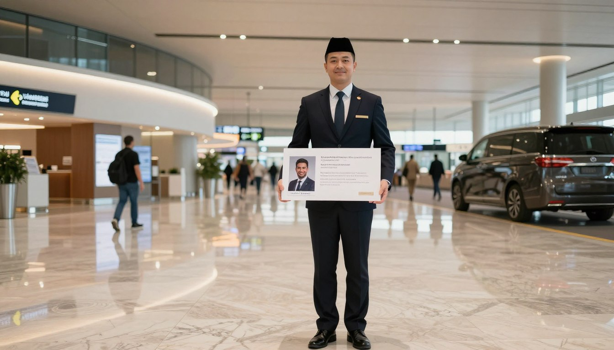

# **Dubai International Airport (DXB) Transfers: Airport Chauffeur Service Dubai**

An airport chauffeur service Dubai connects arriving passengers directly from Dubai International Airport (DXB) to city destinations with dedicated flight tracking and professional meet and greet attendance. Chauffeurs assist with luggage at arrivals and manage local routes smoothly.

Vehicle selection and scheduled pickup timing depend on group size, luggage volume, and onward corporate itinerary requirements across the emirates.

[Book now](https://www.ab.limo/airports/dubai-international-dxb) [View the fleet](https://www.ab.limo/airports/dubai-international-dxb)

Dubai International Airport (DXB) · DIFC, Dubai

The DXB fleet

## **Airport Chauffeur Service Dubai Fleet for DXB Transfers**

AB maintains an executive fleet of luxury sedans, premium sports utility vehicles, and executive passenger vans configured for comfortable transfers from Dubai International Airport across the United Arab Emirates.

### **Standard Sedan**

**Tag line:** Practical urban travel

**Model:** Toyota Camry or similar \[Confirm\]

**Ideal for:** Individual travellers and routine business travel

Reliable sedan transport from DXB to regional offices and hotel accommodations across the city. Professional drivers manage luggage and navigation while passengers prepare for upcoming meetings in quiet comfort.

### **Business Sedan**

**Tag line:** Premium corporate travel

**Model:** Mercedes E Class or similar \[Confirm\]

**Ideal for:** Corporate executives and business travel

Executive car service connecting Dubai International Airport chauffeur clients with major commercial towers and financial hubs. Passengers enjoy comfortable leather interiors, mobile device connectivity, and quiet cabin acoustics during every transfer.

### **First Class Sedan**

**Tag line:** Flagship VIP comfort

**Model:** Mercedes S Class or similar \[Confirm\]

**Ideal for:** VIP transport and senior executives

First class private driver experience delivering distinguished passengers from DXB directly to five star hospitality suites. The Mercedes S Class provides refined ride comfort, privacy blinds, and dedicated cabin climate control.

### **Executive SUV**

**Tag line:** Elevated prestige and space

**Model:** Cadillac Escalade, GMC Yukon or similar \[Confirm\]

**Ideal for:** VIP delegations and passenger comfort with extra luggage

Spacious luxury car transport built for executive road presence across city avenues. Arriving passengers secure generous luggage capacity alongside commanding seating positions inside either a Cadillac Escalade or GMC Yukon.

### **Premium MPV**

**Tag line:** Luxury team transport

**Model:** Mercedes V Class or similar \[Confirm\]

**Ideal for:** Corporate teams, family offices, and roadshow delegations

Conference style seating allows mobile meetings between DXB terminal gates and corporate headquarters. The Mercedes V Class accommodates multiple passengers with ample space for baggage claim collection and personal equipment.

### **Executive Van**

**Tag line:** Group logistics support

**Model:** Mercedes Sprinter or similar \[Confirm\]

**Ideal for:** Event delegates and group transfers

Managed ground transportation moving conference attendees and corporate staff together in complete comfort. Professional chauffeurs handle scheduled multi passenger collections, group baggage assistance, and organised onward transfer across the UAE.

Popular journeys

## **Popular Dubai Airport Transfer with Chauffeur Routes**

Prearranged airport transfers provide direct transportation from terminal concourses to commercial districts, residential developments, and neighbouring emirates without public transit delays.

### **DXB to Downtown Dubai and DIFC**

Direct airport transfer connecting arrivals with international financial offices, luxury hotels, and Downtown residences. From \[AED price\] · \[Confirm\] minutes.

### **DXB to Abu Dhabi**

Seamless executive travel between Dubai International Airport and government headquarters, embassies, or capital venues in Abu Dhabi. From \[AED price\] · \[Confirm\] minutes.

### **DXB to Sharjah**

Swift transit from arrivals halls to industrial zones, academic institutions, and corporate complexes across Sharjah. From \[AED price\] · \[Confirm\] minutes.

### **DXB to Ras Al Khaimah**

Comfortable intercity car with driver service serving hospitality resorts, manufacturing hubs, and private estates in Ras Al Khaimah. From \[AED price\] · \[Confirm\] minutes.

How it works

## **DXB Meet and Greet Chauffeur Operations**

Every DXB meet and greet booking begins with automated flight tracking managed through operations dispatch. Chauffeurs monitor incoming flight status in real time to adjust pickup timings for early landings or flight delays. Upon clearance through customs and baggage claim, your professional chauffeur stands in the designated terminal arrivals hall displaying a personalised name board. Passengers receive coordinated DXB arrivals pickup guidance to their specific meeting point per terminal \[Confirm\]. The service includes free waiting time \[Confirm\] following flight touchdown to allow unhurried movement through passport control and baggage collection. Your driver assists with luggage handling from the terminal concourse directly to the waiting vehicle.

### 1. **Book**

Submit passenger flight details, terminal information, and preferred vehicle class online or through corporate booking channels in advance.

### 2. **Track**

Operations teams track arrival flights continuously, matching driver staging with precise touchdown times to eliminate curbside delays.

### 3. **Meet**

Your private driver waits at the dedicated terminal arrivals hall greeting area, presenting a clear name board and managing passenger luggage.

### 4. **Ride**

Relax inside an air conditioned luxury vehicle while a licensed chauffeur navigates highway corridors directly to your Dubai destination.

Terminal Coverage

## **Navigating Dubai International Airport Terminals**

Dubai International Airport operates multiple passenger hubs requiring dedicated arrivals coordination for swift curbside departure.

### **Terminal 1 \[Confirm terminal names\]**

Serving international carriers, Terminal 1 handles overseas arrivals with structured concourses. Chauffeurs greet arriving passengers at the dedicated meeting point \[Confirm\] immediately after baggage clearance to escort guests to parked executive vehicles.

### **Terminal 2 \[Confirm terminal names\]**

Dedicated primarily to regional flights and budget services, Terminal 2 offers streamlined processing. Your DXB chauffeur waits at the designated meeting point \[Confirm\] to assist with luggage and provide direct transport onward.

### **Terminal 3 \[Confirm terminal names\]**

As the primary hub for Emirates airline, Terminal 3 features expansive arrivals halls. Chauffeurs stand ready at the agreed meeting point \[Confirm\] near exits to facilitate rapid departure into premium ground vehicles.

### **VIP and Private Terminal Options \[Confirm\]**

For executive aviation passengers using private jet facilities and VIP lounges, ground transfers link directly with tarmac suites. Chauffeurs coordinate private arrivals at designated VIP meeting points \[Confirm\] with full discretion.

Comprehensive Transportation

## **Airport Chauffeur Service Dubai Transportation Options**

AB provides specialized ground transportation tailored for executive aviation, commercial arrivals, and ongoing business schedules across the UAE:

- Airport Transfers in Dubai
- Chauffeur & VIP in Dubai
- Intercity Transfers
- Corporate Accounts

Organisations requiring full day hire or hourly chauffeur availability benefit from central billing, licensed and insured vehicles, and tailored corporate travel accounts managed by our regional operations.

Questions

## **Frequently Asked Questions About Airport Chauffeur Service Dubai**

### **How does flight tracking work for DXB arrivals?**

Operations teams monitor incoming flight schedules in real time using automated commercial aviation tracking feeds. When flights arrive earlier than expected or encounter unexpected air traffic delays, chauffeur arrival times adjust automatically. This tracking coordination helps drivers stage at the correct terminal pickup zones without requiring passengers to make manual itinerary updates during their flight.

### **Where is the chauffeur meeting point at DXB terminals?**

Chauffeurs assemble in the official arrivals hall immediately outside customs and baggage claim exit doors. For Terminal 1, Terminal 2, and Terminal 3, your driver waits at the confirmed meeting point \[Confirm\] holding a distinct digital or printed name board. Private aviation passengers receive personalised curbside collection at designated executive terminal suites \[Confirm\].

### **What free waiting time is included with a DXB chauffeur booking?**

Every airport transfer from DXB includes free waiting time \[Confirm\] starting from the recorded aircraft touchdown timestamp. This complimentary window accommodates immigration processing, baggage claim collection, and customs clearance procedures. Should extended delays occur inside the terminal, our operations team coordinates with the assigned driver to adjust collection schedules accordingly.

### **What luggage allowance applies across different chauffeur vehicle classes?**

Vehicle capacity varies depending on the reserved class and the total number of passengers. Executive sedans such as the Mercedes S Class typically hold two standard suitcases, while executive SUVs including the Cadillac Escalade and GMC Yukon accommodate larger travel bags. For extensive delegation luggage or trade show equipment, the Mercedes V Class or executive vans offer optimal cargo volume.

### **Can I arrange intercity transfers directly from DXB to other emirates?**

Direct intercity transfers operate from DXB to Abu Dhabi, Sharjah, Ras Al Khaimah, and all northern emirates. Passengers travel directly from arrivals halls to their final destinations without requiring local taxi transfers or vehicle exchanges. Chauffeurs select optimal highway routes to deliver smooth, quiet intercity travel for corporate delegations and executive visitors.

### **How are corporate accounts and multiple executive bookings managed?**

Corporate travel managers and executive assistants can establish centralized corporate accounts with AB for streamlined dispatch across the UAE. Corporate accounts provide consolidated billing, detailed trip reporting, and dedicated account support. Travel coordinators manage multiple simultaneous arrivals, VIP transport itineraries, and hourly chauffeur schedules through professional operations teams based in Dubai and Riyadh.

### **What standards apply to chauffeur licensing and vehicle safety?**

Professional chauffeurs undergo background vetting, regional route training, and customer service instruction in compliance with local transport regulations. All fleet vehicles maintain full commercial licensing and comprehensive insurance coverage. Regular mechanical inspections, spotless interior detailing, and strict safety guidelines maintain reliable passenger comfort across every journey.

## **Your chauffeur is waiting at DXB.**

Contact AB Dubai dispatch at Suite 206, DBC Building, Al Khabaisi, Deira, Dubai, UAE, or reach headquarters 24/7 dispatch for managed bookings.

+971 50 781 3880

Reserve an executive airport chauffeur service Dubai transfer with AB for punctual airport arrivals, dedicated flight tracking, and seamless corporate transport across the UAE.

[Book now](https://www.ab.limo/airports/dubai-international-dxb) [Request a proposal](https://www.ab.limo/airports/dubai-international-dxb)