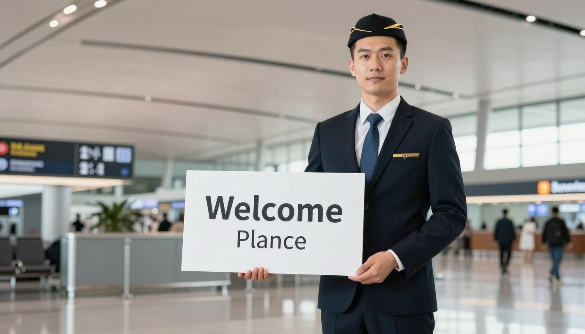

# **Hamad International Airport (DOH) Transfers: Doha Airport Chauffeur**

A professional Doha airport chauffeur provides direct private transfers from Hamad International Airport (DOH) to destinations across Qatar. Chauffeurs meet passengers inside arrivals for efficient executive travel.

Flight schedules and luggage capacity determine vehicle selection for every transfer.

 View the fleet

Hamad International Airport (DOH) to West Bay, Doha

The DOH fleet

## **Doha Airport Chauffeur Fleet Options**

AB operates a modern vehicle fleet maintained to verified safety standards. Each luxury car delivers comfort and connectivity for corporate travel between the airport and urban business centres.

### **Standard Sedan**

Tag line: Practical comfort for individual business travel

Model: Model or similar \[Confirm\]

Ideal for: Solo business travellers and couples

This sedan provides a quiet cabin with dual zone climate settings for transfers across Qatar. Passengers enjoy a smooth ride with space for luggage after landing at DOH.

### **Business Sedan**

Tag line: Corporate styling for executive road journeys

Model: Mercedes E Class or similar \[Confirm\]

Ideal for: Corporate executives and corporate travel managers

Featuring ergonomic leather seating and dedicated acoustic insulation, this executive car service creates an efficient mobile office between regional business hubs and hospitality destinations.

### **First Class Sedan**

Tag line: Prestige refinement for VIP transport

Model: Mercedes S Class or similar \[Confirm\]

Ideal for: Diplomats, board directors, and VIP travellers

The Mercedes S Class delivers unmatched ride smoothness with reclining rear seats and ambient lighting. Travellers arriving at DOH receive elite discretion and chauffeur professionalism.

### **Executive SUV**

Tag line: Elevated luxury with generous cabin space

Model: Cadillac Escalade, GMC Yukon or similar \[Confirm\]

Ideal for: Senior leadership teams and family travel

Offering strong road presence and roomy seating, the Cadillac Escalade or GMC Yukon accommodates passengers and multiple large suitcases. The platform suits secure transit to residences and resorts.

### **Premium MPV**

Tag line: Versatile passenger transport with luxury seating

Model: Mercedes V Class or similar \[Confirm\]

Ideal for: Project teams, roadshows, and conference groups

With adaptable seating arrangements and ample cargo volume, the Mercedes V Class enables group productivity on the road. The vehicle supports DOH arrivals requiring coordinated team movement.

### **Executive Van**

Tag line: Spacious transport for larger delegations

Model: Executive Van or similar \[Confirm\]

Ideal for: Event groups, sports delegations, and summit attendees

Configured for larger parties, this passenger van accommodates entire delegations alongside personal luggage. Professional drivers coordinate scheduled routing between venues and terminal gates.

Popular journeys

## **Popular Doha Airport Chauffeur Journeys**

Selecting a dedicated DOH chauffeur provides punctual departures toward commercial districts and residential communities across the country.

### **DOH to West Bay**

Label: Financial District Connection

Route: Hamad International Airport to West Bay

From \[QAR price\] · \[Confirm\] minutes

### **DOH to Lusail**

Label: Smart City Route

Route: Hamad International Airport to Lusail Marina

From \[QAR price\] · \[Confirm\] minutes

### **DOH to Al Wakrah**

Label: Southern Coastline Transit

Route: Hamad International Airport to Al Wakrah

From \[QAR price\] · \[Confirm\] minutes

### **DOH to Al Khor**

Label: Northern Industrial Corridor

Route: Hamad International Airport to Al Khor

From \[QAR price\] · \[Confirm\] minutes

How it works

## **Doha Airport Chauffeur Meet and Greet Services**

The managed DOH meet and greet service provides an organised reception for incoming flights. Dispatch teams track flights live through integrated software, adjusting pickup timing automatically when arrivals experience schedule changes. Upon clearing baggage claim and customs control, guests meet a professional chauffeur presenting a personalised name board at the designated meeting point per terminal \[Confirm\]. The booking includes complimentary free waiting time \[Confirm\], allowing passengers sufficient time to navigate border controls without pressure. Chauffeurs assist with luggage collection and guide clients directly to their executive vehicle curbside for swift departure.

### 1. **Book**

Submit flight details and select an executive vehicle class online through the direct booking system.

### 2. **Track**

Operations personnel follow flight progress live to align chauffeur staging with actual runway landing times.

### 3. **Meet**

Your chauffeur welcomes you inside the terminal arrivals area displaying a personalised greeting board.

### 4. **Ride**

Relax inside a quiet executive vehicle while your professional chauffeur navigates the route to your destination.

Terminal navigation

## **Terminal Access at Hamad International Airport (DOH) in Doha**

Ground operations coordinate passenger pickups across all operational facilities to maintain rapid transfers for arriving delegations.

### **Main Passenger Terminal \[Confirm\]**

Arriving guests exit customs into the main arrivals concourse to locate their driver at the designated meeting point \[Confirm\]. Chauffeurs coordinate curbside vehicle staging for direct departures into central Doha.

### **VIP Terminal \[Confirm\]**

Passengers using private lounge facilities receive personal reception at the exclusive VIP meeting point \[Confirm\]. Private chauffeurs manage luggage transfers directly to waiting executive vehicles with complete operational discretion.

### **General Aviation Terminal \[Confirm\]**

Private aviation and charter travellers experience apron or lounge greetings at the designated FBO meeting point \[Confirm\]. Drivers coordinate with handling agents to provide instant roadside connection after landing.

Chauffeur services

## **Executive Chauffeur Services from Doha**

AB coordinates comprehensive ground transportation solutions connected to airport arrivals. Clients access versatile booking arrangements tailored for corporate itineraries and long distance journeys across Qatar.

- Book punctual Airport Transfers in Doha for inbound and outbound flights.
- Arrange premium Chauffeur & VIP in Doha for daily executive travel and diplomatic delegations.
- Schedule comfortable Intercity Transfers connecting to industrial and coastal hubs across Qatar.
- Establish dedicated Corporate Accounts for centralised billing and recurring corporate itineraries.

Questions

## **Frequently Asked Questions About Doha Airport Chauffeur Services**

### **How early should a Doha airport chauffeur reservation be confirmed?**

Reservations should be confirmed as early as travel plans are finalised to secure the preferred vehicle class. While AB accommodates short notice bookings through 24/7 dispatch operations, reserving at least 24 hours prior to landing supports optimal driver allocation. Corporate travel organisers can book weeks ahead for major summits.

### **What services does a Hamad International Airport chauffeur provide upon landing at DOH?**

A Hamad International Airport chauffeur delivers full ground support from the terminal exit to any location in Qatar. Services include flight tracking, professional greetings in the arrivals hall, luggage assistance, and direct transit in an executive vehicle. Passengers travel in comfort without waiting in standard taxi lines.

### **How does the DOH meet and greet service operate for international arrivals?**

The DOH meet and greet service begins before touchdown as dispatch controllers track flight progress live. Your professional chauffeur enters the arrivals hall holding a personalised name board at the designated meeting point. The chauffeur assists with luggage transport and guides you directly to the waiting vehicle.

### **What occurs during a DOH arrivals pickup if a flight is delayed?**

Dispatch teams track flight statuses continuously, so your DOH arrivals pickup schedule updates automatically when flights experience delays. Complimentary waiting time begins only after the aircraft actually touches down. This operational protocol removes stress for passengers, as the assigned driver remains on site throughout schedule adjustments.

### **What complimentary waiting time is included for terminal transfers at DOH?**

Terminal pickups at DOH include generous complimentary waiting time \[Confirm\] designed to accommodate immigration, customs clearance, and luggage reclaim. If extended delays occur at border control, passengers can alert dispatch teams. Adjusted pickup windows are arranged through 24/7 operations to maintain driver availability.

### **How should corporate teams select the appropriate vehicle class for DOH transfers?**

Vehicle selection depends on total passengers, luggage pieces, and travel style. Executive sedans like the Mercedes S Class suit solo executives requiring a quiet workspace, whereas the Cadillac Escalade or GMC Yukon provides additional baggage volume. Larger delegations benefit from the Mercedes V Class for collaborative transit.

### **Can companies establish corporate accounts for VIP transport across Doha?**

Yes, organisations can set up dedicated corporate accounts for executive ground travel across Doha and nationwide. Corporate accounts provide centralised invoicing, transparent reporting, flexible cancellation terms, and priority vehicle allocation for high profile executives. Account coordinators organise multi destination travel through AB operations with continuous regional support.

## **Your chauffeur is waiting at DOH.**

Booking a Doha airport chauffeur provides punctual arrivals pickup and seamless ground transportation across the capital. Reliable operations support executive itineraries from the terminal to meetings and hotels.

+974 7734 3300

 Request a proposal