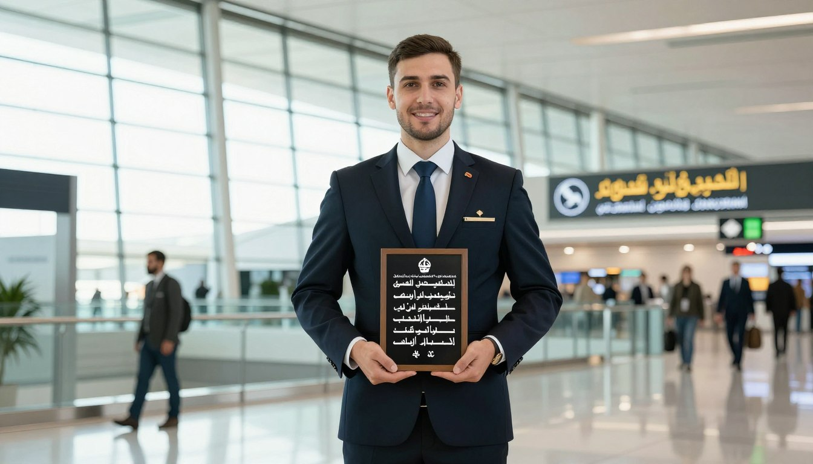
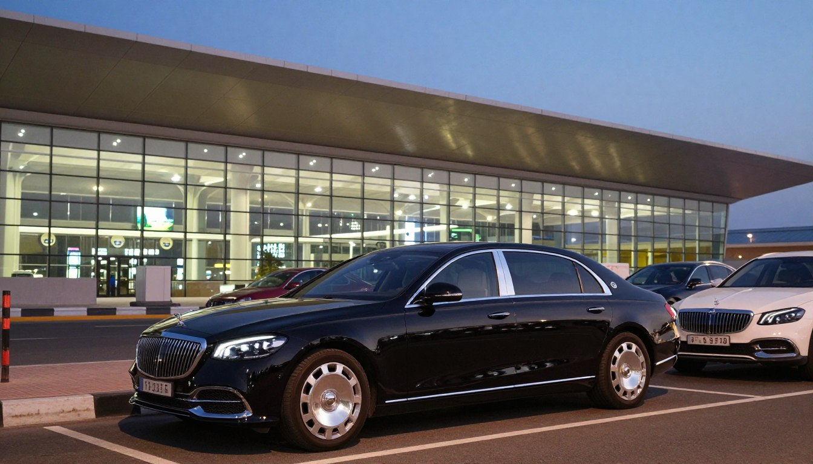

# **Jeddah Airport Chauffeur: King Abdulaziz International Airport (JED) Transfers**

Securing a Jeddah airport chauffeur provides seamless terminal departures and punctual arrivals across the western province. Executive travellers arriving at King Abdulaziz International Airport (JED) connect directly with licensed chauffeurs for discreet, scheduled transportation into central Jeddah and surrounding regional business centres.

Operational flight monitoring and dedicated meet and greet services eliminate arrival curbside delays. Every transfer is managed through central operations to maintain consistent standards for executive delegations and private individuals alike.

 View the fleet

King Abdulaziz International Airport (JED) Jeddah Corniche, Jeddah

The JED fleet

## **Premium Fleet for Jeddah Airport Chauffeur Transfers**

The Jeddah airport chauffeur fleet delivers tailored capacity, immaculate presentation and supreme passenger comfort across Jeddah. Every vehicle class receives rigorous mechanical servicing and detailed valeting prior to every scheduled airport dispatch.

| Vehicle Class     | Model Category                                      | Tagline                   | Fleet Specification Details                                                                                                                               |
| ----------------- | --------------------------------------------------- | ------------------------- | --------------------------------------------------------------------------------------------------------------------------------------------------------- |
| Standard Sedan    | Toyota Camry or similar \[Confirm\]                 | Efficient business travel | Ideal for individual travellers seeking dependable point to point connections from JED to commercial districts in Jeddah.                                 |
| Business Sedan    | Mercedes E Class or similar \[Confirm\]             | Executive airport comfort | Ideal for corporate executives requiring quiet mobile workspaces between terminal departures and city centre meetings across Jeddah.                      |
| First Class Sedan | Mercedes S Class or similar \[Confirm\]             | Prestige chauffeur luxury | Ideal for VIP transport, diplomatic itineraries and discerning guests demanding refined amenities upon landing at JED.                                    |
| Executive SUV     | Cadillac Escalade, GMC Yukon or similar \[Confirm\] | Spacious luxury travel    | Ideal for senior management, high profile travellers and families requiring ample luggage volume on journeys from Jeddah airport.                         |
| Premium MPV       | Mercedes V Class or similar \[Confirm\]             | Collaborative cabin space | Ideal for corporate teams, project managers and executive delegations needing mobile briefing space when departing JED.                                   |
| Executive Van     | Mercedes Sprinter or similar \[Confirm\]            | Group transport capacity  | Ideal for event organisers, flight crews and extended delegations travelling collectively between King Abdulaziz International Airport and Jeddah hotels. |

Popular journeys

## **Jeddah Airport Chauffeur Transfers Across Jeddah and Beyond**

A private Jeddah airport chauffeur provides uninterrupted transit from arrival terminals to commercial hubs, holy sanctuaries and coastal resorts. Fixed routing guidelines and planned transit schedules prevent unexpected city delays.

### **JED to central Jeddah**

Direct executive transfer serving business districts, coastal hotels along the Jeddah Corniche and corporate head offices. From \[SAR price\] · \[Confirm\] minutes.

### **JED to Makkah**

Specialised intercity highway transit tailored for pilgrims and official delegations visiting the holy city. From \[SAR price\] · \[Confirm\] minutes.

### **JED to Madinah**

Long distance private driver transfer connecting King Abdulaziz International Airport directly to central Madinah accommodation. From \[SAR price\] · \[Confirm\] minutes.

### **JED to Taif**

Scenic mountain ascent transport providing private door to door travel between Jeddah airport and Taif mountain resorts. From \[SAR price\] · \[Confirm\] minutes.

How it works

## **JED Meet and Greet Arrival Protocols**

The JED meet and greet service provides seamless coordination from the moment your aircraft lands on the runway. Operational dispatchers maintain real time flight tracking to adjust vehicle arrival times against early arrivals or airport holding patterns. Once the aircraft reaches the gate, your professional chauffeur positions inside the arrivals hall with a personalised digital name board. Guests pass through baggage claim and clear customs before meeting their driver at the designated terminal meeting point \[Confirm\]. Professional luggage assistance and complimentary waiting time \[Confirm\] allow guests to proceed comfortably through border control without transit concerns.

1. **Book:** Reserve your private vehicle transfer online or through corporate dispatch with complete flight details and schedule preferences.
2. **Track:** Central operations continuously monitor incoming commercial and private flights to coordinate timely chauffeur apron positioning.
3. **Meet:** Your professional chauffeur greets you inside the designated arrivals hall displaying your personalised identification sign.
4. **Ride:** Relax in climate controlled luxury as your executive car navigates airport egress toward your Jeddah destination.

Terminal guide

## **King Abdulaziz International Airport Terminal Meeting Points in Jeddah**

King Abdulaziz International Airport features several operational terminals catering to commercial domestic flights, international routes and private aviation. Chauffeurs coordinate pickup logistics based on individual flight terminal assignments across the airport complex.

Designated pickup bays at King Abdulaziz International Airport provide rapid departures across Jeddah.

- **Terminal 1:** Serving the majority of international and domestic commercial carriers, with chauffeurs greeting passengers past the primary customs exit at the main arrivals lounge meeting point \[Confirm\].
- **North Terminal:** Hosting international seasonal and budget flight routes, featuring a designated passenger reception point near the foreign arrivals exit vestibule \[Confirm\].
- **South Terminal:** Historic terminal infrastructure with specialised operational procedures, meeting passengers directly outside the primary luggage reception zone \[Confirm\].
- **Hajj Terminal:** Renowned architectural facility accommodating pilgrimage charter operations, with arranged transport coordinates established at designated external passenger concourses \[Confirm\].
- **Private Aviation Terminal:** Dedicated VIP transport and private jet facilities featuring discreet direct ramp side or VIP lounge reception for executive guests \[Confirm\].

Executive ground transport

## **Comprehensive Chauffeur Services Across Jeddah**

AB provides structured corporate and private ground transportation solutions connecting King Abdulaziz International Airport with broader Saudi destinations. Select a dedicated service category to manage executive travel requirements:

- Airport Transfers in Jeddah: Scheduled private transfers between airport terminals and commercial properties across Jeddah.
- Chauffeur & VIP in Jeddah: Dedicated hourly chauffeur and full day hire options for diplomatic delegations and executive itineraries.
- Intercity Transfers: Direct long distance highway journeys connecting Jeddah with Makkah, Madinah, Taif and regional industrial centres.
- Corporate Accounts: Centralised management, custom billing arrangements and protocol coordination for enterprise travel departments.

Questions

## **Frequently Asked Questions About Jeddah Airport Transfers**

### **How does my Jeddah airport chauffeur track inbound flight schedule adjustments?**

Central dispatch integrates automated flight radar data directly into our operational scheduling systems. Chauffeurs receive automatic flight status updates, allowing driver dispatch times to align precisely with revised landing moments. This active oversight prevents curbside delays and protects your schedule regardless of air traffic control sequencing.

### **What luggage capacity is available for executive transfers from JED?**

Luggage capacity corresponds directly to your selected vehicle category. Business sedans comfortably accommodate two standard suitcases alongside personal carry on bags, while executive SUVs and Mercedes V Class vans transport substantial passenger luggage collections. Booking specialists assist corporate coordinators in matching baggage volumes with appropriate vehicle dimensions prior to departure.

### **Where will my driver meet me upon arrival at King Abdulaziz International Airport?**

Your JED arrivals pickup driver waits inside the designated terminal arrivals hall immediately past the customs clearance exit. Chauffeurs hold an official name board displaying the requested passenger name or enterprise visual identity. Detailed pickup instructions and driver contact numbers arrive prior to landing to facilitate straightforward terminal connections.

### **Are all vehicles and chauffeurs properly licensed and insured in Saudi Arabia?**

Every vehicle in our regional fleet operates with comprehensive commercial transport insurance and maintains full regulatory compliance under Saudi transport authority standards. Chauffeurs undergo extensive background vetting, defensive driving assessments and professional protocol training. Rigorous compliance safeguards passenger safety and delivers consistent executive transport across Jeddah.

### **Can corporate travel managers arrange hourly chauffeur hire directly from JED?**

Hourly chauffeur services and full day hire arrangements can commence directly from King Abdulaziz International Airport. Your dedicated driver remains on standby throughout multiple corporate meetings, site inspections and private dining appointments across Jeddah. Dedicated vehicle retention offers total itinerary flexibility without repetitive transfer bookings.

### **What complimentary waiting time applies to JED airport arrivals?**

All airport pickups include a standard complimentary waiting period \[Confirm\] commencing from the recorded aircraft touchdown time. This allocation permits ample time for international guests to clear passport control, process health declarations and collect baggage. Extended waiting periods can be arranged in advance through our operations centre.

### **Can VIP transport meet private aviation flights landing at JED?**

Executive chauffeur teams coordinate directly with private aviation handlers at the designated VIP terminal facilities at JED. Chauffeurs position vehicles within private handling zones to facilitate discreet passenger transitions upon arrival. Coordinated protocol handling supports government personnel, executive delegations and private aircraft owners seamlessly.

## **Your Jeddah Airport Chauffeur is Waiting at JED**

Reserve an executive Jeddah airport chauffeur to experience punctual, comfortable and discreet ground transportation across the western region. Dedicated operations managers oversee every terminal journey to maintain flawless business travel execution.

### **Coordinate Executive Transportation in Jeddah**

Connect with central dispatch to schedule airport arrivals, executive roadshows or corporate account arrangements across Saudi Arabia.

+966 58 111 8720

 Request a proposal