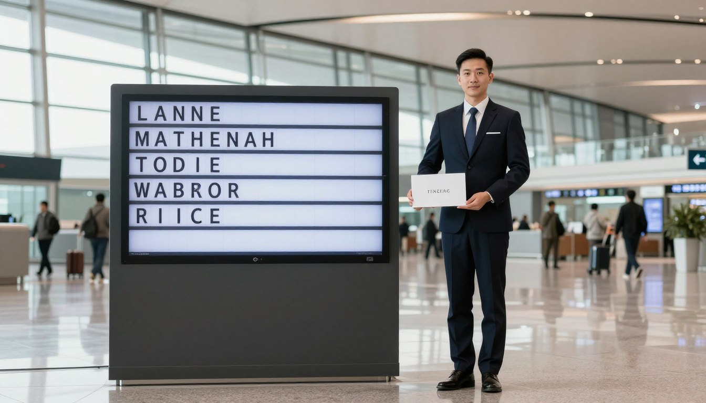
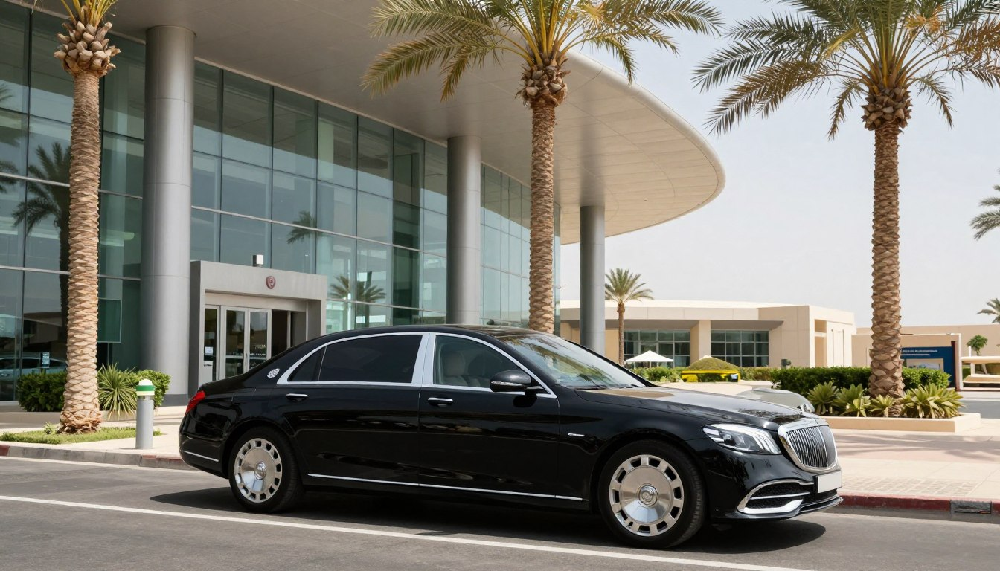

# **Airport transfers at DMM King Fahd International Airport (DMM) Transfers: Dammam Airport Chauffeur**

Booking a dedicated Dammam airport chauffeur provides direct transit from King Fahd International Airport (DMM) to corporate offices across the Eastern Province. Coordinated flight tracking and curbside vehicle staging reduce wait times while incoming passengers proceed directly to regional business appointments.

Selecting an executive vehicle class depends on luggage volume, delegation size and regional travel schedules. Coordinated private driver services support punctual regional departures for individual business leaders and visiting corporate delegations.

 View the fleet

Standard transfer route: King Fahd International Airport (DMM) to Dammam Corniche, Dammam.

The DMM fleet

## **The DMM Fleet for Dammam Airport Chauffeur Travel in Dammam**

The DMM chauffeur fleet provides quiet cabin environments and pristine leather seating for executive transfers across Dammam. Each vehicle class meets strict commercial licensing and maintenance protocols for corporate travel.

### **Standard Sedan**

Tag line: Reliable private transport for solo business travel.

Model: Model or similar \[Confirm\]. Ideal for: Individual executives and airport commutes.

The standard sedan offers comfortable airport transfers from DMM to central Dammam offices. Ample boot space accommodates standard luggage while passengers enjoy a relaxed, air conditioned cabin after long flights.

### **Business Sedan**

Tag line: Executive comfort for corporate roadshows.

Model: Mercedes E Class or similar \[Confirm\]. Ideal for: Corporate managers and regional business trips.

Business sedans deliver refined seating and mobile workstation comfort for transfers between corporate headquarters. Professional chauffeurs handle busy highway corridors while passengers review documents in complete acoustic privacy.

### **First Class Sedan**

Tag line: Flagship luxury for executive dignitaries.

Model: Mercedes S Class or similar \[Confirm\]. Ideal for: VIP transport, senior executives and diplomatic delegates.

Our first class sedan provides premier luxury car transport from DMM arrivals hall directly to luxury hotels. Rear seat climate control, reclining leather seats and acoustic glass deliver restful travel across Dammam.

### **Executive SUV**

Tag line: Spacious executive command and luxury utility.

Model: Cadillac Escalade, GMC Yukon or similar \[Confirm\]. Ideal for: Small executive groups and substantial baggage.

The executive SUV accommodates four passengers with generous luggage capacity for transfers from DMM across the Eastern Province. Elevated ride height and smooth suspension provide stable highway transit to industrial hubs.

### **Premium MPV**

Tag line: Flexible group luxury for project delegations.

Model: Mercedes V Class or similar \[Confirm\]. Ideal for: Corporate delegations, event teams and family offices.

The premium MPV features conference style seating arrangements and expansive legroom for traveling executive teams. Generous cargo capacity accommodates multiple equipment cases and standard luggage sets without crowding passenger space.

### **Executive Van**

Tag line: High capacity corporate group transit.

Model: Luxury executive van or similar \[Confirm\]. Ideal for: Conference teams, event attendees and project crews.

Executive vans transport larger delegations comfortably between international terminals and corporate venues. Dedicated climate controls and wide boarding doors allow efficient passenger movement during demanding event schedules.

Popular journeys

## **Popular Journeys with a Dammam Airport Chauffeur from Dammam**

Point to point airport transfers connect incoming flights with commercial centres, industrial districts and neighbouring cities throughout the region. Prearranged chauffeur itineraries avoid taxi queue delays and provide transparent scheduling.

### **DMM to Dammam**

City Transfer. Route: DMM to Dammam. From \[SAR price\] · \[Confirm\] minutes. Direct transit connects King Fahd International Airport with commercial districts and seaside hotels across Dammam.

### **DMM to Al Khobar**

Business Corridor. Route: DMM to Al Khobar. From \[SAR price\] · \[Confirm\] minutes. Transfers run directly from the terminal to Al Khobar business towers, corporate compounds and dining districts.

### **DMM to Jubail**

Industrial Hub Transit. Route: DMM to Jubail. From \[SAR price\] · \[Confirm\] minutes. Executive transport serves corporate teams and technical leadership traveling directly to Jubail Industrial City facilities.

### **DMM to Bahrain via the King Fahd Causeway \[Confirm\]**

Cross Border Connection. Route: DMM to Bahrain via the King Fahd Causeway \[Confirm\]. From \[SAR price\] · \[Confirm\] minutes. International transfers link DMM arrivals with Manama destinations via vetted partner logistics.

How it works

## **How DMM Meet and Greet Works with a Dammam Airport Chauffeur in Dammam**

Arriving at King Fahd International Airport connects seamlessly to executive ground transport through our coordinated DMM meet and greet service. Dedicated operations dispatch tracks commercial and private flight numbers in real time, adjusting driver arrival times for early landings or flight delays. Upon completing immigration and collecting bags from baggage claim, passengers enter the main arrivals hall to find their professional chauffeur displaying a personalised digital name board. Chauffeurs position at designated terminal meeting points \[Confirm\] and provide courteous luggage help toward the waiting vehicle. Every transfer includes complimentary free waiting time \[Confirm\] after flight touchdown, giving travellers ample time to clear customs. All transfers adhere to licensed and insured service standards for total peace of mind during regional corporate travel.

Terminal coordination teams monitor regional airspace continuously, repositioning chauffeurs automatically when commercial airlines adjust arrival runway schedules.

### **Book**

Reserve an airport transfer online with flight details, passenger counts and destination requirements. Instant booking confirmation provides complete schedule transparency.

### **Track**

Dispatch monitors incoming commercial flights and regional private jets in real time. Chauffeur dispatch adjusts automatically for airline schedule modifications.

### **Meet**

Your chauffeur greets you in the arrivals hall with a clear name board and provides attentive luggage help toward curbside staging.

### **Ride**

Step directly into a chilled, pristine cabin and enjoy smooth transit to corporate offices, residential compounds or seaside hotels.

Terminal navigation

## **King Fahd International Airport (DMM) Terminals in Dammam**

King Fahd International Airport features expansive passenger terminals and specialised handling suites designed for commercial and private aviation. Chauffeur meeting protocols adapt to each terminal facility to keep passenger connections prompt and convenient.

### **Main Passenger Terminal \[Confirm terminal names\]**

The primary passenger complex serves domestic and international airlines arriving in Dammam. Chauffeurs meet passengers at designated arrivals hall greeting points \[Confirm\] directly after luggage collection, assisting with bags to the executive pickup lane.

### **VIP and Private Terminal Options \[Confirm\]**

Private aviation passengers arriving via executive handling facilities receive discreet tarmac or terminal curbside reception \[Confirm\]. Dedicated chauffeurs coordinate directly with ground handling staff to transfer guests smoothly without main terminal congestion.

### **Royal and Government Protocol Terminal \[Confirm\]**

Official delegations and diplomatic travellers receive specialised reception through designated VIP facilities \[Confirm\]. Coordinated motorcades and security vetted drivers follow regional protocol guidelines for swift, private transfers to government offices.

Terminal curbside staging enables rapid vehicle boarding without lengthy walking distances.

Transportation options

## **Executive Chauffeur and Transport Services from DMM in Dammam**

AB provides comprehensive ground transport solutions tailored to multinational corporations, government delegations and private travellers. Select the appropriate transportation category below to coordinate regional logistics.

- Book point to point journeys through Airport Transfers in Dammam for seamless airport arrivals and departures.
- Coordinate premium executive sedans and SUVs through Chauffeur & VIP in Dammam for corporate roadshows and executive itineraries.
- Arrange long distance executive travel through Intercity Transfers connecting Dammam, Jubail, Hofuf and Riyadh.
- Set up centralised corporate billing and service level agreements through Corporate Accounts for regular enterprise travel across the kingdom.

For custom itineraries or rapid vehicle reservations, submit your travel schedule directly via  to receive competitive fleet pricing.

Questions

## **Frequently Asked Questions About Dammam Airport Chauffeur Services in Dammam**

### **How do I book a King Fahd International Airport chauffeur for business travel?**

Reserving a King Fahd International Airport chauffeur requires submitting flight numbers, passenger totals and destination addresses through our online reservation system. Corporate accounts receive priority vehicle allocations and centralised monthly invoicing. Operations dispatch confirms vehicle assignments and transmits chauffeur contact details prior to aircraft arrival.

### **What is included in the DMM meet and greet service?**

The DMM meet and greet service provides complete terminal assistance from aircraft landing to vehicle departure. Professional chauffeurs wait inside the arrivals hall holding a customised digital name sign. Drivers assist with heavy luggage, navigate terminal corridors and guide guests directly to the prearranged executive vehicle curbside.

### **How does flight tracking work for a DMM chauffeur reservation?**

Operations teams track flight numbers through direct aviation monitoring systems that record departure times, route updates and estimated touchdown slots. When airline schedules experience early landings or delays, driver staging times adjust automatically. Passengers meet their chauffeur on arrival without needing to send manual schedule notifications.

### **Where does the DMM arrivals pickup take place at the terminal?**

A standard DMM arrivals pickup takes place directly outside the customs exit in the main terminal arrivals hall. For private jet passengers using VIP terminals, meeting points occur at designated executive lounge exits or direct tarmac gates \[Confirm\]. Chauffeurs escort travellers from the interior greeting point to the waiting car parked nearby.

### **What complimentary waiting time is provided for airport transfers in Dammam?**

Every commercial airport transfer includes complimentary waiting time \[Confirm\] starting from the recorded flight touchdown moment. This policy provides international passengers sufficient time to clear passport control, collect baggage and complete customs checks. Additional waiting time options can be added during the reservation process.

### **Can I arrange an hourly chauffeur or full day hire from DMM?**

Hourly chauffeur and full day hire options allow passengers to retain a dedicated vehicle and driver for multiple consecutive meetings. Chauffeurs remain on standby outside corporate headquarters, conference venues or hotels throughout Dammam and neighbouring cities. This flexible booking style suits executive roadshows requiring dynamic itinerary adjustments.

### **Are vehicles available for cross border transfers from Dammam to Bahrain?**

Cross border transport between Dammam and Bahrain operates through vetted partner logistics via the King Fahd Causeway. Chauffeurs coordinate transit procedures and provide comfortable highway travel between Eastern Province airports and Manama addresses. Advance booking allows operations dispatch to verify cross border permits and travel documentation.

## **Your Chauffeur Is Waiting at DMM: Reserve Your Dammam Airport Chauffeur in Dammam**

Organising reliable airport ground transport eliminates transit uncertainty and establishes executive travel standards across the Eastern Province. Professional drivers and pristine luxury vehicles provide restful travel between King Fahd International Airport and key regional destinations.

### **Coordinate executive ground travel with 24/7 dispatch**

Contact the AB operations centre directly or book your vehicle class online for seamless terminal pickup.

+966 58 111 8720

Headquarters and 24/7 dispatch: AB Riyadh, Building 3036, Office 08, 2nd Floor, Umar Ibn Abdulaziz Road, Al Malaz, Riyadh, Saudi Arabia.

Request a proposal 