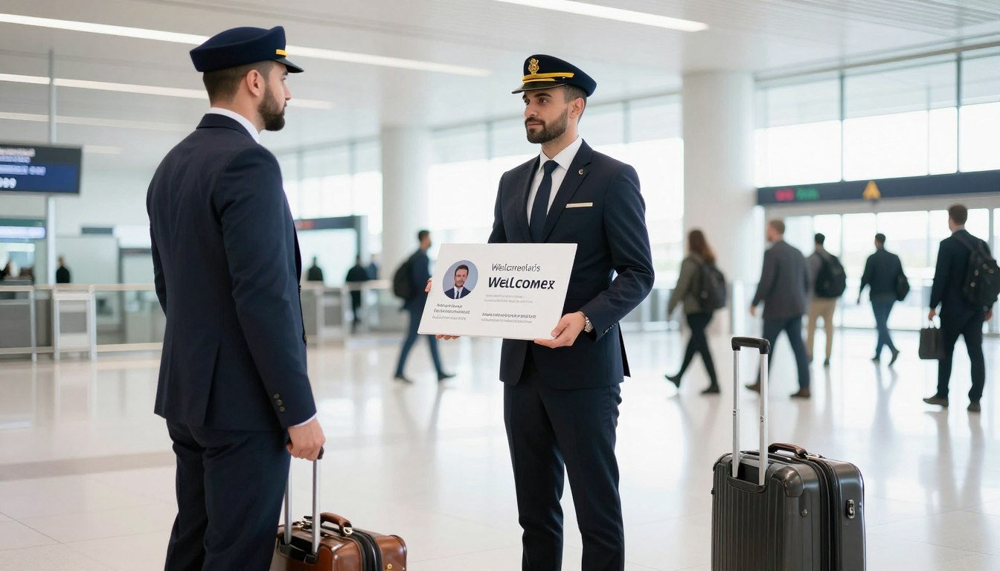
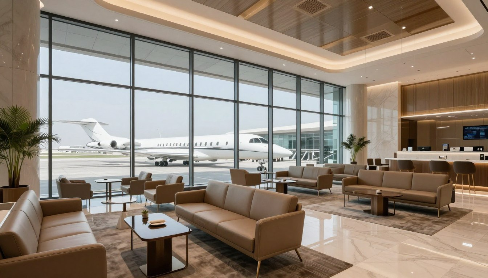

# **King Khalid International Airport (RUH) Transfers**

Arranging a professional Riyadh airport chauffeur secures seamless ground travel directly from your terminal upon arrival in the capital. AB manages executive transport at King Khalid International Airport (RUH) for passengers travelling to commercial districts across Riyadh.

Flight monitoring, greeting in the terminal hall, and luggage assistance operate around the clock through central dispatch. Chauffeurs assist executive travellers heading to hotel accommodations, corporate headquarters, and government institutions with prompt departures.

 View the fleet

King Khalid International Airport (RUH)

KAFD, Riyadh

The RUH fleet

## **The RUH Fleet for Your Riyadh Airport Chauffeur Transfer**

AB coordinates a fleet of premium sedans, executive SUVs, and luxury vans stationed near King Khalid International Airport. Every vehicle provides climate controlled comfort, spacious luggage capacity, and refined styling for corporate itineraries throughout Riyadh.

| Vehicle Class     | Category                      | Ideal For                | Description                                                                                                                                        |
| ----------------- | ----------------------------- | ------------------------ | -------------------------------------------------------------------------------------------------------------------------------------------------- |
| Standard Sedan    | Model or similar \[Confirm\]  | Individual travellers    | Comfortable sedan transport from RUH terminals to business hotels across central Riyadh, offering practical seating and quiet ride dynamics.       |
| Business Sedan    | Model or similar \[Confirm\]  | Corporate professionals  | Executive comfort tailored for enterprise executives commuting between RUH arrivals and key financial headquarters in Riyadh.                      |
| First Class Sedan | Mercedes S Class \[Confirm\]  | VIP delegates            | Prestige sedan travel featuring refined leather seating and acoustic dampening, ideal for dignitaries departing King Khalid International Airport. |
| Executive SUV     | Cadillac Escalade \[Confirm\] | Delegations and families | Spacious SUV accommodation providing generous luggage room for long haul arrivals landing at RUH with multiple suitcases.                          |
| Premium MPV       | Mercedes V Class \[Confirm\]  | Small corporate teams    | Flexible seating layouts allowing working teams to confer comfortably while travelling directly from airport gates across Riyadh.                  |
| Executive Van     | GMC Yukon \[Confirm\]         | Large travel groups      | High capacity group transport suitable for event teams, support personnel, and diplomatic entourages arriving together in the capital.             |

Popular journeys

## **Popular Journeys Across Riyadh and Beyond from King Khalid International Airport (RUH)**

Chauffeurs transfer passengers directly from airport terminals to premier commercial districts, regional industrial zones, and adjacent administrative provinces. Fixed rate options provide transparent coordination for local meetings and cross regional travel.

City Business Hub

### **RUH to Central Riyadh and KAFD \[Confirm\]**

Direct transit connecting arrivals terminals with the King Abdullah Financial District and central corporate towers. From \[SAR price\] · \[Confirm\] minutes.

Eastern Province Route

### **RUH to Dammam**

Intercity chauffeur travel from the airport gate across the highway corridor to commercial facilities in Dammam. From \[SAR price\] · \[Confirm\] minutes.

Central Agricultural Hub

### **RUH to Al Qassim**

Executive private vehicle transport scheduled directly from airport arrivals to business destinations in Al Qassim province. From \[SAR price\] · \[Confirm\] minutes.

How it works

## **How RUH Meet and Greet Operates with a Dedicated Riyadh Airport Chauffeur**

Each RUH arrivals pickup begins with real time flight tracking to accommodate schedule adjustments, route delays, or early touch downs. Your RUH chauffeur monitors your incoming flight number through operations software, positioning the vehicle outside the terminal before disembarkation starts. Upon entering the public terminal concourse, your designated driver holds an identification board displaying your guest or corporate name. The designated meeting point per terminal \[Confirm\] provides an orderly reception area where chauffeurs welcome guests promptly. Complimentary waiting time \[Confirm\] accommodates baggage reclaim and border control queues, followed by professional luggage handling to the vehicle.

### 1. **Book**

Reserve your King Khalid International Airport chauffeur online by submitting your arrival itinerary, passenger totals, and vehicle class preference.

### 2. **Track**

Operations teams track the incoming aircraft path to synchronise driver arrival times with your confirmed landing window.

### 3. **Meet**

Chauffeurs stand ready in the terminal arrivals hall holding an electronic or printed name board to welcome you.

### 4. **Ride**

Your driver manages your heavy luggage, guides you to the private car bay, and transfers you toward your destination.

Airport layout

## **Terminals and Meeting Points at RUH in Riyadh**

King Khalid International Airport operates several active terminal buildings hosting international and domestic passenger carriers, alongside specialized private aviation terminals. Chauffeurs coordinate pickup protocols tailored to each terminal structure across the airport grounds.

### **International Terminals \[Confirm terminal names\]**

Serving overseas flights, these terminals feature dedicated meeting points \[Confirm\] right outside customs inspection exits, where drivers receive long haul arrivals efficiently.

### **Domestic Terminals \[Confirm terminal names\]**

Operating regional flight routes throughout Saudi Arabia, domestic concourses direct passengers toward designated greeting stations \[Confirm\] situated near baggage collection belts.

### **VIP and Private Terminals \[Confirm\]**

Fixed base operators and executive aviation lounges offer discreet tarmac side or private lounge meeting points \[Confirm\] for royal, diplomatic, and private jet arrivals.

Connected solutions

## **Executive Chauffeur Services from RUH**

AB maintains an integrated suite of premium chauffeur solutions connecting air arrivals with comprehensive ground transit itineraries across the region. You can organise airport transfers, private city itineraries, and cross province travel directly through centralised dispatch channels.

- Airport Transfers in Riyadh: Seamless private vehicle pickups and drop offs serving corporate executives landing at the capital airport.
- Chauffeur & VIP in Riyadh: Dedicated high security transit and executive chauffeur services for state visits, delegations, and senior leadership.
- Intercity Transfers: Direct highway travel options linking airport arrivals with regional commercial hubs across Saudi Arabia.
- Corporate Accounts: Consolidated invoicing, travel management dashboards, and priority fleet allocations for multinational enterprises.

Questions

## **Questions About RUH Transfers in Riyadh**

### **How does my Riyadh airport chauffeur locate me inside the terminal?**

Your driver monitors incoming flight data and waits in the designated arrivals concourse holding a personalised name board. Operations dispatch coordinates the meeting location per terminal \[Confirm\] to facilitate immediate visual contact once you exit the baggage claim zone.

### **What complimentary waiting time applies to arrivals at RUH?**

International and domestic flights receive complimentary waiting time \[Confirm\] calculated from actual wheel touchdown. This buffer permits ample time to complete passport checks, immigration screening, and baggage reclamation before meeting your driver.

### **Can I reserve intercity journeys directly from King Khalid International Airport?**

AB arranges continuous intercity transport directly from RUH passenger gates to industrial and commercial hubs including Dammam, Khobar, and Al Qassim. Chauffeurs manage non stop highway routes, avoiding the delays associated with domestic flight connections.

### **What vehicle classes are available for corporate delegations arriving in Riyadh?**

Travellers can select executive sedans such as the Mercedes S Class, luxury SUVs including the Cadillac Escalade, or spacious vans like the Mercedes V Class. Each option accommodates professional delegations with dedicated luggage space and climate control systems.

### **How does flight tracking function if my inbound flight to RUH is delayed?**

Central dispatch tracks commercial aircraft positions via live radar software, automatically adjusting driver dispatch schedules to match revised landing times. You do not need to notify operations regarding routine schedule modifications while in transit.

### **Can private aviation passengers book chauffeur transfers from VIP terminals?**

AB provides specialized coordination for passengers arriving via private aviation lounges and fixed base operator terminals at RUH. Drivers position vehicles near private passenger lounges or designated ramp exits in coordination with local airport security protocol.

### **How do corporate organisations manage ongoing chauffeur bookings in Riyadh?**

Corporate travel departments can open managed transportation accounts through AB to access itemised billing, preferred vehicle allocations, and centralised travel dispatch. Account managers oversee multi passenger schedules for conferences, board meetings, and official events.

## **Your Chauffeur Is Waiting at RUH in Riyadh**

Arranging your executive transfer in advance supports punctual departures from King Khalid International Airport to any business destination across the capital. AB manages airport meet and greet services with licensed, insured drivers and luxury vehicles ready upon your arrival.

### **Reserve Your Riyadh Airport Chauffeur**

Connect with 24/7 central operations at AB Riyadh, Building 3036, Office 08, 2nd Floor, Umar Ibn Abdulaziz Road, Al Malaz, Riyadh, Saudi Arabia, to coordinate transfers or request corporate billing agreements.

+966 58 111 8720

 Request a proposal