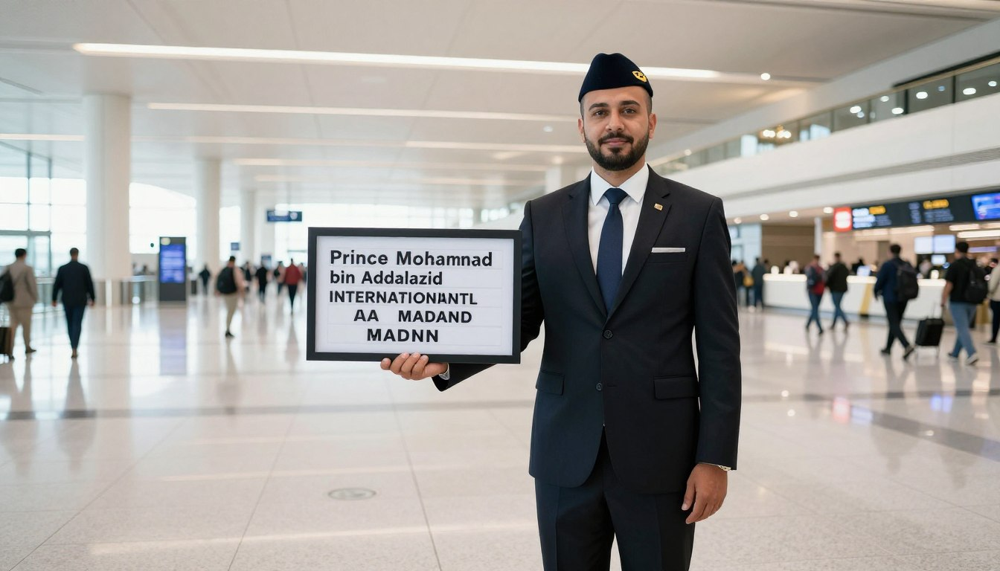

# **Madinah Airport Chauffeur: Prince Mohammad bin Abdulaziz International Airport (MED) Transfers**

Reserving a professional Madinah airport chauffeur provides seamless direct transit between your flight and destinations across Madinah. AB coordinates private ground travel from Prince Mohammad bin Abdulaziz International Airport (MED) with tracked flight timings, professional drivers and premium vehicles.

Passenger count, luggage capacity and schedule flexibility determine the appropriate vehicle class for each transfer. Dedicated operations teams oversee vehicle dispatch to maintain punctuality for private travellers, corporate delegations and institutional groups.

 View the fleet

Pickup: Prince Mohammad bin Abdulaziz International Airport (MED)

Drop off: the Prophet's Mosque area, Madinah

The MED fleet

## **Fleet Options for Madinah Airport Chauffeur Transfers**

AB maintains an executive fleet tailored for individual business travellers, government delegations and visiting families arriving at MED. Each vehicle undergoes regular mechanical inspection and detailing to maintain passenger safety and cabin comfort.

| Class             | Model or Similar              | Ideal For                | Description                                                                                                                    |
| ----------------- | ----------------------------- | ------------------------ | ------------------------------------------------------------------------------------------------------------------------------ |
| Standard Sedan    | Toyota Camry \[Confirm\]      | Solo travellers          | A reliable sedan offering quiet travel for business visits and daily transfers connecting MED to central city hotels.          |
| Business Sedan    | Mercedes E Class \[Confirm\]  | Corporate executives     | Executive comfort with refined interior finishes, suitable for professionals travelling between MED and business appointments. |
| First Class Sedan | Mercedes S Class \[Confirm\]  | VIP transport            | Top tier luxury car service providing acoustic insulation, leather seating and executive amenities for arrivals at MED.        |
| Executive SUV     | GMC Yukon \[Confirm\]         | Families and delegations | A spacious SUV pairing substantial luggage storage with elevated cabin room for regional travel across the province.           |
| Premium MPV       | Mercedes V Class \[Confirm\]  | Small groups             | Flexible seating configurations and luggage space make this van ideal for delegations arriving on commercial flights.          |
| Executive Van     | Mercedes Sprinter \[Confirm\] | Large travel groups      | High capacity cabin designed for conference delegates, event staff and multi passenger airport transfers across Madinah.       |

Each category features climate control, mobile connectivity support and generous luggage space for long haul arrivals. Chauffeurs assist with bags at curbside points and deliver passengers directly to private residences, event centres or pilgrimage accommodations.

Popular journeys

## **Popular Chauffeur Journeys from Madinah**

Fixed rate transfers connect incoming passengers from MED terminals directly to primary religious, business and heritage centres in western Saudi Arabia. Scheduled departures eliminate local taxi queues and provide continuous door to door transport.

### **Prophet's Mosque Area**

Direct terminal transfer connecting MED to the central hospitality district surrounding the Prophet's Mosque.

From \[SAR price\] · \[Confirm\] minutes

### **Intercity to Makkah**

Long distance highway transfer connecting Madinah airport with holy sites and accommodations across Makkah.

From \[SAR price\] · \[Confirm\] minutes

### **Heritage Route to AlUla**

Scenic regional journey linking MED with luxury resorts, cultural venues and archaeological sites in AlUla.

From \[SAR price\] · \[Confirm\] minutes

How it works

## **Professional Madinah Airport Chauffeur Meet and Greet**

Securing a Prince Mohammad bin Abdulaziz International Airport chauffeur provides an organised transition from air travel to the highway. Operations personnel monitor real time flight tracking feeds to adjust driver dispatch around early landings or gate delays. Upon exiting customs, travellers encounter their MED chauffeur holding a tailored name board at the designated terminal meeting point \[Confirm\].

Complimentary waiting time \[Confirm\] accommodates border procedures and baggage claim retrieval without unexpected penalty charges. Chauffeurs manage heavy luggage directly to the vehicle, allowing guests to relax immediately. Every private driver maintains professional licensing, commercial passenger insurance and route training for smooth city navigation.

### 1. **Book**

Enter your arrival schedule, passenger count, luggage details and preferred vehicle category online to establish the confirmed reservation.

### 2. **Track**

Operations staff monitor inbound flight radar updates continuously to align driver arrival times with actual runway touchdown.

### 3. **Meet**

Your driver waits inside the arrivals hall displaying a personalised name board for immediate identification after baggage claim.

### 4. **Ride**

Relax in a climate controlled cabin while your professional driver handles navigation, traffic routing and luggage drop off.

MED terminals

## **Prince Mohammad bin Abdulaziz International Airport (MED) Terminals across Madinah**

Navigating pickup areas requires coordination with established airport security zones and terminal gate allocations. AB operates across all flight facilities serving domestic carriers, international airlines, seasonal charters and private aviation.

### **Terminal 1 \[Confirm terminal names\]**

Scheduled commercial arrivals exit through the main public arrivals hall where drivers wait past customs doors at the greeting barrier \[Confirm\].

### **Hajj and Umrah Terminal \[Confirm terminal names\]**

Seasonal pilgrim flights use dedicated processing halls with exterior passenger staging areas designated for authorised pre arranged ground transportation \[Confirm\].

### **Executive Aviation Terminal \[Confirm\]**

Private jet passengers receive discreet airside or private lounge pickups with rapid ramp access and private driver clearance \[Confirm\].

Operations coordinators remain in direct contact with arriving passengers via messaging applications to guide them toward curbside loading zones when preferred. This coordination keeps transit times brief and prevents delays inside crowded airport roadways.

Services from MED

## **Executive Ground Transport Services in Madinah**

Ground transport solutions extend beyond standard airport runs to accommodate multi day conference programmes, institutional delegations and religious journeys. AB provides dedicated coordinators and unified invoicing for corporate travel planners and travel partner networks.

- Airport Transfers in Madinah provides punctual terminal pickups, direct hotel drop offs and scheduled return transport.
- Chauffeur & VIP in Madinah delivers hourly chauffeur hire, full day vehicle hire and executive transport for dignitaries.
- Intercity Transfers offers direct private highway journeys connecting Madinah with Jeddah, Makkah, Yanbu and AlUla.
- Corporate Accounts delivers centralised billing, priority vehicle allocations and managed ground travel for corporate organisations.

Vehicles can be reserved for single one way legs, multiple stop business itineraries or continuous full day hire. Centralised dispatch simplifies schedule adjustments when meeting agendas change during busy travel seasons.

Questions

## **Frequently Asked Questions on Madinah Airport Transfers**

### **How do I book a Madinah airport chauffeur for my upcoming arrival?**

You can reserve a Madinah airport chauffeur online by submitting your flight number, arrival date, destination hotel and vehicle class selection. The AB reservation team confirms the booking details and issues dispatch confirmation with driver instructions well before departure.

### **Where does my driver meet me for a MED arrivals pickup?**

For an arranged MED arrivals pickup, your driver stands in the arrivals hall immediately past customs clearance holding a sign with your name. Clear pickup directions and driver contact numbers are sent by text message before your flight arrives at the terminal.

### **What does the MED meet and greet service include?**

The MED meet and greet service includes automated flight monitoring, a dedicated driver waiting inside the terminal with an identification board, complete luggage handling and escort to the vehicle. This process removes travel stress and provides smooth terminal exit for individual travellers and visiting groups.

### **What happens if my inbound flight to MED experiences a delay?**

Operations staff monitor live radar schedules for incoming MED flights to track actual landing times. Driver dispatch automatically adjusts around operational delays or early landings so your chauffeur is present in the terminal when you clear customs.

### **How much waiting time is provided after landing at Prince Mohammad bin Abdulaziz International Airport?**

Transfers include complimentary waiting time \[Confirm\] starting from the recorded aircraft landing time. This window provides ample time to navigate border control, customs inspection and baggage retrieval before meeting your assigned driver.

### **Which vehicle classes are available for airport transfers in Madinah?**

The fleet includes executive sedans such as the Mercedes S Class, full size SUVs including the GMC Yukon and Cadillac Escalade, and spacious vans like the Mercedes V Class. Each option accommodates varying passenger numbers and luggage capacities across Madinah.

### **Can corporate accounts reserve hourly chauffeur services across Madinah?**

Corporate accounts can schedule hourly chauffeur hire or full day vehicle hire for executive meetings, institutional delegations and multi city roadshows. Centralised account management provides unified reporting and dedicated account support through our central operations office.

## **Your Chauffeur Is Waiting at MED: Book Your Madinah Airport Chauffeur**

Organising ground transport in advance eliminates terminal queues and provides direct, peaceful transit across the holy city. AB delivers punctual airport transfers, premium vehicles and round the clock operations support for incoming regional and international travellers.

### **Reserve your Madinah airport chauffeur**

Select your vehicle category online or contact dispatch for customized group and delegation logistics.

+966 58 111 8720

 Request a proposal