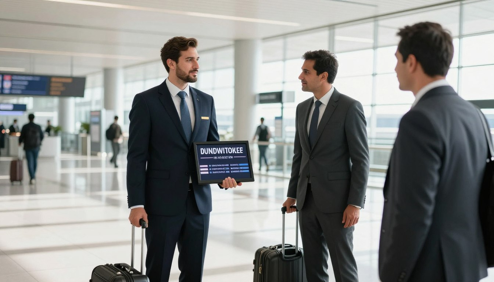

# **Zayed International Airport (AUH) Transfers: Abu Dhabi Airport Chauffeur Service**

An executive Abu Dhabi airport chauffeur service provides seamless, prearranged private mobility from Zayed International Airport (AUH) to hotels, corporate offices and diplomatic districts across Abu Dhabi. Professional flight monitoring and terminal assistance maintain punctuality across commercial flights and private aviation arrivals.

Coordinated airport transfers eliminate kerbside delays, connecting passengers directly with licensed chauffeurs and immaculately presented premium vehicles. Flight tracking technology aligns arrival schedules with kerbside staging to accommodate early landings or unexpected airspace holds.

[Book now](https://www.ab.limo/airports/zayed-international-auh) [View the fleet](https://www.ab.limo/airports/zayed-international-auh)

Pick up: Zayed International Airport (AUH)

Drop off: Abu Dhabi Corniche, Abu Dhabi

The AUH fleet

## **Executive Vehicles for Abu Dhabi Airport Chauffeur Service**

AB maintains an immaculate fleet of executive sedans, sport utility vehicles and multi purpose vans configured for seamless airport transfers at Zayed International Airport (AUH). Every vehicle is operated by a vetted professional chauffeur.

| Vehicle Class     | Vehicle Model                                         | Ideal For                           | AUH Service Description                                                                                                           |
| ----------------- | ----------------------------------------------------- | ----------------------------------- | --------------------------------------------------------------------------------------------------------------------------------- |
| Standard Sedan    | Toyota Camry or similar \[Confirm\]                   | Individual corporate travellers     | Comfortable and efficient transfers connecting AUH arrivals directly with city hotels and commercial offices across the emirate.  |
| Business Sedan    | Mercedes E Class or similar \[Confirm\]               | Business executives and delegates   | Refined executive travel from AUH with leather seating, climate control and discrete acoustic insulation for mobile work.         |
| First Class Sedan | Mercedes S Class or similar \[Confirm\]               | VIP transport and senior leadership | Flagship luxury car service providing exceptional comfort, extended rear legroom and superior kerbside arrival presence.          |
| Executive SUV     | Cadillac Escalade or GMC Yukon or similar \[Confirm\] | Executive groups with luggage       | Commanding cabin volume and luggage capacity tailored for premium AUH transfers across Abu Dhabi and cross border emirate routes. |
| Premium MPV       | Mercedes V Class or similar \[Confirm\]               | Families and executive roadshows    | Spacious conference style seating accommodating multiple passengers and extensive baggage seamlessly from AUH terminal kerbsides. |
| Executive Van     | Mercedes Sprinter or similar \[Confirm\]              | Event delegations and travel groups | High capacity chauffeured transportation offering generous luggage space and high roof walk in access for group itineraries.      |

Popular journeys

## **Popular Journeys: Airport Chauffeur Service Abu Dhabi Routes**

AB provides fixed route transfers from Zayed International Airport to primary corporate destinations, residential developments and neighbouring emirates. Transparent scheduling supports predictable itineraries for international business visitors.

### **AUH to central Abu Dhabi**

From \[AED price\] · \[Confirm\] minutes

Connecting arriving passengers directly to the downtown commercial sector, government ministries and luxury Corniche hotels with seamless kerbside delivery.

### **AUH to Yas Island**

From \[AED price\] · \[Confirm\] minutes

Direct transit to Yas Marina Circuit, entertainment arenas, exhibition centres and resort complexes located minutes north of the terminal complex.

### **AUH to Dubai**

From \[AED price\] · \[Confirm\] minutes

Intercity chauffeur transport linking AUH directly to Downtown Dubai, Business Bay and Dubai International Financial Centre via highway corridors.

### **AUH to Al Ain**

From \[AED price\] · \[Confirm\] minutes

Chauffeured intercity transfer to the eastern region, serving university campuses, industrial zones and heritage properties across the oasis city.

How it works

## **AUH Meet and Greet Chauffeur Logistics**

The standard AUH meet and greet service simplifies international arrival. Operations personnel monitor flights continuously to adjust vehicle staging for variable landing times. Chauffeurs enter the terminal arrivals hall holding personalised name boards as passengers clear baggage claim and customs. Chauffeurs provide professional luggage help, escorting guests to dedicated terminal limousine pickup areas. Each AUH arrivals pickup includes complimentary waiting time \[Confirm\] to accommodate customs clearance and baggage retrieval procedures without administrative stress.

### 1. **Book**

Reserve an executive car with driver online or via corporate dispatch, confirming flight details, passenger counts and luggage requirements.

### 2. **Track**

Central operations track inbound aircraft in real time, matching chauffeur arrival with actual touchdown and gate assignment.

### 3. **Meet**

Your Zayed International Airport chauffeur greets you inside the designated arrivals hall with a clear name board and takes your luggage.

### 4. **Ride**

Board an air conditioned luxury car for a smooth, direct journey to your residential, hotel or corporate destination.

Terminals

## **Zayed International Airport Terminal Meeting Points**

AUH operates distinct passenger processing zones for commercial airlines, premium travellers and private general aviation movements across the airport grounds.

### **Terminal A \[Confirm terminal names\]**

Commercial arrivals meet their AUH chauffeur directly past baggage claim inside the main arrivals hall at the specified passenger exit point \[Confirm\].

### **VIP Terminal \[Confirm\]**

Delegations using premium meet and assist services exit through designated VIP reception lounges with kerbside executive vehicle staging \[Confirm\].

### **Private Aviation Terminal \[Confirm\]**

Fixed base operator facilities accommodate private charters and business jets with direct ramp side coordination and private tarmac chauffeur pickups \[Confirm\].

Services from AUH

## **Comprehensive Airport and Corporate Ground Transportation**

Beyond one way airport pickups, AB delivers complete mobility solutions across Abu Dhabi and the wider region for corporate enterprises and VIP travellers.

- Airport Transfers in Abu Dhabi
- Chauffeur & VIP in Abu Dhabi
- Intercity Transfers
- Corporate Accounts

Corporate accounts benefit from centralised consolidated invoicing, dedicated account managers, customized billing cycles and priority vehicle allocations during peak conference periods.

Questions

## **Frequently Asked Questions About AUH Chauffeur Services**

### **How does flight tracking work for an AUH chauffeur transfer?**

Central operations track commercial flights through automated radar monitoring systems. Chauffeur dispatch adjusts automatically when an inbound flight lands early or suffers operational delays. This procedure supports precise arrivals pickup without passengers needing to report flight adjustments manually.

### **Where does the chauffeur meet arriving passengers at AUH?**

The assigned chauffeur waits directly in the terminal arrivals hall immediately after the customs exit doors. The chauffeur displays an electronic tablet or printed board showing the passenger or company name. The chauffeur then provides luggage assistance before walking to the executive vehicle pickup bay.

### **What complimentary waiting time applies to AUH airport pickups?**

Airport pickups at AUH include complimentary waiting time \[Confirm\] calculated from the actual aircraft touchdown time. This allowance gives international travellers sufficient time to navigate passport control, collect baggage and complete customs clearance. Additional waiting time can be arranged if extended transit processing occurs.

### **Can corporate travel managers book hourly chauffeur service from AUH?**

Yes, AB provides hourly chauffeur and full day hire services commencing directly upon arrival at AUH. This option suits executives attending consecutive meetings, government summits or site inspections across Abu Dhabi before returning to the airport or proceeding to another emirate.

### **What vehicle classes are available for airport transfers in Abu Dhabi?**

The fleet includes executive sedans such as the Mercedes S Class and Mercedes E Class, spacious SUVs like the Cadillac Escalade and GMC Yukon, and multi passenger vans including the Mercedes V Class. Every vehicle is fully licensed, insured and maintained to strict executive safety standards.

### **How are private aviation and VIP terminal pickups handled at AUH?**

For passengers arriving via private jet or VIP terminal facilities, AB coordinates directly with local ground handlers and fixed base operators. Chauffeurs stage vehicles at designated VIP exit gates \[Confirm\] to support confidential, swift departures from the airport perimeter.

### **How do corporate organisations establish a managed account with AB?**

Organisations can establish corporate accounts through our operations team to secure contracted tariffs, consolidated monthly billing and access to regional ground transportation. Direct coordination with 24/7 dispatch provides seamless booking management across Abu Dhabi, Dubai, Riyadh and Doha.

## **Your chauffeur is waiting at AUH.**

Secure a dependable Abu Dhabi airport chauffeur service with professional flight tracking, dedicated terminal meet and greet, and immaculate executive vehicles. Our dispatch team coordinates scheduled transfers and VIP roadshows across Abu Dhabi and all seven UAE emirates.

For immediate reservations, flight updates or specialised corporate bookings, contact AB Abu Dhabi at Office 03, Mezzanine Floor, Building C57, Abu Dhabi, UAE.

+971 50 918 0556

[Book now](https://www.ab.limo/airports/zayed-international-auh) [Request a proposal](https://www.ab.limo/airports/zayed-international-auh)