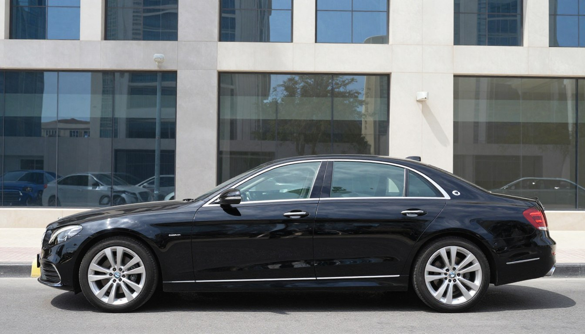
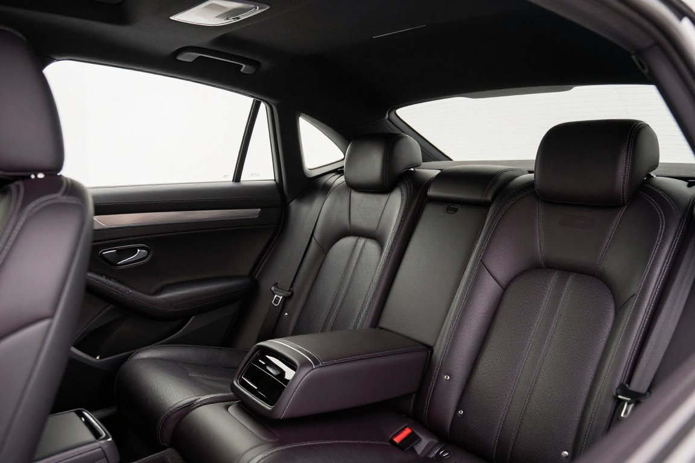

# **Business Sedan with Driver: Executive Class Travel**

A business sedan with driver provides executive passengers with a quiet mobile environment to conduct work or rest between commercial appointments across primary business districts. Skilled chauffeurs navigate dense metropolitan corridors with complete discretion, supported by regional dispatch centres tracking traffic patterns continuously.

Corporate travel programmes rely on this vehicle category for dependable transfers where punctuality and professional presentation take precedence over ceremonial display. Each vehicle maintains strict cosmetic standards, rigorous safety readiness, and seamless operational coordination from pickup to arrival.

[Book this class](https://seowriting.ai/quote/book) [Request a quote](https://seowriting.ai/quote/book)

- **Guests:** 3
- **Luggage:** 2
- **Typical model:** Mercedes E Class or similar
- **Ideal for:** Executives and roadshows

Inside

## **Inside the Business Sedan with Driver Rear Cabin**

The rear cabin of the business sedan with driver delivers an acoustic environment tailored to intense focus and personal comfort. Generous legroom permits corporate passengers to review presentation materials, manage urgent correspondence, or conduct confidential telephone discussions in total isolation from external traffic noise.

Supple seating, zoned climate regulation, and ergonomic passenger controls enable relaxed transit across extended urban transfers. Rear window blinds provide additional shade and privacy when travelling through prominent commercial avenues during daylight hours.

The rear cabin layout prioritises productive transit, providing independent climate vents, dedicated reading illumination, and low interior ambient sound levels suited for telephone conferences.

The quiet rear passenger cabin provides dedicated climate controls and ergonomic seating for productive travel.

Onboard

## **Onboard Connectivity and Amenities**

Each executive saloon arrives equipped with functional appointments that support continuous productivity throughout the working journey.

### **Device Charging Points**

Universal charging ports support mobile devices and laptops so passengers remain powered throughout back to back business meetings.

### **Wireless Internet Connection**

Onboard Wi Fi enables continuous connectivity, allowing passengers to draft emails and review documents during transit without interruption.

### **Quiet Workstation Ambience**

Fold down central armrests and refined sound dampening create an orderly desk environment for urgent mobile document reviews.

### **Passenger Refreshments**

\[Confirm: complimentary bottled water and refreshment provisions\] accompany passenger journeys to maintain comfort during warm regional transfers.

Use cases

## **When to Select Executive Sedan Hire**

Selecting an executive sedan hire delivers an ideal balance of understated elegance, nimble city manoeuvrability, and commercial practicality across dynamic metropolitan areas.

### **Executive Roadshows**

Multi stop financial and corporate roadshows require punctual movements between banking towers, regional headquarters, and conference venues on tight schedules.

### **Daily Corporate Mobility**

Visiting directors and resident executives benefit from dependable daily itineraries coordinated by a private driver who manages parking and urban congestion.

### **Direct Airport Pickups**

Terminal arrivals and departures transition smoothly into productive work sessions, carrying carry on luggage and passengers without unnecessary transport delays.

Services

## **Corporate Ground Transportation Services**

The executive saloon operates across several managed service programmes designed for multinational firms, financial institutions, and government bodies requiring structured mobility solutions.

- **Chauffeur and VIP Programmes:** Deploying an [executive chauffeur Riyadh](https://seowriting.ai/services/chauffeur-vip/saudi-arabia/riyadh) service delivers polished protocol standards, route familiarity, and refined hospitality for senior leaders visiting company headquarters.
- **Corporate Mobility Solutions:** Establishing ongoing regional transport through [business chauffeur hire](https://seowriting.ai/services/corporate-transportation/uae) and structured [corporate chauffeur hire](https://seowriting.ai/services/corporate-transportation/uae) agreements simplifies billing via monthly invoice schedules.
- **City Transfers and Visiting Delegations:** Organising regional commercial travel through an [executive car service Dubai](https://seowriting.ai/services/chauffeur-vip/uae/dubai) deployment provides effortless movements across key trade zones and international exhibition centres.
- **Fleet Diversity:** Explore our wider [fleet](https://seowriting.ai/fleet) options to match specific delegation headcounts, executive luggage volumes, and security profile requirements.

At a glance

## **Executive Car with Driver Fleet Comparison**

Comparing saloon specifications assists corporate travel coordinators in assigning appropriate vehicle classes to visiting executives and group delegations.

| Class             | Typical model    | Guests | Luggage | Ideal for                                                            |
| ----------------- | ---------------- | ------ | ------- | -------------------------------------------------------------------- |
| Standard Sedan    | Ford Taurus      | 3      | 2       | Cost conscious point to point staff transfers and crew logistics     |
| Business Sedan    | Mercedes E Class | 3      | 2       | Executives, financial roadshows, and corporate account itineraries   |
| First Class Sedan | Mercedes S Class | 3      | 2       | C level dignitaries, VIP protocol delegations, and diplomatic travel |

Coverage

## **Regional Service Availability**

Stationed vehicles serve primary business destinations including Riyadh, Jeddah, Dammam, Dubai, Abu Dhabi and Doha \[Confirm: cities where this class is stationed\]. AB manages direct corporate ground transportation operations across Saudi Arabia, all seven UAE emirates and Qatar. Cross border and extended GCC travel across Bahrain, Kuwait and Oman is fulfilled exclusively on request through vetted corporate partners.

Direct fleet deployments operate from our regional headquarters in Al Malaz, Riyadh, alongside branch operations in Dubai, Abu Dhabi, and Doha. Every reservation remains supported by 24/7 dispatch tracking.

Questions

## **Frequently Asked Questions About Business Sedan with Driver Services**

### **What luggage capacity does an executive car with driver accommodate?**

An executive car with driver accommodates two standard suitcases in the rear boot alongside two compact carry on bags inside the cabin. Groups requiring additional baggage capacity for extended overseas assignments should arrange multiple vehicles or reserve a dedicated passenger minivan.

### **How does a business class chauffeur handle delayed flight arrivals?**

A business class chauffeur tracks flight statuses in real time through automated terminal monitoring systems linked directly to our central operations room. When flight schedules change unexpectedly, dispatch coordinators adjust the driver arrival schedule to match your actual landing time.

### **What meet and greet procedures occur at regional airport terminals?**

Our chauffeur service provides professional meet and greet attendance in the arrivals hall immediately following customs clearance. Your driver displays a personalised digital or printed name board, assists with heavy baggage handling, and escorts guests directly to the waiting vehicle kerbside.

### **Can corporate accounts access consolidated monthly invoice billing?**

A verified corporate account enables centralised billing management, itemised ride summaries, and flexible payment arrangements settled via a single monthly invoice. Corporate travel administrators receive dedicated booking portal access with transparent expenditure auditing across all registered team members.

### **How does AB uphold duty of care for executive travellers?**

Our operational duty of care encompasses comprehensive driver vetting, defensive driving accreditation, rigorous vehicle maintenance regimes, and continuous GPS tracking managed by 24/7 dispatch specialists. Corporate coordinators can monitor vehicle progress across all regional journeys at any time.

### **Can I book a Mercedes E Class with driver for multi day roadshows?**

Booking a Mercedes E Class with driver for multi day schedules allows complete flexibility for complex city agendas and changing stakeholder timetables. Dedicated chauffeurs remain on standby near meeting venues to facilitate immediate departures without transit delays.

### **What amenities are included during executive saloon transfers?**

Executive saloons feature device charging connectivity, onboard Wi Fi capability, individual climate adjustment, and \[Confirm: complimentary bottled water and refreshments\]. These provisions allow travelling professionals to maintain productivity and physical comfort across demanding itineraries.

## **Reserve Your Business Sedan with Driver**

Secure a dependable business sedan with driver for upcoming corporate roadshows, VIP delegation transfers, or daily commercial mobility across the Gulf region. Experienced chauffeurs, modern vehicles, and attentive dispatch teams deliver seamless ground transit tailored to international business requirements.

### **Plan Your Executive Journey**

Submit your itinerary requirements to receive corporate transport options and custom corporate terms.

[Request a proposal](https://seowriting.ai/quote/book) [Book a transfer](https://seowriting.ai/quote/book)