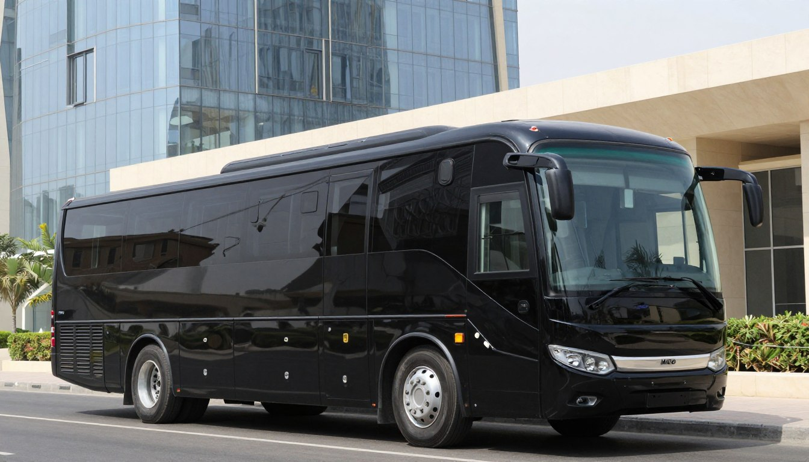
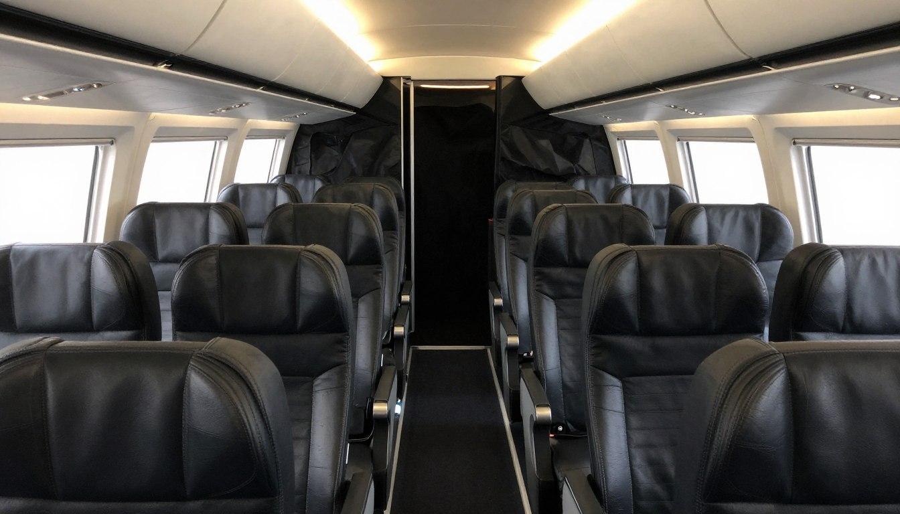

# **Coach Hire with Driver: AB Coach Class**

AB provides managed coach hire with driver across Saudi Arabia, the UAE and Qatar for corporate and institutional programmes. Every booking deploys a vetted professional chauffeur backed by continuous central flight tracking and live GPS tracking.

Organisations coordinate large passenger movements through dedicated ground transportation specialists who align vehicle allocations with complex venue itineraries. This premium service maintains passenger comfort across long regional transfers and multi vehicle convoys.

[Book this class](https://seowriting.ai/quote/book) [Request a quote](https://seowriting.ai/quote/book)

- Guests: \[Confirm, up to 50\]
- Luggage: \[Confirm\]
- Typical model: \[Confirm model\] or similar
- Ideal for: Delegations, events and staff programmes

Inside

## **Inside the Cabin for Coach Hire with Driver**

The coach cabin offers an expansive interior engineered for long distance passenger relaxation and productive group transit. Ergonomic reclining passenger seats feature durable leather or executive fabric upholstery, paired with individual overhead reading lights and personal ventilation controls. Wide central aisles allow smooth passenger movement during boarding and disembarkation at major terminal facilities.

For corporate delegations requiring luxury coach rental standards, the cabin interior presents immaculate aesthetic standards and acoustic insulation that dampens exterior roadway noise. Deep tinted privacy glass regulates natural daylight, keeping ambient temperatures balanced across arid Gulf travel corridors. Overhead parcel racks accommodate executive briefcases, while voluminous underfloor storage compartments securely hold large baggage suites.

Underfloor compartments provide partitioned storage areas, allowing ground crew to separate fragile presentation cargo from guest luggage. This arrangement preserves cabin cleanliness and prevents aisle obstructions during regional transfers.

Organised group movements benefit from consistent climate control settings managed directly by the primary cabin system. Passengers remain comfortable during midday desert transfers between metropolitan commercial districts and remote corporate project locations. Every seat position incorporates certified safety restraint belts, supporting corporate duty of care requirements across all regional itineraries.

Onboard

## **Standard Onboard Amenities and Passenger Comfort**

Passenger cabins are equipped with practical utilities designed to maintain guest productivity and comfort throughout regional journeys. Corporate travellers use travel intervals between convention halls and international airports to review documentation or conduct mobile communications. Central operations teams confirm that each vehicle meets rigorous sanitisation and technical preparation schedules before departing regional staging depots.

Coaches deployed for VIP bus rental movements undergo comprehensive interior inspections before client arrivals. Chauffeurs verify that digital charging ports, cabin network routers and refreshment supplies meet specified passenger requirements.

- Chilled Refreshment Water: Complimentary bottled drinking water is supplied across all guest seats for every scheduled transfer. \[Confirm amenities: water, chargers, Wi Fi and similar\]
- Personal Device Charging: USB charging ports and standard electrical power points are situated at passenger seating rows. \[Confirm amenities: water, chargers, Wi Fi and similar\]
- Onboard Wi Fi Connectivity: High speed wireless internet access supports uninterrupted mobile communications across urban and highway travel routes. \[Confirm amenities: water, chargers, Wi Fi and similar\]
- Climate Regulation System: Dual zone automated air conditioning maintains uniform thermal stability across the entire passenger interior. \[Confirm amenities: water, chargers, Wi Fi and similar\]

Operational teams monitor passenger satisfaction across corporate shuttle networks and institutional programmes. Consistent cabin amenities assist guest wellbeing during extended journeys between Riyadh, Dammam and western province destinations. These amenities reflect AB standards across all GCC managed fleet categories.

Applications

## **When to Select Coach Hire with Driver for Group Travel**

Choosing coach hire with driver streamlines group logistics by consolidating numerous passengers into a unified, professionally coordinated vehicle movement. Coordinating multiple smaller private cars often creates arrival dispersion, parking congestion and complex coordination overhead at high security venues. Selecting a full size coach simplifies convoy planning for protocol officers and private event coordinators alike.

### **Government and Diplomatic Delegations**

Diplomatic missions require coordinated transport between summit halls, international embassies and protocol airstrips. Dedicated coach movements allow entire delegations to travel together under unified security supervision.

### **Exhibitions and Corporate Events**

International conferences demand precise scheduling between regional airport gates, key hotels and exhibition centres. Dedicated coaches keep corporate attendee groups punctual across intense multi day agendas.

### **Ongoing Staff Commuter Programmes**

Corporate enterprises operating large operations centres utilise scheduled coach shuttles for technical workforces. Structured workforce routes reduce site vehicle traffic while supporting reliable daily shift arrivals.

Event planners who require coach with driver for events frequently coordinate operations through central dispatch managers. Centralised route scheduling avoids congested urban arteries and adheres to venue loading bay schedules. Professional drivers maintain direct radio or cellular communication with on site logistics supervisors throughout major summit proceedings.

Services

## **Managed Ground Transportation Services That Deploy the Coach Class**

AB integrates the Coach category into comprehensive ground transportation frameworks across commercial, governmental and cultural sectors. Dedicated account teams design bespoke transportation schedules that combine full size coaches with executive sedans and multi purpose vans from the wider [fleet](https://seowriting.ai/fleet). This integrated methodology addresses diverse passenger hierarchies and scheduling demands across major projects.

Commercial clients requiring regional [coach hire Saudi Arabia](https://seowriting.ai/services/bus-coach-hire/saudi-arabia) services receive unified billing arrangements through a central corporate account. Standardised reporting provides procurement directors with clear visibility over regional transit expenditure and operational performance. Local ground staff oversee passenger boarding at primary airport terminals and convention venues, maintaining prompt departure schedules.

- Bus & Coach Hire: Comprehensive group travel solutions operating across urban centres, including dedicated [bus rental Riyadh](https://seowriting.ai/services/bus-coach-hire/saudi-arabia/riyadh) routes for corporate conventions.
- Event Transportation: Synchronised conference and summit passenger operations, featuring punctual [bus rental Dubai](https://seowriting.ai/services/bus-coach-hire/uae/dubai) transfers for major trade expos.
- Workforce Transportation: Reliable daily employee transit programmes connecting commercial accommodation communities with business parks and industrial headquarters.
- Religious Tourism: Respectful, organised passenger transport for cultural and spiritual itineraries across holy sites in western Saudi Arabia.

Cross border transit programmes between eastern Saudi Arabia and neighbouring states are managed through vetted regional infrastructure. Organisations arranging international summits in the Gulf region benefit from uniform vehicle presentation and trained professional chauffeurs. Every booking benefits from continuous oversight conducted by regional duty managers.

At a glance

## **Comparing Coach Class with the Executive Van**

Selecting the appropriate vehicle class depends on overall delegation volume, luggage profiles and venue drop off constraints. While the Executive Van excels at navigating tight hotel entrances and transferring leadership committees, the Coach class accommodates large attendee bodies in a single trip. Assessing these logistical factors in advance prevents unnecessary vehicle chartering and optimizes ground movement costs.

| Vehicle Class | Typical Model     | Guest Capacity        | Luggage Capacity      | Ideal Application                                                             |
| ------------- | ----------------- | --------------------- | --------------------- | ----------------------------------------------------------------------------- |
| Coach         | \[Confirm model\] | \[Confirm, up to 50\] | \[Confirm\]           | Ideal for delegations, major public events and structured staff programmes.   |
| Executive Van | \[Confirm model\] | \[Confirm: capacity\] | \[Confirm: capacity\] | Suited for executive boards, airport delegations and small operational teams. |

Organisations handling complex summits frequently pair coach movements with individual limousine or private driver allocations for senior dignitaries. This multi tiered approach maintains strict protocol separation while providing dependable bulk transport for broader delegation staff. Transport coordinators can review available vehicle classes directly via central booking channels.

Coverage

## **Geographic Coverage Across Saudi Arabia, UAE and Qatar**

AB provides direct coach hire with driver operations in Riyadh, Jeddah, Dammam, Dubai, Abu Dhabi and Doha \[Confirm cities where this class is stationed\]. Direct managed service extends across Saudi Arabia, all seven UAE emirates and the State of Qatar. Operations in Bahrain, Kuwait and Oman are fulfilled exclusively on request through carefully vetted partner networks.

The Riyadh central dispatch operations centre maintains round the clock communication with drivers and on site transport marshals across all active territories. Regional offices provide local operational supervision in key Gulf business centres.

Clients coordinating cross regional programmes can arrange international transfers including specialized [coach hire Qatar](https://seowriting.ai/services/bus-coach-hire/qatar) itineraries through central client accounts. Municipal movements within Qatar are supported by dedicated [bus rental Doha](https://seowriting.ai/services/bus-coach-hire/qatar/doha) schedules, providing consistent standards for sporting events and state gatherings. In the Emirates, local planners book specialized coach rental dubai options to service luxury coastal resorts and metropolitan exhibition hubs.

Urban event organisers also reserve 50 seater bus rental dubai packages to accommodate international corporate delegates arriving at regional airports. These extensive options allow corporate travel managers to deploy luxury bus rental Dubai services with total operational confidence. Dedicated account executives supervise regional route permissions and airport security clearances in advance of vehicle arrival.

Questions

## **Frequently Asked Questions About Coach Operations**

### **What does coach hire with driver include?**

Coach hire with driver provides a fully licensed luxury vehicle, fuel allowances, professional chauffeur services and comprehensive 24/7 dispatch monitoring. AB operations teams track all vehicle itineraries via GPS tracking, providing route supervision and coordination support. Standard amenities include bottled drinking water and cabin utilities arranged prior to departure.

### **What passenger group sizes suit 50 seater coach hire?**

The Coach class accommodates groups of \[Confirm, up to 50\] passengers comfortably in an expansive seating cabin. Organising a single 50 seater coach hire movement reduces road congestion and streamlines passenger boarding during major commercial summits. Larger conferences utilise multiple coaches dispatched in timed convoys to handle hundreds of attendees seamlessly.

### **How are luggage and passenger belongings managed onboard?**

The coach features generous lower belly luggage holds suited for large travel suitcases and event equipment \[Confirm\]. Inside the coach cabin, deep overhead parcel racks hold executive briefcases, coats and personal carry on bags. Drivers oversee orderly loading and unloading to prevent baggage scuffs and avoid terminal congestion.

### **Can corporate clients set up monthly billing accounts?**

Corporate travel managers and government procurement teams can establish a corporate account with flexible credit structures. This arrangement consolidates multi city journeys across Saudi Arabia, the UAE and Qatar into a transparent monthly invoice. Dedicated account representatives handle route adjustments, passenger manifests and itemised invoicing details.

### **What standards apply to professional chauffeur teams?**

Every professional chauffeur undergoes rigorous driving assessments, defensive route training and customer service protocol orientation. Drivers wear formal executive suits, maintain complete confidentiality and communicate effectively with flight tracking coordinators. Chauffeurs understand local protocol requirements at major government buildings, international airports and corporate headquarters.

### **How does AB manage airport meet and greet operations?**

Airport meet and greet teams coordinate directly with flight tracking desks to monitor commercial and private flight arrivals. Ground representatives welcome arriving delegations at the terminal gate or arrivals concourse before escorting them to the waiting coach. The chauffeur coordinates with terminal marshals to stage the luxury vehicle at official passenger pickup zones.

### **What safety and duty of care standards govern coach operations?**

AB enforces comprehensive duty of care protocols covering mechanical roadworthiness inspections and driver duty hour limitations. Every vehicle operates under real time GPS tracking observed continuously by the central operations centre in Riyadh. Chauffeurs follow strict route safety parameters to ensure passenger security throughout cross country and urban itineraries.

### **Which Gulf territories does AB service directly?**

AB directly serves all major commercial regions across Saudi Arabia, all seven UAE emirates and Qatar. Transfers in Bahrain, Kuwait and Oman are fulfilled on request through thoroughly vetted partner transport networks. Central dispatch teams coordinate cross border logistics and permit filings to ensure uninterrupted multinational travel.

## **Need a larger movement with coach hire with driver?**

Connect with regional transport coordinators to organise large capacity coach movements across the Gulf region.

[Book this class](https://seowriting.ai/quote/book) [Request a proposal](https://seowriting.ai/quote/book)