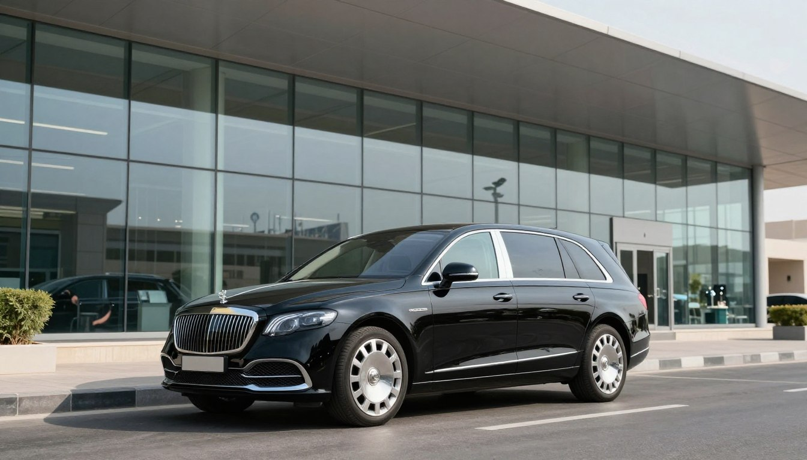
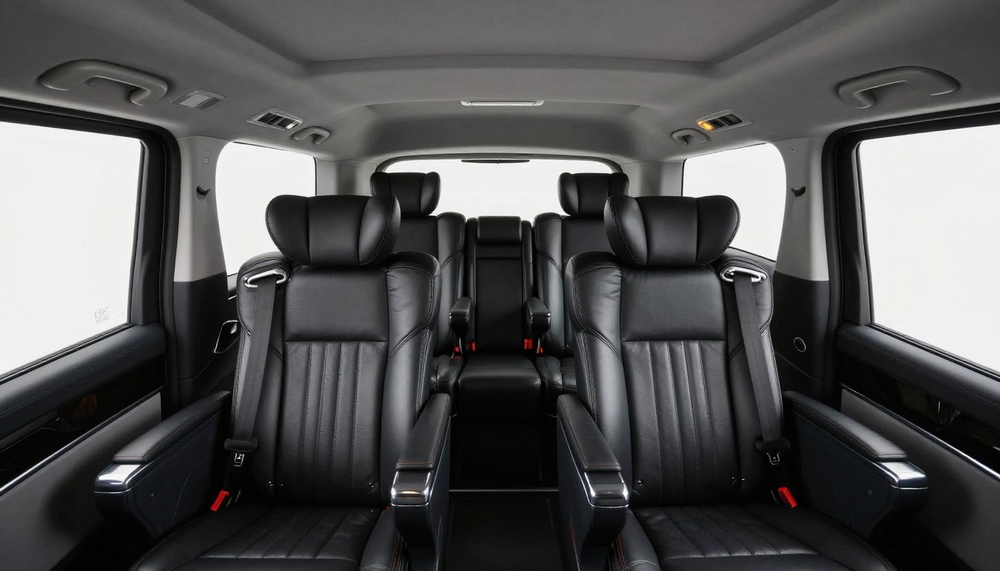

# **Chauffeur-driven premium MPVs for group travel**

A premium MPV with a professional driver offers a comfortable, practical way for small groups to travel together between airports, hotels, business meetings and events. Face-to-face seating in selected vehicles creates room to talk or work en route, while a dedicated chauffeur keeps the journey organised around your itinerary.

Choose a vehicle according to your passenger numbers, luggage and schedule. A Mercedes V Class with driver is one example of a spacious Mercedes-Benz class MPV; comparable vehicles may also be available. Whether the trip is for business or leisure, confirm the model and capacity when booking so the car suits your group's needs.

[Book this class](https://seowriting.ai/quote/book) [Request a quote](https://seowriting.ai/quote/book)

**Guests:** Up to 6, depending on vehicle | **Luggage:** Typically up to 5 standard pieces; confirm dimensions | **Typical model:** Mercedes V Class or similar | **Ideal for:** Delegations and small teams

Inside

## **Comfortable lounge seating in a chauffeur-driven MPV**

The cabin layout depends on the vehicle model and configuration. Selected premium MPVs have individual seats arranged face to face, creating a shared space where passengers can talk, review documents or prepare for meetings during the journey. This seating arrangement suits small groups travelling between venues, while forward-facing layouts are also available in some vehicles. Ask about the preferred configuration when making a reservation.

Interior features vary across the fleet. Depending on the vehicle, passengers may have generous legroom, rear climate controls and tinted windows. These details support a comfortable journey and offer some discretion, although window tinting does not guarantee complete privacy. Selected MPVs also have folding work surfaces for laptops and papers. Confirm which features are available in your vehicle before booking, particularly when they are important for your itinerary.

A clean, well-presented cabin helps passengers settle in before a business meeting or event. Chauffeurs prepare the vehicle before pickup, checking the seating, carpets and frequently touched surfaces. For groups, it is worth sharing passenger numbers and any specific seating needs in advance. This helps the service team match the vehicle to the journey and lets passengers know what to expect before they travel.

Face-to-face seating in a selected MPV creates a shared space for onboard conversations.

Onboard

## **Comfort and connectivity on board**

For executives travelling between business districts, comfort and useful onboard amenities can make time on the road more productive. The features available depend on the vehicle and service booked, so confirm any requirements when arranging your journey. For longer trips lasting several hours, check which options are included before you travel.

Passengers can ask about refreshments, device charging, Wi-Fi and rear climate controls. Availability varies across vehicles, and the operations team can confirm the details for your booking. This helps set clear expectations and supports a comfortable experience from pickup to destination.

Amenities vary by vehicle and booking. Confirm what is included when you reserve to plan a consistent passenger experience across your itinerary.

### **Bottled water**

Ask whether bottled water is included for your transfer, particularly when planning a longer journey or several hours on the road.

### **Mobile device chargers**

Charging cables and supported connector types vary by vehicle. Share your device requirements in advance so the team can confirm suitable options for the trip.

### **Wi-Fi connectivity**

Wi-Fi availability and network specifications vary. Confirm access before booking, and use appropriate security measures when handling sensitive business correspondence online.

### **Climate control**

Some vehicles provide rear climate controls, allowing passengers to adjust cabin temperature. Check availability when selecting a vehicle, especially for longer travel during warmer weather.

Use cases

## **When to choose a chauffeur-driven MPV**

Choose a premium MPV according to your group size, luggage, journey length and itinerary. It suits small teams who want to travel together between several venues, with room to talk or review documents on the way. The right vehicle class also depends on whether your trip involves business meetings, an event, leisure travel or a mix of purposes. For larger groups or bulky equipment, compare passenger and luggage capacity before booking.

Chauffeur-driven MPVs offer a practical alternative to executive saloons and larger passenger vans. They combine space for a small group with a more comfortable setting for city journeys and scheduled stops. Share your itinerary and pickup requirements when arranging transport. Where live vehicle tracking is available, dispatch teams use it to coordinate pickups as schedules change.

### **Corporate roadshow teams**

For roadshows, a shared vehicle keeps management teams together as they travel between financial centres and investor presentations. The cabin offers a place to continue business discussions or prepare for meetings between stops. Confirm seating and luggage capacity to ensure the vehicle fits the group and its schedule.

### **Diplomatic delegations**

Organised group transport helps delegations arrive together at official engagements. A professional chauffeur manages the planned route and pickup arrangements, while the booking team confirms vehicle details and any protocol requirements in advance. Discuss privacy needs and luggage arrangements when planning the journey.

### **Executive event speakers**

Speakers and panel members travelling between hotels and event venues can share one vehicle instead of coordinating separate trips. This simplifies transport around rehearsals, conference sessions and other scheduled events. For multi-venue programmes or tours, provide the itinerary and timings in advance to help coordinate each transfer.

Services

## **Ground transport services using chauffeur-driven MPVs**

AB provides chauffeur-driven MPVs for corporate, event and airport transport across its Middle East service locations. Centralised reservations help companies arrange journeys in different cities, with vehicle models and specifications confirmed for each booking. Chauffeurs hold the local commercial licences required for their work and receive defensive-driving training.

Organisations arranging group travel benefit from a single coordination point at the Riyadh operations centre. Project coordinators plan routes, organise vehicle staging and monitor flight information for airport pickups where flight tracking is available. Clients seeking a chauffeur service should confirm locations, vehicle requirements and timings when requesting a quote. The team can also advise whether a chauffeur-driven Mercedes or a comparable MPV suits the group and its luggage.

- Corporate Transportation: Chauffeur-driven transfers for financial roadshows, connecting commercial headquarters, industrial zones and client offices.
- Event Transportation: Coordinated delegate journeys with our [corporate events chauffeur](https://seowriting.ai/services/event-transportation/uae) network and [chauffeur service for events Dubai](https://seowriting.ai/services/event-transportation/uae/dubai). Confirm service availability and vehicle arrangements for your event.
- Airport Transfers: Pre-arranged airport transfer services for corporate groups. Where included in the booking, flight monitoring helps coordinate arrival times, while a meet-and-greet service provides assistance at the terminal. Confirm pickup instructions and any applicable service details before travel.

At a glance

## **Compare vehicle classes and plan capacity**

Choosing the right vehicle helps prevent cramped seating and insufficient luggage space. Consider the number of passengers, the size and quantity of their bags, and any equipment they need to carry. Executive saloons suit smaller parties, while an MPV or van offers space for a group to travel together. Check the capacity of the specific vehicle before booking, as models and configurations differ.

For groups that exceed an MPV's passenger capacity or have bulky demonstration equipment, an executive van provides a larger alternative. An SUV may suit senior leadership travelling with a smaller amount of luggage. The comparison below is a guide: confirm passenger and luggage figures with the service team, particularly when bags are oversized. Capacity depends on the vehicle supplied, its seating layout and the dimensions of each item.

| Class         | Typical model               | Guests                         | Luggage                                               | Ideal for                     |
| ------------- | --------------------------- | ------------------------------ | ----------------------------------------------------- | ----------------------------- |
| Premium MPV   | Mercedes V Class or similar | Up to 6; confirm configuration | Typically up to 5 standard pieces; confirm dimensions | Delegations and small teams   |
| Executive SUV | \[Confirm: SUV model\]      | \[Confirm: SUV guests\]        | \[Confirm: SUV luggage\]                              | Senior leadership site visits |
| Executive Van | \[Confirm: Van model\]      | \[Confirm: Van guests\]        | \[Confirm: Van luggage\]                              | Large conference delegations  |

Coverage

## **Regional ground transport across Saudi Arabia, the UAE and Qatar**

AB coordinates chauffeur services in Saudi Arabia, the UAE and Qatar. Coverage for each vehicle class varies by city, so confirm MPV availability when planning travel to Riyadh, Jeddah, Dammam, Dubai, Abu Dhabi or Doha. The Riyadh operations centre provides centralised coordination for bookings, with locations and service arrangements confirmed for each journey.

For cross-border itineraries, clients can discuss route requirements and booking conditions with the team. This includes [group transportation Qatar](https://seowriting.ai/locations/qatar) services and journeys connecting with UAE operations. Account managers can explain billing arrangements and how service coordination works across each destination. Vehicle availability, border procedures and local requirements should be agreed before travel.

AB coordinates transport in Saudi Arabia, the UAE and Qatar. Confirm direct service coverage for your destination and vehicle class when booking. Partner networks support journeys in Bahrain, Kuwait and Oman on request.

Questions

## **Frequently asked questions**

### **How many passengers and luggage items fit in a premium MPV?**

Capacity depends on the vehicle model and seating layout. Some premium MPVs carry up to six passengers and five standard luggage pieces, but these figures are not guaranteed for every vehicle. Tell the booking team how many people are travelling and the size of their bags, especially if you have oversized cases or exhibition materials.

### **Can the seating configuration be adjusted?**

Seating layouts vary by vehicle. Some MPVs offer face-to-face seating, while others have forward-facing seats. Share your preference when making a reservation so the team can confirm which configuration is available and arrange it before pickup where possible. Check the final layout and passenger capacity as part of your booking.

### **How are airport pickups arranged for groups?**

Airport pickup arrangements depend on the service selected. Confirm whether flight monitoring and a meet-and-greet service are included in your booking. If provided, the chauffeur uses the agreed meeting instructions to greet the group, assist with luggage and guide passengers to the vehicle. Share flight details and a contact number in advance so the team can confirm pickup arrangements.

### **Can I book an MPV for a multi-day roadshow?**

Multi-day bookings can be arranged for roadshows and other scheduled business travel, subject to vehicle and driver availability. Provide the itinerary, daily timings and planned stops when requesting a quote. The team will confirm whether the same driver can remain with your group throughout the journey and how schedule changes should be communicated.

### **What qualifications do chauffeurs hold?**

Chauffeur qualifications and training depend on local requirements and company procedures. Ask the service team about licensing, screening and driver training when these details are important to your organisation. Share any relevant travel or protocol requirements before the journey so they can confirm whether the service is suitable.

### **How do corporate accounts handle billing?**

Corporate account billing arrangements vary. Ask whether consolidated invoices, journey details or cost-centre reporting are available for your destinations. A dedicated account contact can explain the payment terms and information provided, helping your procurement team align transport bookings with its travel policy.

### **Can I arrange inter-city travel between Riyadh and the Eastern Province?**

Ask the team to confirm availability for routes between Riyadh, Dammam and Al Khobar. For a longer journey, provide your preferred departure time, passenger numbers and luggage requirements. The service team can confirm the vehicle, planned stops and any arrangements needed for the trip before you complete your booking.

### **What safety and duty-of-care measures apply to each transfer?**

Vehicle maintenance, inspections, driver procedures and tracking options depend on the service and operating location. Ask which measures apply to your transfer and whether live journey updates are available. Confirm the pickup details and emergency contact process before travel so passengers know how to reach the operations team during the day.

## **Arrange chauffeur-driven group transport**

Share your group size, luggage requirements, itinerary and preferred timings with the transport team. They can help you select a suitable vehicle and confirm availability, capacity and service arrangements for your destinations.

### **Book group transport**

Request a quote for individual transfers or contact the team to discuss corporate bookings and account arrangements. Confirm the vehicle and service details before travel.

[Book this class](https://seowriting.ai/quote/book) [Request a proposal](https://seowriting.ai/quote/book)