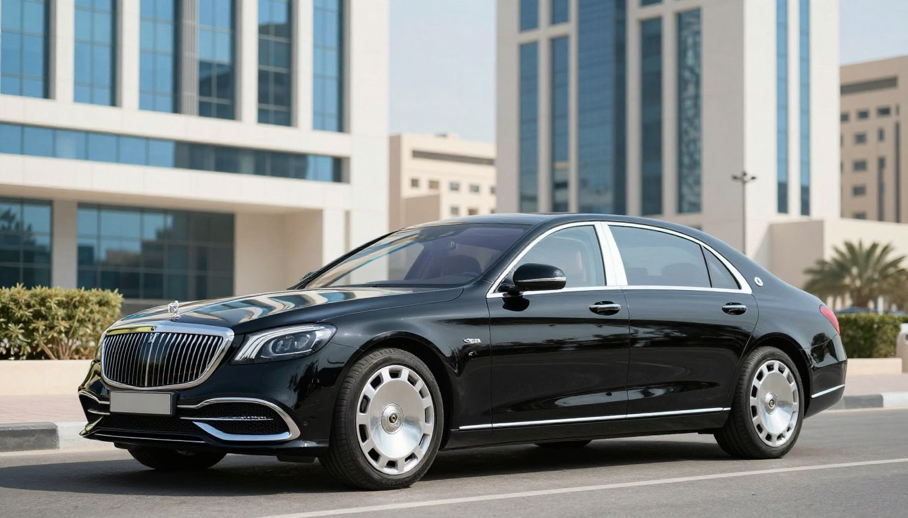
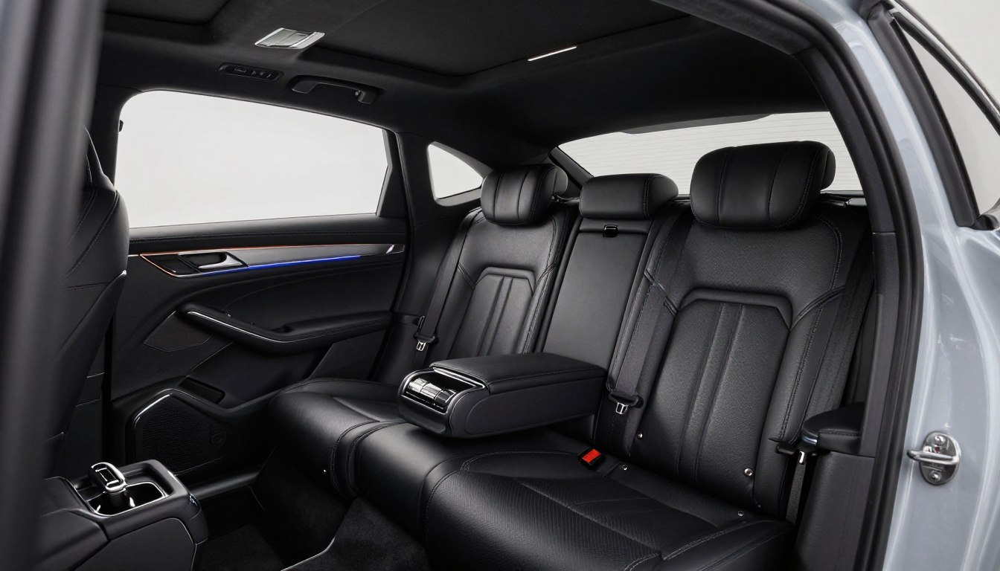

# **First Class Sedan Chauffeur Service**

The First Class Sedan offers discreet, comfortable executive travel across Saudi Arabia, the UAE and Qatar. This chauffeur service is suited to principals, VIP guests and business travellers who value a calm cabin, reclining rear seats and attentive service. A Mercedes S Class is a typical model in this class, alongside a comparable vehicle where supplied.

Choose this luxury sedan for corporate itineraries, formal events or individual journeys between meetings. A professional chauffeur provides a dedicated car and driver for your trip, helping you travel comfortably between appointments. The Mercedes S Class chauffeur option combines the refinement expected of a First Class vehicle with practical transport for up to three guests and two pieces of luggage. Confirm your party's requirements when you book, as the model and capacity depend on the vehicle assigned.

Whether you need a First Class chauffeur service for business travel or a class driver in Riyadh for a formal occasion, share your itinerary and collection details with our team. For larger delegations requiring additional vehicles, ask about options such as a Mercedes-Benz Sprinter. The First Class Sedan remains a focused choice for individual executives and small groups seeking a polished journey, with a Mercedes-Benz S-Class driver and vehicle provided according to the confirmed booking.

[Book this class](https://seowriting.ai/quote/book) [Request a quote](https://seowriting.ai/quote/book)

- Guests: 3
- Luggage: 2
- Typical model: Mercedes S Class or similar
- Ideal for: Principals, VIPs and occasions

Inside

## **Inside the Mercedes S Class Chauffeur Cabin**

The rear cabin of a First Class Sedan gives passengers a quiet, comfortable place to work or unwind between appointments. As part of a class chauffeur service, the vehicle is prepared for executive travel, with a professional chauffeur and a calm setting for calls, reading or rest. The Mercedes Benz Class cabin experience depends on the specific vehicle assigned to your trip, so confirm available features when booking.

Reclining rear seats and generous legroom help make city journeys and longer transfers more comfortable. Rear-seat adjustments support different sitting positions, while climate control lets passengers set a comfortable temperature. Acoustic glass helps reduce outside traffic noise. Upholstery varies by vehicle, so check whether the booked car has leather seats if this is important to you. These practical details help a class chauffeur make the journey more comfortable without distracting from the passenger's schedule.

Where fitted, acoustic glass and rear privacy blinds offer a quieter, more private cabin for business conversations. Ask your Mercedes Benz Class driver or class driver Riyadh contact which features are available in your vehicle. A Mercedes Benz Class chauffeur service is arranged around the car confirmed for your booking; larger groups can ask about options such as a Mercedes Benz Sprinter.

Onboard

## **Refined Onboard Amenities and Connectivity**

Each First Class Sedan is prepared before collection to support passenger comfort and a productive journey. The chauffeur checks the cabin and requested preferences, while the operations team coordinates the booking across the service network. Amenities vary between vehicles, so confirm the details for your car before travel.

For business travel, a Mercedes Benz Class vehicle offers a comfortable setting to work or relax between appointments. Ask the team which features are included in your Mercedes Benz Class chauffeur service and whether your assigned vehicle has leather seats. A Mercedes Benz Class driver or class driver Riyadh contact can confirm arrangements for your booking and collection time.

### **Complimentary Mineral Water**

Bottled water is prepared for passengers where available. Confirm this amenity when booking your class service.

### **Multi Device Charging Ports**

Power outlets and charging connections support phones, tablets and laptops during the journey. Cable types depend on the vehicle, so tell your chauffeur what you need in advance.

### **High Speed Wi Fi Connectivity**

Onboard internet is subject to availability and coverage. Ask about connection access and performance before travel rather than relying on a specific data speed.

### **Individual Climate Control Zones**

Where fitted, rear passengers can adjust the temperature and airflow for greater comfort in warm Gulf weather.

- Cabin amenities checked before customer boarding
- Storage for briefcases and personal technology, depending on vehicle layout
- Rear sunshades, where fitted, to reduce glare and improve privacy

Suitability

## **When to Choose the First Class Sedan**

Choose a First Class Sedan when you want a refined ride for a small party, with space for up to three guests and two pieces of luggage, as listed for this vehicle category. This luxury sedan suits business travel when a quiet cabin, professional presentation and dedicated chauffeur service matter more than extra passenger or cargo space.

A class chauffeur service is well suited to formal itineraries, but the right car depends on your passenger count, luggage and schedule. Share these details with the team when booking so the chauffeur and vehicle match your plans for the day. Clients arranging a class driver in Riyadh can also provide protocol or collection requirements in advance. Confirm airport greeting arrangements separately when planning arrivals.

### **Corporate Principals**

Executives can use the quiet cabin to take calls, review documents or prepare for a meeting. A dedicated driver helps keep the business itinerary moving between appointments.

### **Visiting VIP Guests**

Arrange a chauffeur for visiting speakers, investors and dignitaries travelling between the airport and host venues. Confirm passenger and luggage numbers to make sure the sedan is suitable.

### **Special Occasions**

For formal events, award ceremonies and diplomatic gatherings, a First Class Sedan offers a polished arrival and a comfortable journey. It also suits private leisure travel when refined service is a priority.

Organisers booking an [expanded fleet](https://seowriting.ai/fleet) movement can pair executive saloons with support vehicles for larger delegations. A Mercedes-Benz Sprinter or other suitable cars can carry additional guests or equipment, while individual chauffeurs provide dedicated transportation for senior leaders. This coordinated approach helps groups arrive together without asking one sedan to accommodate more than its stated capacity.

Services

## **Services That Deploy the First Class Fleet**

The First Class Sedan is available through several service options coordinated by the AB operations team. Dispatch plans vehicle positioning around the itinerary and collection time, helping the chauffeur arrive ready for the scheduled journey. A Mercedes Benz S Class is a typical model, subject to availability.

Business travel managers can book a class chauffeur for multi-stop schedules or request standby hire for a full day. Ask about booking terms, centralised billing and vehicle monitoring when arranging the service. A Mercedes Benz S Class driver provides dedicated transportation for the confirmed itinerary, while a Mercedes Benz Sprinter can suit larger groups.

- Chauffeur and VIP protocol services for corporate principals, including [VIP transport Riyadh](https://seowriting.ai/services/chauffeur-vip/saudi-arabia/riyadh) deployments. Ask whether a class driver Riyadh and the required protocol arrangements are available for your journey.
- Event transportation for organised motorcades, summit shuttles and VIP car pools. Confirm vehicle numbers, driver schedules and service availability for each event.
- Airport transfers with options such as flight tracking, luggage assistance and a terminal meet greet service. Arrange a meet greet in advance and confirm the airport collection point and timing.

Clients planning travel across multiple emirates can use our [luxury chauffeur service UAE](https://seowriting.ai/locations/uae) network. A class chauffeur service provides coordinated transfers, with local teams checking route conditions and positioning times. Ask which meet-and-greet service and vehicles are available at your destination when you make the booking.

At a glance

## **Compare the First Class Sedan with Other Fleet Options**

Passenger numbers and luggage help travel organisers choose the right vehicle for each trip. The First Class Sedan is suited to smaller parties seeking a refined ride, while larger groups or bulky baggage may call for a different car. Consider the destination and itinerary before booking.

This comparison summarises the typical models and stated capacities across sedan and SUV categories. Confirm vehicle availability and capacity when arranging transportation, as models and luggage allowances can vary.

| Vehicle Class     | Typical Model    | Guests | Luggage | Ideal for                                                                     |
| ----------------- | ---------------- | ------ | ------- | ----------------------------------------------------------------------------- |
| First Class Sedan | Mercedes S Class | 3      | 2       | Principals, VIP guests and formal occasions requiring refined seating comfort |
| Business Sedan    | BMW 5 Series     | 3      | 2       | Senior managers, solo business travellers and daily corporate roadshows       |
| Executive SUV     | GMC Yukon        | 6      | 5       | Delegation teams, families and travellers with extended luggage requirements  |

When choosing a luxury sedan with a chauffeur, check that the luggage allowance suits your plans. First Class vehicles focus on rear-cabin comfort and are listed for two pieces of luggage, so they are not intended for oversized cargo. A Mercedes Benz Class car provides a considered travel experience for a small group; confirm the assigned model and capacity with your driver. For a larger party, ask about other vehicles, including a Mercedes Benz Sprinter. A Mercedes Benz Class driver or class driver Riyadh booking team can help match the service to your schedule, whether you need transport for one day or several journeys.

Coverage

## **Cities with Mercedes S Class Chauffeur Stations**

AB coordinates chauffeur transportation across major cities in the Arabian Gulf. Established operating hubs support city and intercity transfers, as well as airport journeys. First Class Sedan availability depends on the location and vehicle schedule, so confirm the model and service when booking.

Direct fleet operations cover Riyadh, Jeddah, Dammam, Dubai, Abu Dhabi and Doha. Dispatch is coordinated from the Riyadh operations centre; confirm its hours and the availability of a Mercedes Benz Class vehicle for your travel dates. Operations also extend across the seven UAE emirates. Partner services are arranged in Bahrain, Kuwait and Oman upon request, with vehicle options and transfer arrangements confirmed for each destination. A Mercedes Benz Sprinter is another option to ask about when a group needs more space.

For a full-day roadshow or diplomatic summit in the Saudi capital, book a [luxury car with driver Riyadh](https://seowriting.ai/locations/saudi-arabia/riyadh) service. A class driver Riyadh booking team can confirm collection times, route details and the assigned car. Ask whether a Mercedes Benz Class driver is available for your itinerary.

Corporate visitors to the UAE can arrange a [VIP chauffeur Dubai](https://seowriting.ai/services/chauffeur-vip/uae/dubai) assignment for transfers between international airports, financial free zones and private estates. Confirm service coverage, vehicle availability and airport collection details in advance, so the driver can plan the journey around your schedule.

Questions

## **Frequently Asked Questions About First Class Chauffeur Hire**

### **What distinguishes a first class chauffeur from a standard driver?**

A First Class chauffeur service is designed for executive travel, with professional presentation, courteous conduct and attention to passenger privacy. Chauffeur screening and protocol training follow the provider's procedures. A Mercedes-Benz S-Class driver coordinates with the operations team about the itinerary and collection details.

All drivers focus on safe, punctual transportation. Confirm any specific service standards, confidentiality requirements and dispatch hours when booking.

### **How does AB coordinate airport arrivals for executive travellers?**

Airport transfers can include flight monitoring and a terminal meet and greet service, subject to the booking and location. Share your flight details and confirm the meeting point and collection time with the team.

Meet and greet arrangements and luggage assistance vary by airport. Ask what the greet service includes before confirming your ride.

### **What luggage capacity is accommodated in the First Class Sedan?**

The listed capacity is two pieces of luggage for up to three guests. Suitcase dimensions and the assigned car affect what fits, so provide your baggage details when booking.

For oversized cases or extra equipment, request another vehicle. The Mercedes-Benz S-Class cabin prioritises passenger comfort, including rear seats, rather than bulky cargo.

### **Can corporate clients establish centralised billing with monthly invoices?**

Corporate account billing is available to approved clients. Ask the team whether itemised monthly invoices can include journey details, booking references and cost centre information.

Confirm account eligibility and billing terms before arranging regular business travel.

### **How does AB support corporate duty of care standards?**

Ask AB about vehicle servicing, driver screening and journey monitoring for your booking. The Mercedes-Benz S-Class chauffeur service can provide details of its procedures and the support available during travel.

Confirm dispatch operating hours and how travel managers can request updates about passenger status or itinerary progress.

### **Is the First Class Sedan available for hourly and daily hire?**

Hourly and full-day hire options are available, subject to location and booking terms. An as-directed service keeps the car and chauffeur assigned to your itinerary for the agreed period.

This option suits meetings, site visits and events with several stops. Confirm the hire duration, waiting time and any additional charges when you book.

### **What amenities are prepared inside the vehicle prior to pick-up?**

Amenities vary by vehicle. Confirm whether bottled water, charging connections, internet access or leather upholstery are included in your Mercedes-Benz S-Class booking.

Share drink or route preferences in advance. The team will confirm which requests can be arranged for your journey.

### **Can intercity journeys between Gulf destinations be arranged?**

Intercity transfers, including journeys between Dubai and Abu Dhabi or Dammam and Riyadh, can be requested through the service team. Confirm the destination, travel time and vehicle availability when booking a chauffeur.

Cross-border journeys require advance checks on vehicle documentation and passenger clearance. Ask whether a Mercedes-Benz S-Class driver or class driver in Riyadh is available for your route and what arrangements apply.

## **Book a First Class Sedan or Plan a Larger Fleet Movement**

Arrange a First Class Sedan with a chauffeur for executive business travel, airport transfers or leisure journeys across Saudi Arabia, the UAE and Qatar. Share your destination, collection time and travel plans with our team. For events or larger groups, request coordinated transportation with multiple cars and drivers.

### **Plan Your Executive Ground Transportation**

Our chauffeur service supports individual bookings and multi-vehicle movements. Tell us the service you need, the day of travel and any preferences, such as bottled water in the car. Clients arranging a First Class Sedan can request a booking or ask the team for a proposal covering larger fleet requirements.

[Request a proposal](https://seowriting.ai/quote/book) [Book this class](https://seowriting.ai/quote/book)