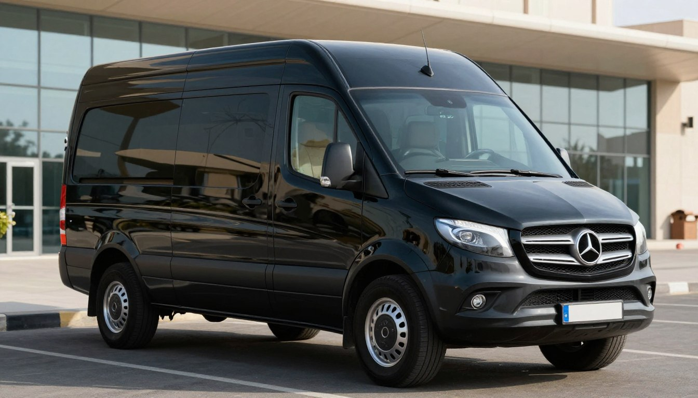
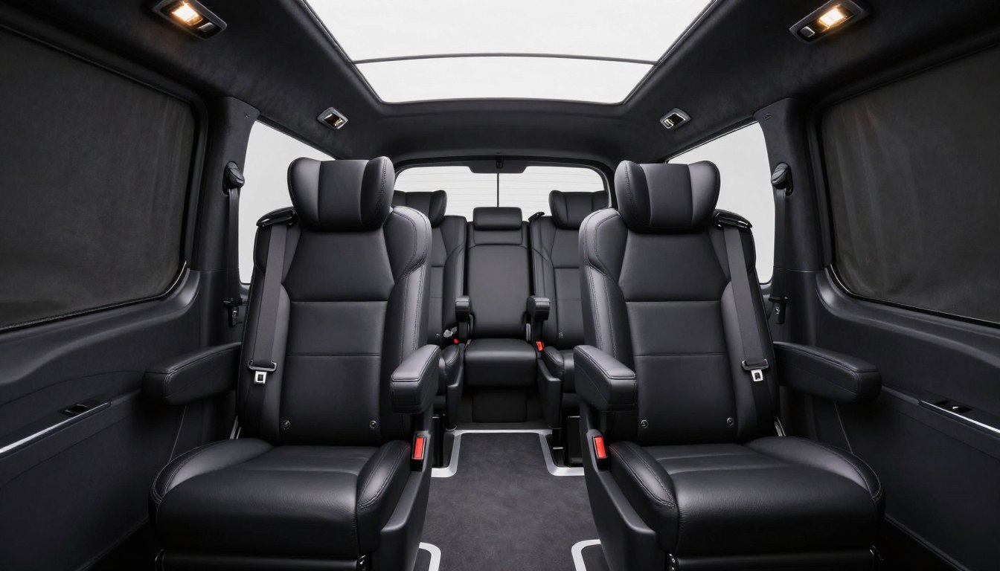

# **Executive Van and Group Transport with Driver**

Book an executive van with a driver for airport transfers, event transportation, business travel and group trips across the Gulf. Options include a Mercedes Sprinter with driver or a comparable vehicle, subject to availability. AB arranges chauffeur service for teams, private groups and VIP guests, with professional drivers for airport, hotel and venue transfers. Share your dates, route, passenger numbers, seating needs and luggage details when booking; we will confirm the suitable vehicle and provide a quote. A sprinter chauffeur can support city tours, business meetings or a full-day itinerary. Choose a comfortable vehicle with a spacious interior and comfortable seating for a relaxed ride.

[Book this class](https://seowriting.ai/quote/book) [Request a quote](https://seowriting.ai/quote/book)

- **Guests:** Up to 14, depending on vehicle configuration
- **Luggage:** Up to 10 standard bags; confirm capacity when booking
- **Typical model:** Mercedes Sprinter or similar
- **Ideal for:** Event shuttles and offsites

Inside

## **Comfort and Seating Across Executive Vehicles**

Cabin layouts vary by vehicle and configuration. An executive van or minibus may offer elevated roof clearance, generous legroom and comfortable seating for group travel. Confirm passenger and luggage capacity when booking, as the space available for bags depends on the number of seats in use. Wide sliding doors and a clear aisle help passengers board and leave efficiently between event stops.

For a Mercedes Sprinter, features such as leather seating, acoustic glass, climate control, armrests and storage depend on the model and specification. Ask your chauffeur service which features are included in the vehicle assigned to your journey. A professional chauffeur and a well-prepared cabin support a comfortable ride for passengers, whether a team is travelling between business hubs or heading to an event. The right seating layout helps make the overall transportation experience more comfortable for every passenger.

A spacious interior gives passengers room to board and settle in. During city transfers and airport journeys, check the seating plan and luggage allowance with your driver in advance to help ensure the vehicle suits your group.

Onboard

## **Onboard Features Across Executive Vehicles**

AB prepares vehicles before dispatch for business journeys, team travel and event transportation. Available onboard features vary by vehicle and seating configuration, so confirm the details with the chauffeur service when booking. A professional chauffeur helps passengers settle in and supports a smooth journey between destinations.

### **Bottled Water for Passengers, Subject to Vehicle and Service Arrangement**

Where provided, bottled water is placed in the cabin before departure. Ask about refreshments when arranging your service, particularly for a full day of transfers or scheduled shuttle journeys.

### **Device Charging Options, Depending on Vehicle Specification**

Some vehicles have USB or other charging ports for passengers' phones and tablets. Check the port types and availability before travel, and bring a suitable charging cable for your device.

### **Onboard Wi-Fi Availability for Business Travel**

Wi-Fi is not available in every vehicle, and signal strength depends on network coverage along the route. Confirm availability in advance if passengers need internet access for business tasks or team communication.

### **Lighting and Climate Controls According to Seating Configuration**

Personal reading lights and individual air vents vary by vehicle. Ask your driver or booking contact which controls are available at each seat, especially when arranging transportation for passengers with different comfort needs.

Applications

## **When to Choose an Executive Van or Minibus**

An executive van or minibus suits groups who need to travel together but do not require a large coach. Choose the vehicle according to passenger numbers, seating, luggage, route, schedule and budget. A chauffeur service can arrange a single transfer or transportation throughout the day.

### **Event Shuttles Between Hotels, Venues and Dinner Locations**

Event organisers use group transport to connect hotels, exhibition venues and private dining locations. For busy events, planned vehicle rotations help passengers follow departure times and reach each stop. Confirm access and pick-up points with your event transportation provider.

### **Corporate Retreats, Offsites and Business Meetings**

A van gives a business team the chance to travel together between offices and regional venues. Select a vehicle with suitable seating and luggage space for the group's itinerary. A Mercedes Sprinter or another suitable option with a professional chauffeur supports transfers for business meetings and full-day programmes.

### **Delegations and VIP Guest Transfers**

For official delegations and VIP guests, confirm passenger capacity, equipment and luggage requirements before booking. A professional driver and experienced chauffeur help coordinate pick-ups and travel between locations. Vehicle choice, including a Sprinter or minibus, depends on the group size and route.

Services

## **Group Ground Transportation Services**

AB arranges group transportation in Saudi Arabia, the UAE and Qatar, with vehicle options selected according to passenger numbers, seating, luggage and route requirements. Services include event transport, business travel and airport transfers. Dispatch teams coordinate bookings, share route updates and communicate with the chauffeur. Ask about availability, operating hours and vehicle tracking when arranging your transfer.

- **Event Transportation:** Organisers use AB for [corporate event transportation](https://seowriting.ai/services/event-transportation/uae), coordinating speaker, sponsor and delegate movements between venues. A chauffeur service helps event teams plan group transfers for busy events.
- **Corporate Transportation:** Companies arrange [staff transportation Riyadh](https://seowriting.ai/services/corporate-transportation/saudi-arabia/riyadh) routes and business meeting transfers. Corporate account and monthly invoice options are available; confirm terms when booking. A professional chauffeur supports business and VIP travel.
- **Workforce Transportation:** AB coordinates crew transfers, airport journeys and project team travel. Choose a vehicle such as a minibus, or request [minibus rental Dubai](https://seowriting.ai/services/bus-coach-hire/uae/dubai). For larger groups, ask about a 30-seater bus in Dubai. Professional drivers support scheduled services, city tours and full-day transportation, subject to availability.

For each assignment, confirm the vehicle, driver arrangements and service details in advance. Whether booking a Mercedes Sprinter or another suitable option, share the itinerary and group requirements so the transportation plan fits the journey.

At a glance

## **Comparing Executive Vans, MPVs and Coaches**

Choose a vehicle according to passenger numbers, seating needs, luggage and route. An executive van, such as a Mercedes Sprinter, sits between a premium MPV and a coach in size. The right option for group travel depends on the specific vehicle and configuration, so confirm capacity with your chauffeur before booking.

| Fleet Class   | Typical Model                | Guests                             | Luggage                                  | Ideal Use                              |
| ------------- | ---------------------------- | ---------------------------------- | ---------------------------------------- | -------------------------------------- |
| Executive Van | Mercedes Sprinter or similar | Up to 14, subject to configuration | Up to 10 standard bags; confirm capacity | Event shuttles and offsites            |
| Premium MPV   | Confirm with booking team    | Confirm for selected vehicle       | Confirm for selected vehicle             | Smaller groups and individual journeys |
| Coach         | Confirm with booking team    | Confirm for selected vehicle       | Confirm for selected vehicle             | Larger groups and longer routes        |

An executive van offers a group transport option without booking several smaller vehicles. Confirm the available space, passenger capacity and route access with your driver before arranging transportation.

Coverage

## **Group Transportation Service Areas**

AB arranges ground transportation across Saudi Arabia, the UAE and Qatar, with service options varying by city and vehicle availability. Coverage includes Riyadh, Jeddah, Dammam, Dubai, Abu Dhabi and Doha. Ask whether a Mercedes Sprinter or another suitable vehicle is available for your journey. Bahrain, Kuwait and Oman requests are handled through regional partners. Confirm the route, passenger numbers and airport or other pick-up details when booking, particularly for cross-border travel.

AB lists operations offices in these locations. Contact the team to confirm local services, chauffeur arrangements and availability for your travel day:

- **AB Riyadh (Headquarters and 24/7 Dispatch):** Building 3036, Office 08, 2nd Floor, Umar Ibn Abdulaziz Road, Al Malaz, Riyadh, Saudi Arabia.
- **AB Dubai:** Suite 206, DBC Building, Al Khabaisi, Deira, Dubai, UAE.
- **AB Abu Dhabi:** Office 03, Mezzanine Floor, Building C57, Abu Dhabi, UAE.
- **AB Doha:** Office 110, Building 100, Zone 26, Street 310, Old Airport Road, Doha, Qatar.

+966 58 111 8720

Questions

## **Frequently Asked Questions About Group Transport and Chauffeur Services**

### **How many passengers and how much luggage can an executive van carry?**

Capacity depends on the vehicle and seating configuration. Some Mercedes Sprinter options accommodate up to 14 passengers and 10 standard bags, but confirm the available seating and luggage space when booking. Tell the team about extra equipment so they can recommend a suitable vehicle for your group travel.

### **Does executive van hire include a chauffeur?**

Chauffeur arrangements are confirmed with your booking. Ask whether a professional chauffeur is included, and confirm the service area, schedule and vehicle details. AB coordinates driver assignments and duty requirements for its transportation services. Share any requirements for business meetings or VIP guests in advance.

### **How are airport transfers arranged for groups?**

Provide flight details, passenger numbers and luggage information when requesting airport transfers. Confirm whether flight monitoring and an arrivals-hall meet and greet are included for your airport. The driver and pick-up instructions are arranged according to the confirmed service. Allow time for baggage collection before the group leaves the terminal.

### **Can I arrange event shuttle routes across multiple cities?**

Event organisers can request transport between hotels, venues and dining locations. Share the itinerary, timings and passenger numbers so the team can plan suitable transfers. Availability, dispatch hours and real-time route updates depend on the service booked. Ask about event transportation across the cities on your trip.

### **What safety checks apply to the vehicles and professional drivers?**

Ask AB which inspections, safety equipment and driver checks apply to your selected vehicle. Confirm seatbelt availability and any requirements for a longer journey. A sprinter chauffeur or minibus driver follows the service arrangements agreed for the booking. Vehicle specifications and safety procedures can vary across the fleet.

### **Can corporate clients arrange monthly invoicing?**

Corporate accounts and consolidated monthly invoices are subject to AB's terms. Ask the team about account eligibility, itemised transfer details and reporting before scheduling regular services. Businesses can discuss recurring transportation for staff, airport journeys and full-day bookings with an account representative.

### **Where are group chauffeur services available?**

AB lists services across Saudi Arabia, the UAE and Qatar. Bahrain, Kuwait and Oman requests are handled through regional partners. Confirm availability for your destination, vehicle and route, including cross-border travel. A Mercedes Sprinter, minibus or other option depends on local fleet availability.

### **How do I book a van with driver?**

Submit your dates, route, passenger count, luggage needs and flight details through the booking portal. AB will confirm vehicle availability, service inclusions and the quotation. Before travel, check the pick-up plan and driver contact details. For comfortable seating or a spacious interior, state your preferences when requesting a vehicle for the day.

## **Plan Group Transportation with a Chauffeur**

Arrange transportation for a corporate delegation, conference shuttle or team journey with AB's group transport services. Share your passenger numbers, route, schedule and luggage requirements so the team can recommend a suitable vehicle and confirm the chauffeur service. Use the booking form to outline your plans, check availability and request a proposal for your journey across the Gulf.

[Book this class](https://seowriting.ai/quote/book) [Request a proposal](https://seowriting.ai/quote/book)