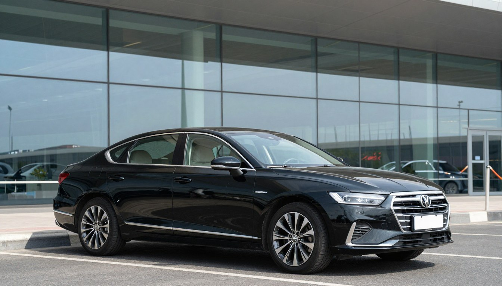
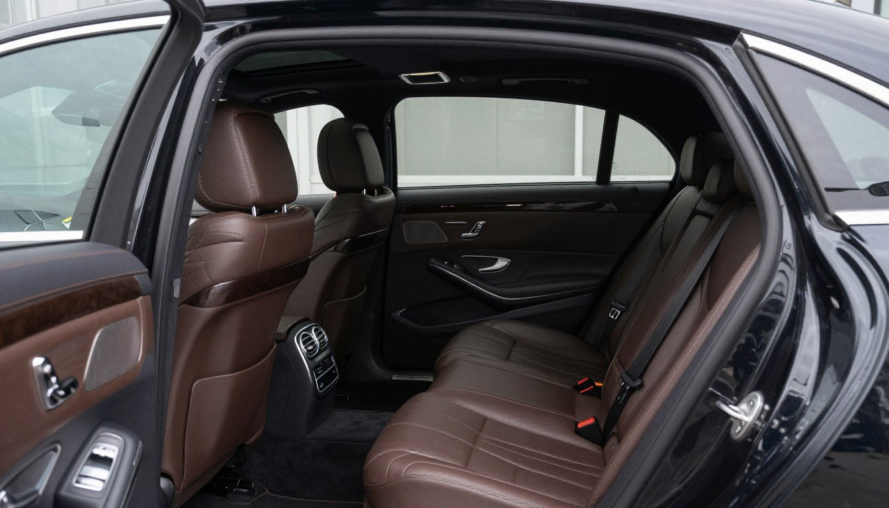

# **Standard Sedan with Driver**

A standard sedan with driver provides dependable ground transportation across Saudi Arabia, the UAE and Qatar for individual executive itineraries. AB coordinates point to point city transfers and airport connections with professional chauffeurs and central dispatch support.

Quiet, spotless and always on time, this vehicle class offers the sensible choice for airport runs and everyday meetings. Schedule requirements, passenger numbers and luggage volume determine when this efficient category fits corporate travel programmes.

[Book this class](https://seowriting.ai/quote/book) [Request a quote](https://seowriting.ai/quote/book)

- Guests: 3
- Luggage: 2
- Typical model: Lexus ES or similar
- Ideal for: Airport runs and city meetings

Inside

## **Executive Interior Comfort in a Sedan with Driver**

The rear seats in this class provide supportive seating tailored for working professionals moving between business appointments. Generous legroom permits passengers to open laptops comfortably or review briefing notes during transit. Acoustic glass keeps exterior traffic noise away from the cabin, establishing a serene workspace. Plush upholstery and independent climate vents maintain passenger comfort in high summer temperatures across the Gulf region. Every vehicle undergoes rigorous interior cleaning before each assignment.

Corporate travellers appreciate an uncluttered environment that supports continuous focus during demanding travel schedules. The rear seats offer physical comfort alongside practical workspace features that make travel time productive. Smooth suspension tuning cushions rough road textures across urban motorways and secondary streets.

The rear cabin provides an organised workspace with supportive seating.

Onboard

## **Standard Onboard Inclusions and Cabin Features**

Every journey in an AB sedan includes dedicated amenities selected to support personal comfort and operational efficiency. Travellers receive essential mobile accessories and climate adjustments suited to regional conditions.

### **Chilled Bottled Water**

Complimentary bottled water is stocked in the rear compartment for passenger refreshment during journeys.

### **Mobile Device Chargers**

Multi format charging cables keep mobile phones and electronic devices powered throughout the trip.

### **Onboard Wi Fi**

High speed wireless internet connectivity allows uninterrupted communication and mobile working between meetings.

### **Climate Control**

Individual climate vents enable rear passengers to select comfortable temperatures in warm regional weather.

Vehicle presentation remains uniform across all operating territories. Chauffeurs inspect onboard provisions before each assignment begins to confirm that connectivity accessories and refreshments are readily accessible.

Suitability

## **Selecting a Sedan with Driver for Corporate Schedules**

Choosing a sedan with driver gives corporate travel planners an economical, dignified vehicle tier for daily executive movements. This class balances low carbon footprint and practical size with complete executive privacy.

### **Executive Airport Runs**

Corporate travellers arriving on domestic or international flights receive prompt curbside pickup or terminal greetings. Efficient luggage capacity accommodates standard flight bags with ease.

### **City Business Meetings**

Business executives visiting multiple commercial offices in a single day maintain productivity while their chauffeur manages parking, traffic navigation and tight schedules.

### **Partner and Client Itineraries**

Visiting consultants and professional partners secure quiet transport across central business districts. Spotless presentation aligns with high diplomatic and institutional protocol requirements.

Ground operations remain agile when deploying this vehicle category. It navigates crowded financial district parking garages and hotel drop off lanes without the spatial constraints of larger passenger vans.

Services

## **Managed Services Powered by the Standard Fleet**

AB deploys the standard chauffeur car across diverse ground operations throughout Saudi Arabia, the UAE and Qatar. Our central operations team coordinates every booking with live GPS tracking and proactive flight monitoring.

- Airport Transfers: Flight tracked arrivals and punctual airport departures featuring terminal meet and greet services.
- Chauffeur & VIP: Dedicated hourly hire and daily itineraries for corporate officers requiring continuous ground mobility.
- Intercity Transfers: Scheduled city to city transit between regional economic centres with fixed business billing.

Corporate organisers managing multi vehicle movements can inspect the wider [fleet](https://seowriting.ai/fleet) selection to combine standard saloons with larger executive people movers. Each itinerary receives oversight from the central dispatch office to maintain punctual execution.

At a glance

## **Comparing Standard and Business Sedan Categories**

Evaluating standard and business categories assists corporate transport buyers in matching vehicle capabilities with executive seniority and event profile. Both options provide spotless presentation and professional chauffeurs.

| Feature       | Standard Sedan | Business Sedan                    | Operational Suitability                         |
| ------------- | -------------- | --------------------------------- | ----------------------------------------------- |
| Typical model | Lexus ES       | \[Confirm: Business Sedan value\] | Quiet reliable performance in daily service     |
| Guests        | 3 Guests       | \[Confirm: Business Sedan value\] | Best suited for individual executives or pairs  |
| Luggage       | 2 Bags         | \[Confirm: Business Sedan value\] | Generous capacity for standard flight cases     |
| Ideal for     | City transfers | \[Confirm: Business Sedan value\] | Sensible choice for everyday business logistics |

While the business category introduces alternative executive models, the standard tier remains the most popular choice for recurring corporate transfers. It delivers premium refinement alongside predictable budgetary control for enterprise clients.

Coverage

## **Regional Coverage Across the GCC**

The standard fleet operates across major metropolitan centres including Riyadh, Jeddah, Dammam, Dubai, Abu Dhabi and Doha \[Confirm: cities where this class is stationed\]. AB is headquartered in Riyadh, maintains regional offices in Dubai, Abu Dhabi and Doha, and provides 24/7 dispatch from the Riyadh operations centre.

Clients booking a [private driver Riyadh](https://seowriting.ai/locations/saudi-arabia/riyadh) receive punctual service coordinated through our central headquarters. Organisations operating in the Emirates can reserve a [private driver Dubai](https://seowriting.ai/locations/uae/dubai) with identical billing procedures and operational standards. For projects in Qatar, enterprises can arrange to [rent a car with driver in Qatar](https://seowriting.ai/locations/qatar) through our local Doha office.

Direct services cover Saudi Arabia, all seven UAE emirates and Qatar. Operations in Bahrain, Kuwait and Oman are available upon request through vetted regional partners.

Questions

## **Frequently Asked Questions About Reserving a Sedan with Driver**

### **What specific vehicle model is provided when booking a sedan with driver?**

The standard category features a Lexus ES with driver or an equivalent executive vehicle of similar specification. Models are selected for mechanical reliability, passenger safety ratings and acoustic insulation in the cabin.

Vehicles feature neutral exterior colours, predominantly black, with immaculate interiors free from commercial decals. While specific model assignments depend on local availability, the operational standards and cabin comforts remain consistent across all operating cities.

### **How does flight tracking function for an airport car with driver?**

Every airport car with driver booking includes automated flight tracking managed by our 24/7 dispatch office. Operations staff monitor commercial flight numbers to adjust chauffeur staging times for early arrivals or flight delays.

The chauffeur enters the arrival terminal once the aircraft completes taxiing, holding a discreet digital greeting board. This continuous flight tracking eliminates waiting confusion and protects corporate clients against unnecessary waiting fees.

### **What passenger and luggage capacity does a chauffeur driven sedan accommodate?**

A chauffeur driven sedan accommodates up to 3 guests and 2 standard pieces of check in luggage. The boot volume is designed to hold standard rolling suitcases alongside passenger briefcases or laptop carriers.

If three adult passengers travel together, two occupy the rear seats while the third occupies the front passenger seat. For delegations travelling with oversize demonstration equipment or additional luggage, our dispatch team recommends booking an executive van.

### **How are professional drivers vetted and trained across the regional fleet?**

Every professional chauffeur employed by AB undergoes thorough background verification, defensive driving assessments and local route evaluations. Chauffeurs hold commercial driving licences compliant with regional transport authorities across Saudi Arabia, the UAE and Qatar.

Training programmes focus on executive discretion, protocol etiquette and passenger comfort. Drivers maintain professional appearance in dark business suits and demonstrate thorough familiarity with corporate districts and diplomatic premises.

### **Can corporate accounts access consolidated monthly invoicing for sedan services?**

Enterprise clients and corporate travel desks can establish centralised corporate accounts that streamline billing across multiple Gulf cities. Consolidated monthly invoice billing removes the requirement for chauffeurs to collect individual card payments from business passengers.

Account managers receive itemised digital statements listing journey dates, passenger names, cost centres and dispatch references. This reporting simplifies expenditure auditing and strengthens corporate travel policy compliance.

### **What amenities are confirmed inside a sedan with driver during transit?**

Passengers reserving a sedan with driver receive complimentary bottled mineral water, tissue packs and multi port mobile phone chargers. Vehicles feature functioning air conditioning calibrated for extreme Gulf summer conditions.

Onboard Wi Fi connectivity is available across our fleet to support uninterrupted mobile business communications. Chauffeurs ensure that charging cables and cabin accessories are prepared before greeting passengers.

### **How does the 24/7 dispatch centre support daily vehicle movements?**

Our central operations headquarters in Riyadh provides continuous 24/7 dispatch monitoring across all regional transport assignments. Dispatch controllers monitor vehicle progression in real time using satellite GPS tracking technology.

If unpredicted road closures or severe traffic congestion develop, controllers guide drivers onto alternate routes to preserve arrival schedules. Travel managers retain direct communication channels with dispatch supervisors for itinerary adjustments at any hour.

### **Is cross border transit between GCC countries supported in this class?**

Cross border transport between Saudi Arabia, Bahrain, Qatar and the UAE is coordinated on request through vetted partner protocols. Standard city bookings operate within their designated metropolitan zones and intercity domestic corridors.

Because regional customs and vehicle entry regulations require dedicated permits, international road transfers require advance coordination with our booking office. Dispatch coordinators review documentation requirements to ensure seamless border crossings.

## **Need a Sedan with Driver or a Larger Fleet Movement?**

AB coordinates individual transfers and complex multi city transportation programmes with dedicated chauffeur support across the Middle East. Reserve your vehicle online or request an enterprise proposal for scheduled corporate travel.

### **Corporate Ground Logistics Across Saudi Arabia, the UAE and Qatar**

Contact our central operations team to organise executive transfers or establish a corporate account with consolidated monthly billing.

[Request a proposal](https://seowriting.ai/quote/book) [Book this class](https://seowriting.ai/quote/book)