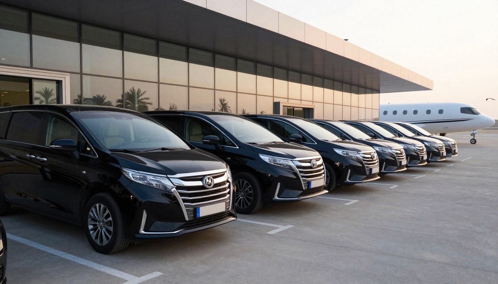

# **Reliable Crew Transportation for Aviation and FBO Networks**

Aviation logistics requires exact synchronisation between flight schedules and tarmac turnarounds. AB delivers managed crew transportation across Saudi Arabia, the UAE and Qatar for international airlines, crew planners, FBOs, private jet operators and ground handlers. Our 24/7 operations centre in Riyadh coordinates regional dispatches to keep flight personnel rested, compliant and on schedule.

[Request a proposal](https://seowriting.ai/corporate-accounts) [Talk to a planner](https://seowriting.ai/corporate-accounts)

\[Confirm: years in the sector\] operating across regional aviation corridors

\[Confirm: programmes run\] successful crew rotations and private flight movements

\[Confirm: cities covered\] primary air hubs across Saudi Arabia, the UAE and Qatar

The challenge

## **Operational Pressures in Aviation Ground Mobility**

Coordinating ground movements for commercial flight decks and private charters leaves no room for administrative delays. Planners manage rigid rest protocols while dealing with unpredictable airspace congestion across regional sectors. Ground handlers require dependable transport partners who adapt when timetables shift unexpectedly.

### **Crew Rest Rules and Duty Time Limits**

Civil aviation authorities mandate strict rest windows between operational sectors. Chauffeur delays directly consume legal rest periods, risking unexpected duty violations and aircraft groundings. Coordinated hotel to airport transfers protect mandatory rest breaks through planned routes and timely staging.

### **Irregular Operations, Delays and Diversions**

Weather diversions, technical holds and slot renegotiations disrupt planned transfers across airline rosters. Ground networks must deploy backup capacity immediately when flights divert to alternate bases. Central dispatch teams adjust pickup schedules in response to live flight tracking alerts.

### **Airside and Private Terminal Access**

Navigating dedicated FBO facilities, general aviation gates and restricted commercial aprons requires specific security credentials. Chauffeurs lacking proper gate clearances cause passenger frustration and boarding holdups. Professional operations clear access protocols before vehicles arrive at terminal perimeters.

### **Daily Rosters Across Several Airports**

Operating simultaneous flight rotations across several hubs introduces acute logistics complexity for regional transport managers. Crew movements demand unified scheduling across multiple cities without miscommunication. Unified billing and real time visibility ease the administrative burden for busy operations teams.

How we run it

## **A Disciplined Operating Model for Aviation Movements**

AB applies a systematic framework designed around airline crew transport Dubai hubs and broader Gulf commercial networks. Our centralized dispatch protocols align every transfer with live aircraft positions to protect on time performance. Every movement follows four distinct stages from preliminary roster ingestion to post flight reporting.

### **Brief**

Our aviation team reviews flight rotations, passenger manifests, hotel contracts and specific handling preferences. We assign a dedicated account manager to establish communications protocols, preferred vehicle categories, passenger quotas and terminal access procedures across all participating airports.

### **Plan**

Operations planners map out transit corridors between crew accommodation and departure gates, allowing for regional traffic fluctuations. We reserve primary vehicles and standby units while integrating airline scheduling software feeds directly into our central dispatch platform.

### **Operate**

The Riyadh 24/7 operations centre tracks inbound aircraft sectors in real time and updates vehicle staging windows automatically. Chauffeurs arrive ahead of schedule, verify passenger identity discreetly, assist with flight luggage and deliver personnel smoothly to their departure terminal.

### **Report**

Following completed rotations, we deliver transparent analytics covering pickup timings, route milestones and overall punctuality metrics. Consolidated invoicing matches individual flight legs with agreed purchase orders, simplifying audit reconciliations for airline commercial offices.

Services

## **Connected Ground Services for Aviation Partners**

Aviation logistics demands versatile transport categories tailored to varying crew volumes and executive passenger profiles. AB links specialist ground capabilities through managed corporate frameworks across Saudi Arabia and the Emirates.

[Airport Transfers](https://seowriting.ai/services/airport-transfers) provides punctual terminal movements for flight operations using dedicated [luxury airport transfer](https://seowriting.ai/services/airport-transfers/uae) vehicles for flight commanders.

[Bus & Coach Hire](https://seowriting.ai/services/bus-coach-hire) moves complete cabin groups efficiently between layover accommodation and international gates on shared sector rotations.

[Chauffeur & VIP](https://seowriting.ai/services/chauffeur-vip) delivers discrete transit for private aviators, including tailored [airport chauffeur service](https://seowriting.ai/services/airport-transfers/uae) solutions for VIP terminal arrivals.

[Corporate Accounts](https://seowriting.ai/corporate-accounts) centralises multi city billing, custom duty of care reporting and dedicated booking tools for airline logistics coordinators.

Arranging an [airport chauffeur service Dubai](https://seowriting.ai/airports/dubai-international-dxb) booking maintains punctual transfers between terminal facilities and regional hospitality properties.

Booking an [Abu Dhabi airport chauffeur service](https://seowriting.ai/airports/zayed-international-auh) transfer provides smooth transit for personnel arriving at modern capital flight facilities.

Fleet

## **Purpose Built Fleet for Aviation and FBO Logistics**

Selecting suitable vehicles preserves passenger comfort during layovers and accommodates uniform standards for commercial crews. AB operates modern executive models fitted with advanced safety features and ample luggage space across the Gulf region. Browse our complete [fleet](https://seowriting.ai/fleet) options to review interior dimensions and passenger configurations.

### **Premium MPV**

Mercedes V Class or similar \[Confirm\]. Exceptional comfort and generous cargo capacity make this vehicle ideal for flight deck duos and cabin crew baggage during extended regional rotations.

### **Executive Van**

Mercedes Sprinter or similar \[Confirm\]. The preferred choice for complete cabin teams, offering standing headroom, individual reclining seats and climate control engineered for desert conditions.

### **Business Sedan**

Mercedes E Class or similar \[Confirm\]. A refined transport solution for relief captains, technical inspectors, maintenance engineers and airline ground executives travelling between hub offices.

### **First Class Sedan**

Mercedes S Class or similar \[Confirm\]. Discreet, quiet travel suited to private aviation principals, aircraft owners, executive flight charter guests and high profile commercial aviation leaders.

Coverage

## **Comprehensive Aviation Hub Coverage Across the Gulf**

AB provides coordinated ground transport across major aviation gateways in Saudi Arabia, the UAE and Qatar. Our chauffeurs serve King Khalid International Airport (RUH) in Riyadh, King Abdulaziz International Airport (JED) in Jeddah, and King Fahd International Airport (DMM) in Dammam. Direct support extends across the Emirates via [Dubai International (DXB)](https://seowriting.ai/airports/dubai-international-dxb), Dubai World Central (DWC), and Zayed International Airport ([AUH](https://seowriting.ai/airports/zayed-international-auh)) in Abu Dhabi, alongside Hamad International Airport (DOH) in Doha.

Proof

## **Documented Performance in Aviation Ground Mobility**

Published only with client approval.

### **\[Confirm: approved client or event type\]**

\[Industry\] · \[City\]

\[Scale\] · \[One measurable result\]

[Read the case study](https://seowriting.ai/case-studies)

### **\[Confirm: approved client or event type\]**

\[Industry\] · \[City\]

\[Scale\] · \[One measurable result\]

[Read the case study](https://seowriting.ai/case-studies)

Standards

## **Rigorous Aviation Compliance and Chauffeur Standards**

Maintaining regulatory compliance remains central to every managed ground programme. Operating near active airfields demands strict adherence to local transport authority rules, airport security procedures and duty of care frameworks. AB applies continuous flight tracking and proactive vehicle monitoring to protect passenger well being and preserve on time performance.

Licensed chauffeurs holding verified police clearances, airport safety accreditations and professional defensive driving certifications.

Real time GPS tracking and telematics monitored continuously by the 24/7 operations centre in Riyadh.

Dedicated standby vehicles positioned across key hub radii to mitigate schedule disruption during peak traffic windows.

Sector specific requirement \[Confirm: airport security permits and ramp clearance documentation\].

Questions

## **Frequently Asked Questions About Crew Transportation**

### **How does AB coordinate crew transportation during unexpected flight delays?**

Our 24/7 operations centre in Riyadh monitors live aviation radar and scheduling feeds to identify timetable adjustments automatically. Chauffeurs adjust their staging windows without requiring manual intervention from airline planners. Dedicated backup vehicles remain on standby near primary terminals to assist when arrival slots shift unexpectedly.

### **What options are available for crew transportation Dubai airline rotations?**

We deploy high capacity Executive Vans for complete cabin crews and Premium MPVs for flight deck officers operating across Dubai International and Dubai World Central. Operations teams manage daily layover routes between regional hotels and private airport facilities. Transparent reporting and centralised dispatch maintain regular communication throughout the layover cycle.

### **How are crew transportation solutions Dubai programmes tailored for international airlines?**

International airlines receive dedicated account oversight with custom passenger manifests integrated directly into our central dispatch system. Transport plans adapt to complex crew rosters, layover arrangements and sudden aircraft swaps across regional terminals. Consolidated monthly invoicing simplifies accounting audits for international commercial aviation offices.

### **Can AB support airport crew transportation UAE schedules across multiple emirates?**

Yes, AB coordinates multi airport crew logistics across all seven UAE emirates directly through our local operations offices. We facilitate smooth inter terminal transfers between Dubai, Sharjah and Abu Dhabi when flight crews reposition between bases. Real time telematics give airline coordinators complete oversight over every transit leg.

### **What services are offered for crew transportation Abu Dhabi operations?**

Our Abu Dhabi branch coordinates terminal transfers at Zayed International Airport for commercial airlines, executive charter operators and government flight delegations. We provide executive sedans, spacious MPVs and luxury coaches maintained to exacting safety standards. Chauffeurs understand local terminal access gates and protocol requirements thoroughly.

### **How does AB deliver FBO ground transportation for private aviation terminals?**

AB coordinates transfers directly with general aviation handling agents and FBO lounges across Saudi Arabia, the UAE and Qatar. Our team coordinates airside drop offs and discreet passenger pickups according to specific flight arrival coordinates. Clean executive vehicles stand ready as soon as the aircraft taxi cycle completes.

### **Can private flight operators book a private jet chauffeur for flight deck crew?**

Yes, business aviation operators frequently book our executive sedans and premium MPVs for dedicated pilot and flight deck movements. Chauffeurs maintain flexible standby schedules to accommodate shifting departure slots and handling delays without stress. Direct communication with handling staff facilitates prompt terminal departures upon landing.

## **Arranging Coordinated Crew Transportation**

Reliable crew transportation protects mandatory rest windows and keeps scheduled flight operations moving smoothly across primary aviation hubs in Saudi Arabia, the UAE and Qatar.

[Request a proposal](https://seowriting.ai/corporate-accounts) [Book a transfer](https://seowriting.ai/services/airport-transfers)