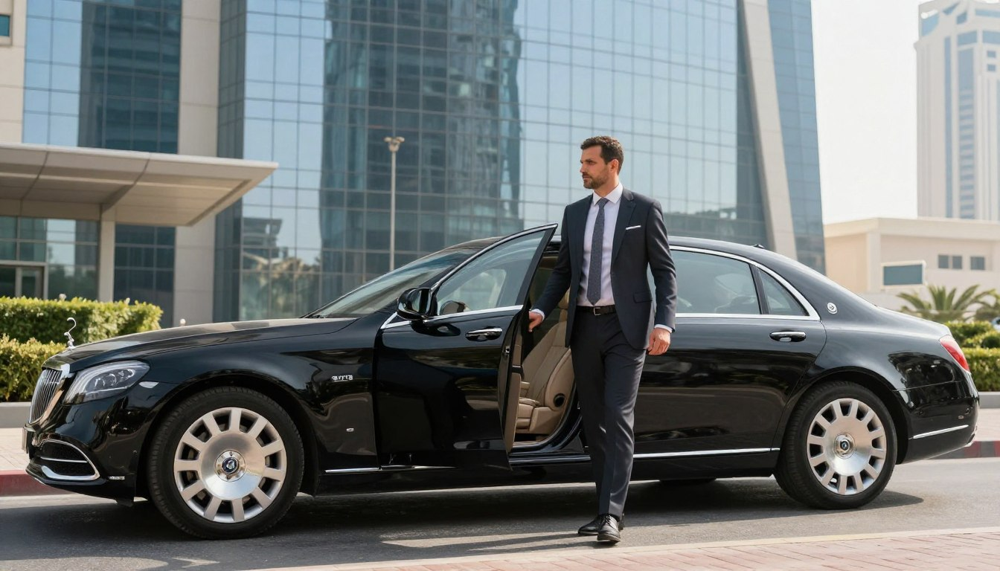
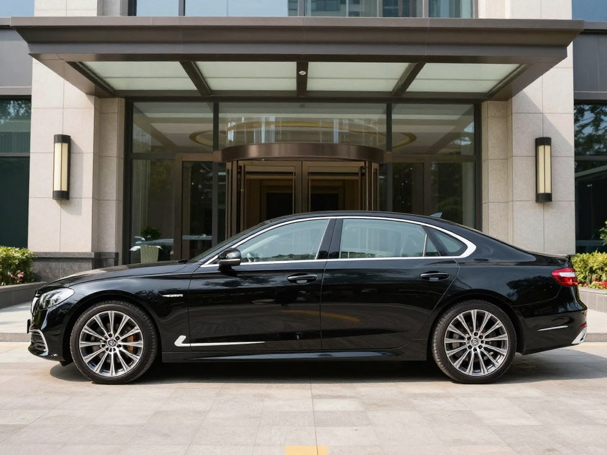
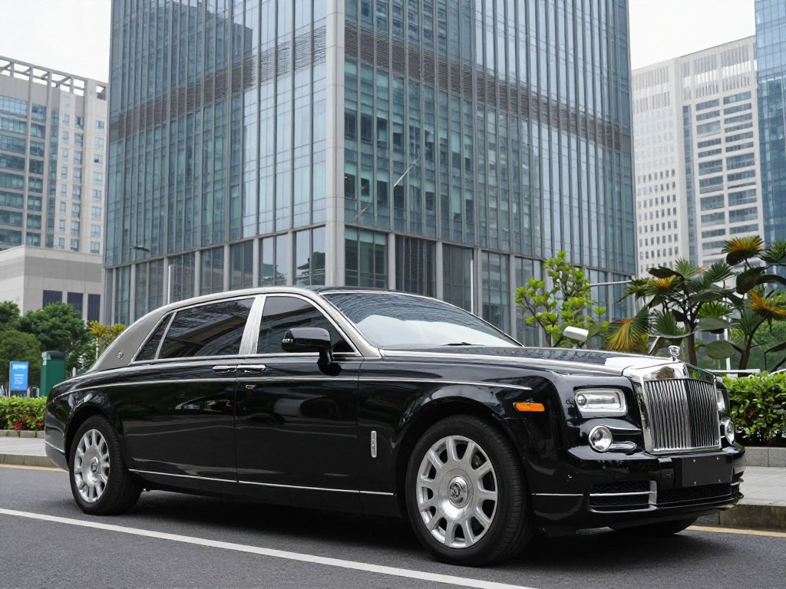
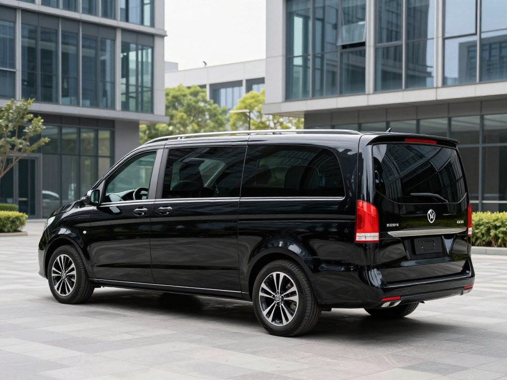

# **Managed Corporate Ground Transportation for Enterprise**

Reliable corporate ground transportation provides enterprise organisations with dependable travel coordination for executive movements, cross border itineraries and daily staff transfers. AB supports multinational companies, executive assistants, travel managers and procurement teams with centralized operations across Saudi Arabia, the UAE and Qatar. Our managed transport framework aligns dispatch, duty of care compliance and consolidated account billing under a single service contract.

Modern enterprise mobility demands punctuality, professional conduct and rigorous cost administration across every operating territory. Organisations select AB to eliminate service fragmentation, replace disparate taxi providers and gain real time visibility over regional business travel.

[Request a proposal](https://seowriting.ai/corporate-accounts) [Talk to a planner](https://seowriting.ai/services/corporate-transportation)

**\[Confirm: years in sector\]** Enterprise Experience

**\[Confirm: programmes run\]** Corporate Programmes Managed

**\[Confirm: cities covered\]** Cities Across the GCC

The challenge

## **Addressing Corporate Ground Transportation Obstacles**

Corporate travel managers and procurement leads frequently encounter operational friction when coordinating transport across multiple regional territories. Managing multiple local providers leads to unpredictable service quality, administrative overhead and poor duty of care visibility. AB resolves these systematic challenges with structured fleet governance and transparent digital oversight.

### **Many suppliers and invoices across cities**

Working with disconnected transport suppliers across Riyadh, Dubai and Doha generates paperwork friction. Procurement teams face separate accounting cycles, varying billing currencies and inconsistent payment terms that obscure total travel spend.

### **Inconsistent service for executives**

Unmanaged ride hailing services and unverified car services create unpredictable arrival timings and variable driver standards. Senior directors and visiting board members require discreet chauffeurs, immaculate vehicles and punctual routing without exception.

### **Staff routes that change every week**

Dynamic project rosters and changing office attendance schedules disrupt static shuttle contracts. Mobility teams need flexible fleet allocation that adjusts vehicle capacity and pick up schedules as workforce requirements shift.

### **No reporting for cost control**

Decentralised bookings leave travel managers without passenger verification or trip audits. Without granular reporting by department and cost centre, enterprise leadership cannot identify itinerary inefficiencies or control expenditure.

How we run it

## **Delivering Managed Corporate Ground Transportation**

AB operates a centralized service model designed specifically for enterprise travel programmes across the Middle East. Through our 24/7 operations centre in Riyadh, dedicated account managers coordinate dispatch, track journey status and audit vehicle compliance. We standardise service delivery across all direct markets to maintain consistent standards.

### **Brief**

Our enterprise team reviews your corporate travel patterns, executive preferences and compliance protocols. We establish custom service level agreement parameters, vehicle class allocations and cost centre structures suited to your organisation.

### **Plan**

Transport planners build optimised route matrices, coordinate flight monitoring for airport transfers and assign dedicated account specialists. Schedules are integrated directly with executive assistant workflows to streamline advance bookings.

### **Operate**

Our 24/7 operations centre monitors movements in real time using onboard GPS tracking. Chauffeurs arrive ahead of schedule, observe regional protocol and maintain vehicle presentation across every itinerary.

### **Report**

Finance teams receive a consolidated monthly invoice detailing trip logs, passenger names and assigned internal cost centres. Custom analytics reports help procurement leads evaluate usage trends and optimize transport spend.

Services

## **Comprehensive Mobility Services for Corporate Programmes**

Enterprise requirements encompass varied journey profiles ranging from recurring airport runs to executive board summits. Organisations access specialised [corporate chauffeur hire](https://seowriting.ai/services/corporate-transportation/uae) for local operations, alongside scalable solutions for business chauffeur hire and employee transportation service. AB unifies these capabilities into structured corporate transportation services UAE and regional frameworks.

- [Corporate Transportation](https://seowriting.ai/services/corporate-transportation) provides comprehensive executive travel transportation, scheduled shuttle programmes and regional project team transit.
- [Chauffeur & VIP](https://seowriting.ai/services/chauffeur-vip) delivers elite executive transportation services tailored for corporate leaders, board delegations and official protocol guests.
- [Airport Transfers](https://seowriting.ai/services/airport-transfers) features flight tracking, terminal meet and greet coordination, and uninterrupted transfer routing between commercial terminals.
- [Corporate Accounts](https://seowriting.ai/corporate-accounts) manages centralized invoicing, consolidated payment terms and assigned account specialists for regional organisations.

Fleet

## **Executive Fleet for Corporate and Enterprise Operations**

AB maintains an audited fleet of premium vehicles equipped for executive comfort, corporate productivity and mobile connectivity. Every vehicle undergoes stringent technical inspections, carries comprehensive insurance and features satellite tracking monitored by our dispatch centre. Explore our full vehicle range through our [fleet](https://seowriting.ai/fleet) directory.

### **Business Sedan**

Ideal for senior managers and daily business travel, providing quiet cabins and refined comfort. BMW 5 Series, Mercedes Benz E Class, or similar \[Confirm\].

[View Business Sedan](https://seowriting.ai/fleet)

### **First Class Sedan**

Tailored for chief executives, board directors and distinguished protocol dignitaries requiring discreet luxury. Mercedes Benz S Class, BMW 7 Series, or similar \[Confirm\].

[View First Class Sedan](https://seowriting.ai/fleet)

### **Executive SUV**

Perfect for delegation movements, roadshow transportation, site visits and passengers travelling with substantial luggage capacity. Cadillac Escalade, GMC Yukon Denali, or similar \[Confirm\].

[View Executive SUV](https://seowriting.ai/fleet)

### **Executive Van**

Suited for corporate teams, visiting event staff and coordinated airport shuttle itineraries without sacrificing luxury. Mercedes Benz V Class, or similar \[Confirm\].

[View Executive Van](https://seowriting.ai/fleet)

Coverage

## **GCC Coverage Across Primary Commercial Hubs**

AB provides direct coverage across Saudi Arabia, all seven UAE emirates and Qatar, supported by our operations headquarters in Riyadh. Clients reserve dedicated [corporate chauffeur service Riyadh](https://seowriting.ai/services/corporate-transportation/saudi-arabia/riyadh) for capital operations, alongside regular schedules across Jeddah and Dammam. For broader Gulf business itineraries, our teams deliver dependable [corporate chauffeur service Dubai](https://seowriting.ai/services/corporate-transportation/uae/dubai) and Abu Dhabi, as well as premium [corporate chauffeur service Doha](https://seowriting.ai/services/corporate-transportation/qatar/doha). Partner operations in Bahrain, Kuwait and Oman are available on request through vetted affiliates.

Proof

## **Demonstrated Results for Enterprise Clients**

Published only with client approval.

### **\[Confirm: approved client or event type\]**

**\[Industry\] · \[City\]**

\[Scale\] · \[One measurable result\]

[Read the case study](https://seowriting.ai/case-studies)

### **\[Confirm: approved client or event type\]**

**\[Industry\] · \[City\]**

\[Scale\] · \[One measurable result\]

[Read the case study](https://seowriting.ai/case-studies)

Standards

## **Operational Rigour, Duty of Care and Compliance**

AB enforces strict operational procedures to uphold corporate duty of care responsibilities across every booking. Every itinerary operates under an agreed service level agreement that defines vehicle standards, dispatch protocols and reporting timetables. Our 24/7 operations centre in Riyadh oversees driver readiness and vehicle positioning, providing central safety governance across all business movements.

- **Licensed chauffeurs:** Professionally certified drivers trained in corporate etiquette, defensive driving, route planning and passenger discretion.
- **GPS tracking:** Real time telemetry monitoring by our dispatch centre for passenger safety and precise milestone reporting.
- **Standby vehicles:** Strategic backup fleet positioned across key business districts to address sudden schedule adjustments.
- **Sector specific requirement \[Confirm\]:** Customised compliance frameworks matching corporate security standards and health protocols.

Questions

## **Frequently Asked Questions About Corporate Ground Transportation**

### **How does a corporate chauffeur account simplify multi city business travel?**

A corporate chauffeur account with AB consolidates bookings across Riyadh, Dubai and Doha into a unified enterprise framework. Travel coordinators book journeys through a central point of contact, eliminating the administrative friction of multiple supplier agreements. Billing arrives on a consolidated monthly invoice broken down by internal department, project code and booking reference, simplifying reconciliation for finance teams.

### **What executive transportation services are available for visiting board delegations?**

AB delivers dedicated executive transportation services for board meetings, investor visits and executive leadership tours. Chauffeurs operate premium first class sedans and luxury SUVs, remaining on standby throughout full day itineraries. The dispatch team coordinates airport tarmac meets, motorcades and hotel transfers with meticulous attention to passenger privacy and timing precision.

### **How does AB manage dynamic roadshow transportation across Gulf financial centres?**

Our roadshow transportation teams handle tight, multi stop itineraries across financial districts in Saudi Arabia, the UAE and Qatar. Dedicated roadshow dispatchers track market schedules, monitor regional traffic conditions and maintain continuous communication with executive assistants. Chauffeurs remain assigned to the passenger group throughout the assignment, adjusting seamlessly to impromptu meeting extensions or venue adjustments.

### **How does AB handle changing staff routes and workforce commuter requirements?**

Enterprise mobility managers can adjust staff shuttle routes, vehicle capacities and pick up schedules through their assigned account manager. AB tracks passenger volume trends and adapts daily dispatch plans to accommodate hybrid working patterns or sudden site relocations. This operational flexibility allows organisations to right size their employee transit programmes while preserving commuter reliability.

### **What duty of care measures are enforced across corporate travel transportation?**

AB enforces duty of care through strict vehicle maintenance schedules, professional background checks and real time GPS telemetry monitored by our 24/7 operations centre. Corporate travel managers receive departure and arrival notifications, with full driver identification provided in advance. These safeguards ensure full operational transparency and passenger security across all corporate travel transportation routes.

### **Can corporate ground transportation spend be segmented by cost centre and department?**

Yes, AB provides customized invoicing that maps directly to your organization internal accounting structures. Travel managers assign specific cost centre codes, purchase order numbers and employee identifiers to each booking request. Consolidated monthly statements present clean accounting breakdowns, enabling procurement leads to allocate transport expenditure accurately without manual data sorting.

### **How are airport transfers coordinated for late night or delayed commercial flights?**

AB dispatch specialists monitor commercial flight schedules in real time through direct aviation data feeds. When flight arrivals are delayed or rescheduled, pickup times adjust automatically without requiring rebooking intervention from executive assistants. Chauffeurs are staged at designated airport waiting zones, prepared to welcome arriving passengers immediately upon terminal exit.

## **Upgrade Your Corporate Ground Transportation Programme**

Partner with AB to unify executive transfers, workforce mobility and multi city roadshows under a managed regional framework backed by our 24/7 operations centre.

[Request a proposal](https://seowriting.ai/corporate-accounts) [Book a transfer](https://seowriting.ai/services/corporate-transportation)