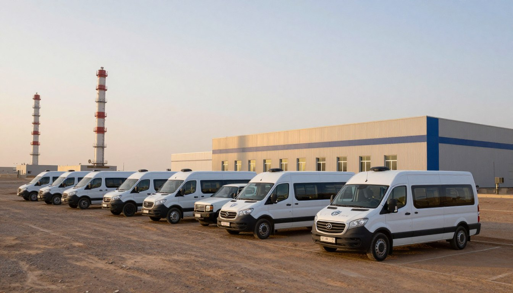

# **Managed Giga Project Transportation**

Specialised giga project transportation moves thousands of specialists, engineers and executives across expansive industrial footprints every day. Project owners, tier one contractors, multinational energy companies and site managers rely on dedicated operations to maintain continuous shift schedules across remote developments. Centralised control coordinates daily movements between regional airports, worker residential camps and active construction zones.

Choosing the correct ground mobility strategy depends on regional road conditions, client health and safety mandates, daily passenger volumes and peak turnaround windows. AB aligns vetted vehicles, professional drivers and live technology to protect schedules across major capital ventures.

[Request a proposal](https://seowriting.ai/quote/tender) [Talk to a planner](https://seowriting.ai/quote/tender)

- \[Confirm: years in the sector\] operating within energy and heavy infrastructure mobility
- \[Confirm: programmes run\] completed passenger logistics programmes across the Gulf region
- \[Confirm: cities covered\] industrial hubs and development centres supported directly

The challenge

## **Navigating Giga Project Transportation Logistics on Remote Sites**

Operating passenger movements on massive infrastructure developments presents unique operational difficulties rarely found in urban transit. Dynamic work fronts, heavy plant traffic and strict entry protocols require proactive planning. AB addresses these four key logistical pressures to keep personnel safe and active.

### **Shift changes for large teams**

Coordinating simultaneous personnel rotations demands exact staging and route planning. Staggered arrivals prevent bottleneck delays at security gates, keeping production runs fully staffed across all operational shifts.

### **Remote sites far from cities**

Long transit corridors between commercial airports, living quarters and isolated plots require disciplined scheduling. Routine vehicle maintenance and professional driver rotations mitigate fatigue over extended desert highway runs.

### **Safety and compliance on site roads**

Unpaved tracks and heavy machinery zones demand rigorous driver training and strict vehicular standards. Every vehicle must comply with industrial safety protocols before clearing security perimeters.

### **Visitor and executive site tours**

Government delegations, investor groups and corporate directors need secure, premium transport with experienced local drivers. Discreet, punctual service keeps VIP itineraries on track throughout active build environments.

How we run it

## **How We Manage Giga Project Transportation Programmes**

Delivering dependable giga project transportation requires a structured operating framework that combines regional coordination with field execution. AB manages end to end transit programmes through dedicated resources and strict oversight. Our methodology keeps teams moving without disruption across Saudi Arabia, the UAE and Qatar.

### **Brief**

We evaluate passenger volumes, site entry requirements, shift rosters and route hazards. A dedicated account manager aligns fleet specifications directly with health and safety standards before deployment.

### **Plan**

Our logistics team models turnaround windows, camp to site transit times, staging locations and contingency assets. Every corridor receives verified emergency response procedures and allocated backup units.

### **Operate**

The 24/7 operations centre in Riyadh oversees live dispatch, GPS tracking and chauffeur handovers in real time. Continuous communication maintains strict duty of care across all active transit links.

### **Report**

Clients receive transparent invoicing, route completion logs, driver performance records and punctuality reports. Regular account reviews provide data backed insights to refine ongoing transport schedules.

Services

## **Integrated Ground Services for Energy and Infrastructure**

AB delivers comprehensive transit options tailored to the physical demands of large scale industrial ventures. Choose from our dedicated operational divisions below:

- [Workforce Transportation](https://seowriting.ai/services/workforce-transportation) provides daily project site transportation for technical teams between central accommodation facilities and operational plots.
- [Bus & Coach Hire](https://seowriting.ai/services/bus-coach-hire) delivers high capacity coaches that streamline shift changes across high volume construction zones.
- [Corporate Transportation](https://seowriting.ai/services/corporate-transportation) offers executive chauffeur travel for corporate leadership, government partners and visiting technical consultants.
- [Tender / RFP](https://seowriting.ai/quote/tender) provides procurement managers with detailed commercial proposals for multi year fleet operations.
- Organisations seeking structured [staff transportation Saudi Arabia](https://seowriting.ai/services/corporate-transportation/saudi-arabia) programmes benefit from centrally managed fleet networks across industrial territories.
- Regional contracts requiring dependable [employee bus transportation UAE](https://seowriting.ai/services/bus-coach-hire/uae) solutions receive continuous oversight through our regional operations offices.
- Firms establishing industrial footprints can utilise [staff transportation Qatar](https://seowriting.ai/services/corporate-transportation/qatar) to support continuous site operations and administrative movements.
- Multinational engineering contractors requiring an integrated [employee transportation service](https://seowriting.ai/services/corporate-transportation/uae) gain access to vetted vehicles and scheduled line transfers.

Fleet

## **Fleet for Energy & Giga Projects**

Navigating rough terrain and remote desert corridors requires modern vehicles that meet industrial safety specifications. AB supplies late model vehicles that combine passenger comfort with operational reliability. Explore our full capabilities at [Fleet](https://seowriting.ai/fleet).

### **Executive Van**

Mercedes Benz V Class or similar \[Confirm\] providing spacious, refined mobility for engineering leadership, VIP client inspections and small technical units across regional project offices.

### **Executive SUV**

Toyota Land Cruiser, GMC Yukon or similar \[Confirm\] built for difficult desert highways, providing superior durability, safety protection and passenger comfort during remote site inspections.

### **Premium MPV**

Toyota Alphard or similar \[Confirm\] suited for visiting investors, executive delegations and management transfers between regional flight hubs and development headquarters.

Coverage

## **Regional Coverage Across Saudi Arabia and the Gulf**

AB provides direct ground mobility across Saudi Arabia, all seven UAE emirates and Qatar. Operations support major developments including NEOM, Tabuk, AlUla, Dammam, Jubail and the Eastern Province with links through our [Industries](https://seowriting.ai/industries) division. Centralised management operates from Riyadh, Dubai, Abu Dhabi and Doha to deliver seamless regional line transfers.

Whether moving project personnel to oil installations in the Eastern Province or supporting development corridors in Tabuk, our network coordinates fleet dispatch across long distances without service gaps. Dedicated partner networks support Bahrain, Kuwait and Oman upon request.

Proof

## **Proven Project Delivery Across the Middle East**

Published only with client approval.

### **\[Confirm: approved client or event type\]**

\[Industry\] · \[City\]

\[Scale\] · \[One measurable result\]

[Read the case study](https://seowriting.ai/case-studies)

### **\[Confirm: approved client or event type\]**

\[Industry\] · \[City\]

\[Scale\] · \[One measurable result\]

[Read the case study](https://seowriting.ai/case-studies)

Standards

## **Standards, HSE and Operational Compliance**

Heavy industry and energy infrastructure demand absolute compliance with workplace health, safety and environmental standards. AB embeds protective measures into every transport schedule, from site security clearances to driver health assessments. Our operations reduce transit risk while maintaining strict duty of care across active project zones.

- Licensed chauffeurs with complete safety induction credentials and defensive driving certificates
- GPS tracking on all vehicles monitored live by our 24/7 operations centre in Riyadh
- Standby vehicles pre positioned to protect scheduled shift changes without delay
- Sector specific requirement \[Confirm: client HSE gear and gate access permits\]

Questions

## **Frequently Asked Questions About Giga Project Transportation**

### **How does AB coordinate workforce transportation Saudi Arabia shift changes on remote sites?**

AB designs scheduled timetables that match contractor shift patterns directly. Our central operations team coordinates line runs between residential compounds and work plots, utilizing GPS tracking to prevent congestion at plant gates. Standby vehicles remain positioned along key corridors to cover any mechanical failure immediately.

### **What safety credentials do drivers possess for project site transportation?**

Every chauffeur completes thorough background checks, commercial licensing and mandatory site safety inductions before operating on active energy developments. Drivers follow strict speed parameters and continuous fatigue management guidelines. This disciplined approach supports comprehensive client duty of care on remote industrial highways.

### **Can AB support specialized oil and gas crew transport in the Eastern Province?**

AB provides dedicated oil and gas crew transport across Dammam, Jubail and surrounding refinery areas. Fleets meet rigorous petrochemical site access rules, including onboard safety equipment and specialized vehicle passes. Our dispatch team manages time critical transfers between commercial air terminals and production facilities.

### **What capabilities exist for NEOM transportation and northwest regional ventures?**

AB delivers robust NEOM transportation solutions connecting Tabuk regional airport, residential base camps and active work sectors. Our fleet of modern sport utility vehicles, executive passenger vans and luxury coaches supports both daily workforce logistics and visiting corporate leadership. Operations run under continuous tracking from our regional control room.

### **How are emergency breakdowns handled in isolated desert areas?**

Our 24/7 operations centre monitors all vehicle telemetry in real time across Saudi Arabia, the UAE and Qatar. In the event of a mechanical fault, dispatch sends pre positioned standby vehicles to secure passenger safety and keep travel schedules intact. Drivers maintain direct communication links with local operations supervisors at all times.

### **What billing and reporting options are available for major project contractors?**

Corporate accounts receive centralized invoicing broken down by cost centre, project division or work order number. Detailed monthly reports summarize trip completions, vehicle utilisation, punctuality metrics and route efficiency. Your designated account manager provides clear commercial oversight to simplify enterprise procurement audits.

### **How does AB manage executive delegations and investor tours on active building grounds?**

Executive site tours receive dedicated premium sport utility vehicles and professional chauffeurs trained in executive protocol. AB coordinates advance security clearances and gate passes to facilitate smooth transit through active construction perimeters. Visiting dignitaries experience punctual, comfortable transfers between regional air terminals and operational plots.

## **Secure Managed Giga Project Transportation Today**

Partner with AB to coordinate dependable giga project transportation across your regional energy assets and capital programmes in Saudi Arabia, the UAE and Qatar.

### **Deploy Dedicated Project Fleets**

Contact our transport planning team in Riyadh to structure a scalable passenger logistics model for your project site.

[Request a proposal](https://seowriting.ai/quote/tender) [Book a transfer](https://seowriting.ai/quote/tender)