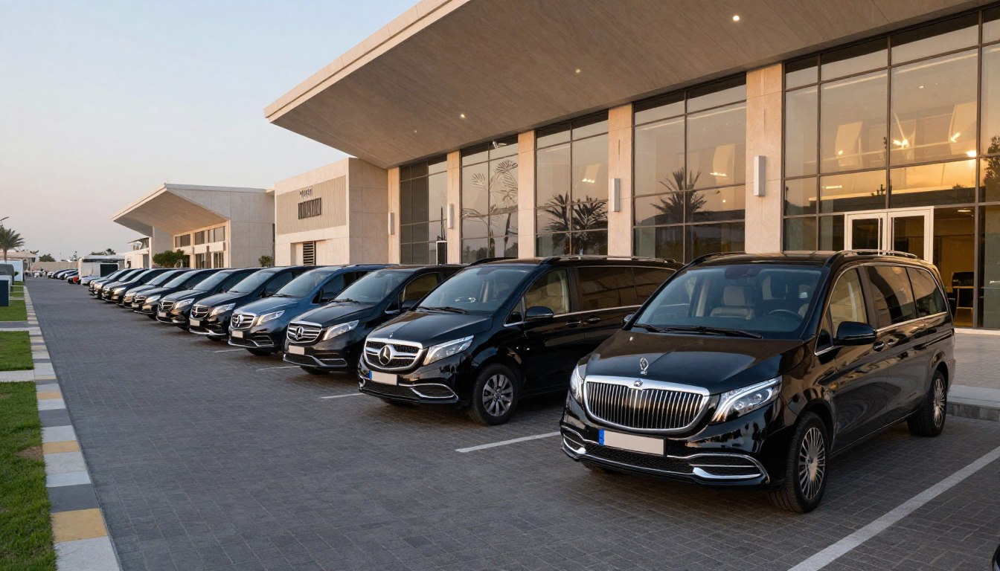
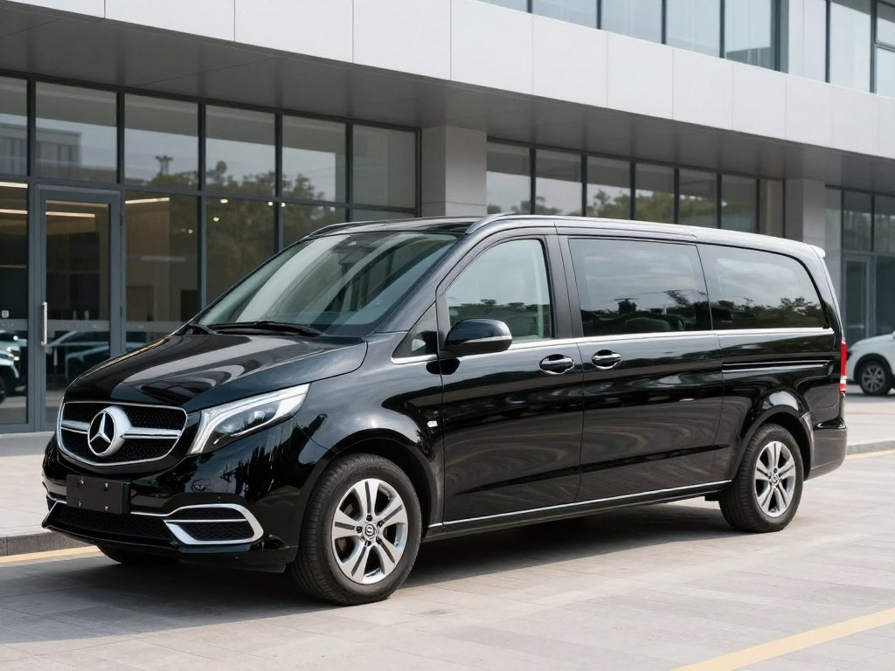
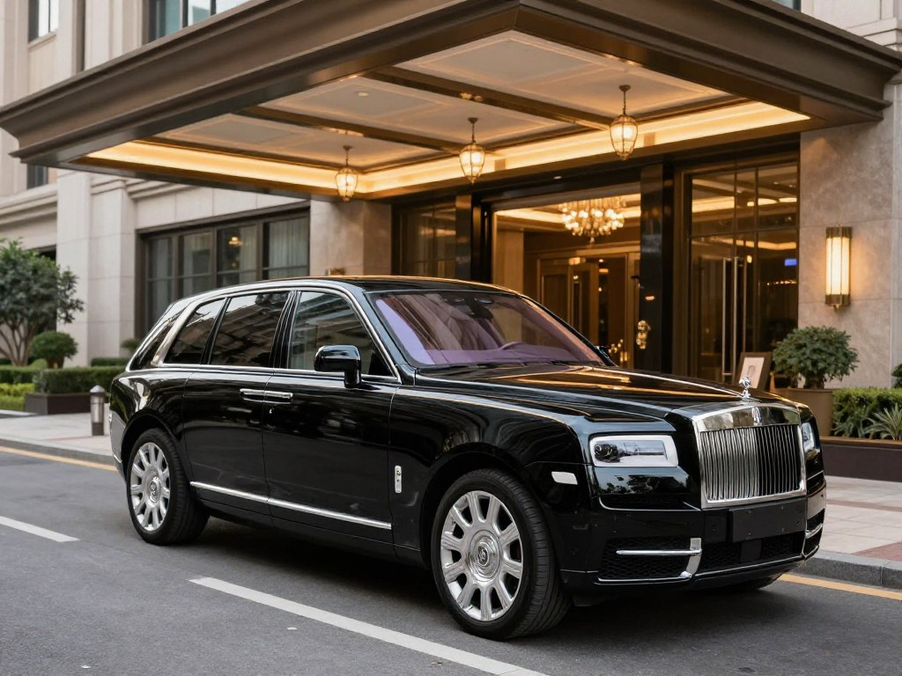
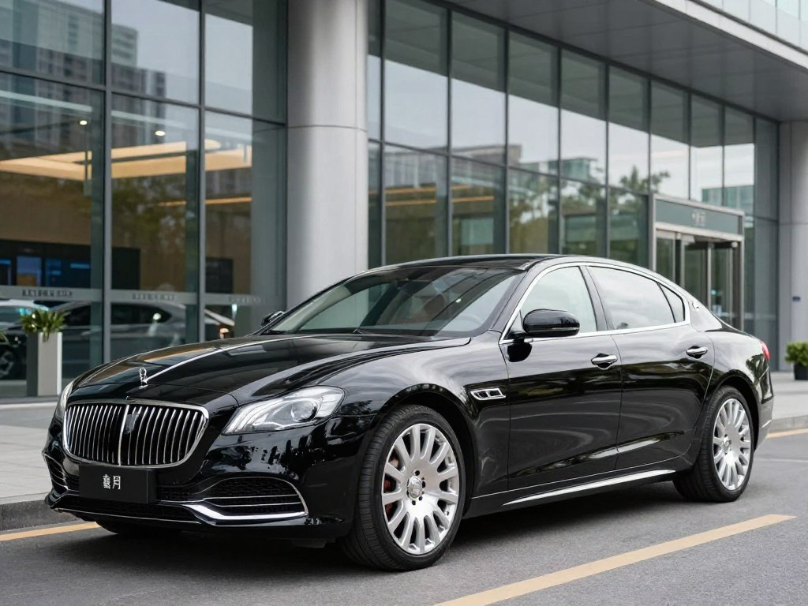
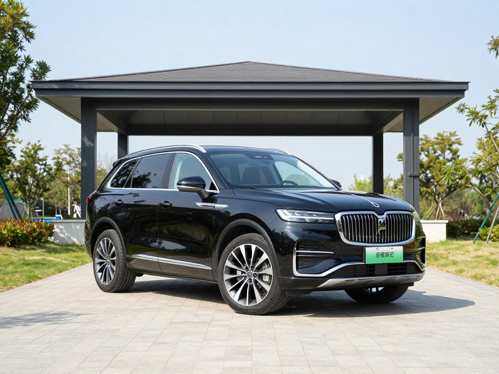

# **Exhibition Transportation Services**

AB delivers managed exhibition transportation services for complex trade shows, international conferences, government gatherings and commercial summits across the Middle East. Event organisers, major exhibition venues, production agencies and conference hosts rely on our dedicated operations teams to coordinate mass arrivals, executive movements and daily venue connections with complete precision.

Coordinating major convention movements requires central oversight, strict flight monitoring and disciplined local dispatch across every host city. From single guest airport transfers to multi vehicle transport operations, our teams manage every journey through unified scheduling, continuous communication and rigorous safety standards.

[Request a proposal](https://seowriting.ai/quote/event) [Talk to a planner](https://seowriting.ai/quote/event)

| Programme Experience          | Active Markets         | Fleet Coordination    |
| ----------------------------- | ---------------------- | --------------------- |
| \[Confirm\] sector programmes | \[Confirm\] key cities | 24/7 central dispatch |

The challenge

## **The Challenge of Exhibition Transportation Services**

Organising high volume ground transportation for international exhibitions requires handling intense delegate surges, variable city traffic and strict VIP security protocols without friction. When hundreds of attendees arrive simultaneously across terminal halls and hotel clusters, fragmented supplier networks often break down, creating severe congestion at main venue gates.

AB resolves these operational pressures through structured planning, active staging zones and live traffic mitigation, giving event planners complete visibility over every passenger movement.

### **Hundreds of delegates moving at once**

Peak arrivals during morning keynote sessions cause bottlenecking at venue entry points. AB structures timed departure blocks and active staging buffers that keep attendee flows steady, organised and aligned with venue gate capacity.

### **Shuttle loops between hotels and venues**

Connecting multiple hotel partner properties with the main exhibition grounds requires strict timetable adherence. Continuous loop management balances coach capacity, coordinates hotel transport desks and prevents long delegate waiting queues during morning and evening rush hours.

### **VIP arrivals on a timed schedule**

Ministers, keynote speakers and board members demand prompt airport curbside greetings and direct route clearance. AB coordinates dedicated chauffeur service teams, VIP car pool units and direct airport terminal airside tarmac access where permitted.

### **Live changes on show days**

Exhibition agendas frequently shift due to delayed panel discussions, extended networking sessions or abrupt venue room changes. Our 24/7 operations centre and on site coordinator teams adjust vehicle staging in real time to accommodate evolving schedules.

How we run it

## **How AB Delivers Exhibition Transportation Services**

Our operational framework transforms complex passenger manifests into an orderly, accountable ground transport network. We work directly with event production committees, municipal traffic authorities and venue operations teams from initial site planning through to post event reporting.

Through centralised control and proactive oversight, we manage every vehicle movement with clear lines of communication, consistent driver standards and transparent commercial reporting.

### **Brief**

We review attendee numbers, flight arrival patterns, hotel room allocations, protocol requirements and exhibition floor schedules. This initial analysis establishes the vehicle volume, required vehicle categories and dedicated staffing levels needed for seamless delivery.

### **Plan**

Our logistics planners create detailed routing maps, access permit requests, driver shift rosters, load zone diagrams and contingency paths. We liaise with venue management to secure priority kerbside space and establish designated passenger collection bays.

### **Operate**

During live show dates, an on site coordinator manages venue kerbside activity while the Riyadh operations centre monitors all fleet movements via GPS tracking. Chauffeurs receive live flight updates and passenger paging alerts directly on their mobile consoles.

### **Report**

Following show closure, AB produces consolidated reporting and clear digital invoicing detailing vehicle utilisation, passenger counts and route timing milestones. Transparent accounting simplifies cost allocation across diverse cost centres, sponsors and government partners.

Services

## **Core Ground Transportation Services We Deploy**

AB delivers complete ground transport solutions designed specifically for large scale conferences, commercial exhibitions and high profile governmental summits. Our managed services integrate seamlessly to support attendees, executive speakers and production crews throughout the event cycle.

- [Event Transportation](https://seowriting.ai/services/event-transportation) provides managed group logistics, dedicated dispatch teams and coordinated car pools for multi day trade shows.
- [Bus & Coach Hire](https://seowriting.ai/services/bus-coach-hire) supplies high capacity delegate coaches, mid size shuttles and point to point venue transfers.
- [Chauffeur & VIP](https://seowriting.ai/services/chauffeur-vip) offers executive sedans, protocol drivers and private chauffeured transfers for keynote speakers and dignitaries.
- [Event brief](https://seowriting.ai/quote/event) connects your planning committee with our transport logistics team to design customized mobility programmes.

For cross border programmes, AB organises coordinated [corporate event transportation](https://seowriting.ai/services/event-transportation/uae) across Dubai and Abu Dhabi, as well as dedicated services within Saudi Arabia and Qatar.

Fleet

## **Managed Vehicle Fleet for Events and Exhibitions**

Selecting the right vehicle mix maintains delegate comfort, optimizes transport budgets and eliminates roadside bottlenecks during peak exhibition hours. AB maintains a modern, uniform fleet operated by professional, uniformed drivers trained in corporate protocol and defensive driving standards.

Explore our complete [fleet](https://seowriting.ai/fleet) options to match passenger volumes and executive requirements across all event categories.

### **Executive Van**

Mercedes Benz V Class or similar \[Confirm\] provides spacious leather seating and ample luggage space, making it ideal for event operations staff, speaker panels and delegation groups.

### **Premium MPV**

Toyota Granvia or similar \[Confirm\] offers exceptional comfort, wide legroom and effortless boarding for production coordinators, technical crews and small corporate delegate groups traveling between hotels.

### **First Class Sedan**

Mercedes Benz S Class, BMW 7 Series or similar \[Confirm\] delivers peerless luxury, acoustic privacy and refined comfort for ministers, ambassadors and keynote summit presenters.

### **Executive SUV**

Cadillac Escalade, GMC Yukon Denali or similar \[Confirm\] combines commanding road presence with extensive cabin capacity for diplomatic escorts, executive security teams and senior corporate leadership.

Coverage

## **Regional Coverage Across Saudi Arabia, the UAE and Qatar**

AB provides direct exhibition transportation coverage across Riyadh, including primary venues such as Riyadh Front, as well as Jeddah and the cultural heritage destination of AlUla. In the United Arab Emirates, our local operations coordinate continuous shuttle links at Dubai World Trade Centre in Dubai and ADNEC in Abu Dhabi. In Qatar, we manage complex delegate transportation at the Qatar National Convention Centre (QNCC) and Doha Exhibition and Convention Center (DECC). AB serves Saudi Arabia, all seven UAE emirates and Qatar directly. Bahrain, Kuwait and Oman are available only on request through vetted partners.

Organisers planning regional tours can secure dedicated [event transportation Saudi Arabia](https://seowriting.ai/services/event-transportation/saudi-arabia) teams, coordinated [corporate event transportation Dubai](https://seowriting.ai/services/event-transportation/uae/dubai) transfers, professional [event transportation services Abu Dhabi](https://seowriting.ai/services/event-transportation/uae/abu-dhabi) shuttles and managed [event transportation Doha](https://seowriting.ai/services/event-transportation/qatar/doha) operations through a single account manager.

Proof

## **Documented Delivery for Commercial Exhibitions and Summits**

Published only with client approval.

### **\[Confirm: approved client or event type\]**

**\[Industry\] · \[City\]**

\[Scale\] · \[One measurable result\]

[Read the case study](https://seowriting.ai/case-studies)

### **\[Confirm: approved client or event type\]**

**\[Industry\] · \[City\]**

\[Scale\] · \[One measurable result\]

[Read the case study](https://seowriting.ai/case-studies)

Standards

## **Operational Standards and Compliance**

Exhibition mobility demands strict safety management, reliable vehicles and adherence to regional transport authorities. Every chauffeur undergoes thorough background verification, defensive driving assessments and detailed training on exhibition protocol, venue access control and flight tracking technology. Our managed transportation processes fulfill your duty of care obligations while maintaining consistent service quality on the ground.

- Licensed chauffeurs holding complete municipal permits and professional commercial credentials.
- GPS tracking active on every vehicle with live integration into our central dispatch platform.
- Standby vehicles staged near primary venue hubs to address unexpected timetable surges.
- Sector specific requirement \[Confirm\].

Direct coordination with our 24/7 operations centre in Riyadh supports rapid response across all host destinations.

+966 58 111 8720

Questions

## **Frequently Asked Questions About Exhibition Transportation Services**

### **How does AB manage conference transportation for thousands of arriving attendees?**

AB coordinates conference transportation by analysing flight manifests and clustering passenger arrivals into organised airport pick up schedules. We establish dedicated airport greeting desks, supply high capacity coach transfers to partner hotels and deploy an on site coordinator at each terminal. This systematic approach reduces roadside congestion and maintains steady delegate arrivals at opening sessions.

### **What vehicle types support high volume delegate transportation between hotels and venues?**

Our delegate transportation fleets utilise a combination of executive 50 seat coaches, 30 seat mini buses and spacious executive vans such as the Mercedes Benz V Class. This tiered vehicle mix allows event organisers to run scheduled shuttle loops during peak morning hours while providing responsive on demand transfers during off peak show periods.

### **How is an exhibition shuttle service scheduled during multi day trade shows?**

An exhibition shuttle service is planned by mapping travel times, peak traffic patterns and delegate distribution across contracted hotel zones. AB designs timed circular routes with designated departure intervals, stationing kerbside marshals at key venues to manage boarding queues and liaising with municipal traffic authorities to use dedicated transit lanes where permitted.

### **Can AB provide dedicated summit transportation for visiting VIPs and state delegations?**

AB offers specialised summit transportation featuring First Class sedans such as the Mercedes Benz S Class and luxury SUVs including the Cadillac Escalade. We coordinate secure airport tarmac transfers, assign seasoned chauffeurs trained in diplomatic protocol and allocate dedicated standby units for high level ministers, guest speakers and chief executives.

### **How do on site dispatchers handle live agenda modifications during exhibition days?**

Our on site transport desk maintains constant radio and digital contact with the AB 24/7 operations centre. If a keynote session runs late or an evening reception changes location, dispatch managers immediately reassign standby vehicles, adjust driver duty cycles and re route shuttle loops to accommodate the revised timetable without service interruption.

### **What duty of care and safety tracking standards apply to all event vehicles?**

Every vehicle in our fleet operates under strict duty of care protocols, including real time telemetry, continuous GPS monitoring and comprehensive passenger liability insurance. Chauffeurs observe strict maximum driving hour limits, while our operations desk oversees live route progress to assist international corporate travel managers with passenger tracking.

### **Can event agencies book corporate event chauffeur hire across multiple GCC cities?**

Event agencies can arrange corporate event chauffeur hire, VIP event transportation UAE services and regional transport fleets through a single master agreement with AB. Organisers receive a dedicated corporate events chauffeur team in each host market, supported by consolidated regional invoicing and centralized coordination from our Riyadh headquarters.

## **Plan Your Exhibition Transportation Services With AB**

AB delivers reliable exhibition transportation services across Saudi Arabia, the UAE and Qatar, coordinating every delegate journey with precision, safety and professional care.

### **Coordinate Your Event Ground Logistics**

Connect with our dedicated event planning specialists to review passenger manifests, map shuttle routes and receive a tailored transportation proposal.

[Request a proposal](https://seowriting.ai/quote/event) [Book a transfer](https://seowriting.ai/quote/event)