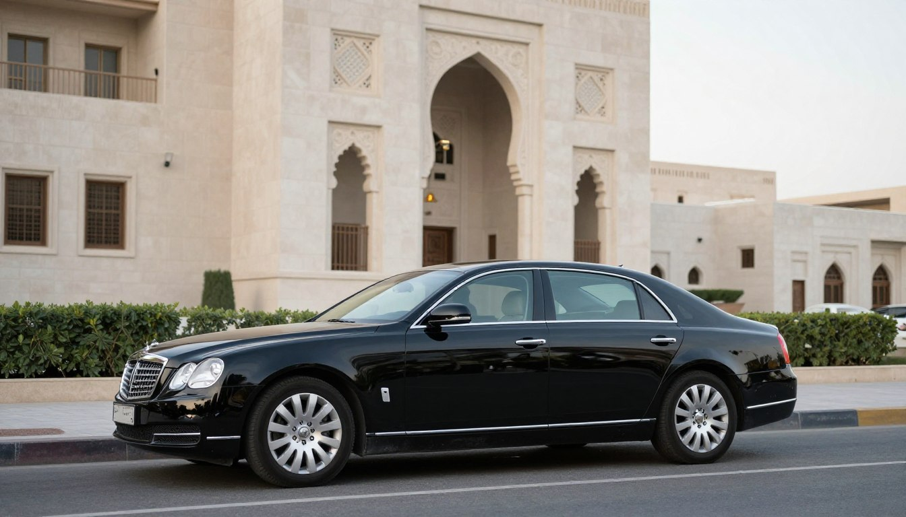
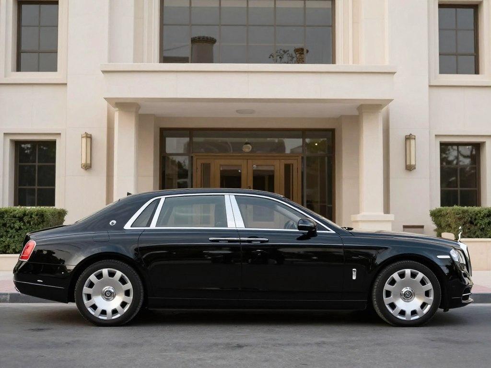
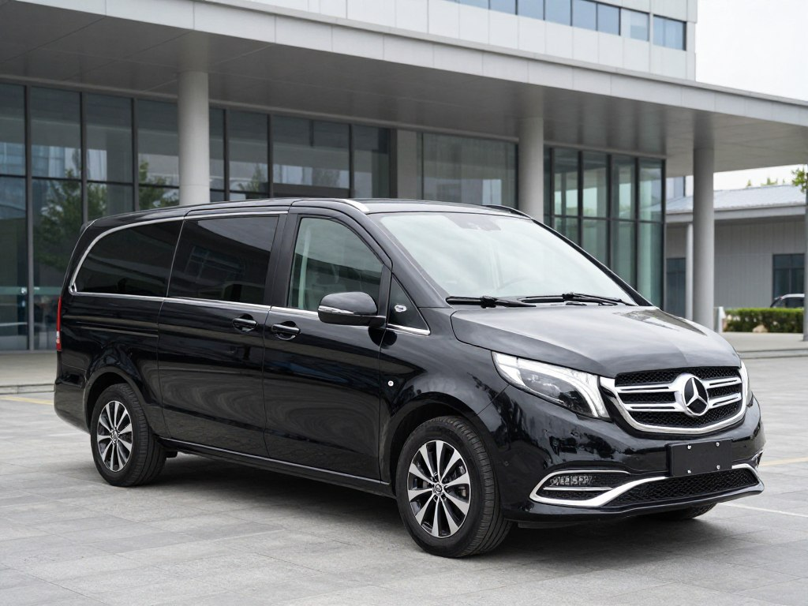

# **Diplomatic Transportation**

AB provides discreet diplomatic transportation designed specifically for visiting heads of state, accredited embassies, government ministries and official delegations across the Gulf region. Every assignment coordinates directly with diplomatic missions and national protocol departments to maintain secure motorcades, vetted routes and quiet operational precision throughout every transfer.

[Request a proposal](https://seowriting.ai/services/chauffeur-vip) [Talk to a planner](https://seowriting.ai/services/chauffeur-vip)

### **Sector Experience**

\[Confirm: years operating in government and diplomatic sector\] supporting international missions.

### **Delegation Movements**

\[Confirm: number of official delegation programmes delivered\] managed across major regional summits.

### **Cities Served**

\[Confirm: number of Gulf capital cities and diplomatic hubs covered\] with active local fleet infrastructure.

The challenge

## **Demands of Diplomatic and Official Transit**

Coordinating government transportation services requires absolute operational precision under stringent public scrutiny. Protocol teams face unpredictable schedules, intricate motorcade logistics, diplomatic security mandates and multi agency communications where errors carry severe consequences for bilateral engagements.

### **Strict protocol and security requirements**

Official visits demand strict protocol alignment, diplomatic etiquette, close coordination with protective security details, advance vehicle security sweeps and complete confidentiality across every route and staging point.

### **Convoys with timed arrivals**

Bilateral state visits require multi vehicle motorcades running to split second schedules, precise vehicle spacing, immediate police escort synchronisation and vetted primary and secondary transit pathways.

### **Confidential itineraries**

Sensitive ministerial talks and embassy assignments require strict data handling, non disclosure compliance, operational discretion and compartmentalised journey details restricted only to mission essential personnel.

### **Last minute schedule changes**

Dynamic bilateral discussions and fluid ministerial agendas frequently produce sudden itinerary adjustments, altered aircraft landing times, added bilateral venues and unexpected extension requests that demand instant vehicle redeployment.

How we run it

## **A Managed Operating Model for Protocol Movement**

AB coordinates every government deployment through structured managed transportation frameworks overseen by our 24/7 operations centre in Riyadh. A dedicated account manager supervises every stage from initial security clearance to final post mission reporting, keeping duty of care and communication seamless.

### **Brief**

The dedicated account manager gathers detailed movement orders, security clearances, passenger manifests, luggage volumes and specific embassy directives to align fleet allocation with formal state protocol requirements.

### **Plan**

Operations specialists conduct thorough route reconnaissance, map primary and alternate corridors, verify embassy staging bays and synchronise motorcade timetables alongside local security authorities and diplomatic liaison teams.

### **Operate**

Live dispatch teams monitor movements through GPS tracking systems, maintaining direct communications with chauffeurs, protective officers and airport tarmac staging crews to adapt instantly to dynamic motorcade movements.

### **Report**

Following completion of the mission, AB provides consolidated journey logs, vehicle manifest verifications, precise incident free documentation and transparent consolidated invoicing aligned to institutional procurement standards.

Services

## **Integrated Services Supporting Official Delegations**

AB deploys specialised mobility packages configured for multilateral summits, ministerial forums and resident mission requirements across the Gulf Cooperation Council.

- [Chauffeur & VIP](https://seowriting.ai/services/chauffeur-vip): Dedicated executive vehicles providing discreet travel for visiting ambassadors, state dignitaries and ministerial delegations.
- [Event Transportation](https://seowriting.ai/services/event-transportation): High capacity synchronized vehicle fleets supporting bilateral conferences, regional summits and international state banquets.
- [Airport Transfers](https://seowriting.ai/services/airport-transfers): Tarmac and private terminal vehicle staging delivering expedited transfers for official state missions.

For municipal assignments in the Saudi capital, AB coordinates [VIP transport Riyadh](https://seowriting.ai/services/chauffeur-vip/saudi-arabia/riyadh) for ministerial transfers between government ministries and diplomatic headquarters. Missions stationed across the Emirates access comprehensive [VIP transport Abu Dhabi](https://seowriting.ai/services/chauffeur-vip/uae/abu-dhabi) to support embassy personnel during regional consultations and palace engagements. Delegations attending multilateral summits in the Qatari capital utilise dedicated [VIP transport Qatar](https://seowriting.ai/services/chauffeur-vip/qatar) for seamless cross city transit between official venues and bilateral suites.

Fleet

## **Fleet Configured for Government & Diplomatic Movements**

Our fleet comprises pristine executive vehicles meeting stringent diplomatic presentation and passenger comfort criteria, available through our [fleet](https://seowriting.ai/fleet) solutions.

### **First Class Sedan**

Mercedes Benz S Class or similar \[Confirm\] providing discreet prestige, silent passenger compartments and rear seat executive amenities suitable for principal diplomats and ministers.

### **Executive SUV**

Cadillac Escalade or similar \[Confirm\] offering generous passenger protection, elevated security posture and substantial cabin capacity for accompanying security teams.

### **Premium MPV**

Mercedes Benz V Class or similar \[Confirm\] delivering flexible seating layouts and ample luggage storage for ministerial staff, advisers and delegation working groups.

Coverage

## **Comprehensive Regional Coverage Across the Gulf**

AB maintains direct regional operating capacity across Saudi Arabia, all seven emirates of the UAE and Qatar. Our chauffeurs regularly operate throughout Riyadh, providing seamless connectivity into the high security Diplomatic Quarter, ministerial compounds and royal terminals. Coverage extends across primary diplomatic hubs including Abu Dhabi, Dubai and Doha, delivering synchronized cross border standards for multi leg diplomatic itineraries.

Proof

## **Operational Track Record**

Published only with client approval.

### **\[Confirm: approved client or event type\]**

\[Industry\] · \[City\]

\[Scale\] · \[One measurable result\]

[Read the case study](https://seowriting.ai/case-studies)

### **\[Confirm: approved client or event type\]**

\[Industry\] · \[City\]

\[Scale\] · \[One measurable result\]

[Read the case study](https://seowriting.ai/case-studies)

Standards

## **Rigorous Protocol Standards and Duty of Care**

Official state visits, ministerial talks and embassy missions allow zero tolerance for logistical oversights. AB enforces uncompromising compliance procedures governing chauffeur vetting, vehicle readiness, route telemetry and institutional confidentiality. Our central Riyadh dispatch hub actively monitors duty of care metrics, keeping every vehicle aligned with diplomatic protocols throughout Saudi Arabia, the UAE and Qatar.

- Licensed chauffeurs: Fully vetted professional chauffeurs trained in diplomatic etiquette, motorcade positioning and absolute client confidentiality.
- GPS tracking: Real time vehicle telemetry and movement monitoring coordinated directly through our central Riyadh operations centre.
- Standby vehicles: Dedicated contingency vehicles positioned along principal routes to provide immediate redundancy during official visits.
- Sector specific requirement \[Confirm\]: Compliance with \[Confirm: sector specific protocol certification, embassy security clearance or transport authority licensing standard\].

Questions

## **Frequently Asked Questions About Diplomatic Transportation**

### **What distinguishes diplomatic transportation from standard executive chauffeur services?**

Diplomatic transportation demands specialized operational preparation, heightened security awareness, strict adherence to diplomatic protocol and close coordination with national security agencies. Chauffeurs undergo extensive screening and protocol etiquette training, while vehicles are maintained to ceremonial standards. Operations teams manage multi vehicle convoys, dedicated radio communication and advance route reconnaissance to protect visiting dignitaries and ambassadors during official state missions.

### **How does AB coordinate government transportation services during international summits?**

AB assigns a dedicated account manager who collaborates directly with ministry logistics teams, embassy staff and host nation protocol departments. Our 24/7 operations centre in Riyadh establishes staging zones, confirms security clearances, maps primary corridors and deploys real time GPS tracking. Chauffeurs manage timed arrivals at summit venues, keeping principal officials and support staff aligned with demanding conference programmes.

### **Can AB deliver high capacity delegation transport for bilateral state visits?**

Yes. AB coordinates complete delegation transport frameworks moving heads of state, ministerial cabinets, trade delegations and security personnel simultaneously. Our mixed fleet of First Class sedans, Executive SUVs and Premium MPVs provides unified motorcade coherence. Every vehicle moves under active dispatch supervision, maintaining exact spacing, dedicated radio contact and synchronized arrivals across airport terminals, embassies and official palaces.

### **How do your teams manage protocol transportation across different Gulf capital cities?**

AB operates established local offices across Riyadh, Dubai, Abu Dhabi and Doha, maintaining uniform operational procedures for cross border protocol transportation. We serve Saudi Arabia, all seven UAE emirates and Qatar directly, allowing diplomatic missions to run multi country itineraries under a single account. Operations adhere strictly to local sovereign protocol guidelines while maintaining consistent communication and centralized billing through our headquarters.

### **What qualifications do chauffeurs possess for an embassy chauffeur service assignment?**

Chauffeurs assigned to our embassy chauffeur service hold required professional passenger transport licences, clean security backgrounds and intensive training in defensive driving techniques. They understand international diplomatic courtesies, flag protocol, embassy perimeter procedures and the non disclosure obligations surrounding confidential conversations. Chauffeurs remain discreet, well presented and responsive to sudden schedule changes throughout their diplomatic postings.

### **How does AB protect passenger confidentiality and sensitive itinerary data?**

Passenger confidentiality is maintained through strict data access protocols, encrypted booking channels and formal non disclosure agreements signed by all dispatch staff and chauffeurs. Travel itineraries, passenger names and meeting locations are compartmentalised within our 24/7 operations centre. Chauffeurs never discuss passenger identities or travel itineraries, protecting visiting dignitaries from public disclosure or security vulnerabilities.

### **How are last minute schedule changes and flight delays handled during official visits?**

Our 24/7 operations centre actively monitors private aviation tail numbers, commercial flight arrivals and official convoy movements in real time. When bilateral negotiations run late or flight schedules shift, dispatchers instantly adjust chauffeur staging times and update motorcade routes. Dedicated standby vehicles remain on active standby along key corridors to provide immediate vehicle redundancy without disrupting the official programme.

## **Secure Diplomatic Transportation for Official Missions**

AB coordinates discreet diplomatic transportation tailored to visiting state dignitaries, accredited embassies and official delegations across the Gulf region with operational precision.

### **Plan Your Official Delegation Logistics**

Contact our protocol operations desk to coordinate comprehensive motorcade management and secure vehicle movements across Saudi Arabia, the UAE and Qatar.

[Request a proposal](https://seowriting.ai/services/chauffeur-vip) [Book a transfer](https://seowriting.ai/services/chauffeur-vip)