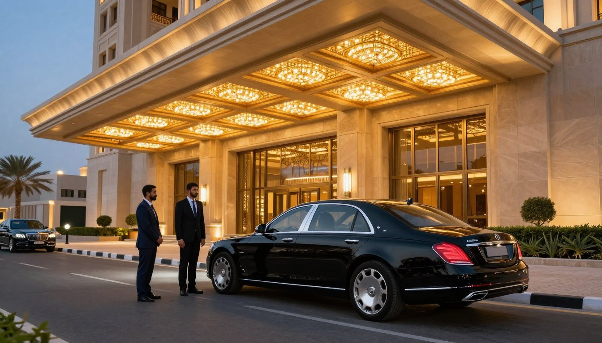
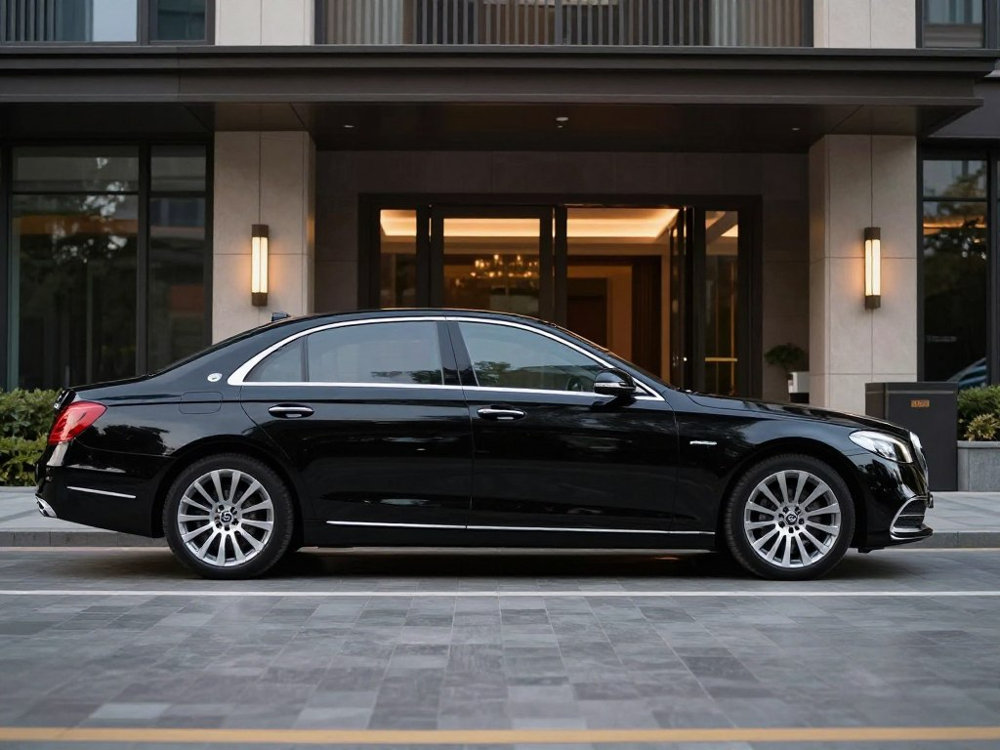
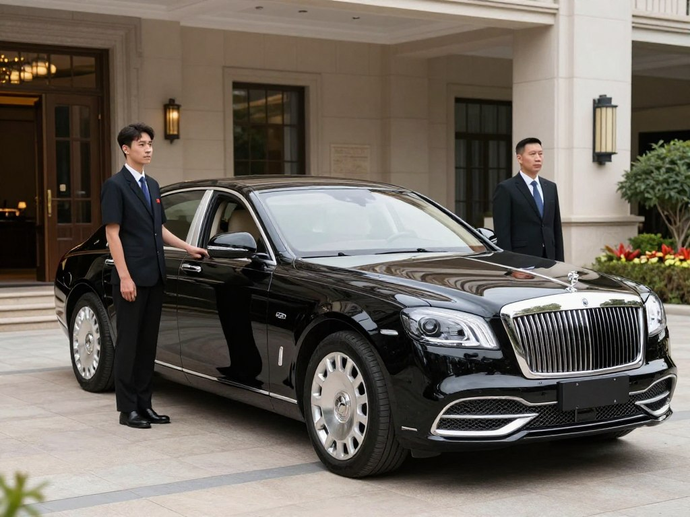
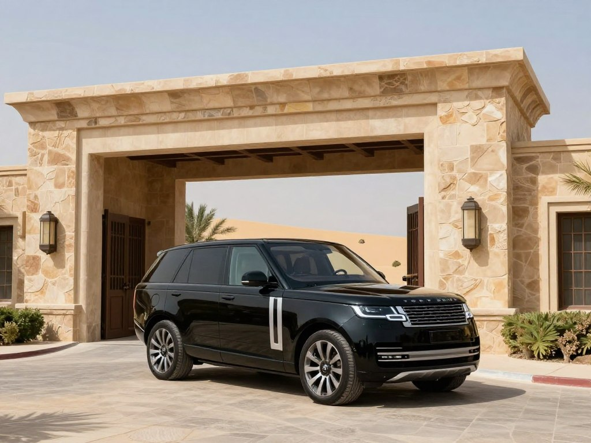
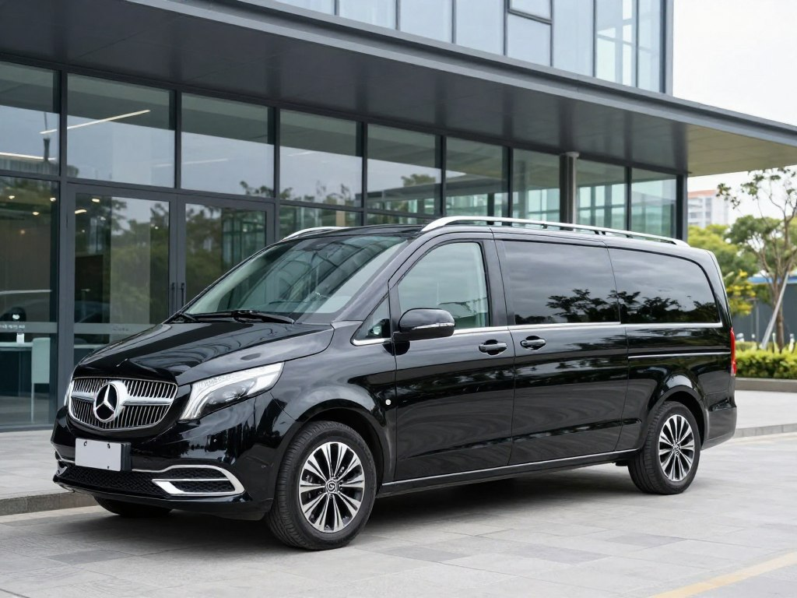

# **Premium Hotel Transportation Services**

Professional hotel transportation services provide luxury properties with immaculate guest mobility from arrival to departure. AB partners with leading hotels, five star resorts, destination management companies and dedicated concierge teams across the Middle East. Every private journey reflects the exacting hospitality benchmarks of your property.

Request a proposal Talk to a planner

- \[Confirm: years supporting luxury hospitality brands\]
- \[Confirm: hospitality guest journeys completed\]
- \[Confirm: key hospitality cities served across GCC\]

The challenge

## **Operational Pressures in Luxury Guest Mobility**

Coordinating premium hotel transfers demands unyielding consistency across variable schedules, regional flight alterations, and bespoke guest expectations. Hospitality providers require ground transit partners capable of protecting brand reputation across every itinerary without operational friction or administrative delays.

### **Guest arrivals at all hours**

Commercial flights and private aviation land throughout the night and early morning. Chauffeurs must be staged early, with live flight tracking managing unexpected delays seamlessly.

### **Brand standards in every vehicle**

Vehicles serving five star hotels must maintain pristine cleanliness, silent cabins, and correct climate control. Inconsistent vehicle quality damages the guest experience before check in occurs.

### **Peaks during events and holidays**

Citywide summits, seasonal festivals, and holiday periods create sudden surges in demand. Hotel fleets require elastic capacity without compromising chauffeur vetting or punctuality standards.

### **Billing to rooms, guests or the hotel**

Hospitality finance teams face complex billing across direct guest charges, concierge accounts, and corporate master folios. Consolidated reporting and itemised invoicing remove reconciliation disputes.

How we run it

## **A Structured Operating Model for Hotel Ground Transport**

AB operates as a managed transportation provider with dedicated account teams and centralised coordination. Our central operations centre in Riyadh oversees continuous dispatch, automated tracking, and rigorous duty of care protocols across every regional property booking.

### **Brief**

Your dedicated account manager captures specific property preferences, concierge workflows, room billing codes, and protocol requirements. Every guest profile and arrival instruction integrates directly into our reservation system.

### **Plan**

Our scheduling team assigns vetted chauffeurs, validates terminal access, and arranges vehicle staging windows. Dynamic route monitoring evaluates regional traffic patterns to maintain uninterrupted punctuality for every itinerary.

### **Operate**

The 24/7 operations centre monitors active movements using GPS tracking and live flight telemetry. Chauffeurs execute discreet arrivals with customised guest name boards and white label vehicle presentation.

### **Report**

Post journey reporting consolidates trip timings, mileage, and approved guest signatures. Monthly itemised invoicing streamlines hotel billing, linking charges directly to appropriate guest folios or corporate cost centres.

Services

## **Integrated Mobility Solutions for Hospitality Partners**

Hospitality partners draw upon our broad operational portfolio to fulfil diverse guest transport requirements. We provide flexible booking pathways tailored for single guest transfers, visiting delegations, and bespoke regional sightseeing.

- [Airport Transfers](https://seowriting.ai/services/airport-transfers) deliver punctual terminal meet and greet arrivals alongside luggage assistance for inbound property guests. Properties in the Emirates frequently schedule our [luxury airport transfer](https://seowriting.ai/services/airport-transfers/uae) solutions for international arrivals.
- [Chauffeur & VIP](https://seowriting.ai/services/chauffeur-vip) provides dedicated daily driver allocations for executive guests requiring continuous on call city travel. Guests seeking elite city transit rely on our dedicated airport chauffeur service throughout their stay.
- [Tourism Transportation](https://seowriting.ai/services/tourism-transportation) connects hotel guests to heritage landmarks, desert excursions, and curated shopping venues across the Gulf. Concierge desks arrange complete travel itineraries using our [luxury chauffeur service UAE](https://seowriting.ai/locations/uae) across Dubai and Abu Dhabi.
- [Partners](https://seowriting.ai/partners) allows regional hospitality brands and international travel planners to access preferred fleet capacity and preferential agreements.

Fleet

## **Curated Luxury Fleet for Hotel Operations**

Our modern fleet satisfies strict hospitality criteria for comfort, luggage capacity, and onboard quietness. Review full specifications on our [fleet](https://seowriting.ai/fleet) page to match vehicles with specific guest profiles.

### **Business Sedan**

Ideal for corporate travellers and solo guests requiring efficient transit between airport terminals and hotel lobbies. Mercedes Benz E Class or similar \[Confirm\].

### **First Class Sedan**

Designed for VIP dignitaries, suite occupants, and executive leadership desiring exceptional cabin refinement and silence. Mercedes Benz S Class or similar \[Confirm\].

### **Executive SUV**

Combines generous luggage space with commanding comfort for travelling families and small executive groups. Cadillac Escalade or similar \[Confirm\].

### **Premium MPV**

Accommodates delegations, event groups, and family parties requiring coordinated transit with substantial luggage allowances. Mercedes Benz V Class or similar \[Confirm\].

Coverage

## **Strategic Regional Coverage Across the GCC**

AB maintains direct operational presence across key commercial and tourism centres in Saudi Arabia, the United Arab Emirates, and Qatar. Our regional footprint supports continuous guest transit across Riyadh, Jeddah, AlUla, Dubai, Abu Dhabi, and Doha. Extended travel into Bahrain, Kuwait, and Oman is managed on request through our network of vetted regional partners.

Cross border travel and multi destination itineraries are coordinated through our primary dispatch hub, maintaining consistent standards across regional boundaries.

Proof

## **Verified Hospitality Partnerships**

AB delivers managed transportation programmes for prominent regional hospitality brands and high profile international events. Published only with client approval.

### **\[Confirm: approved client or event type\]**

Hospitality · Riyadh

\[Confirm: scale of operation\] · \[Confirm: measurable result such as zero missed pickups\]

[Read the case study](https://seowriting.ai/case-studies)

### **\[Confirm: approved client or event type\]**

Tourism · Dubai

\[Confirm: scale of operation\] · \[Confirm: measurable result such as on time dispatch score\]

[Read the case study](https://seowriting.ai/case-studies)

Standards

## **Hospitality Compliance and Duty of Care**

Protecting guest safety and property prestige is the foundation of our managed transportation services. Chauffeurs undergo extensive route assessment, defensive driving instruction, and five star hospitality etiquette training. Active operations integrate transparent concierge communication, white label vehicle preparation, personalised guest name boards, and rigorous safety protocols.

- Licensed chauffeurs with verified background clearances and regional hospitality accreditation
- GPS tracking on all vehicles connected directly to our 24/7 operations centre
- Standby vehicles positioned strategically to mitigate unexpected delays or flight diversions
- Sector specific requirement \[Confirm: regional tourism authority permits and hotel compliance audits\]

Questions

## **Frequently Asked Questions About Hotel Transportation Services**

### **How does AB coordinate hotel guest transfers during unexpected flight delays?**

Our 24/7 operations centre monitors inbound commercial flights and private aviation schedules in real time. Chauffeur staging adjusts automatically to revised touchdown times, preventing missed pickups and eliminating unnecessary waiting charges for the hotel.

### **Can destination management companies book dedicated DMC transportation for large conferences?**

Yes. Destination management companies coordinate multi vehicle programmes through a single account manager. We allocate premium sedans, executive SUVs, and luxury vans with centralised dispatch, on site marshals, and unified billing across high volume itineraries.

### **What vehicle presentation standards apply to your hotel limousine service?**

Every vehicle deployed for our hotel limousine service undergoes thorough interior detailing, sanitisation, and mechanical inspection before dispatch. Vehicles arrive unbranded to support white label hotel representation, stocked with bottled water, device chargers, and daily publications upon request.

### **How are guest airport transfers handled at arrival terminals?**

Chauffeurs stage inside the terminal arrival hall displaying a clean digital or physical guest name board tailored with hotel branding. The driver assists with all luggage and escorts passengers directly to the awaiting vehicle stationed in priority parking.

### **How does AB structure invoicing and hotel billing for concierge desks?**

Concierge teams can assign journey charges to guest room folios, central company accounts, or corporate payment cards. We issue transparent electronic receipts immediately after journey completion, accompanied by consolidated monthly billing statements itemised by booking reference.

### **Can hotels reserve standby vehicles for urgent VIP guest requests?**

Yes. Luxury resorts and business hotels frequently arrange dedicated standby vehicles stationed nearby to accommodate short notice departures, private dining runs, or emergency executive itineraries without dispatch delays.

### **Which geographic regions are covered directly by AB?**

AB operates direct managed services across Saudi Arabia, all seven Emirates in the UAE, and Qatar. Properties in Riyadh, Jeddah, AlUla, Dubai, Abu Dhabi, and Doha receive direct fleet support, while transit in Bahrain, Kuwait, and Oman is arranged through vetted regional partners.

## **Upgrade Your Property with Premium Hotel Transportation Services**

Enhance guest loyalty and streamline concierge operations with dependable, high standard hotel transportation services tailored to the requirements of your luxury property.

### **Establish Your Hotel Transport Partnership**

Connect with our hospitality mobility team to review dedicated vehicle allocations, property pricing, and operational integration.

Request a proposal [Book a transfer](https://seowriting.ai/services/airport-transfers)