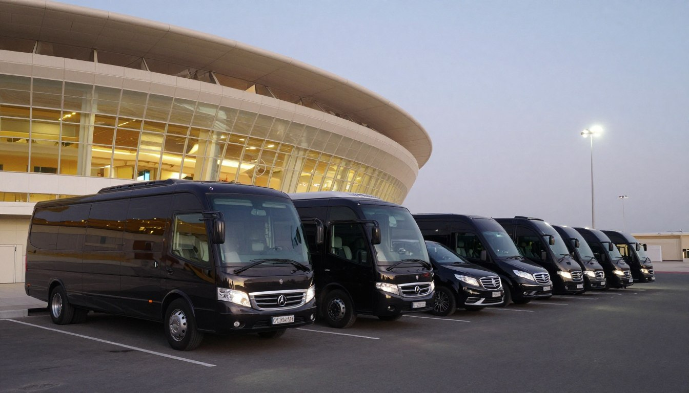
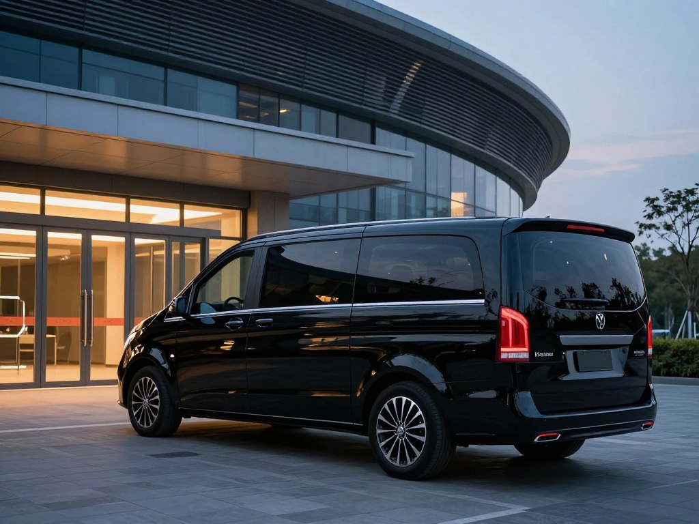
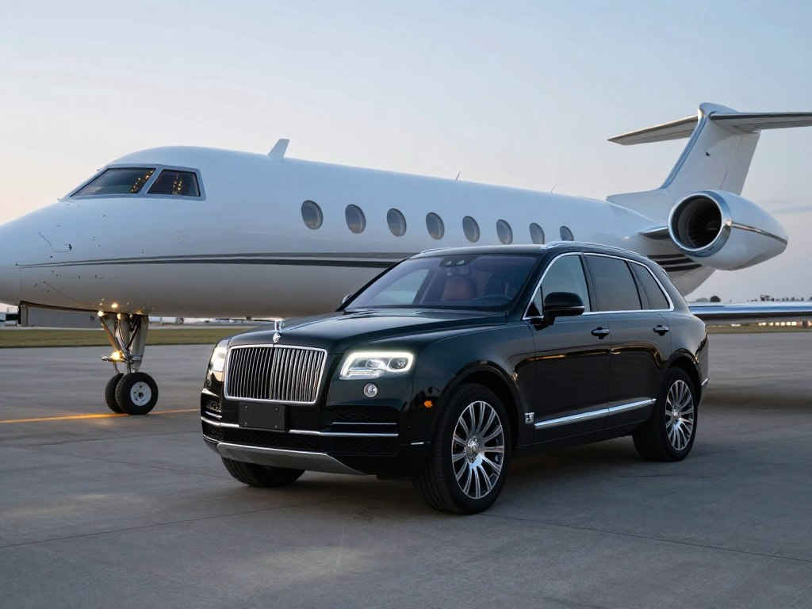
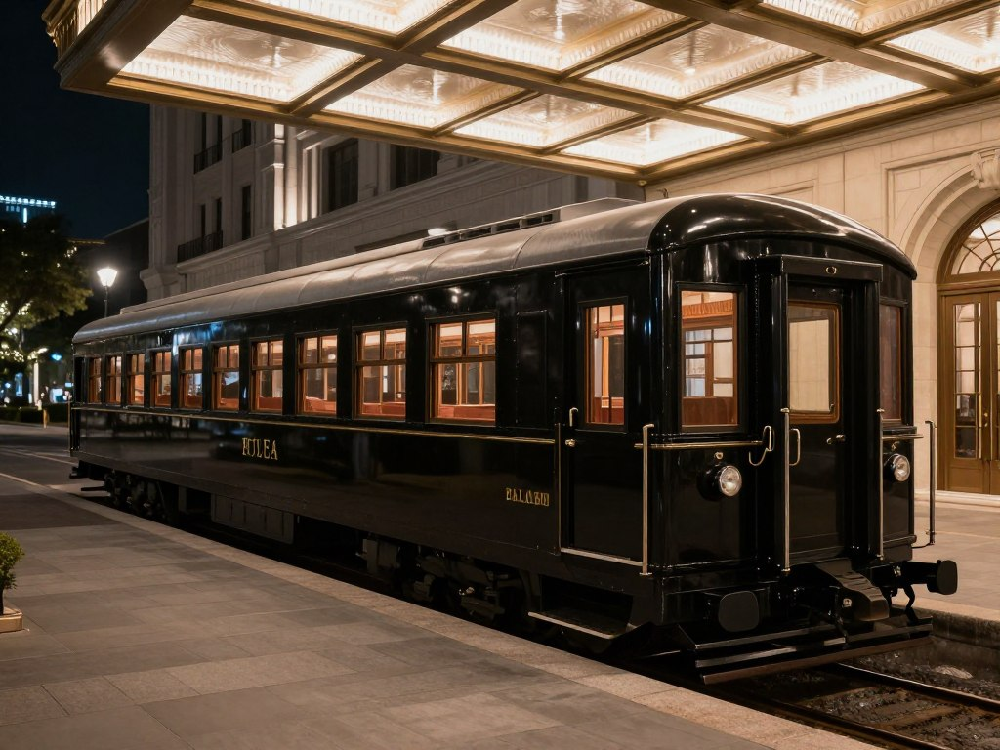

# **Sports Team Transportation for Athletics and Live Entertainment**

Reliable sports team transportation demands precise scheduling, dedicated vehicle allocations and rigorous coordination between venues and hotels. Athletic departments, touring squads and production crews require punctual movements that protect player focus and keep event itineraries running smoothly.

AB coordinates ground travel for professional leagues, athletic clubs, concert promoters, stadium venues and talent management teams across the Middle East. Dedicated operational planners oversee every transfer, aligning high capacity motor coaches and executive support convoys with strict match fixtures and performance schedules.

[Request a proposal](https://seowriting.ai/services/event-transportation) Talk to a planner

### **\[Confirm: years in sector\]**

Years supporting professional sports tournaments and live entertainment tours across the Gulf.

### **\[Confirm: programmes run\]**

Complex team mobility programmes and high profile entertainment operations completed to date.

### **\[Confirm: cities covered\]**

Major host cities supported directly across Saudi Arabia, the United Arab Emirates and Qatar.

The challenge

## **Managing Complex Pressures in Sports Team Transportation**

Organising athletic and entertainment travel presents logistical obstacles that standard car services cannot accommodate. Tight match day timetables, dense urban traffic surrounding stadiums and sensitive talent security demand continuous oversight from an experienced ground transportation partner.

Logistics directors must balance player comfort with strict security protocols while handling fluctuating equipment volumes and unexpected itinerary shifts. Without centralised dispatch and experienced chauffeurs, isolated delays can disrupt pre match warmups, broadcast cues and venue crowd management.

### **Team movements on match days**

Coordinating team bus transfers requires synchronized departures, police or venue escort alignments and clear stadium docking access to prevent costly fixture delays.

### **Talent and artist security**

Headlining musicians, technical directors and VIP guests require discreet transfers, private airport tarmac pickups and secured hotel staging that safeguard personal privacy.

### **Fan and staff shuttles at scale**

Moving thousands of ticketholders, match officials and operational staff demands continuous circuit management that mitigates perimeter congestion around metropolitan arenas.

### **Tight load in and load out windows**

Stage crews, technical personnel and sports equipment managers must access backstage bays within rigid access windows set by venue operations and broadcast directors.

How we run it

## **A Disciplined Operating Model for High Stakes Events**

AB delivers managed transportation built around sector expertise, thorough contingency planning and central operational control. The Riyadh operations centre oversees movements across Saudi Arabia, the United Arab Emirates and Qatar, maintaining continuous radio and telematics connectivity with every chauffeur.

Each client engagement receives a dedicated account manager who oversees flight tracking, itinerary adjustments, duty of care compliance and consolidated billing. This operational framework supports seamless coordination from the opening technical briefing through post event reporting.

### **Brief**

AB audits tournament fixtures, passenger manifests, flight times and venue access permissions to define exact fleet volumes, luggage capacity needs and chauffeur duty schedules.

### **Plan**

Your assigned account manager maps dedicated transit routes, identifies primary and secondary ingress points, arranges airport ramp permits and stages standby vehicles for peak operational resilience.

### **Operate**

The 24/7 operations centre tracks vehicle movements via live GPS tracking, coordinating stadium gate access, chauffeur rotations and convoy marshaling alongside municipal traffic authorities.

### **Report**

Following tournament or tour completion, AB delivers consolidated invoicing, detailed trip duration audits and service level telemetry for transparent post event reconciliation.

Services

## **Specialised Transportation Services for Sports and Entertainment**

Major athletic competitions and live entertainment productions require multiple transport tiers working in close synchronization. Delegations need premium executive vehicles for directors, spacious multi passenger transport for rosters and high frequency circuits for spectators.

Through our dedicated divisions, AB provides integrated ground transport solutions that adapt to changing tour schedules. For large group operations in the Emirates, clients book our [luxury bus rental Dubai](https://seowriting.ai/services/bus-coach-hire/uae/dubai) service, with options including a 50 seater bus rental dubai for venue staff transfers. Similarly, tournament directors coordinate national rosters through verified [group transportation Qatar](https://seowriting.ai/locations/qatar) networks and specialised [coach hire Qatar](https://seowriting.ai/services/bus-coach-hire/qatar) allocations.

- [Event Transportation](https://seowriting.ai/services/event-transportation): Comprehensive fleet marshaling and route management for large scale entertainment event transportation and international athletic tournaments.
- [Bus & Coach Hire](https://seowriting.ai/services/bus-coach-hire): Premium motor coaches engineered for comfortable athletic team travel with ample luggage bays for equipment storage.
- [Chauffeur & VIP](https://seowriting.ai/services/chauffeur-vip): Discreet executive saloon and SUV transfers providing talent security and direct movements for team executives.

Fleet

## **Vehicle Classes Tailored to Match Days and Tour Runs**

AB maintains an executive fleet configured for the specialised demands of professional athletic squads and touring artists. Vehicles offer spacious seating, advanced climate control systems and generous cargo compartments suitable for sports bags, stage trunks and medical kits.

Every vehicle undergoes strict pre departure mechanical inspections and interior sanitisation before entering event service. Explore our complete range of passenger capacities and configurations by visiting our [fleet](https://seowriting.ai/fleet) specification guide.

### **Executive Van**

Mercedes Benz V Class or similar \[Confirm\] provides spacious leather seating and ample cargo space for coaching staff, scout teams and media technical kits.

### **Executive SUV**

Cadillac Escalade or similar \[Confirm\] delivers commanding presence, all wheel drive capability and enhanced privacy for headline artists, team owners and sports directors.

### **First Class Sedan**

Mercedes Benz S Class or similar \[Confirm\] offers refined comfort, acoustic insulation and sophisticated styling for match referees, dignitaries and VIP talent.

Coverage

## **Regional Operating Footprint Across Key Host Cities**

AB provides direct ground transport management across Saudi Arabia, all seven Emirates of the UAE and Qatar, with cross border capabilities connecting regional hubs. Bahrain, Kuwait and Oman are served on request through vetted affiliate networks.

In Saudi Arabia, operational teams support major fixtures across Riyadh, including Boulevard Riyadh City, Kingdom Arena and key Riyadh Season venues, alongside coastal stadium transfers in Jeddah. In the United Arab Emirates, AB coordinates extensive fleet operations between Dubai and Abu Dhabi, including racing and arena locations across Yas Island. In Qatar, central dispatch handles complex stadium shuttle service schedules serving Lusail Stadium, dynamic cultural hubs and surrounding metropolitan sports complexes.

Proof

## **Documented Reliability in Sports and Live Entertainment**

Major event organisers, national federations and international promoters rely on AB for mission critical ground movements. Published only with client approval.

### **\[Confirm: approved client or event type\]**

Sports Logistics · Riyadh  
\[Confirm: scale\] · \[Confirm: one measurable result\]

[Read the case study](https://seowriting.ai/case-studies)

### **\[Confirm: approved client or event type\]**

Live Entertainment · Doha  
\[Confirm: scale\] · \[Confirm: one measurable result\]

[Read the case study](https://seowriting.ai/case-studies)

Standards

## **Rigorous Safety, Compliance and Operational Control**

Transporting elite athletes and international performers requires an unwavering commitment to duty of care. AB enforces rigorous chauffeur vetting protocols, vehicle safety checks and data privacy measures across every regional operating office. Chauffeurs sign strict non disclosure agreements to safeguard client confidentiality on tour.

Our centralized management structure maintains direct radio and cellular contact with drivers, while telemetry sensors monitor vehicle speed, location and route adherence. This unified framework enables rapid operational adaptations whenever arena traffic flow or stadium security details mandate route adjustments.

- Licensed chauffeurs: Experienced drivers screened with extensive background audits, defensive driving certifications and local venue security credentials.
- GPS tracking: Live satellite telemetry streaming real time vehicle coordinates directly to the 24/7 Riyadh operations centre.
- Standby vehicles: Dedicated backup saloons, vans and coaches positioned at strategic staging areas near venues for prompt deployment.
- Sector specific requirement \[Confirm\]: Specialised security escorts and airside tarmac ramp clearances arranged in full compliance with local civil aviation and stadium authority regulations.

+966 58 111 8720

Questions

## **Frequently Asked Questions About Sports Team Transportation**

### **How does AB coordinate sports team transportation on busy match days?**

AB assigns a dedicated account manager who synchronizes movements with stadium operations, local transport authorities and team security directors. Chauffeurs conduct route test runs in advance, while our central dispatch monitors live traffic patterns to navigate congestion and support timely team arrivals at venue docking bays.

### **Can AB manage high volume fan shuttle service during major tournaments?**

Yes, AB coordinates dedicated fan shuttle service fleets running continuous loops between metro stations, park and ride hubs and stadium perimeters. Central dispatch monitors spectator queues and adjusts coach departures dynamically to maintain smooth passenger flow during peak pre match and post match periods.

### **What vehicle options are recommended for concert transportation and touring artists?**

Headlining musicians and talent directors typically choose First Class Sedans and Executive SUVs for discreet transit, while production crews travel in spacious Executive Vans. AB coordinates entire artist convoys, integrating luggage runners and equipment trucks so that touring entourages move together without logistical bottlenecks.

### **How does AB handle equipment storage and gear during athletic team travel?**

AB deploys luxury motor coaches equipped with generous underfloor luggage bays designed to carry bulky sports bags, medical kits and training gear. When delegations travel with oversized athletic equipment, dedicated support vans shadow the team bus to handle overflow cargo securely.

### **What security measures protect talent and VIP athletes during transfers?**

All chauffeurs operate under binding non disclosure agreements and possess extensive training in discreet passenger handling. AB coordinates directly with private close protection teams, venue security marshals and airport tarmac handlers to arrange secure boarding in private bays away from public areas.

### **How are unexpected itinerary adjustments managed during a multi city tour?**

The 24/7 Riyadh operations centre provides continuous dispatch support, allowing tour directors to adjust schedules or add staging stops at any hour. Dedicated operational teams coordinate directly with regional offices in Dubai, Abu Dhabi and Doha to implement route modifications without operational friction.

### **What invoicing and reporting procedures are provided after an event series?**

Following event completion, AB compiles consolidated corporate invoicing itemised by vehicle class, transfer date and routing code. Account managers also deliver comprehensive service reports detailing trip milestones, arrival logs and operational metrics for thorough client reconciliation.

## **Book Managed Sports Team Transportation Across the Gulf**

Event directors count on AB for sports team transportation and artist convoys across premier stadiums and entertainment venues in the Gulf region.

[Request a proposal](https://seowriting.ai/services/event-transportation) [Book a transfer](https://seowriting.ai/fleet)