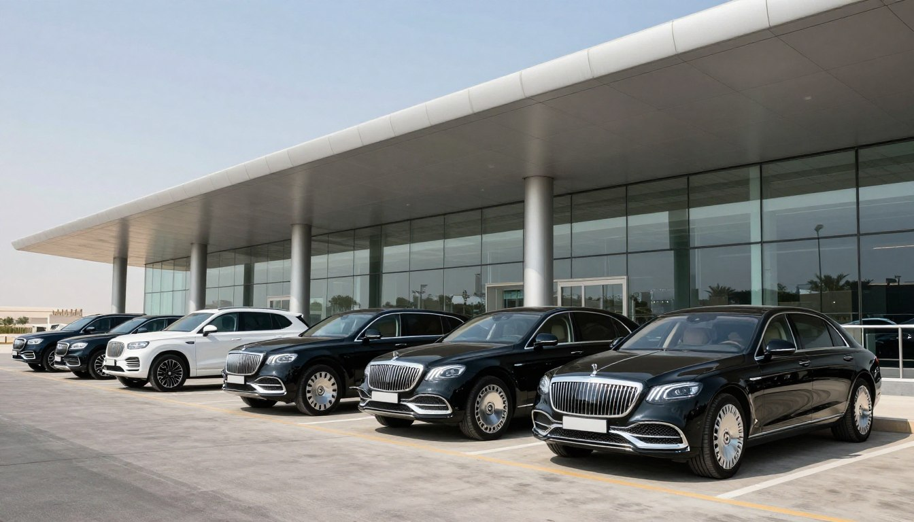
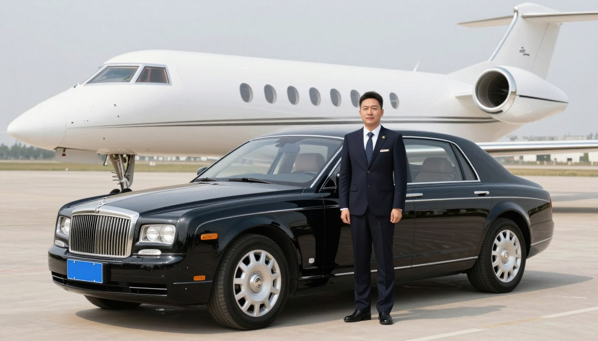
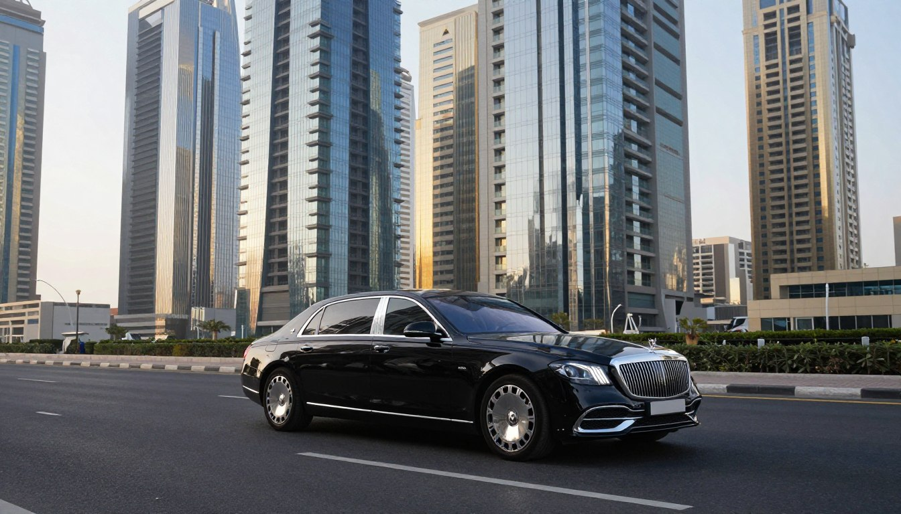
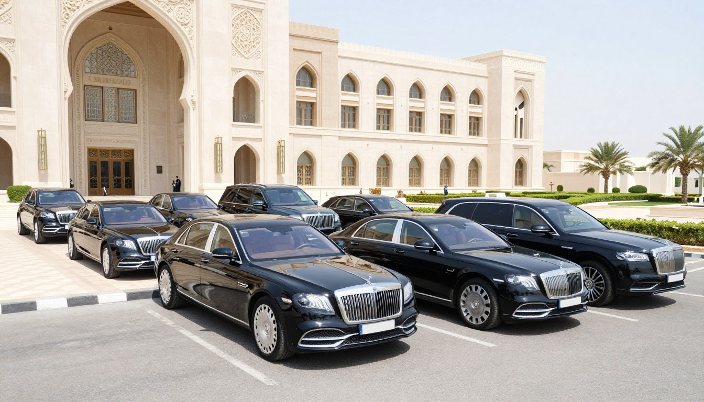
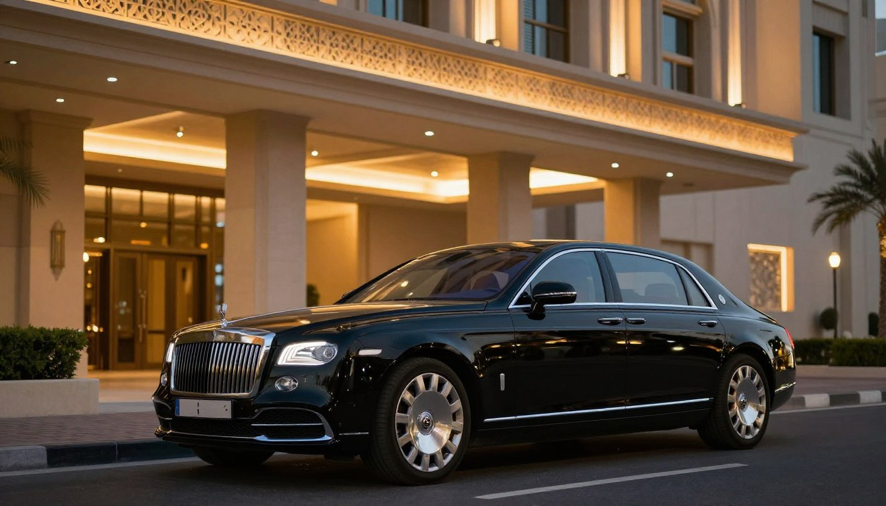
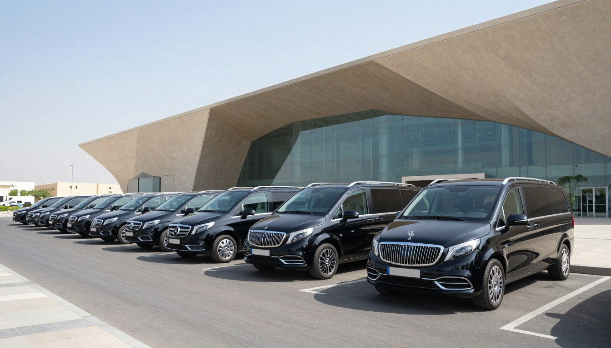
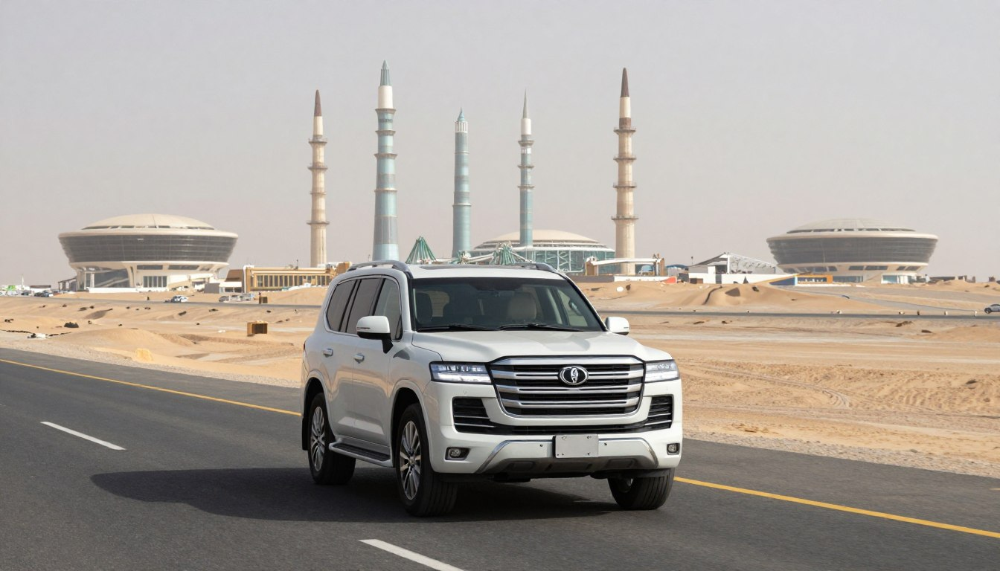

# **Dont use pictures from here those will be shared separately**

 **Transportation Services by Industry Across the Gulf**

Transportation services by industry help corporate, aviation, government and event teams coordinate reliable ground transportation across the Gulf. AB provides managed ground transportation GCC programmes, matching fleet, chauffeur service and dispatch to each sector's operating needs in Saudi Arabia, the UAE and Qatar, with consistent duty of care and clear account oversight.

[Request a proposal](https://seowriting.ai/quote/tender) [Talk to a planner](https://seowriting.ai/quote/tender)

1. Aviation & FBO
2. Corporate & Enterprise
3. Government & Diplomatic
4. Hospitality
5. Events & Exhibitions
6. Energy & Giga Projects
7. Sports & Entertainment

## **01 Aviation & FBO**

Airlines, private jet operators and FBO teams need reliable crew transfers and coordinated airport transit. AB aligns chauffeur services, dispatch and flight schedules for aviation operations in Riyadh, Dubai and Doha, supporting timely movement between terminals and aircraft.

- Dedicated tarmac airside transfers
- Real time flight schedule synchronisation
- Complete duty of care compliance

[Explore crew transportation](https://seowriting.ai/industries/aviation)

## **02 Corporate & Enterprise**

Corporate travel managers, procurement teams and executive assistants use corporate transportation solutions for commutes and multi-city roadshows. AB coordinates chauffeurs, account management, invoicing and reporting across Saudi Arabia and the UAE, helping organisations improve transportation services and travel efficiency.

- Centralised billing and transparent reporting
- Executive roadshow route planning
- Professional bilingual corporate chauffeurs

[Explore corporate ground transportation](https://seowriting.ai/industries/corporate-enterprise)

## **03 Government & Diplomatic**

Government protocol teams, embassy staff and ministry delegations rely on government transport services for discreet, coordinated journeys. AB arranges chauffeur-led transport for official visits and summits across Saudi Arabia, with attention to protocol, security requirements and passenger duty of care.

- Strict diplomatic protocol adherence
- Armoured vehicle options on request
- Vetted security trained chauffeurs

[Explore diplomatic transportation](https://seowriting.ai/industries/government-diplomatic)

## **04 Hospitality**

Hotel general managers, resort concierge teams and private residence directors use AB's chauffeur service to coordinate guest arrivals with front-of-house staff. Reliable transport supports welcome standards, smooth billing and a premium guest experience in Doha and across the Gulf.

- White glove guest arrival experiences
- Seamless front desk billing integration
- Immaculate late model premium fleet

[Explore hotel transportation services](https://seowriting.ai/industries/hospitality)

## **05 Events & Exhibitions**

Conference organisers, exhibition producers and meeting planners rely on event transportation services to manage attendee demand and venue transit. AB coordinates shuttle routes, staging and VIP speaker transfers, with dispatch support on site to keep movements organised.

- On site dispatch coordinators
- Dynamic delegate shuttle management
- Real time manifest tracking

[Explore exhibition transportation services](https://seowriting.ai/industries/events-exhibitions)

## **06 Energy & Giga Projects**

Infrastructure directors, procurement leads and project operations teams need reliable remote-site transport and executive transfers. AB coordinates suitable vehicles and drivers across Saudi Arabia, using tracking systems and technology to support journeys and site requirements.

- Remote project site transport
- Comprehensive IVMS safety monitoring
- Rigorous site access compliance

[Explore giga project transportation](https://seowriting.ai/industries/energy-giga-projects)

## **07 Sports & Entertainment**

Sports directors, touring production managers and federations need coordinated transportation for athletes, artists and crews. AB organises venue arrivals, luggage logistics and fleet movements for events across the region, helping teams and production staff travel between hotels, training sites and venues.

- Dedicated athlete and artist transfers
- Secure stadium ingress coordination
- Specialised equipment support transport

[Explore sports team transportation](https://seowriting.ai/industries/sports-entertainment)

## **Not sure where you fit?**

Talk to a planner about transportation services and tailored solutions for your industry, including programmes that span multiple sectors.

[Talk to a planner](https://seowriting.ai/quote/tender)

How we work

## **One Operational Standard for Transportation Services by Industry**

AB brings every sector under one standard through a 24/7 operations centre in Riyadh. Our managed transportation approach coordinates ground transportation, dispatch and GPS tracking across Saudi Arabia, the UAE and Qatar. Clients benefit from consistent duty of care, a dedicated account manager, one consolidated invoice and clear reporting. Explore our [transportation services](https://seowriting.ai/services) to see how the operating standard supports each programme.

### **Brief**

Clients share passenger manifests, vehicle requirements, schedules and protocols. An account manager confirms site access, compliance requirements and communication channels before operations begin.

### **Plan**

Operations specialists build route plans, assign vetted chauffeurs and allocate fleet resources. They set timing buffers and contingency arrangements for each destination.

### **Operate**

The 24/7 operations centre coordinates live dispatch and monitors journeys with GPS tracking. Chauffeurs follow agreed procedures, supporting passenger safety and duty of care.

### **Report**

Clients receive journey data, billing summaries and performance indicators. The account manager provides consolidated invoicing and reporting to help teams review service delivery and efficiency.

Review delivery examples in our [Case Studies](https://seowriting.ai/case-studies) before finalising corporate tenders.

Questions

## **Frequently Asked Questions About Transportation Services by Industry**

### **Which geographic markets does AB cover for industry transport programmes?**

AB coordinates ground transportation across Saudi Arabia, the UAE and Qatar, with offices in Riyadh, Dubai, Abu Dhabi and Doha. Regional journeys are managed through central dispatch, helping clients coordinate transport across these markets. Movements beyond these countries should be confirmed with AB when planning a programme.

### **How does AB maintain duty of care across different sectors?**

AB supports duty of care through journey coordination, GPS tracking and communication between chauffeurs and dispatch. Planning takes account of passenger schedules, route requirements and sector protocols. Vehicle and driver arrangements are matched to each assignment, giving clients clear oversight of movements throughout the service.

### **Can AB accommodate large scale events and government summits?**

AB plans transport for exhibitions, official visits and multi-venue sporting events. The programme can include fleet allocation, venue staging, shuttle coordination and support for VIP movements. Organisers work with AB to agree schedules, routes and dispatch arrangements that reflect the event plan and its passenger requirements.

### **How does consolidated billing and reporting operate for multi city accounts?**

For multi-city accounts, AB coordinates journey records and billing under agreed commercial arrangements. Clients can receive itemised reports and consolidated invoicing to support cost-centre review. An account manager can discuss reporting needs and service performance with the client as the programme develops.

### **What vehicle categories are available for specialised industry requirements?**

AB's fleet includes executive saloons, luxury SUVs, passenger coaches and executive vans. Vehicle selection depends on passenger numbers, route and sector requirements. Specialised options, such as armoured vehicles or four-wheel-drive vehicles for remote project journeys, can be discussed with the planning team when preparing a programme.

### **How can organisations initiate a transportation services by industry proposal?**

To request transportation services by industry, organisations can submit project details through the quotation portal at /quote/tender. Include passenger numbers, schedules, locations and any relevant site or protocol requirements. AB's planning team uses this information to assess fleet needs, operational scope and service arrangements for a tailored proposal.

## **Choose Transportation Services by Industry with AB**

AB coordinates tailored transportation services, professional chauffeurs and fleet support across Saudi Arabia, the UAE and Qatar, giving organisations one managed approach for sector-specific journeys.

[Request a proposal](https://seowriting.ai/quote/tender) [Book a transfer](https://seowriting.ai/services)