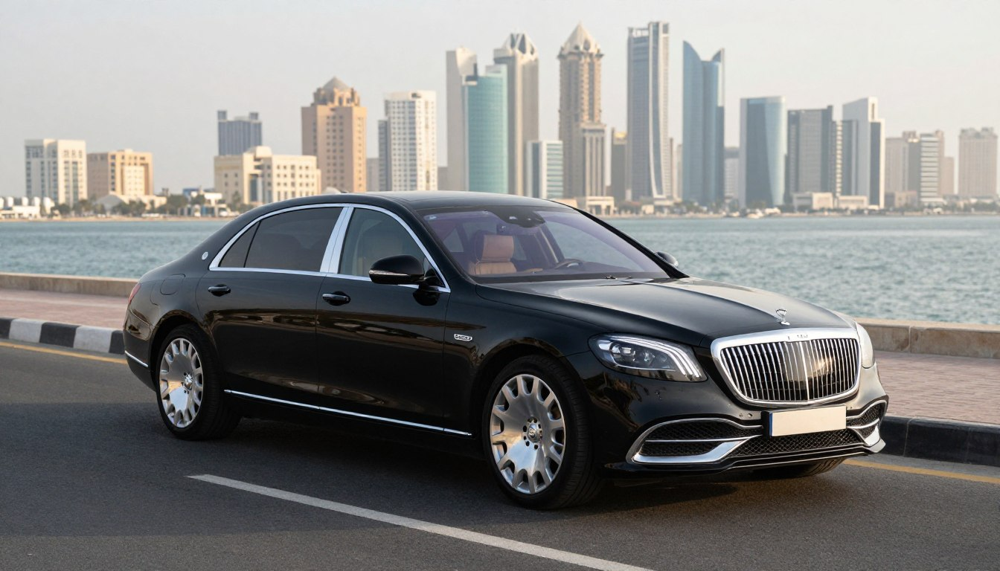
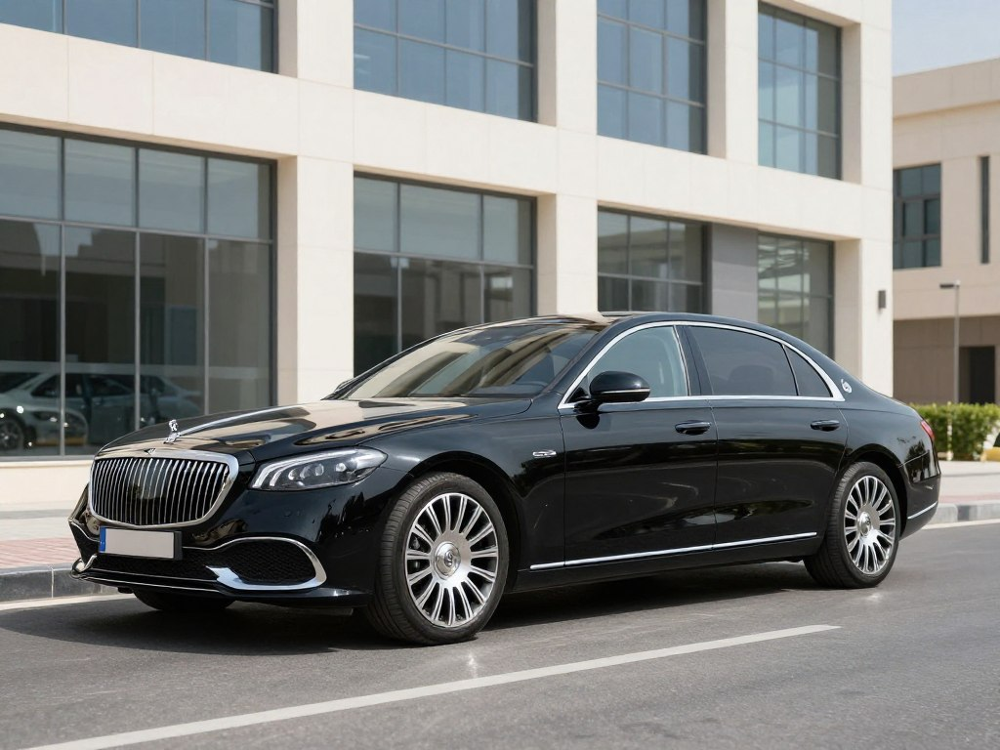
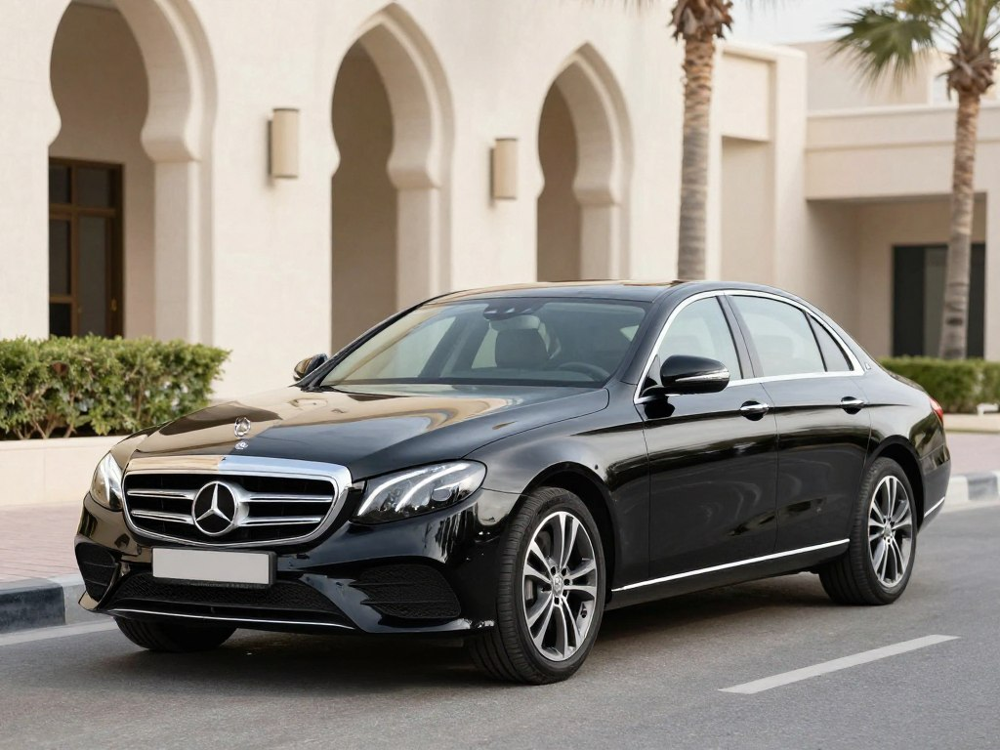
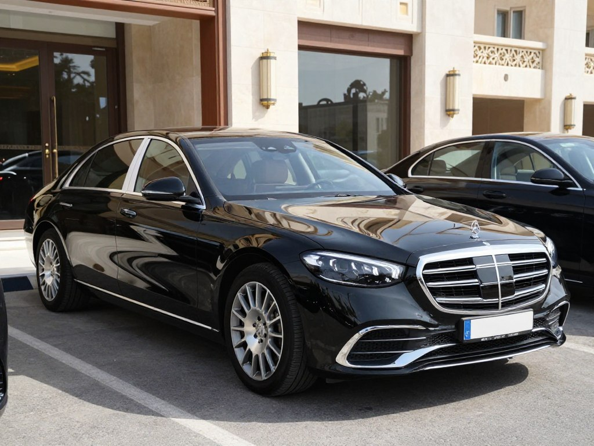
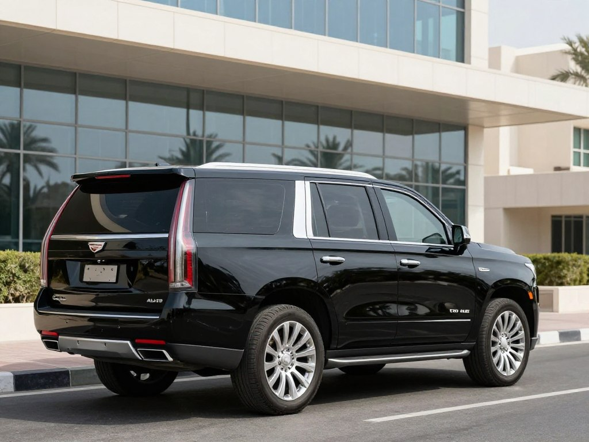
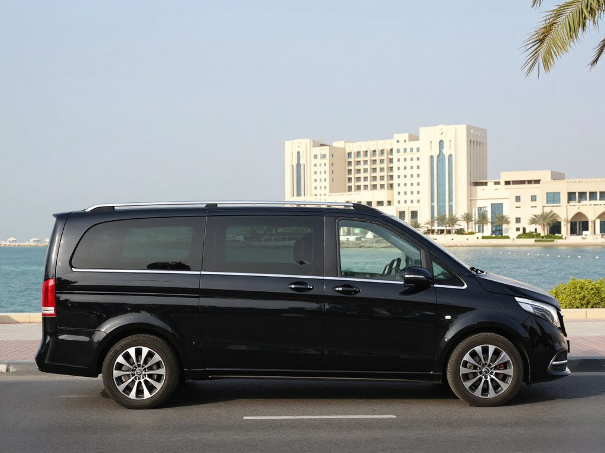
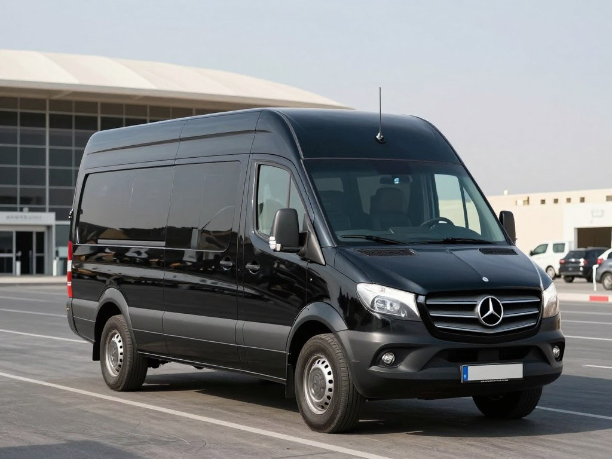

# **Chauffeur service in Al Khor**

AB delivers premium chauffeur service Al Khor solutions connecting travellers between coastal destinations, commercial districts, and Hamad International Airport (DOH). Every private driver in Al Khor maintains punctual schedules, pristine vehicles, and discreet care for corporate and executive journeys across Qatar.

Corporate travel managers and event organisers rely on our dedicated logistics network for coordinated arrivals, executive roadshows, and industrial transfers throughout northern Qatar. Each itinerary receives active flight monitoring, route management, and round the clock operations support.

Book now View the fleet

### **Pick up**

Hamad International Airport (DOH)

### **Drop off**

Al Khor city centre, Al Khor

### **Date and time**

Scheduled departure time

Get a quote

The Al Khor fleet

## **Executive Chauffeur Service Al Khor Fleet**

Vehicles for Al Khor are dispatched from the nearest office, AB Doha, providing immaculate sedans, spacious executive SUVs, and luxury vans with licensed chauffeurs for every transfer across northern Qatar.

### **Standard Sedan**

Sedan · 3 guests · 2 bags

Toyota Camry or similar \[Confirm\]

Individual airport runs and commutes

This comfortable sedan offers smooth, cost effective travel for daily business meetings, site visits, and transfers throughout Al Khor and surrounding coastal districts with an experienced private driver.

Book this class Request a quote Airport transfer Hourly chauffeur Full specifications

### **Business Sedan**

Sedan · 3 guests · 2 bags

Mercedes E Class or similar \[Confirm\]

Executive travel and business meetings

Selected for senior professionals, this executive car service delivers quiet refinement, climate controlled leather seating, and seamless connectivity for working trips connecting Doha and corporate offices in Al Khor.

Book this class Request a quote Airport transfer Hourly chauffeur Full specifications

### **First Class Sedan**

Flagship sedan · 3 guests · 2 bags

Mercedes S Class or similar \[Confirm\]

VIP transport and diplomatic travel

Providing the ultimate luxury car standard, our flagship limousine service Al Khor fleet delivers acoustic insulation, reclining rear seats, and flawless chauffeur presentation for dignitaries and executive delegations.

Book this class Request a quote Airport transfer Hourly chauffeur Full specifications

### **Executive SUV**

SUV · 6 guests · 5 bags

Cadillac Escalade or GMC Yukon or similar \[Confirm\]

Corporate teams and family groups

Spacious, commanding, and exceptionally safe, this premium vehicle accommodates leadership teams with extensive luggage, offering generous legroom, rear climate control, and supreme comfort across highway journeys.

Book this class Request a quote Airport transfer Hourly chauffeur Full specifications

### **Premium MPV**

MPV · 6 guests · 5 bags

Mercedes V Class or similar \[Confirm\]

Roadshows and mobile executive meetings

Configured with face to face conference seating and mobile workspace amenities, this vehicle provides luxury group transportation for project managers and specialists visiting industrial facilities in northern Qatar.

Book this class Request a quote Airport transfer Hourly chauffeur Full specifications

### **Executive Van**

Van · 14 guests · 10 bags

Mercedes Sprinter or similar \[Confirm\]

Event delegations and crew transport

Engineered for high capacity passenger logistics, this spacious passenger van accommodates event crews, conference speakers, and corporate groups requiring coordinated, punctual movement without compromising executive standards.

Book this class Request a quote Airport transfer Hourly chauffeur Full specifications

Popular journeys

## **Across Al Khor and beyond**

Prearranged transfers offer predictable schedules and fixed pricing for airport connections, local venues, and intercity corridors across Qatar.

Airport transfer

### **DOH to Al Khor city centre**

From \[QAR price\]

Airport transfer

### **DOH to Ras Laffan**

From \[QAR price\]

City

### **Al Khor to Al Bayt Stadium**

From \[QAR price\]

Intercity

### **Al Khor to Doha**

From \[QAR price\] · \[Confirm\] hours

Intercity

### **Al Khor to Ras Laffan \[Confirm\]**

From \[QAR price\] · \[Confirm\] hours

Plan direct regional journeys with our managed intercity transfers service across Qatar.

Services in Al Khor

## **One partner for every movement in Al Khor**

AB delivers managed ground mobility, executive transfers, and group logistics across Al Khor with dedicated dispatch and professionally vetted chauffeurs.

- Chauffeur & VIP travel providing executive vehicles and professional private drivers for corporate leaders and state guests.
- Airport Transfers connecting Hamad International Airport (DOH) with Al Khor hotels and commercial compounds.
- Bus & Coach Hire arranged in Al Khor for large conference groups, project staff, and delegate logistics.
- Intercity transfer Al Khor corridors linking northern industrial zones with central Doha.

Airport transfers

## **Arriving at Hamad International Airport (DOH)**

Stepping off your flight at Hamad International Airport (DOH), your professional chauffeur monitors inbound air traffic through active flight tracking to adjust for schedule changes. Once you clear baggage collection, your private driver welcomes you inside the arrivals hall with a personalised name board at meeting point \[Confirm\].

Guests receive complimentary free waiting time \[Confirm\] to complete customs procedures without rushing before your driver assists with luggage. The transfer from DOH to Al Khor provides tranquil leather seating, mobile connectivity, and discreet driving, allowing business travellers to rest or work in total comfort.

### **Flight tracking**

Every arrival

### **Meet and greet**

Inside the terminal

### **DOH to Al Khor city centre**

\[Confirm\] minutes

Review comprehensive arrival procedures on our Hamad International Airport (DOH) guide.

Coverage

## **Where we work in Al Khor**

AB coordinates executive ground transport throughout the municipality of Al Khor, serving local corporate headquarters, residential compounds, industrial zones, and cultural landmarks. Chauffeurs maintain intimate familiarity with northern coastal highways, stadium access routes, and secure commercial entry gates. Operating with continuous operations centre support, our fleet delivers punctual, discreet travel to every key destination across northern Qatar.

| Business        | Events          | Heritage         | Government and Industry                                  |
| --------------- | --------------- | ---------------- | -------------------------------------------------------- |
| Al Khor Mall    | Al Bayt Stadium | Purple Island    | Ras Laffan Industrial City administration complex        |
| Al Khor Centre  | Al Khor Club    | Al Khor Corniche | Al Khor Municipality headquarters and municipal services |
| Commercial Road | Youth Centre    | Al Farkiah Beach | Al Khor Commercial Port maritime facility                |

Our office

## **Managed Chauffeur Service Al Khor Operations**

Chauffeur service in Al Khor is operated directly from our regional office in Doha, maintaining immediate dispatch capabilities across northern Qatar. AB manages a unified premium transportation network serving Saudi Arabia, all seven UAE emirates, and Qatar directly, coordinated through continuous 24/7 dispatch from the Riyadh operations centre. Every vehicle arrives immaculately prepared with professional drivers adhering to rigorous standards.

### **AB Doha**

Office 110, Building 100, Zone 26, Street 310, Old Airport Road, Doha, Qatar

Telephone: +974 7734 3300

Get directions

### **AB Riyadh**

Building 3036, Office 08, 2nd Floor, Umar Ibn Abdulaziz Road, Al Malaz, Riyadh, Saudi Arabia

Telephone: +966 58 111 8720

Central dispatch

Questions

## **Chauffeur service in Al Khor: your questions**

### **How do I book a chauffeur service Al Khor transfer with AB?**

You can book a transfer through our Doha operations team by telephone or direct reservation request. Please provide your scheduled pick up location, destination in Al Khor, passenger count, luggage requirements, and preferred vehicle class. Our operations team coordinates 24/7 dispatch from the Riyadh centre to confirm your professional driver and vehicle well ahead of your journey.

### **What occurs when my inbound flight to DOH is delayed?**

AB monitors inbound flights into Hamad International Airport (DOH) using real time flight tracking systems. If your commercial or private flight is delayed, your assigned chauffeur adjusts arrival timing accordingly. Your transfer reservation includes complimentary waiting time \[Confirm\] following actual touchdown, allowing ample time to clear immigration and collect your luggage before meeting your driver at the designated arrivals point.

### **Can I arrange an intercity transfer Al Khor to Doha or Ras Laffan?**

Yes, AB provides direct intercity transfers connecting Al Khor with Doha, Ras Laffan Industrial City, and other destinations across Qatar. Chauffeurs operate premium sedans, executive SUVs, and passenger vans dispatched from our Doha facility for point to point highway journeys. Fixed route rates include door to door service, fuel, toll management, and executive vehicle amenities without variable meter charges.

### **Can I hire an hourly chauffeur in Al Khor for local business meetings?**

Yes, hourly chauffeur Al Khor services are available for multi stop business itineraries, facility inspections, or diplomatic visits. Reserving by the hour provides an executive car with driver Al Khor on standby throughout your schedule. You can modify stops across coastal venues and commercial districts at your discretion while your driver remains parked on site ready for immediate departure.

### **What vehicle types are available for private driver Al Khor bookings?**

AB maintains a versatile fleet dispatched to Al Khor including Standard Sedans, Business Sedans, First Class Sedans like the Mercedes S Class, Executive SUVs like the Cadillac Escalade, Premium MPVs, and Executive Vans. Every vehicle is thoroughly cleaned, mechanically maintained, and operated by a vetted, professionally licensed chauffeur trained to deliver discreet executive hospitality.

## **Your chauffeur is ready in Al Khor.**

Reserve your premium chauffeur service Al Khor with AB today. Contact our 24/7 central dispatch team on +966 58 111 8720 for immediate bookings or corporate project quotations.

Book now Request a proposal