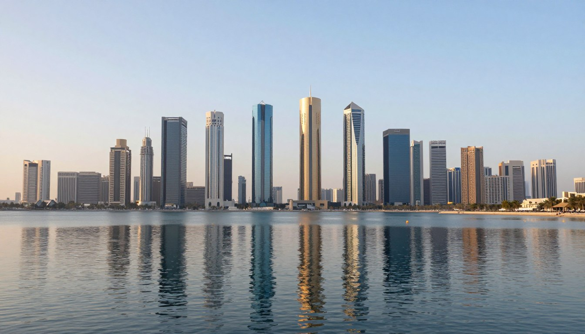
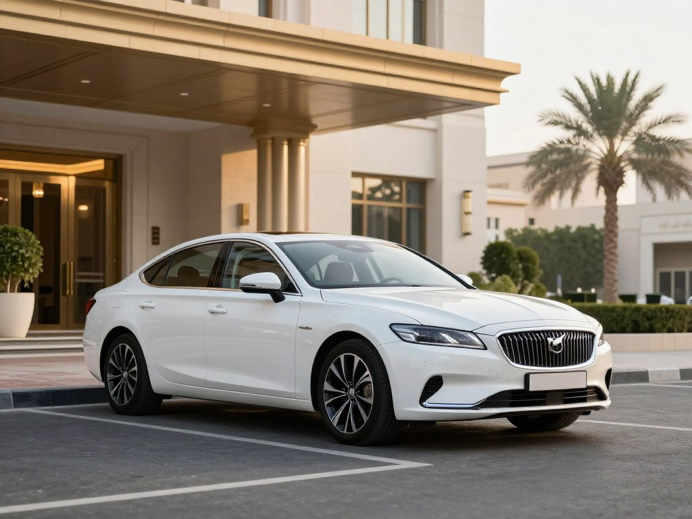
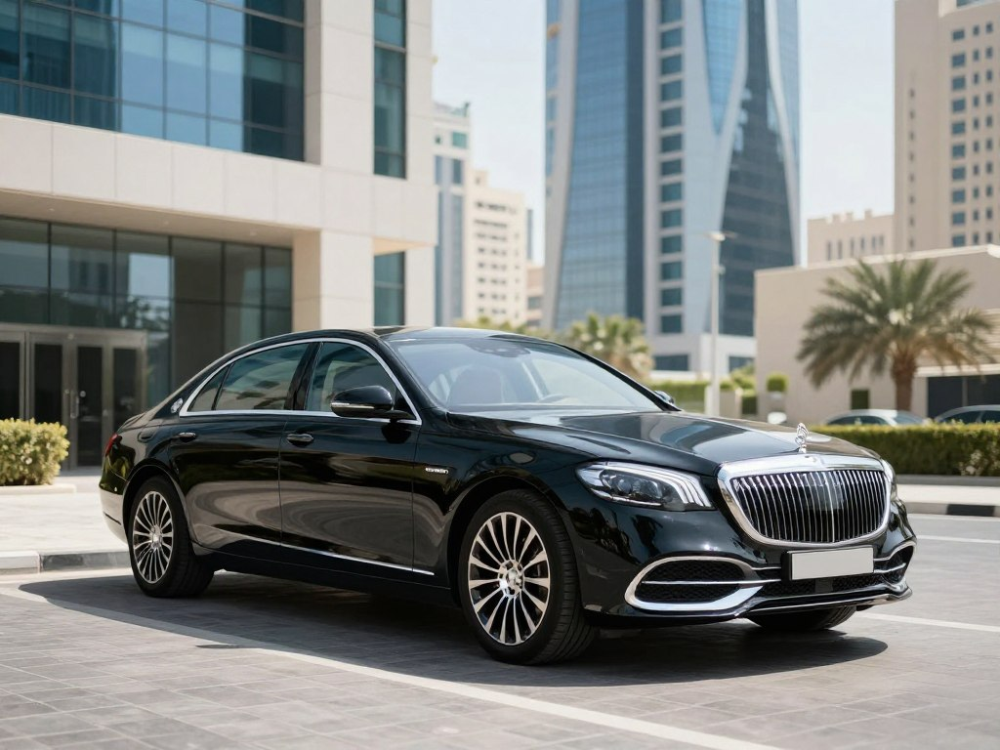
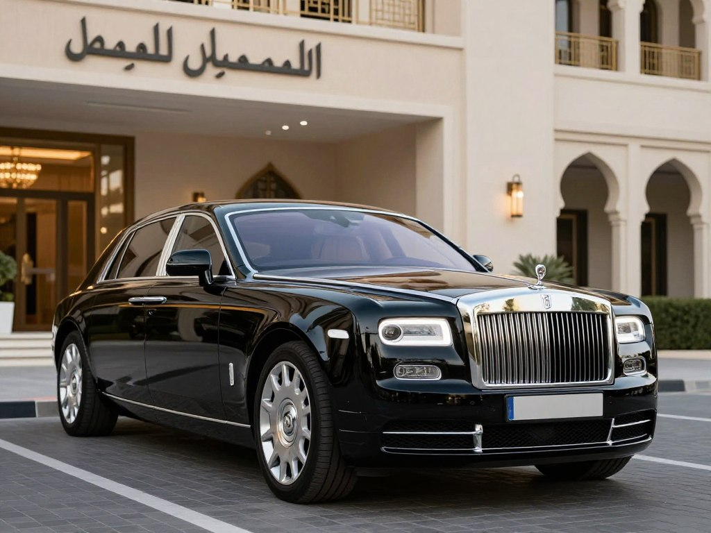
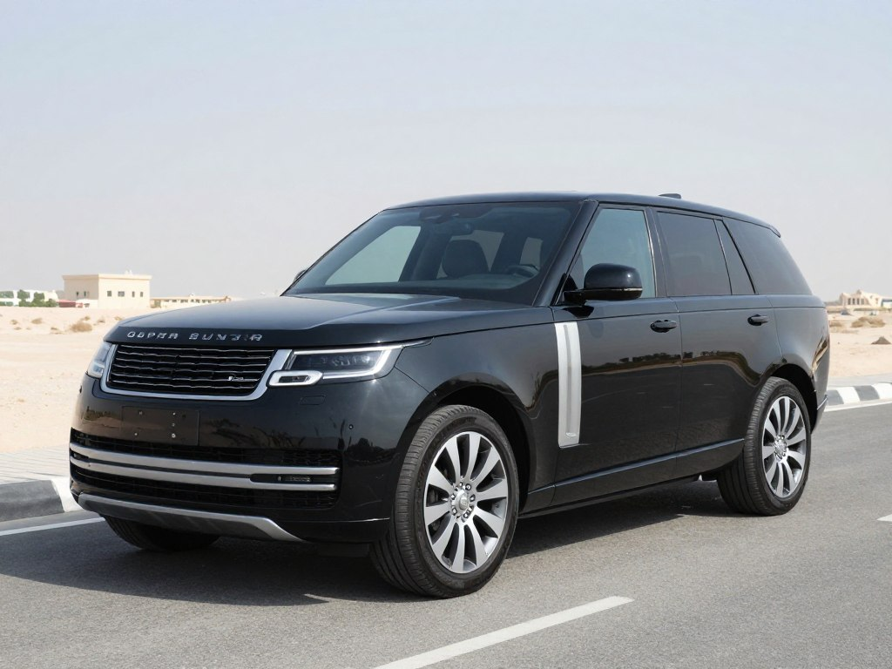
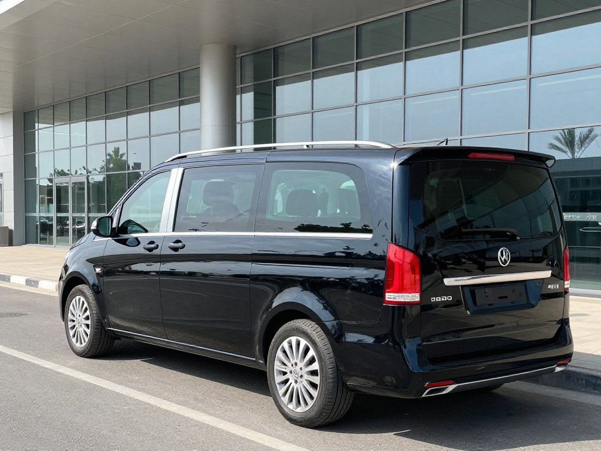
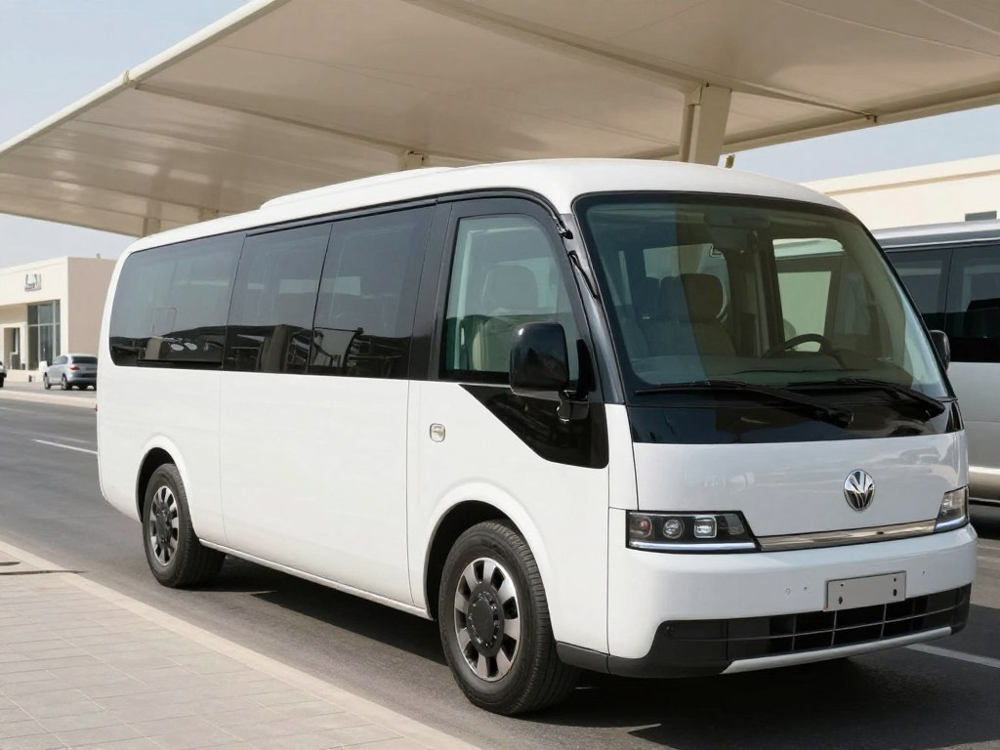

# **Chauffeur Service in Sharjah**

Professional chauffeur service Sharjah transport provides punctual journeys across the emirate and regional road corridors. AB connects arrivals from Sharjah International Airport (SHJ) to commerce centres throughout Sharjah with dedicated business vehicles and experienced chauffeurs.

Corporate travel coordinators rely on our vetted standards for airport transfers, board meetings and intercity connections throughout the United Arab Emirates.

Book now View the fleet

| Pick up                             | Drop off          | Date and time   | Reservation                                                                 |
| ----------------------------------- | ----------------- | --------------- | --------------------------------------------------------------------------- |
| Sharjah International Airport (SHJ) | Al Majaz, Sharjah | Select schedule | Get a quote |

The Sharjah fleet

## **Choose your Sharjah chauffeur class**

Every vehicle in our Sharjah fleet is GPS tracked and detailed before each journey. AB maintains executive standards across all vehicle categories for corporate itineraries and personal movements.

### **Standard Sedan**

Sedan · 3 guests · 2 bags

Typical model: Toyota Camry or similar \[Confirm\]

Ideal for: Daily corporate travel and transfers

A dependable sedan providing quiet travel across Sharjah for corporate professionals and individual travellers needing prompt point to point journeys. Chauffeurs maintain pristine vehicle presentation for every road transfer.

Book this class

### **Business Sedan**

Sedan · 3 guests · 2 bags

Typical model: Mercedes E Class or similar \[Confirm\]

Ideal for: Executive meetings and airport journeys

Refined comfort for executives attending commercial appointments in the city. The vehicle provides generous legroom, quiet interiors and leather seating for focused work between destinations.

Book this class

### **First Class Sedan**

Flagship sedan · 3 guests · 2 bags

Typical model: Mercedes S Class or similar \[Confirm\]

Ideal for: VIP transport and state delegations

The premier luxury car option for prominent delegations visiting Sharjah. Superior suspension, acoustic insulation and rear cabin climate control provide an elevated private driver Sharjah experience.

Book this class

### **Executive SUV**

SUV · 6 guests · 5 bags

Typical model: Cadillac Escalade, GMC Yukon or similar \[Confirm\]

Ideal for: Family travel and executive groups

Spacious prestige SUVs offering commanding road presence and generous luggage capacity. Perfect for group transfers navigating between commercial engagements and hotel resorts across the northern Emirates.

Book this class

### **Premium MPV**

MPV · 6 guests · 5 bags

Typical model: Mercedes V Class or similar \[Confirm\]

Ideal for: Small teams and mobile conferences

Flexible conference style seating designed for business teams moving across Sharjah. Passengers work collaboratively while travelling with dedicated climate controls and convenient device charging points.

Book this class

### **Executive Van**

Van · 14 guests · 10 bags

Typical model: Mercedes Sprinter or similar \[Confirm\]

Ideal for: Event delegations and corporate groups

High capacity group transport tailored for large delegations and event participants. Generous headroom, wide entry doors and partitioned luggage storage accommodate group logistical requirements smoothly.

Book this class

Request a quote Airport transfer Hourly chauffeur

Popular journeys

## **Across Sharjah and beyond**

AB provides fixed route pricing and scheduled transfers connecting vital commercial hubs, cultural institutions and neighbouring emirates.

Airport transfer

### **SHJ to Al Majaz**

From \[AED price\]

Book a transfer

Airport transfer

### **SHJ to University City**

From \[AED price\]

Book a transfer

City

### **Sharjah to Expo Centre Sharjah**

From \[AED price\]

Book a transfer

Intercity

### **Sharjah to Dubai**

From \[AED price\] · \[Confirm\] hours

Book a transfer

Intercity

### **Sharjah to Ajman**

From \[AED price\] · \[Confirm\] hours

Book a transfer

Intercity

### **Sharjah to Abu Dhabi**

From \[AED price\] · \[Confirm\] hours

Book a transfer

Review comprehensive cross border options and schedule regional road journeys through our Intercity Transfers programme.

Services in Sharjah

## **One partner for every movement in Sharjah**

AB delivers managed ground mobility solutions supporting corporate delegations, group transfers and personal schedules with professional chauffeurs throughout the emirate.

- Chauffeur & VIP in Sharjah for executive itineraries, hourly hire and dedicated private driver assignments.
- Airport Transfers in Sharjah delivering flight tracked terminal collections and seamless hotel connections.
- Bus & Coach Hire in Sharjah supplying high capacity coaches and bus rental Sharjah options for conferences and staff transport.

Airport transfers

## **Arriving at Sharjah International Airport (SHJ)**

Sharjah International Airport (SHJ) serves as a primary international gateway for business and leisure visitors entering the northern Emirates. AB provides dedicated SHJ airport transfer coordination built on real time flight tracking, monitoring inbound arrivals to adjust pickup schedules for early landings or air traffic delays.

Upon clearing customs, guests receive a personalised meet and greet service from a professional chauffeur holding a clear digital name board at meeting point \[Confirm\]. Travellers benefit from free waiting time \[Confirm\], luggage assistance and direct escort to an air conditioned vehicle, eliminating terminal taxi queues and parking delays.

Connecting flights across emirates remain effortless, with direct ground links available to Dubai International Airport (DXB) through our regional chauffeur network.

**Flight tracking:** Every arrival monitored automatically.

**Meet and greet:** Inside the terminal arrivals hall.

**SHJ to Al Majaz:** \[Confirm\] minutes transit time.

Book an airport transfer

Coverage

## **Where we work in Sharjah**

AB coordinates complete executive transport coverage across all key commercial, industrial and cultural zones in the emirate. Our chauffeurs manage itineraries connecting multinational headquarters, regional exhibition venues, government complexes and coastal hospitality properties.

### **Business**

Sharjah Chamber of Commerce and Industry

Al Majaz Waterfront

Sharjah Media City Shams

### **Events and conferences**

Expo Centre Sharjah

Al Jawaher Reception and Convention Centre

Sharjah Golf and Shooting Club

### **Heritage and leisure**

Heart of Sharjah

Sharjah Art Museum

Al Noor Island

### **Government and industry**

Sharjah Government House

Hamriyah Free Zone

Sharjah Airport International Free Zone SAIF Zone

Our office

## **Chauffeur service Sharjah operations and regional office**

Ground operations in Sharjah are managed directly from the nearest regional office, AB Dubai, situated minutes from the emirate border. Transportation schedules benefit from unified fleet standards and continuous dispatch monitoring provided by the AB central operations centre in Riyadh.

### **AB Dubai**

Suite 206, DBC Building, Al Khabaisi, Deira, Dubai, UAE

Telephone: +971 50 781 3880

[Get directions](https://maps.google.com/maps?q=Suite+206,+DBC+Building,+Al+Khabaisi,+Deira,+Dubai,+UAE)

Questions

## **Chauffeur service in Sharjah: your questions**

### **How does airport transfer meet and greet operate at SHJ?**

Chauffeurs track inbound flights arriving at Sharjah International Airport (SHJ) to adjust for scheduling changes. Upon entering the arrivals concourse, guests encounter their driver holding an electronic name board at meeting point \[Confirm\]. The chauffeur manages baggage handling and escorts travellers directly to the awaiting vehicle with complimentary waiting time \[Confirm\].

### **What vehicle classes are available for chauffeur service in Sharjah?**

AB provides a comprehensive fleet across Sharjah, including Standard Sedan, Business Sedan, First Class Sedan, Executive SUV, Premium MPV and high capacity Executive Van models. Vehicles such as the Mercedes S Class, Cadillac Escalade and Mercedes V Class deliver comfort, discrete presentation and business productivity for every scheduled journey.

### **Can I arrange an intercity transfer Sharjah to Dubai or Abu Dhabi?**

Yes, AB schedules frequent cross emirate transfers between Sharjah, Dubai, Ajman and Abu Dhabi. Travel managers book intercity transfer Sharjah routes for single meetings or multi city executive itineraries. Chauffeurs navigate inter emirate highway corridors efficiently, avoiding congestion and ensuring timely arrivals at regional corporate hubs.

### **Can I book an hourly chauffeur or full day hire in Sharjah?**

Hourly chauffeur bookings and full day hire packages provide flexible mobility for complex itineraries across Sharjah. Clients retain a dedicated vehicle and professional driver on standby for corporate site visits, trade exhibitions at Expo Centre Sharjah or government appointments. Packages are tailored to required operating hours with clear upfront terms.

### **Are all AB chauffeurs licensed and insured in the UAE?**

Every professional chauffeur operating in Sharjah holds official commercial licensing and undergoes rigorous background vetting and route training. All vehicles carry comprehensive commercial passenger insurance in compliance with United Arab Emirates transport authorities. Strict safety protocols and regular fleet mechanical audits support passenger security on every journey.

### **How far in advance should I make a booking for Sharjah?**

Advance booking is recommended to secure preferred vehicle classes, especially during peak international exhibition periods and tourism seasons in Sharjah. Reservations can be placed through our digital booking portal or corporate desk. For last minute itineraries, our 24/7 central dispatch team coordinates available fleet capacity to accommodate urgent executive transfer requests.

### **What services are provided for corporate travel and large delegations?**

AB supports corporate travel managers and protocol teams with dedicated group transportation, bus rental Sharjah options and VIP car with driver arrangements. Our team coordinates manifests for major conferences, board meetings and state visits, backed by centralized billing, passenger tracking and round the clock operations oversight.

## **Your chauffeur is ready in Sharjah.**

Book your executive chauffeur service Sharjah transfer today or speak directly with our Riyadh dispatch operations team on +966 58 111 8720 for corporate accounts.

Book now Request a proposal

+966 58 111 8720