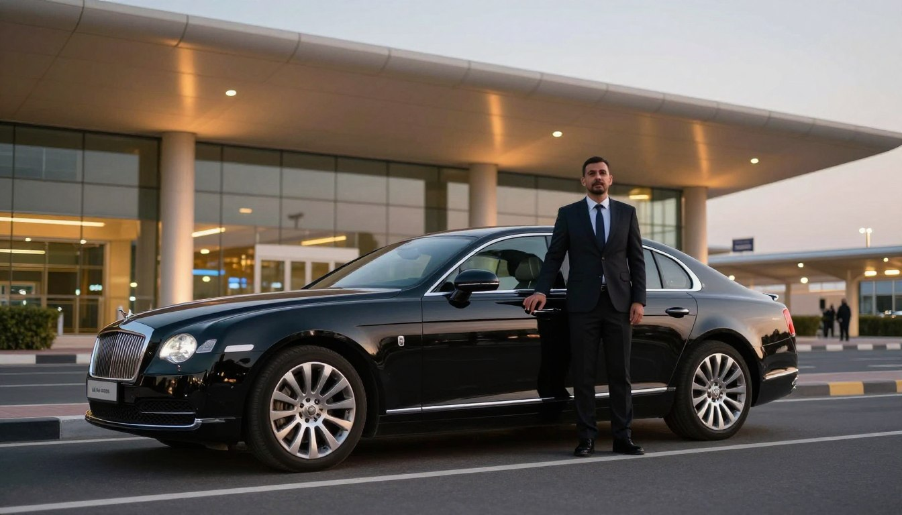
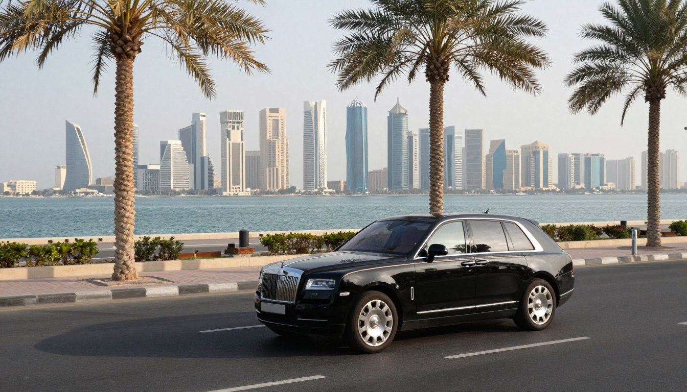
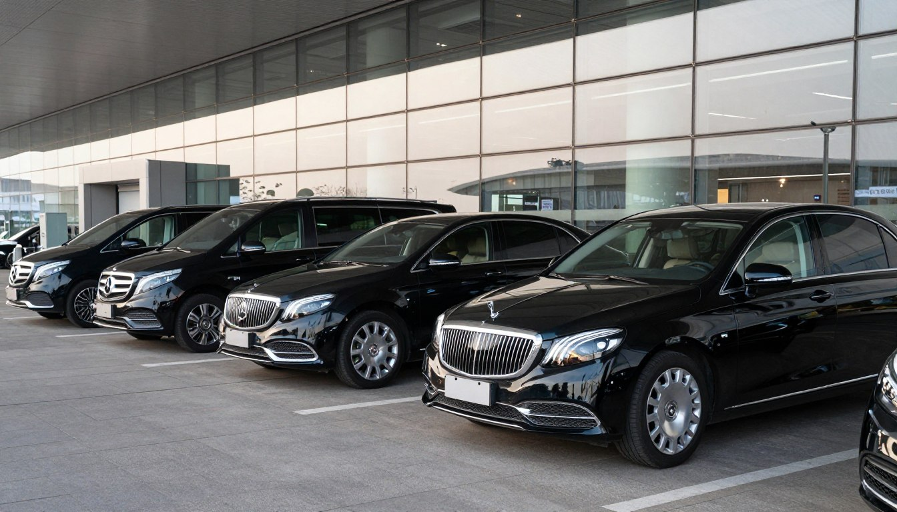
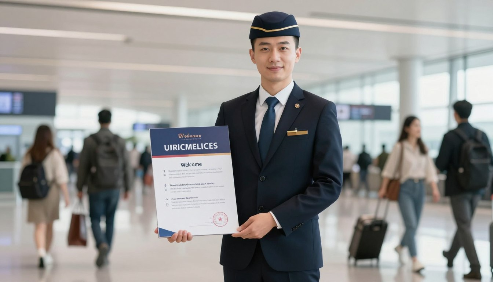
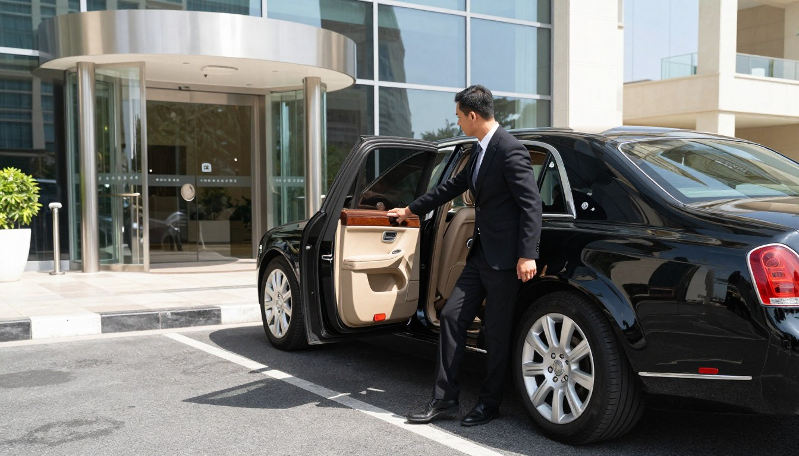

# **Airport Transfers in Qatar: Executive Airport Transfer Qatar**

AB coordinates executive airport transfer Qatar services for corporate travellers arriving across the country. Our dispatch team manages terminal pickups with scheduled vehicle staging.

Flight monitoring and private drivers support punctuality for every corporate schedule across Doha.

[Book now](https://seowriting.ai/services/airport-transfers) [Request a proposal](https://seowriting.ai/services/airport-transfers)

Quote bar parameters: Pick up, Drop off, Date and time, Get a quote.

Coverage

## **Airport Transfers across Qatar: Managed Airport Transfer Qatar Network**

Our transport desk provides continuous coverage across primary commercial districts and aviation hubs throughout Qatar. Ground operations link incoming executive flights directly to commercial districts, industrial corridors and diplomatic zones.

AB maintains an active operational presence within the capital. This deployment delivers responsive airport transfer Qatar solutions for international delegations, board members and visiting project executives.

Centralised control from our Riyadh operations centre coordinates vehicle movements alongside our local office. Direct fleet positioning reduces kerbside waiting times while supporting corporate travel itineraries.

### **Doha**

Direct terminal connections link Hamad International Airport with West Bay, Msheireb Downtown and Lusail. Chauffeurs provide punctual transfers tailored for corporate executives.

[Doha Transfers](https://seowriting.ai/services/airport-transfers/qatar/doha)

Fleet

## **Executive Fleet for Airport Transfer Qatar Services**

AB operates a strictly governed fleet of premium saloons, spacious sports utility vehicles and executive passenger vans. Every vehicle meets exacting regional safety criteria and presentation standards before deployment to airport arrival lanes.

Vehicles maintain quiet interiors, climate control configured for Gulf temperatures and discreet corporate exterior styling. Dedicated fleet managers inspect each car daily to maintain mechanical reliability across every scheduled journey.

Our dispatchers assign specific vehicle categories based on passenger counts, luggage volumes and executive security preferences. Onboard GPS tracking allows the transport desk to monitor transit progress from departure to destination.

### **First Class Sedan**

Mercedes S Class or similar \[Confirm\]. Flagship luxury saloon for senior executives requiring refined comfort, mobile office amenities and privacy.

### **Business Sedan**

Mercedes E Class or similar \[Confirm\]. Premium executive saloon offering quiet efficiency for business travellers navigating metropolitan commercial districts.

### **Executive SUV**

Cadillac Escalade or similar \[Confirm\]. Spacious luxury vehicle providing ample legroom and generous luggage capacity for small groups.

### **Luxury Van**

Mercedes V Class or similar \[Confirm\]. Dedicated multi passenger vehicle designed for corporate delegations, event crews and coordinated team transit.

Process

## **How Our Airport Transfer Qatar Process Operates**

Arranging managed ground transportation through AB follows a systematic protocol designed for enterprise travel managers. Every reservation integrates live flight data to coordinate kerbside staging with precision.

From initial booking submission to drop off confirmation, our operational teams oversee each movement phase. The regional control architecture links passenger schedules directly to chauffeur assignment desks.

Central coordination reduces travel friction for corporate guests arriving on regional or intercontinental routes. Transparent reporting and clear communications keep travel administrators informed throughout transit.

### 1. **Reservation and Flight Details**

Travel administrators submit routing parameters, flight numbers and passenger requirements through our enterprise booking portal or corporate account desk.

### 2. **Dispatch and Chauffeur Allocation**

Our 24/7 dispatch desk assigns a vetted driver, stages the vehicle in advance and monitors incoming airspace telemetry continuously.

### 3. **Meet, Greet and Destination Transfer**

The chauffeur welcomes the traveller inside the arrivals hall, assists with baggage handling and provides direct transportation to the final address.

Compliance

## **Licensing and Standards for Airport Transfer Qatar Deployments**

Operational integrity across every airport transfer Qatar deployment relies on strict regulatory adherence. All vehicles hold valid commercial transport permits under local licence \[Confirm\] requirements enforced by national transport authorities.

AB drivers undergo comprehensive background screening, defensive driving instruction and protocol training. Each chauffeur carries valid Qatari identification and airport security credentials permitting legitimate access to arrival terminals.

We maintain an enterprise duty of care programme across every route. Centralised oversight from our operations centres in Saudi Arabia and the UAE works alongside our local team in Qatar to maintain uniform safety standards.

Commercial compliance documentation and driver certification files remain available for corporate compliance audits upon client request.

## **Airport transfer Qatar FAQs**

### **Which airports are served by AB in Qatar?**

AB provides airport transfer Qatar services at Hamad International Airport in Doha. We also coordinate arrivals at Doha International Airport for specialised charters and private aviation movements.

Chauffeurs stage vehicles within approved staging locations to support rapid terminal egress. Our operations desk manages tarmac transfers in coordination with handling agents when requested.

### **How does flight tracked pickup Qatar operate when arrivals are delayed?**

Our dispatch desk maintains continuous flight tracking for every inbound journey. We track incoming airspace telemetry to adjust driver staging schedules if flights land ahead of schedule or experience delays.

A flight tracked pickup Qatar booking automatically recalibrates chauffeur dispatch timing. Travellers encounter their driver in the terminal without manual schedule adjustments or unnecessary phone calls.

### **What is included in the airport meet and greet Qatar service?**

An airport meet and greet Qatar service provides a designated chauffeur waiting inside the arrivals terminal holding a personalised name board. The driver assists with luggage collection and guides passengers directly to the waiting vehicle.

This managed meet and greet process bypasses taxi queues and terminal confusion. Corporate travellers transfer smoothly from baggage claim to their executive vehicle.

### **How do corporate clients arrange monthly invoice billing for transfers in Qatar?**

Enterprise clients can establish a corporate account with AB to access consolidated billing structures. This facility aggregates multiple executive bookings into a single monthly invoice with itemised route details.

Centralised billing simplifies expense tracking for internal travel managers and finance teams. Account holders receive dedicated booking access and prioritised vehicle allocation during peak business periods.

### **Can an airport limousine Qatar booking be scheduled for large delegations?**

Yes, AB provides coordinated fleet solutions for state summits, business conferences and corporate delegations. Booking an airport limousine Qatar package allows travel coordinators to reserve multiple executive saloons, sport utility vehicles and passenger vans under a unified schedule.

Our transport management desk oversees multi vehicle arrival manifests with precision. Dedicated on site coordinators can be assigned to manage complex group arrivals at the airport terminal.

### **What vehicle types are available for airport pickup Qatar bookings?**

Clients arranging an airport pickup Qatar journey can select from first class sedans, business saloons, premium sports utility vehicles and executive vans. Each luxury vehicle features leather upholstery, rear climate control and privacy tinting.

Fleet options accommodate varying luggage capacities and passenger volumes. Every car undergoes routine technical maintenance to deliver quiet, dependable road performance across the state.

### **How does AB maintain passenger duty of care across Qatar?**

AB enforces strict risk management protocols across all ground transportation movements. Vehicles utilise GPS tracking to allow real time journey oversight from our centralised transport command desk.

Chauffeurs sign non disclosure agreements and adhere to formal safety guidelines. We operate verified ground networks across Riyadh, Jeddah, Dubai, Abu Dhabi and Doha to uphold regional standards.

### **Where can clients book a chauffeur service Qatar for onward journeys?**

Clients can arrange onward urban travel and intercity transit through our dedicated [chauffeur service Qatar](https://seowriting.ai/locations/qatar) network. Chauffeurs remain available for hourly hire or direct point to point transfers following your airport arrival.

Our drivers navigate metropolitan routes with local route expertise. Travel coordinators can combine airport pickups with multi stop business itineraries through a single reservation desk.

## **Arrange Your Airport Transfer Qatar with AB**

Coordinate executive airport transfers, meet and greet services and private chauffeur transport across Doha through our dedicated operations team.

[Request a proposal](https://seowriting.ai/services/airport-transfers) [Book a transfer](https://seowriting.ai/services/airport-transfers)